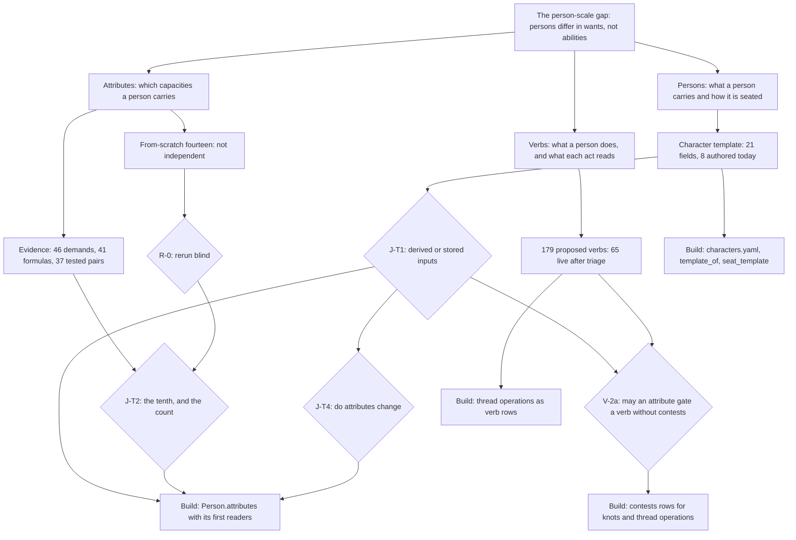
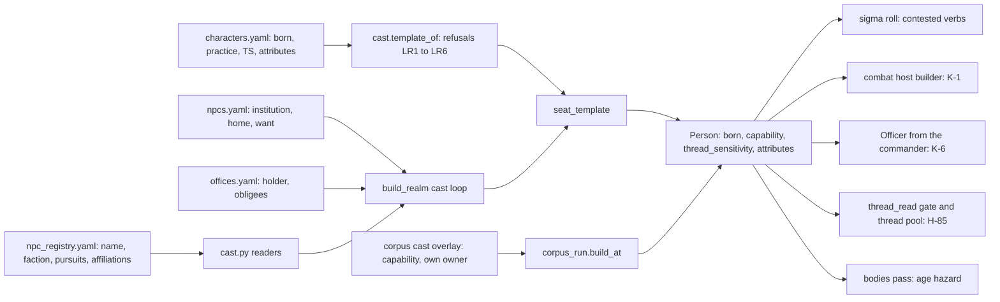
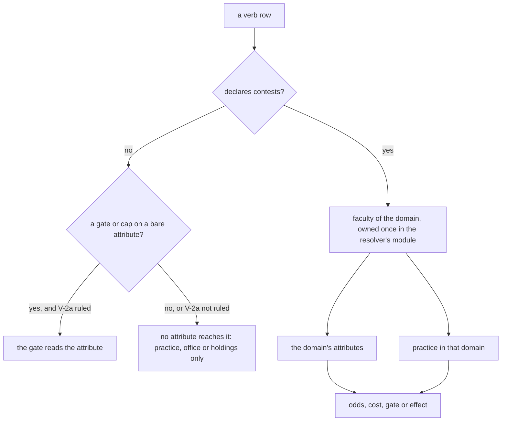

# Persons, attributes and verbs: the v2 synthesis

## Status: PROPOSED (2026-10-16). A distillation of the same day's v1 proposals and their critics' reports. No new probe, run or trace was made for it. Merging it ratifies nothing unless Jordan so rules.
## Lane: IN (cross-cutting), with PC, MB, SC, FI, WR, NPC, GO as sources. IDs: none allocated.
## Scope: persons (the character template), attributes and verbs only. The troop-stock design is out of scope and is not distilled here (Sources). The filename keeps the path the orchestrator named.
## Parts, in reading order: this file (§0 Thesis and Map, Part I Persons) · [`_part2`](2026-10-16-v2-person-troop-attribute-synthesis_part2.md) (Part II Attributes) · [`_part3`](2026-10-16-v2-person-troop-attribute-synthesis_part3.md) (Part III Verbs, the Roadmap, the Reliability ledger, Sources).

**How to read a citation.** A locator tagged **[CHECKED]** was re-opened in this pass. Every other
locator is carried from a v1 document, keeps the v1 tag listed in `_part3` §7, and is cited by v1
document and section where its line may have moved. **One class of v1 locator is known stale:** the
merge of `origin/main` (#483, #484) rewrote `workplans/valoria_master_workplan_v9_part5.md` from 475 to
442 lines, so the v1 pointers `_part5.md:433` (J-13) and `:444` (the tenth attribute) now read
`:400` and `:411` [CHECKED]. The same merge landed `seize` as a shipped row
(`engine/season/verb_table.yaml:898`; the table now has 46 rows by `grep -c '^  - verb:'`) [CHECKED].
v1's counts were taken before it; this document keeps them and says where the merge moves one.

**Short names.** *Template* = `proposals/2026-10-16-character-template*.md`. *Derivation* =
`proposals/2026-10-16-attribute-derivation*.md` (with `_divergence`, `_aptitudes`, `_equivalences`).
*From-scratch* = `proposals/2026-10-16-attributes-from-scratch*.md`. *Comparative* =
`research/by_lane/00_COMPARATIVE_ANALYSIS.md`. Tiers, as the template defines them: **T1** code the
season loop runs; **T2** code outside the loop; **T3** a ratified specification, a v9 position, or a
proposal recorded RATIFIED AS INTENT; **T4** design intent only.

---

## 0. THESIS

1. **Persons today differ in what they want, never in what they can do.** In the season loop exactly
   one verb reads a personal input (`tell` reads one `capability` key), and no attribute has a T1
   reader.
2. **The character template can be built now, all but one block.** Its attribute block waits on one
   ruling (J-T1). The evidence favours stored attributes (Option B) on the plan's own narrow reading of J-13.
3. **The evidence supports a stored set of ten: the registry's nine plus Thread Sensitivity.** Attunement
   and Charisma stand on design intent only. Recall is not a candidate until something reads it.
4. **The game is short of readers, not of verbs.** Of 86 verbs designed from scratch, 2 survive triage.
5. **The from-scratch fourteen does not count yet.** Its brief seeded its result. It must be rerun blind.

**The five decisions that unlock the rest** (Roadmap, `_part3` §5): **J-T1**, the source of personal
inputs; **J-T2**, the tenth attribute (and with it whether the ruled count is reopened); **J-T4**,
whether attributes change after tick 0; **V-2a**, the amendment that lets an attribute reach a gate,
a cap or a row without `contests:`; and **R-0**, rerunning the from-scratch derivation under a neutral
brief rather than correcting it. J-T3 (kin) is not among them: v1 answered it for the template
(kin is not carried, §I.5), and it unlocks no build.

### 0.1 The map

---

## PART I. PERSONS: THE CHARACTER TEMPLATE

### I.1 The template is an assembly record seated once at world-gen; build it now, nearly empty

**Claim.** The character template is one typed artifact that assembles what no existing file owns
about a named person, read once by world-gen. It should be built now, and it should ship nearly
empty, because almost nothing a person could carry has a value with a lawful source today.

**Argument.**

- *Premise 1.* The plan already defines creation as *"a cast entry the world-gen builder seats"*
  (IN-47, `workplans/valoria_master_workplan_v9_part4.md:41`) [CHECKED].
- *Premise 2.* That entry exists today, split over `references/npc_registry.yaml`,
  `engine/season/npcs.yaml`, `engine/season/offices.yaml` and, in corpus worlds, a case's `cast:`
  overlay. Nothing types it as one thing (Template §1).
- *Premise 3.* Measured on `build_realm(0)`: `Person.capability` is empty on 83 of 83 persons, `born`
  is 0 on all, and `body` is 1000 on all. Over 143 corpus cases, `capability` is empty on 429 of 430
  persons; NPC-088's `p_a` holds `{copying: 3}` (Template §10 probe 1, artifact `tmpl/cap_count.out`).
- *Premise 4.* ID-13: *"A DECLARED FIELD MUST REACH A READER, OR IT IS NOT DECLARED"*
  (`architecture/meta/01_AXIOMS.md:561`) [CHECKED].
- *Premise 5.* Of the template's would-be values, a lawful source exists today for 3 attribute values
  (NPC-001) and 8 integer TS values; everything else is prose (`'3–4'`, `'~50'`) or absent (Template §5).
- *Inference.* The record has a shape and no content, and ID-13 forbids filling it with defaults
  or with numbers read out of prose.
- *Conclusion.* Build the shape, the loader and its refusals now. Let each field land only with its
  first reader. Ship the values that have a source, and leave the rest null.

**The strongest counter-argument.** *An empty template is a stat block for show, which is exactly
what ID-13 forbids.* It fails on the build's own falsifier. The test file holds a table, accepted key
→ the reader it feeds, and fails on a key with no entry (Template §4.5 test 4). A key with no reader
cannot be accepted. The loader is load-bearing on the game: it is the only route by which an
authored practice, age or (under B) attribute reaches a realm person (Template §7.1, N-line 1).

**Consequence (what is built).**

- `engine/season/characters.yaml`, one row per cast case while ED-WR-0011 stands. Keys: `case`,
  `born`, `practice`, `thread_sensitivity` (lands with its reader), and `attributes` (Option B only).
- `cast.template_of(case_id) -> CharacterTemplate`, a frozen record in `engine/season/data/cast.py`,
  composing on the existing `cast.*` readers.
- Refusals LR1–LR6. They refuse an off-set key, a non-cast case, a value with no `source:`, an
  off-roster attribute or practice key, and prose where a number is due.
- One call, `seat_template`, after the convictions are seated in `build_realm`. It writes `born`,
  `capability` and, when they land, `thread_sensitivity` and `attributes`.
- `rosters.yaml: practice_roster`, absorbing `verb_capability`'s values. `corpus_run._check_capability`
  becomes the one practice validator for both paths.
- `engine/season/tests/test_character_template.py`.

**What is cut.** Very little exists to cut. Of seven "cut" rows in v1, four decline to build something
and remove nothing; two relocate a list or a rule; one takes `(Person, capability)` off
`write_matrix.yaml`'s `retired:` list, which IN-12 step 9 removes anyway (Template §6). The template
is additive, and that is stated rather than dressed up.

**Two rules the build must keep.**

- **The corpus overlays keep their own values.** NPC-088's `copying: 3` stays in
  `cases/exercises/NPC-088.yaml` (one owner, `CLAUDE.md` §0.05 cl.3).
- **A magnitude never comes from prose.** A case's text may license which practice KEY a person
  holds. Its value needs a ruling, a dated Jordan value or a numeric registry cell (Template §5).

### I.2 Three things are called templates; only one is a person's

| | character template (this Part) | faction role template | cohort template |
|---|---|---|---|
| what it is | the authored record for one named person, read once at world-gen | a weighted pursuit vector a faction expects of its members | one row per populated rung: a `Person` at `weight > 1` |
| where it lives | spread over the registry, `npcs.yaml`, `offices.yaml`, the corpus overlay | `rosters.yaml: role_templates` | `engine/season/cohorts.yaml` |
| what reads it | the readers of §I.3, field by field | `cast.loyalty` → one stance row at build | the larder draw and `population`, through `weight` |
| what it must not become | a home for a faction's expectations or a population's size | a per-person field | a carrier of a named person's facts |

Source: Template §1. The point of the table is the third row. Each kind of template has a different
reader, so folding any two would give one carrier two meanings.

### I.3 The 21 fields: carrier, reader, state

**Claim.** Of 21 candidate fields, 8 are authored today, 1 is derived at build, 3 are defaulted, 2 sit
null on a carrier that exists, and 7 are not carried. The ruled attributes, Thread Sensitivity, kit
and kin are all in the last group.

**Rule.** Each field takes the FIRST of five tests it passes: not carried → null → defaulted → derived
at build → authored. So each lands in exactly one class (Template §2). The first critic broke v1's
9/1/3/2/6 for lacking a tie-break, and 8/1/3/2/7 is the corrected partition (CHAR_TEMPLATE.md finding
10, applied).

| # | field | carrier on `Person` | reader that moves an outcome | state (46 cast rows) |
|---|---|---|---|---|
| F1 | identity | `id`, `name` | `id` keys every lookup; `name` moves nothing (a label) | authored |
| F2 | home | `contain` + `reside` Tenures | presence: who witnesses, who can be acted on | authored |
| F3 | institution | none (a build input to F2, F6) | build only | not carried |
| F4 | faction | `commit` Tenure + loyalty stance row | Q4 standing questions; a field side's morale | authored |
| F5 | office | `hold` Tenure (`granted_acts`) | remit candidates; `budget_office_bonus` | authored (31 of 46 hold one) |
| F6 | want and tie | OUGHT Proposition + `commit` | `world_q.ambitions` → Q4; the want's TEXT has no reader (H-185) | authored |
| F7 | pursuits | `Person.pursuits` | `options.project`, `crisis_weights`, `regard` | authored |
| F8 | affiliations | `Person.conviction` | scar counting; `confliction`, inert at weight 0 | authored |
| F9 | registry `goals:` | none | none | not carried |
| F10 | stance | `Person.stance` | `stance_toward`, `regard`, the chooser, morale | derived at build |
| F11 | obligations sworn | `oblige` Tenure | `purview_reaches`; `_req_oblige`; `establishment_of` | authored (2 edges) |
| F12 | known claims at tick 0 | `Person.ledger` | `LedgerReader`, question sources | null (0 of 46) |
| F13 | age | `Person.born` | `body_hazard`; dark (`age_step`, `illness_rate` ship 0) | defaulted (0) |
| F14 | body | `Person.body` | scene budget; combat `end` | defaulted (1000) |
| F15 | practice | `Person.capability` | the sigma roll, contested verbs only | null (46 of 46 empty) |
| F16 | the ruled attributes | none | none in the loop; T2 readers under aliases | not carried |
| F17 | Thread Sensitivity | none | none in the loop; T2 thread pool and knot gate | not carried |
| F18 | kit | none | none in the loop; T2 `Combatant.weapon`, `armor` | not carried |
| F19 | temperament | none | T2 combat `disp` | not carried |
| F20 | kin | none (no Tenure kind is kin) | none | not carried |
| F21 | weight | `Person.weight` | larder draw, `population`, field size | defaulted (1; the cohort template's field) |

Sources: Template §2, with probe artifacts named there (§10 probes 1–3). Readers marked
*[CHECKED-draft]* in v1 were opened only in the drafting pass (`_part3` §7). **One v1 correction carried:**
regard moves live (`judged_gain`, `told_valence_gain` ship 0.5); over four realm seasons body moved
on 4 persons, and stored stance, pursuits, conviction and capability on none (Template §2, probe 2).
So what ships static is values, practice and age.

### I.4 How a template row becomes an outcome

The left half exists today except `characters.yaml`, `template_of` and `seat_template`. Of the right
half, only the sigma roll is reached in the loop, and only by `tell`. The other four readers are plan
positions or stub code, so every arrow after `Person` is a build, not a description.

### I.5 J-T1: where personal inputs come from — recommend B, stored, on the narrow reading of J-13

**Claim.** Store the ruled attributes (Option B) and derive every subsystem figure from them at read.
Option A (derive everything from practice, kit and office) costs the game measured differences
between persons and overwrites a ruling. It buys nothing B lacks.

**Two rulings pull against each other, and only on one reading.**

- *"It will be 10 attributes"*: ED-IN-0185 Q7, in an entry headed *"THE AGENDA IS CLOSED; DO NOT
  RE-RAISE IT"* (`registers/editorial_ledger_in_archive.jsonl:137`) [CHECKED]. The registry ships nine
  and says *"The TENTH IS UNNAMED"* (`references/descriptor_registry.yaml:27-31`) [CHECKED].
- J-13: *"It's a derived score that is used for the subsystem for a character, but it is not a
  character attribute in and of itself"* (RS-16, `workplans/valoria_master_workplan_v9_part8.md:329`;
  the J-13 row at `_part5.md:400`) [CHECKED].
- Read **broadly** ("nothing a person brings to a roll is stored"), J-13 forces A and overwrites the
  ten. Read **narrowly** ("the subsystem's figure is derived"), B satisfies both: attributes are
  stored, and every pool, Command and competence is derived at read. The plan's own gloss is the
  narrow one, *"a social figure is derived, not stored"* (Template §3.4, carried).

**Argument.**

- *Premise 1.* Under B the two rulings are jointly satisfiable. Under A one of them is overwritten,
  and only Jordan may overwrite a ruling (`CLAUDE.md` §0, fifth answer).
- *Premise 2.* In the stub combat resolver, one step of every attribute moves win rate beyond the
  ±0.98-point control band. The executed spreads at one step: STR +9.90, AGI +8.78, END +4.50,
  ACU +17.89, ATT +10.18, WIL +5.19, FOC +1.87 points (Derivation `_divergence` §3.1).
- *Premise 3.* Under A every `Combatant` attribute stays at its class default, because no source
  derives them from practice (Template §3A.4.2). Premise 2's differences therefore vanish.
- *Premise 4.* The practice block (`capability`, written by world-gen and `train`) is identical
  under A and B (Template §3.3).
- *Inference.* B contains everything A offers, plus innate difference where the stubs already read
  it. A's only advantage is fewer values to author, and that advantage is nil today, because neither
  option has values to author (§I.1, premise 5).
- *Conclusion.* B, on the narrow reading. **This recommends; it does not rule.** Which reading Jordan
  meant is the substance of J-T1.

**The strongest counter-argument.** *Attributes barely matter where code reads them, so storing ten
numbers is overhead.* The sources behind it are real:

- 43 of 65 verb rows read no personal input at all (Template §3A.3).
- The 2026-08-15 proposal: roles are *"distinguished by practice, instruments, and office"*.
- In the stub combat resolver, practice (combat History +1: +20.31 points) outweighs any single
  attribute (`_divergence` §3.1).
- The contest kernel's only live input is `faculty`, and Charisma is byte-identical inert across
  20,000 bouts (`_divergence` §3.4).

**This stands in part.** Under B and the standing rule V-2, attributes reach only rows declaring
`contests:`. Today those are `fight` and `accept` ("the body"), `march` ("a field") and `tell` ("a
standing"), and `tell`'s kernel binds no attribute (Template §3.3; V-2 at
`proposals/2026-09-30-character-and-play-surface/10_verbs_and_attributes.md:198`) [CHECKED]. So B's
payoff is concentrated in combat and command until V-2a is ruled. **It does not reverse the
recommendation.** A loses those same differences outright, and the counter-argument's own figure
says practice dominates, which is the block both options share. So build the practice block first,
under either option.

**J-T1 side by side** (sources: Template §3.5–§3.7, §8).

| | **Option A: derived** | **Option B: stored (recommended)** | **A-1: six faculties + two capacities** |
|---|---|---|---|
| stored on `Person` | practice (`capability`), `thread_sensitivity` | the ten attributes (1–7, closed roster) + practice + `thread_sensitivity` | six blended faculties + Recall and Bonds as gates |
| where an attribute is read | nowhere: none exist | only through `faculty(domain)` on a row declaring `contests:` (V-2, V-3) | through blends only |
| combat | one practice key + body + kit; every attribute at class default | every `Combatant` field from the person (K-1) | six faculties |
| command | practice key set straight onto `Officer.command` | `derive_command(CHA, ACU)` (K-6) | loses its primary input (no Charisma) |
| knot gate | no lawful input: no knot forms (`bonds` defaults to 0, below 5) | bare BON needs V-2a | Bonds as a gate |
| what persons differ in | practice, body, kit | innately, and by practice | six faculties |
| the ruled ten | overwritten | kept | overwritten (eight) |
| hash | moves when `thread_sensitivity` lands | moves when `attributes` lands | moves |
| open cells | the knot; competence at deposit; the combat derivation | the tenth (J-T2); V-2a; `contests:` rows; competence at deposit | Recall has no reader above T4 |

**A fourth option is orthogonal, not a rival.** *"A rank scale you rule"* for `capability`'s values
(J-13 (ii), `_part5.md:400`) [CHECKED] sets the SCALE of practice, which both A and B store. It rides
with J-T6, the one-ladder question (§I.6).

**How an attribute would reach a verb under B:**

Today the "yes" branch holds four rows: `fight`, `accept`, `march` and `tell`. `tie / knot`, the
thread operations and the six inquiry acts sit on the "no" branch. The inquiry acts stay there, as the
roster rules: *"INVESTIGATION MUST NOT BE MADE A CONTEST TO BECOME GRADEABLE"* (Template §3.1.1,
carried).

**Consequence.** Under B the build is K-2's `Person.attributes`, seeded empty, landing with its first
reader: K-1's combat host builder (`fight`, `accept`) or K-6's officer (`march`). The registry's
`default: 1` is never used as a seat-time fill (it would make every unauthored person worse than
every module default). What waits on J-T1: R-09's by-person conjunct, K-1, K-6, K-GO-8's creation
fields, and the template's `attributes:` block. What does not wait: every other field, the practice
block, the loader and its refusals.

### I.6 Decisions J-T1 to J-T4, and what each blocks

**Claim.** Of the template's nine decisions, three are Jordan's and still open (J-T1, J-T2, J-T4).
J-T3 is answered for the template. The other five ride on these or are already someone else's.

| id | question | options | v2 position | blocks | owner |
|---|---|---|---|---|---|
| **J-T1** | the source of personal inputs | A derived · B stored · A-1 eight · J-13 (ii) scale (orthogonal) | **B**, on the narrow reading of J-13 (§I.5) | R-09 by-person; K-1; K-6; K-GO-8 fields; the `attributes:` block | Jordan |
| **J-T2** | the tenth attribute (B only) | TS · TMP · RES · Recall · reopen the count | **TS** (Part II §II.6) | B's roster closes; Godot fields bind (`CLAUDE.md` §5) | Jordan (ED-IN-0193; `_part5.md:411` [CHECKED]) |
| **J-T3** | kin in the template | (i) not carried · (ii) a carried relation with a reader | **answered: (i)** for the template. No reader exists at any tier; ID-13 bars the field; `goals:` (F9) is the precedent; the live half belongs to `tie / knot` (K-NPC-6, Comparative J-C-26) | nothing in this template | v1 answered at ladder step 5 [medium]; Jordan may revert |
| **J-T4** | do attributes change after tick 0 (B only) | none · age · wounds | **interim: none**, the code's state. Age and wounds already have carriers (`born`, `body`), and a second channel for one effect would be an S defect | B's write rule | Jordan: the options make materially different games |

**The others, and why none is a sixth decision.**

- **J-T1a, TS's carrier: answered by ratification.** K-3 is RATIFIED AS INTENT
  (`workplans/valoria_master_workplan_v9_part8.md:207`) [CHECKED]. Take K-3's `thread_sensitivity`
  field under either option.
- **J-T5, a person's kit: deferred.** Nothing reads kit off a person until K-1 lands.
- **J-T6, one ladder from practice to dice: a known S defect.** Sigma uses pool = value, combat
  `max(5, history + 6)`, threadwork `min(3, history + 3)`. It rides with J-13's scale remainder.
- **J-T7, whether creation writes a row: already Jordan's**, inside IN-47's held review.
- **J-T9, competence at deposit: folded into J-T1 and J-T2.**

(Template §8.)

**Falsifiers for Part I.** Each of these would show the position wrong.

- **The all-null control.** With an empty `characters.yaml`, the act log at `build_realm(0)` and
  after two seasons equals the pre-change tree. The hash moves only on a declared new `Person` field.
- **One field, one divergence.** Two persons differing in one practice key (or one attribute, under
  B) produce different reader outputs and, over N seeds, different outcome rates, against the
  equal-field control. Only the input half has run: the `tell` pool is 2 with `{}` and 5 with
  `{copying: 5}` (Template §10 probe 4).
- **No key without a reader** (§I.1).
