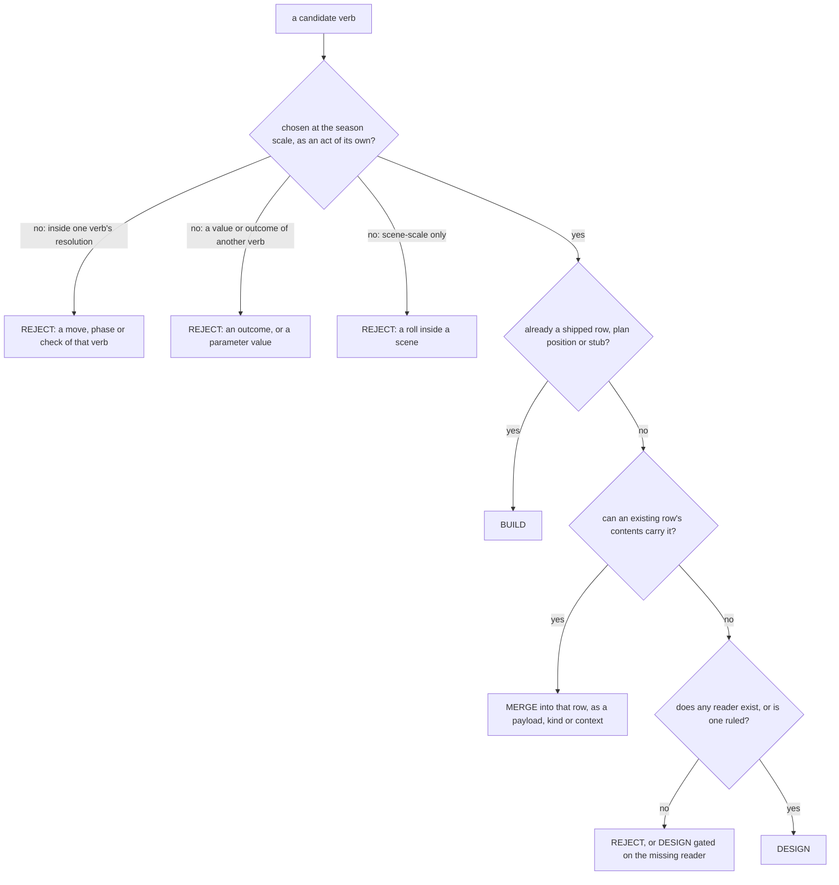

# Persons, attributes and verbs: the v2 synthesis — part 3: Verbs (triage, and PC to FI)

## Status: PROPOSED (2026-10-16). Not ratified; merging ratifies nothing unless Jordan so rules.
## Parts, in reading order: [head](2026-10-16-v2-person-troop-attribute-synthesis.md) · [`_part2`](2026-10-16-v2-person-troop-attribute-synthesis_part2.md) Attributes · **this file** (Part III: §III.0–§III.3, subsystems PC, MB, SC, FI) · [`_part4`](2026-10-16-v2-person-troop-attribute-synthesis_part4.md) (Part III: TW, GV, FA, EC, WT, NP, roll-up, verb × attribute) · [`_part5`](2026-10-16-v2-person-troop-attribute-synthesis_part5.md) and [`_part6`](2026-10-16-v2-person-troop-attribute-synthesis_part6.md) (Part IV) · [`_part7`](2026-10-16-v2-person-troop-attribute-synthesis_part7.md) (Roadmap, Reliability ledger, Sources, Trial registry) · [`_part8`](2026-10-16-v2-person-troop-attribute-synthesis_part8.md) (Part V: the trial).

---

## PART III. VERBS

### III.0 The game is short of readers, not of verbs

**Claim.** The 179 verbs proposed across the work reduce to **65 live rows**: 63 BUILD (a shipped
row, a plan position or a stub operation) and 2 DESIGN. Of the 86 verbs the From-scratch work designed,
**2 survive triage** (`ward`, `marry`), and both are gated on a ruling or a design that does not
exist yet. A pessimistic NERS pass then distils the 66 live verbs (the 65 plus the stub Past-pulling)
to **37**.

**Argument.**

- *Premise 1.* The template's inclusion rule says a verb is an act a person (or the seat he
  exercises) chooses at the season's scale, as an act of its own (Template `_part2` §A.1).
  - It excludes values of another verb's parameter, forms or arms of another verb, choices inside one
    verb's resolution, private helpers, superseded acts and scene-scale rolls.
  - Two critics applied it and upheld it.
- *Premise 2.* The From-scratch work added its 86 verbs *"subsystem by subsystem"*, excluding only
  exact synonyms (From-scratch head §2.1). It did not apply that rule.
- *Premise 3.* Its critic found about 15 of 25 sampled additions duplicate existing verbs, and named
  the pairs (heal and recover = `tend`; disguise = `conceal`; besiege = `march`; drill = `train`;
  shadow = `surveil`; tax = `requisition`; testify = `tell`; relieve = `transfer` or `give`; bribe =
  suborn; endure = withstand; abdicate = `release`; declare war = `utter` + `commit`; betray = a deed
  cell on `release`; yield, concede, retreat and disengage against surrender and withdraw).
- *Inference.* Apply the inclusion rule to all 86, then test each survivor for a duplicate. Most
  additions are in-bout moves (excluded by class 3) or acts an existing row already performs on
  different contents.
- *Conclusion.* The verb surface is nearly complete. **What is missing is not acts but readers:**
  - 43 of 65 rows read no personal input (Template §3A.3);
  - 20 of the 45 shipped rows executed zero times in four realm seasons (Template §10 probe 6);
  - 6 shipped rows carry no alignment cell at all, so the chooser's value term never ranks them
    (Part IV §IV.1).

**The strongest counter-argument.** *Merging many specific verbs into a few generic ones hides
distinctions a player cares about (bribe is not oblige).* It stands as a condition, not as an
objection. A merge is lawful only if the absorbing verb's CONTENTS can carry the difference: its
payload, its object kind, the contextual node it reads (Part IV §IV.3). Where a contents parameter
cannot carry a distinction, the merge is listed as a **composition to watch** (§III.3) and the trial
may reverse it.

**Consequence.**

- Build no new verb row from the 86 except, conditionally, `ward` (when opposed threadwork exists)
  and `marry` (if kin is ever carried).
- Spend the effort on readers: alignment cells, inquiry yields, contents parameters.

**After the trial (Part V, `_part8`).** The verdicts in this Part are the **first pass**. Part V tried
every new verb (108 items) and governs where it overturned one (§V.4 is the error ledger). Its
result: 4 new rows (`weave`, `mend`; `sever` and `bribe` conditional), 16 named survivals inside
incumbents, 57 merges, 14 parks with triggers (`ward` and `marry` among them), 17 cuts. Jordan has
since ruled the counter-argument's example above: *"bribe and oblige are completely different."*

**The rule for a primary subsystem.** Each verb takes the **first-listed** subsystem tag of
From-scratch head §2.3. Its other tags are its secondary subsystems. The rule is mechanical, so it
sometimes files a verb where its use is thin; for example, `fight` reaches MB only through `march`.
Every tally below was checked by script (`scratchpad/v2/triage.py`, a table count, not a probe).

### III.1 Triage, as a flow

### III.2 All 179 verbs, by primary subsystem

| subsystem | code | plan | plan cut | lane rec | designed here | total | new after triage |
|---|---|---|---|---|---|---|---|
| PC | 3 | 0 | 2 | 3 | 13 | 21 | 0 |
| MB | 1 | 2 | 0 | 5 | 12 | 20 | 0 |
| SC | 8 | 2 | 0 | 3 | 13 | 26 | 0 |
| FI | 8 | 1 | 0 | 0 | 9 | 18 | 0 |
| TW | 1 | 0 | 0 | 7 | 3 | 11 | 1 (`ward`) |
| GV | 12 | 7 | 3 | 2 | 5 | 29 | 0 |
| FA | 1 | 3 | 0 | 2 | 4 | 10 | 0 |
| EC | 6 | 0 | 1 | 0 | 9 | 16 | 0 |
| WT | 2 | 0 | 0 | 0 | 7 | 9 | 0 |
| NP | 3 | 3 | 1 | 1 | 11 | 19 | 1 (`marry`) |
| **total** | **45** | **18** | **7** | **23** | **86** | **179** | **2** |

**Notes on the columns.**

- The plan column is the From-scratch work's 18, of which 6 are mis-sourced (§II.6). The template's
  count is 12.
- `seize` is counted as plan, as v1 counted it. It has since shipped (`verb_table.yaml:898`) [CHECKED].
- Of the 86 designed verbs: DESIGN 2, MERGE 57, REJECT 27.
- Over all 179: BUILD 63, MERGE 77, REJECT 37, DESIGN 2.
- Every MERGE target is a live verb (script check).

**How to read each subsystem section.** Each section gives, in order:

1. **Inspirations**: 3–6, from the repo's tier-3 research (`engine/season/rosters.yaml:75-90`
   [CHECKED]: research *"informs DESIGN; it is not a source of canon names"*). Each lane row cited
   was re-read this pass through an extract of its table [CHECKED, extract].
2. **The triaged candidates**: code, plan and lane rows, then the designed verbs.
3. **The pessimistic NERS pass** over the subsystem's live verbs (BUILD and DESIGN).
4. **The distilled set**, the honest cost, and the closest calls.

**The pessimistic stance is an instrument, not a verdict** (Jordan, 2026-10-16: each verb *"has to
argue its case for inclusion"*). Its rules:

- A verb survives only with a named N-line loss (`skills/ners/SKILL.md` §2–§3).
- A verb that differs from another only in which contextual node it reads (Part IV §IV.3) is merged,
  as one verb with a context parameter.
- A cut never silently deletes a shipped or planned verb: each is written *"recommend retiring X"*
  with its status.

### III.3 Compositions to watch

Six merges compose two existing rows rather than fold into one. The trial should test each first.

| designed verb | composed as | what would break the merge | trial ruling (Part V) |
|---|---|---|---|
| bribe, suborn | `oblige` paid by `give` / `transfer` | if the payment and the binding cannot be one act's contents, so a refused bribe leaves the coin moved | **broken.** Bribe is not oblige (Jordan); one own row `bribe`, conditional, `suborn` the same act; an offer moves nothing |
| lend | `transfer` + an `oblige` with a repayment term | if the term cannot name an amount owed | **broken.** `Term` has no amount; the `debt` Record kind instead |
| infiltrate | `conceal` (a cover Record) then `move` | if a cover cannot be held inside another seat's establishment | **broken.** CUT as a verb: `oblige` → `tell`, with a cover read |
| conspire | `covenant` kept concealed | if `covenant`'s dispensation is necessarily public (chronicled) | **broken.** `covenant` is seat-only: `utter` + `commit` + `conceal` |
| ambush | `march` opened under a held cover | if `march` cannot read the attacker's cover | **re-targeted.** `fight` for persons, `march` for armies; a first-mover input |
| assassinate | `fight` to death, opened unseen | if `fight` cannot be opened without the subject's presence being witnessed | **held, and named:** a preset of `fight` |

---

### PC — personal combat

**Inspirations.**

| source | kind | contributes | bears on |
|---|---|---|---|
| Fiore, Zogho Largo / Stretto, and grappling gated on an opening (`research/by_lane/PC_personal_combat.md:49`, `:55`) | HISTORICAL RESEARCH, tier 3 | grapples follow an opening inside the bout; already the `contact.py` grab menu | **against** grapple, disarm and parry as verbs: they are moves inside `fight` |
| Meyer, feint discipline (`PC_personal_combat.md:53`) | HISTORICAL RESEARCH, tier 3, partly unverified | the feint is a commitment inside a bout | **against** feint as a verb |
| Total War auto-resolve: *"Don't build a second resolver"* (`PC_personal_combat.md:102`) | PRECEDENT GAME, tier 3 | one resolver per contest | **for** one `fight` row; **against** strike, shoot and rush rows that would resolve a bout's parts separately |
| Football Manager, one engine at three fidelities (`PC_personal_combat.md:101`) | PRECEDENT GAME, tier 3 | the duel, grid and auto modes are one bout | **for** keeping in-bout choices as contents of `fight` |
| CK3 imprison, ransom, execute; Mount & Blade execution starts a feud (`PC_personal_combat.md:113`) | PRECEDENT GAME, tier 3, partly [UNVERIFIED] | death sentence = `detain` + `fight`; a grudge loop | **for** `avenge` as a motive (stance), not a verb; `fight` writes no stance today |

**Triaged candidates.**

| verb | origin | status | sourced read (tier) | demand → the ten | note |
|---|---|---|---|---|---|
| `fight` | code | BUILD | STR AGI END FOC ACU WIL ATT · PRA TMP KIT (T2) | AGI END STR | shipped row |
| `challenge` | code | BUILD | none | CHA · nerve | shipped row |
| `accept` | code | BUILD | as fight (T2) | AGI STR · nerve | shipped row |
| `kill`, `wound` | plan cut | REJECT | none | STR | outcomes of fight, not acts |
| `interpose` | lane | MERGE → `fight` | none | AGI END · nerve | a third party entering a bout |
| `rescue` | lane | MERGE → `fight` | none | AGI STR · nerve | a fight against captors, or the release of a detain |
| `champion` | lane | MERGE → `challenge` | none | nerve | a proxy party to a challenge |

**Designed here: 13** (DESIGN 0 · MERGE 2 · REJECT 11).

| verb | also | domain | status | reads (the ten) | reason |
|---|---|---|---|---|---|
| strike | — | force | REJECT | AGI END STR | a move inside fight's bout (template A.1, class 3) |
| guard | MB GV | protection, perception | REJECT | ACU AGI | a bout posture; keeping a place is presence (`move`) |
| parry | — | force | REJECT | AGI ATT | a move inside fight's bout |
| dodge | — | motion | REJECT | AGI | a move inside fight's bout |
| feint | — | deceit | REJECT | ATT · comp | a bout move; the field's feint check is inside `march` |
| grapple | — | force | REJECT | AGI END STR | a bout move; taking alive is a fight outcome |
| disarm | — | force | REJECT | AGI STR | a move inside fight's bout |
| shoot | MB WT | force at range | REJECT | AGI END STR | ranged arms are KIT inside fight; game is `hunt` |
| rush | MB | motion, force | REJECT | AGI STR · nerve | the charge is a phase inside fight or march |
| disengage | MB | motion | REJECT | comp | IN-46's in-bout `withdraw` |
| yield | MB SC | binding, submission | REJECT | comp fore | a value of `challenge_terms` [yield, blood, death] |
| ambush | MB FA | concealment, war | MERGE → `march` | ACU | an attack opened from a held cover |
| assassinate | FA | concealment, killing | MERGE → `fight` | ACU END · nerve | fight to death, opened unseen; co-location required (R-C-13) |

(*fore, nerve, comp*: From-scratch demands with no home among the ten: forethought, nerve, composure.)

**Pessimistic NERS.**

| verb | first-pass verdict | letter | the named loss, or its absence |
|---|---|---|---|
| `fight` | **KEEP** | N | the only act by which one person harms or kills another (`Person.body`, `Person.exists`); cut it and personal violence leaves the game |
| `accept` | **MERGE into `fight`** (as the challenged party's answer, referencing the challenge) | E | identical writes and emits to `fight` (`verb_table.yaml` rows 18 and 20, read by script); the difference is who opens it, a context node, not an outcome |
| `challenge` | **MERGE into `fight`** (as `terms` content with consent requested; emits `challenge.issued`) | N | narrowed: what survives the cut is the witnessable refusal. A declined challenge stops being an event unless `fight`'s terms content emits the request. Recommend retiring `challenge` and `accept` (both shipped, resolvable; 14 and 28 executions in four realm seasons) |

**Distilled set: `fight` (3 → 1).** **Honest cost:** the duel as a two-step public ritual (a
challenge issued, then accepted or refused) survives only if `fight`'s contents carry the request and
the answer.

**Closest calls (reverse these first):**

1. `challenge`: the refusal-as-shame drama is R-WORLD material.
2. `accept`.

**After the trial (Part V §V.3).** Both closest calls reversed: `challenge` and `accept` are kept
(PC-10b mints a `challenge` Record and makes `accept` refuse without one), so the set is `fight`,
`challenge`, `accept` (3). Of 16 new verbs, no row; `yield` (a named term and choice) and
`assassinate` (a named preset) survive on `fight`; `shoot`, `rescue`, `champion` are parked.

---

### MB — mass battle

**Inspirations.**

| source | kind | contributes | bears on |
|---|---|---|---|
| Total War auto-resolve, warned against (`research/by_lane/MB_mass_battle.md:156`) | PRECEDENT GAME, tier 3 | a second algorithm beside the played one drifts | **for** one `march` resolver; **against** besiege, storm and command rows |
| Dominions, the lone commander anchor, warned (`MB_mass_battle.md:158`) | PRECEDENT GAME, tier 3 | a commander effect dominates at small N and vanishes at large N | **against** a `command` verb or a `rally` verb that applies a person to a side |
| du Picq, local panic spreads (`MB_mass_battle.md:99`) | HISTORICAL RESEARCH, tier 3, partly applied | rout as contagion inside one battle | **for** rally and rout as phases inside `march`, not verbs |
| JA2, Brigandine, Unicorn Overlord: *"Garrison is an assignment, never a unit type"* (`MB_mass_battle.md:161`) | PRECEDENT GAME, tier 3 | defence is presence, not a unit | **against** guard, patrol and encamp as verbs |
| Total War occupy, sack, raze; CK3 de jure drift (`research/by_lane/SE_settlements_territory_economy.md:104`) | PRECEDENT GAME, tier 3 | conquest must be more than a colour change | **for** `raze` and `seize` as the two outcomes of a won field |

**Triaged candidates.**

| verb | origin | status | sourced read (tier) | demand → the ten | note |
|---|---|---|---|---|---|
| `march` | code | BUILD | CHA ACU via Command (T2) | END | shipped row |
| `raze` | plan | BUILD | none | END | IN-12 step 11 |
| `levy` | plan | MERGE → `requisition` | none | BON CHA | the plan's store act, renamed on this branch; the name is reserved for a troop verb outside this document |
| `muster`, `marshal` | lane | REJECT | none | CHA; fore | troop scope; not distilled here |
| `surrender` | lane | MERGE → `covenant` | none | fore | ends a field or a war on terms; yield and concede fold here |
| `storm` | lane | MERGE → `march` | none | CHA · nerve | an assault is a march on a place |
| `sack` | lane | MERGE → `seize` | none | — | plunder is a seizure of stores |

**Designed here: 12** (DESIGN 0 · MERGE 6 · REJECT 6).

| verb | also | domain | status | reads (the ten) | reason |
|---|---|---|---|---|---|
| reconnoitre | FI | perception | MERGE → `survey` | ACU | looking over a rung before a march |
| encamp | WT | war, shelter | REJECT | — | a position, not an act |
| fortify | GV | making, war | MERGE → `build` | fore | raises a Site's condition |
| forage | WT | gathering | MERGE → `seize` | END | taking stores from occupied land |
| provision | EC GV | logistics | MERGE → `transfer` | fore | moving stores to a force |
| besiege | — | war | MERGE → `march` | WIL · fore | a march that stays (critic) |
| rally | PC | war, speech | REJECT | CHA · nerve | a phase check inside march (`rally_check` is an empty hook) |
| pursue | PC FI | motion | REJECT | END WIL | a phase inside march; a fugitive is `move` + `arrest` |
| retreat | — | motion, war | REJECT | comp | a phase inside march (critic: duplicates withdraw) |
| command | GV FA | rule, war | REJECT | CHA · comp | the commander's acts are inside march |
| drill | — | teaching, war | MERGE → `train` | CHA WIL | critic: drill = train |
| withstand | PC | force, will | REJECT | END WIL · nerve | the defender's side of a contested act; nobody chooses it |

**Pessimistic NERS.**

| verb | first-pass verdict | letter | the named loss, or its absence |
|---|---|---|---|
| `march` | **KEEP** | N | the only act that contests ground between sides and moves a force onto it (`Person.travel_leg`, `Tenure`); cut it and war has no act |
| `raze` | **KEEP** | N (closure) | the only planned destroyer of a Rung or Site. No shipped verb removes a place, so `found` and `build` have no inverse without it (Part IV §IV.7, CLOSURE) |

**Distilled set: `march`, `raze` (2 → 2).** **Honest cost:** none from the cut. The subsystem's
richness is meant to live in `march`'s contents; whether those contents are troop-scope is not
distilled here.

**Closest calls:** none to reverse; besiege is the merge most likely to be argued back (a siege's
duration is a context node, the clock).

**After the trial (Part V §V.3, §V.2.5).** `march`, `raze` (2) stand, but "honest cost: none" was
wrong. Rally, pursue, retreat, command and withstand are kept as named choices inside the battle
module (Jordan); storm and besiege as `march` postures (`assault`, `invest`); surrender as a named
preset of `give`; forage and sack merge into `requisition`, not `seize`. None is observed until the
force scale (M-MB-1) lets a season field be won.

---

### SC — social contest

**Inspirations.**

| source | kind | contributes | bears on |
|---|---|---|---|
| Stasis theory (Hermagoras, Cicero, *Ad Herennium*) (`research/by_lane/SC_social_contest.md:49`) | HISTORICAL RESEARCH, tier 3, sound | a dispute's issue is classified before it is argued | **for** `argue` with typed contents (the issue); **against** refute and plead as verbs |
| Roman Senate procedure (*relatio*, *sententiae* by rank, *discessio*) (`SC_social_contest.md:54`) | HISTORICAL RESEARCH, tier 3, sound | proceedings are staged: open, speak, divide | **for** `open_case` → `determine` as two acts with a docket between them; **for** vote as a mode of `determine` |
| "Vote = holders' own `commit`s, count a Query" (`SC_social_contest.md:212`) | internal design reading, tier 3 | a vote needs no verb | **for** merging vote |
| Dogs in the Vineyard: raise, see, give; conceding is a priced move (`SC_social_contest.md:105`) | PRECEDENT GAME, tier 3 | concession inside a contest has a price | **for** concede as a choice inside the contest; **against** a concede row |
| Detective games (L.A. Noire, Lacuna, Disco Elysium, Shadows of Doubt): interrogate, accuse a lie (`SC_social_contest.md:117`) | PRECEDENT GAME, tier 3; unreached | catching a lie needs a lie to catch | **for** `lie` as content of `tell` (J-C-6) |
| Null N-1: *"no game models argument content"* (`SC_social_contest.md:119`) | null finding, tier 3 | the content of an argument is unprecedented | a warning: `argue`'s contents are new ground, so test them |

**Triaged candidates.**

| verb | origin | status | sourced read (tier) | demand → the ten | note |
|---|---|---|---|---|---|
| `carry` | code | BUILD | none | END | shipped row, not resolvable |
| `oblige` | code | BUILD | none | ATT | shipped row |
| `open_case` | code | BUILD | none | — | shipped row |
| `petition` | code | BUILD | none | — | shipped row |
| `construe` | code | BUILD | none | ACU | shipped row, not resolvable; grade `absent` |
| `speak` | code | BUILD | open (T3 vs T3) | CHA | shipped row |
| `tell` | code | BUILD | PRA (T1) | ACU | shipped row |
| `utter` | code | BUILD | none | CHA | shipped row |
| `argue` | plan | BUILD | PRA (T3) | ACU | IN-12 step 9 |
| `charge (accuse)` | plan | MERGE → `utter` | none | — | the plan's own row: an `utter` form of the charge (`workplans/valoria_master_workplan_v9_part5.md:68`) [CHECKED] |
| `withdraw` | lane | REJECT | none | fore | a choice inside fight or a contest (IN-46, [ASSUMPTION]) |
| `deny` | lane | MERGE → `destroy_record` | none | nerve | J-C-7 option (a) keeps Layer 1's one-closer shape; (b) a deny row overwrites it |
| `lie` | lane | MERGE → `tell` | none | ACU ATT · comp | an arm of `said_of` (K-SC-6); whether persons lie is J-C-6 |

**Designed here: 13** (DESIGN 0 · MERGE 11 · REJECT 2).

| verb | also | domain | status | reads (the ten) | reason |
|---|---|---|---|---|---|
| persuade | — | speech | MERGE → `argue` | ATT BON WIL | appeal against proof is a manner, not a verb |
| plead | GV | speech, law | MERGE → `argue` | — | argue inside a proceeding |
| threaten | FA | speech, force | MERGE → `utter` | CHA · comp nerve | a proposition carrying a sanction |
| flatter | NP | speech | MERGE → `tell` | ATT BON | a valenced tell (`told_valence_gain`) |
| refute | — | reason | REJECT | ACU | the `rebut` move inside a contest |
| concede | FA | speech | REJECT | comp | a choice inside a contest |
| testify | FI GV | speech, record | MERGE → `tell` | ACU | critic: testify = tell |
| vote | GV FA | rule, assembly | MERGE → `determine` | — | a convened body's determination |
| preach | NP | speech, ritual | MERGE → `utter` | CHA | utter to many |
| insult | PC | speech, force | MERGE → `tell` | ATT · comp nerve | a negatively valenced tell |
| praise | NP | speech | MERGE → `tell` | — | a positively valenced tell |
| counsel | GV | speech, judgement | MERGE → `tell` | fore | a tell to a seat-holder |
| mediate | FA | speech, judgement | MERGE → `convene` | ATT | convene + determine without a bench |

**Pessimistic NERS.**

| verb | first-pass verdict | letter | the named loss, or its absence |
|---|---|---|---|
| `tell` | **KEEP** | N | the only act that moves a claim's CONTENT into another person's ledger (`loop/witness.py:705-760`, the told channel) [CHECKED] |
| `utter` | **KEEP** | N | the only creator of a Proposition: edicts, charges, threats and war are its contents |
| `argue` | **KEEP** | N, R | the only planned act whose target is another person's pursuits. Values otherwise have no writer (`write_matrix.yaml`, `Person.pursuits` unproduced, H-62) [CHECKED] |
| `oblige` | **KEEP** | N | the only bond of a person to a seat's establishment (`loop/predicates.py:339-396`) [CHECKED] |
| `open_case` | **KEEP** | N, S | a pending case is a world state others act on; folding it into `determine` erases the interval between charge and judgement |
| `petition` | **MERGE into `create_record`** (kind `petition`, addressed `to`) | E | the repo's own pattern: one creator over Record kinds. Recommend retiring `petition` (shipped, resolvable; 28 executions) |
| `carry` | **MERGE into `give`** (a Record handed to the docket) | E | carry moves a held petition along. Recommend retiring `carry` (shipped, not resolvable) |
| `speak` | **MERGE into `utter`** (a public, unaddressed Proposition) | N false | *"binds, carries and contests nothing"* (Template row 32). Recommend retiring `speak` (shipped, resolvable; 70 executions, the most of any SC verb) |
| `construe` | **CUT** | N false (no producer) | grade `absent`, writes nothing, not resolvable. Recommend retiring `construe` (shipped, not resolvable) |

**Distilled set: `tell`, `utter`, `argue`, `oblige`, `open_case` (9 → 5).** **Honest cost:**

- a petition is no longer its own act, so the chooser cannot prefer petitioning over recording;
  it ranks `create_record` instead;
- an unaddressed speech becomes an utterance, a Proposition that persists, where a speech left
  nothing.

**Closest calls (reverse these first):**

1. `speak`: 70 executions; it may be the cheap filler act that keeps quiet seasons moving.
2. `petition`: its addressee and docket path are real procedure.
3. `carry`.
4. `construe`: the bending of terms is a distinct deceit if J-C-6 admits lies.
5. `open_case`, if the trial finds the interval carried by `convene`.

**After the trial (Part V §V.3).** `speak` is kept (SC-01 step 12 builds it contested), so the set is
six: `tell`, `utter`, `argue`, `oblige`, `open_case`, `speak`; `construe` is held on J-C-6. Of 16 new
verbs, no row; `deny` survives as a named preset of `release` (not `destroy_record`); `lie`,
`insult`, `preach` are parked.

---

### FI — fieldwork and inquiry

**Inspirations.**

| source | kind | contributes | bears on |
|---|---|---|---|
| Coroner's view of the body (`research/by_lane/FI_fieldwork_investigation.md:47`) | HISTORICAL RESEARCH, tier 3, unverified | the only historical row behind `examine` | **for** `examine` as the generic inquiry |
| Walsingham's cipher secretary (`FI_fieldwork_investigation.md:48`) | HISTORICAL RESEARCH, tier 3; a surface analogy | cipher-breaking is not consulting a record | **against** decipher as distinct from `research` only weakly; supports a Record-content parameter |
| Foscarini affair (`FI_fieldwork_investigation.md:55`) | HISTORICAL RESEARCH, tier 3; unread by FI | the strongest case for a false-testimony mechanic | **for** `lie` and `forge` as contents (J-C-6) |
| GUMSHOE, the core clue never gated, misapplied (`FI_fieldwork_investigation.md:89`) | PRECEDENT GAME, tier 3 | access and quality are separate | a warning: an inquiry needs a yield, not just a gate (R-C-23) |
| Blades in the Dark: fail forward (`FI_fieldwork_investigation.md:90`) | PRECEDENT GAME, tier 3; unreached | failure should still move the story | **against** today's inquiry Failure, which deposits nothing |
| CK3 secrets as ownable, leakable information (`FI_fieldwork_investigation.md:100`) | PRECEDENT GAME, tier 3 | concealment needs a carrier | **for** `conceal` writing a `cover` Record |

**Triaged candidates.**

| verb | origin | status | sourced read (tier) | demand → the ten | note |
|---|---|---|---|---|---|
| `destroy_record` | code | BUILD | none | — | shipped row |
| `forge` | code | BUILD | open | ACU AGI | shipped row, not resolvable |
| `survey` | code | BUILD | none | ACU · fore | shipped row |
| `examine` | code | BUILD | TS gate (T4) · PRA (T3*) | ACU | shipped row |
| `interview` | code | BUILD | PRA (T3*) | ATT BON · comp | shipped row |
| `research` | code | BUILD | PRA (T3*) | ACU WIL | shipped row |
| `surveil` | code | BUILD | PRA (T3*) | ACU | shipped row |
| `reconstruct` | code | BUILD | PRA (T3*) | ACU | shipped row |
| `conceal` | plan | BUILD | none | comp | IN-12 step 10 |

(T3* = the proceedings design's tier, contestable: Template §3.1.1.)

**Designed here: 9** (DESIGN 0 · MERGE 9 · REJECT 0).

| verb | also | domain | status | reads (the ten) | reason |
|---|---|---|---|---|---|
| search | WT | perception | MERGE → `examine` | ACU WIL | examining a place for a hidden thing |
| track | WT MB | perception | MERGE → `surveil` | END | following a person |
| eavesdrop | — | perception, concealment | MERGE → `surveil` | ACU | as shadow (critic) |
| decipher | — | reason, letters | MERGE → `research` | ACU WIL | reading a Record |
| shadow | — | concealment, perception | MERGE → `surveil` | ACU | critic: shadow = surveil |
| infiltrate | FA | concealment | MERGE → `conceal` | ATT · comp | a cover identity, then move |
| disguise | NP | concealment | MERGE → `conceal` | ACU · comp | critic: disguise = conceal |
| bribe | FA GV | exchange, corruption | MERGE → `oblige` | ATT WIL | critic: bribe = suborn; both are an oblige paid by give |
| audit | GV EC | knowing, number | MERGE → `examine` | ACU WIL · fore | examining a Record |

**Pessimistic NERS.** The five inquiry rows share one signature: `writes: []`, emits
`finding.made`, refusal `finding.none` (`verb_table.yaml`, read by script). They differ only in
their OBJECT (a site, a person, a Record, a person's movements, one's own claims) and in their
eligibility (presence). By the context-parameter rule, that is one verb.

| verb | first-pass verdict | letter | the named loss, or its absence |
|---|---|---|---|
| `examine` | **KEEP** (as the generic inquiry: object = site, person, Record, movements, own ledger) | N | the only route from an unknown fact to a held claim other than being present or being told |
| `interview` | **MERGE into `examine`** (object: a person, who learns he was questioned) | N false | its distinct node is the interviewee's awareness, a WITNESS-set parameter. Recommend retiring `interview` (shipped, resolvable; 20 executions) |
| `research` | **MERGE into `examine`** (object: a Record) | N false | recommend retiring `research` (shipped; 25 executions) |
| `surveil` | **MERGE into `examine`** (object: a person's movements; covert) | N narrowed | covertness is a WITNESS-set parameter. Recommend retiring `surveil` (shipped; 56 executions) |
| `reconstruct` | **MERGE into `examine`** (object: one's own ledger) | N false | recommend retiring `reconstruct` (shipped; 111 executions) |
| `survey` | **MERGE into `examine`** (object: a rung's holdings; yields a Record) | E | recommend retiring `survey` (shipped; 10 executions) |
| `forge` | **MERGE into `create_record`** (content flagged false; `forgery_quality`) | E | recommend retiring `forge` (shipped, not resolvable) |
| `conceal` | **MERGE into `create_record`** (kind `cover`, terms = the actor) | E | its effect lives in WITNESS's reading of the cover. Recommend retiring `conceal` (IN-12 step 10, planned) |
| `destroy_record` | **KEEP** | N (closure) | the only closer of a Record by act |

**Distilled set: `examine`, `destroy_record` (9 → 2).** The Record creators move to EC's
`create_record`. **Honest cost:**

- the six inquiry acts of the proceedings design (T3, contestable) become one verb with an object
  parameter;
- the chooser can no longer prefer surveillance over interview by verb, only by object, and today the
  pursuit term cannot see objects at all (Part IV §IV.1);
- `examine` carries no alignment cell, so after the merge **every inquiry scores 0 on values** until
  cells are written.

**Closest calls (reverse these first):**

1. `surveil`: covert watching is a distinct risk profile.
2. `interview`: the interviewee may lie, a third party with a will.
3. `conceal`: concealment is the inverse of inquiry and may deserve its own row for legibility.
4. `reconstruct`: inference from one's own claims needs no place.
5. `forge`.

**After the trial (Part V §V.2.7).** The fold into `examine` is reversed: it cannot be written (the
typed grammar has no disjunction) and it overrides Jordan's instruction to build the six as six. The
set is eight: `examine`, `interview`, `research`, `surveil`, `reconstruct`, `survey`,
`destroy_record` and `conceal` (kept as its own row); `forge`'s merge was not tried. Of 9 new verbs,
`bribe` is an own row, conditional (§V.2.8).
