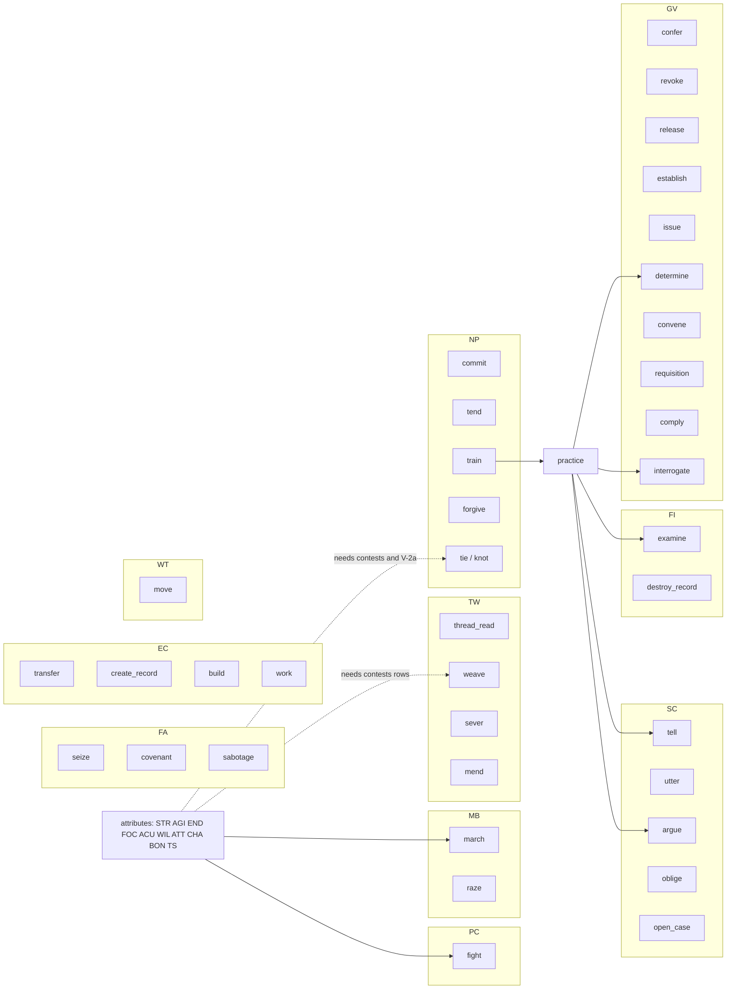

# Persons, attributes and verbs: the v2 synthesis — part 4: Verbs (TW to NP, roll-up, verb × attribute)

## Status: PROPOSED (2026-10-16). Not ratified; merging ratifies nothing unless Jordan so rules.
## Parts, in reading order: [head](2026-10-16-v2-person-troop-attribute-synthesis.md) · [`_part2`](2026-10-16-v2-person-troop-attribute-synthesis_part2.md) · [`_part3`](2026-10-16-v2-person-troop-attribute-synthesis_part3.md) (Part III: triage, PC–FI) · **this file** (Part III: TW–NP, roll-up, verb × attribute) · [`_part5`](2026-10-16-v2-person-troop-attribute-synthesis_part5.md) · [`_part6`](2026-10-16-v2-person-troop-attribute-synthesis_part6.md) · [`_part7`](2026-10-16-v2-person-troop-attribute-synthesis_part7.md) · [`_part8`](2026-10-16-v2-person-troop-attribute-synthesis_part8.md) (Part V: the trial).

Conventions as in `_part3` §III.2. *fore, nerve, comp* are From-scratch demands with no home among the
ten.

---

### TW — threadwork

**Inspirations.** The repo holds almost no precedent for threadwork itself. The rows below bear on it
by shape.

| source | kind | contributes | bears on |
|---|---|---|---|
| Lisbon 1755, Laki 1783, Tambora 1815 (`research/by_lane/WR_world.md:51`) | HISTORICAL RESEARCH, tier 3, sound; unreached | a catalogue of catastrophe shapes for the Calamity | **for** Mending as the one restorative act (R-C-26) |
| Scheffer, Holling regime shifts (`WR_world.md:59`) | HISTORICAL RESEARCH, tier 3, unverified | thresholds and hysteresis in a world-state | a warning: the world's thread-state needs inverses (weave against sever) |
| HCC thesis: *"a Crisis card is a retroactive audit of an earlier Fortif[ication]"* (`WR_world.md:56`) | internal research, tier 3 | the payoff of a protective act shows later | **for** a defensive thread act (`ward`) only once a threat exists to audit |
| Dwarf Fortress: a grudge as an eligibility flag (`WR_world.md:95`) | PRECEDENT GAME, tier 3 | state that gates later acts | **for** thread ops writing `Person.coherence` that later gates them |
| Disco Elysium's *Shivers* and *Inland Empire* as uncanny perception | PRECEDENT GAME [PUBLIC KNOWLEDGE, UNVERIFIED] (named in From-scratch `_part5` §9 from memory) | perception of the uncanny as a capacity | **for** TS as a perception primary; **against** a separate `trace` verb |

**Triaged candidates.**

| verb | origin | status | sourced read (tier) | demand → the ten | note |
|---|---|---|---|---|---|
| `thread_read` | code | BUILD | WIL TS · PRA (T4; TS gate T3) | ACU TS | shipped row, not resolvable |
| `weave` | lane | BUILD | WIL TS · PRA RES (T2) | AGI TS | stub `attempt_weaving`; a verb row per R-C-18 |
| `pull` | lane | BUILD | WIL TS · PRA RES (T2) | TS | stub `attempt_pulling`; K-WR-2 defers it |
| `lock` | lane | BUILD | WIL TS · PRA RES (T2) | TS WIL | stub `attempt_locking` |
| `loosen` | lane | MERGE → `sever` | none | AGI TS | name match to Dissolution [UNVERIFIED] |
| `sever` | lane | BUILD | WIL TS · PRA RES (T2) | TS | stub `attempt_dissolution`, by name [UNVERIFIED] |
| `mend` | lane | BUILD | WIL TS · PRA (T2; no RES) | ACU BON TS | stub `attempt_mending` |
| `leap` | lane | BUILD | WIL TS · PRA RES (T2) | AGI TS · nerve | stub `attempt_leap` |
| Past-pulling | stub only | BUILD | WIL TS · PRA RES (T2) | — | `attempt_past_pulling` (Template row 61); not in the 179 |

**Designed here: 3** (DESIGN 1 · MERGE 2 · REJECT 0).

| verb | also | domain | status | reads (the ten) | reason |
|---|---|---|---|---|---|
| ward | PC | protection | DESIGN | ACU TS | defence against another's threadwork; no stub or row covers it [INFERRED] |
| anchor | NP | stability | MERGE → `mend` | TS WIL | resisting loss of self = Mending oneself (R-C-26) [INFERRED] |
| trace | FI | perception | MERGE → `thread_read` | TS | reading a strand to its source |

**Pessimistic NERS.** Every thread operation rolls one pool, `2·WIL + min(3, History + 3) + ⌊TS/10⌋`
(`operations.py:235-247`, v1 CHECKED-3), and pays one cost (Coherence). The operations differ in their
target and in the direction of their effect.

| verb | first-pass verdict | letter | the named loss, or its absence |
|---|---|---|---|
| `thread_read` | **KEEP** (absorbs `leap` as its access step: *"Thread-Read is a Leap"*, `fieldwork_v30.md:351`, v1 CHECKED) | N | the only route to perceiving the thread; carries K-3's TS ≥ 30 gate |
| `weave` | **KEEP** (absorbs `lock` as a permanence parameter) | N | the only creator of a thread binding |
| `sever` | **KEEP** (absorbs `loosen`) | N (closure) | the inverse of `weave` |
| `mend` | **KEEP** | N, R-WORLD | the only act that lowers the Calamity (R-C-26) |
| `leap` | **MERGE into `thread_read`** (the Leap is the access step) | E | one pool, one gate; a separate row would add a second name for the same roll |
| `lock` | **MERGE into `weave`** (permanence) | E | its target and pool are `weave`'s |
| `pull`, Past-pulling | **CUT** | N false (no producer) | K-WR-2: *"Pull only once P-09's detectable orphan has a carrier"* (`WR_world.md:538`, v1 CHECKED). Recommend retiring the two stubs from the verb plan until that carrier exists |
| `ward` | **CUT** | N false (needs Z built) | no opposed threadwork exists for it to resist. Loss accepted until one does |

**Distilled set: `thread_read`, `weave`, `sever`, `mend` (9 → 4).** **Honest cost:**

- no defence against hostile threadwork;
- no pulling, past or present;
- a lock is a parameter, not a choice the chooser can value separately.

**Closest calls:**

1. `ward`: the only DESIGN survivor in TW.
2. `pull`.
3. `lock`.
4. `leap`.

**After the trial (Part V §V.2.6).** Three rows over the one resolver: `weave`, `mend` (one batch, after
IN-06) and `sever` (built third, only if it writes something Locking does not). `mend`'s N-line above
is wrong: it is the only raiser of coherence; the Calamity's fabric arm is `restore`'s (IN-35), so
`restore` is kept. `ward` and `pull` are parked, not cut (opposed threadwork exists, unplugged), and
the pull stubs are not retired. `leap` is the precondition of every operation, not of `thread_read`
alone; `loosen` goes to `release` (one's own) or `mend` (another's), not `sever`; `anchor` is cut.

---

### GV — settlements and governance

**Inspirations.**

| source | kind | contributes | bears on |
|---|---|---|---|
| Tilly's extraction loop; Levi's quasi-voluntary compliance (`research/by_lane/SE_settlements_territory_economy.md:45`) | HISTORICAL RESEARCH, tier 3, sound as mechanism | extraction meets compliance or evasion | **for** `requisition` with `comply` and `evade / defy` as the answer |
| Moral economy of subsistence: Thompson, Scott, Sen (`SE_settlements_territory_economy.md:47`) | HISTORICAL RESEARCH, tier 3, *"the strongest convergence in the lane"* | dearth turns extraction into unrest | **for** `requisition`'s price in hunger (R-C-10); **for** relieve as a `transfer` |
| Castilian *residencia* and *visita*; Ming–Qing avoidance (`SE_settlements_territory_economy.md:49`) | HISTORICAL RESEARCH, tier 3 | agents are audited by authority | **for** audit as `examine` of a steward's Records, and dismissal by `revoke` |
| Total War's appointed governor, added, removed, re-added (`SE_settlements_territory_economy.md:96`) | PRECEDENT GAME, tier 3; a null | no solved design for an appointed governor | **against** a `steward` verb; for steward as a seat filled by `confer` |
| RS-27: *"designated heir is not a verb but a status or title"* (`workplans/valoria_master_workplan_v9_part8.md:340`, v1 CHECKED-3) | Jordan's ruling | heirship is a title | **against** `succeed` and `designate` as verbs |

**Triaged candidates.**

| verb | origin | status | sourced read (tier) | demand → the ten | note |
|---|---|---|---|---|---|
| `comply` | code | BUILD | none | END | shipped row |
| `confer` | code | BUILD | none | ATT | shipped row |
| `convene` | code | BUILD | none | fore | shipped row |
| `determine` | code | BUILD | PRA (T3) | ACU | shipped row |
| `establish` | code | BUILD | none | fore | shipped row |
| `evade / defy` | code | BUILD | none | comp nerve | shipped row, not resolvable |
| `found` | code | BUILD | none | fore | shipped row |
| `issue` | code | BUILD | none | — | shipped row |
| `requisition` | code | BUILD | none | CHA · fore | shipped row (the store act) |
| `release` | code | BUILD | none | — | shipped row |
| `revoke` | code | BUILD | none | — | shipped row |
| `succeed` | code | BUILD | none | — | shipped row, not resolvable |
| `arrest` | plan | BUILD | PRA (T3) | AGI CHA STR | IN-12 step 5 |
| `pardon` | plan | BUILD | none | — | IN-12 step 5 |
| `interrogate` | plan | BUILD | PRA (T3) | ACU ATT CHA WIL · comp | IN-12 step 5 |
| `detain` | plan | MERGE → `arrest` | none | — | a Tenure kind already landed |
| `ban` | plan | MERGE → `determine` | none | CHA | a Tenure kind already landed; opened by a proceeding |
| `abolish` | plan | REJECT | none | — | a revert in the plan, not an act |
| `proclaim` | plan | MERGE → `issue` | none | CHA | deleted in the plan; publish as an issued Record (R-C-21) |
| `execute`, `designate`, `waive` | plan cut | REJECT | none | — | cut by the plan; `designate` by RS-27 |
| `abdicate` | lane | MERGE → `release` | none | fore | release of one's own hold (K-FA-3) |
| `depose` | lane | MERGE → `revoke` | none | — | by authority; by force it is `seize` |

**Designed here: 5** (DESIGN 0 · MERGE 5 · REJECT 0).

| verb | also | domain | status | reads (the ten) | reason |
|---|---|---|---|---|---|
| tax | EC | rule, number | MERGE → `requisition` | fore | critic: tax = requisition |
| patrol | MB | perception, rule | MERGE → `surveil` | ACU END | watching a rung |
| steward | EC | care, rule | MERGE → `confer` | WIL · fore | a held seat (delegation, R-C-19), not an act |
| ration | MB EC | number, care | MERGE → `transfer` | fore | allocating stores |
| relieve | NP | care | MERGE → `transfer` | BON | critic: relieve = transfer/give |

**Pessimistic NERS.**

| verb | first-pass verdict | letter | the named loss, or its absence |
|---|---|---|---|
| `confer` | **KEEP** | N | the only act that fills a seat (opens a `hold`) |
| `revoke` | **KEEP** (absorbs `pardon` as kind `detain` / `ban`) | N (closure) | the closer by authority of another's tenure |
| `release` | **KEEP** | N (closure) | the closer by the holder: the generic over Tenure kinds |
| `establish` | **KEEP** | N | the only creator of an office and its remit |
| `issue` | **KEEP** | N | the authoritative Record: dispensations, edicts, warrants |
| `determine` | **KEEP** | N | the only proceeding outcome |
| `convene` | **KEEP, narrowed** | N | the only writer of `Date.due_at` (`write_matrix.yaml`, row `Date.due_at`) [CHECKED] |
| `requisition` | **KEEP** | N | the coercive mover of matter (the store act) |
| `comply` | **KEEP** (absorbs `evade / defy` as its answer: comply, evade, defy) | N, R | the subject's answer to a demand: the one place a ruled person chooses resistance |
| `interrogate` | **KEEP** | S | it is contested (*"a proposition"*), and the roster forbids making inquiry a contest (`rosters.yaml:1074-1077`, v1 CHECKED), so it cannot ride `examine` |
| `evade / defy` | **MERGE into `comply`** (the answer) | E | recommend retiring `evade / defy` (shipped, not resolvable) |
| `found` | **MERGE into `build`** (object: a new rung) | E | recommend retiring `found` (shipped, resolvable; 0 executions) |
| `succeed` | **CUT** | N false (RS-27) | an heir is a title. Recommend retiring `succeed` (shipped, not resolvable; effect declined) |
| `arrest` | **MERGE into `seize`** (object: a person → `detain`) | E | recommend retiring `arrest` (IN-12 step 5, planned) |
| `pardon` | **MERGE into `revoke`** (kind `detain` / `ban`) | E | recommend retiring `pardon` (IN-12 step 5, planned) |

**Distilled set: `confer`, `revoke`, `release`, `establish`, `issue`, `determine`, `convene`,
`requisition`, `comply`, `interrogate` (15 → 10).** **Honest cost:**

- mercy (pardon) is no longer a verb a person can value apart from dismissal;
- an arrest is no longer contested by standing (`arrest`'s §9 row is sigma-routed, `seize` is not);
- founding a settlement and raising a building become one act.

**Closest calls (reverse these first):**

1. `evade / defy`: its `hierarchical_equal` cell (+0.9) is opposite in sign to `comply`'s (−0.6), so
   the merge folds resistance and obedience into one value.
2. `arrest`: it loses its contest edge.
3. `pardon`: mercy would want its own alignment cells, which the planned row does not yet have.
4. `found`: scale differs, and so do its cells.
5. `convene`.

**After the trial (Part V §V.3).** The 10 stand (the incumbent retirements were not tried). Of 7 new
verbs, no row: `tax` survives as a `due` writ on `issue` (not `requisition`), `relieve` as
`relief.given` on `transfer`, `abdicate` as a seat-resignation kind on `release`; `ration` is parked,
`depose` is parked on Jordan (ARC-40's replaced arm), `patrol` is cut. The `depose` note above is
wrong: `seize` never takes a seat (`verb_table.yaml:911`).

---

### FA — faction actions

**Inspirations.**

| source | kind | contributes | bears on |
|---|---|---|---|
| Conquest terms: Grotius, Magdeburg 1631, Joyeuse Entrée 1356 (`research/by_lane/FA_faction_actions.md:58`) | HISTORICAL RESEARCH, tier 3, sound shape | terms against storm | **for** `seize` with terms content; **for** surrender as `covenant` |
| Kautilya (dūta, upāya, ṣāḍguṇya, maṇḍala); Callières 1716 (`FA_faction_actions.md:68`) | HISTORICAL RESEARCH, tier 3; sound but unreached | diplomacy as a staged practice | **for** negotiate as `covenant` contents; a warning that no FA code consumes it |
| Victoria 3 law enactment (`FA_faction_actions.md:107`) | PRECEDENT GAME, tier 3 | multi-stage enactment with opposition | **for** proceedings over time (`open_case` → `determine`), not new FA verbs |
| CK2 casus belli and truce (`FA_faction_actions.md:121`) | PRECEDENT GAME, tier 3 | *"the one game case in hand for a priced breach of a peace"* | **for** war as `utter` + `commit`, and a breach as a deed on `release` |
| Diplomacy; Pax Pamir (`FA_faction_actions.md:114`) | PRECEDENT GAME, tier 3; unreached | cheap talk by default, binding instruments expensive | **for** `covenant` as the expensive binding; `tell` as the cheap talk |
| RoTK VIII schemes that lower a rival's order (`FA_faction_actions.md:116`) | PRECEDENT GAME, tier 3; thin | sabotage to deny a rival | weak support **for** `sabotage` |

**Triaged candidates.**

| verb | origin | status | sourced read (tier) | demand → the ten | note |
|---|---|---|---|---|---|
| `dispatch` | code | BUILD | none | fore | shipped row |
| `seize` | plan → shipped | BUILD | none | CHA | IN-12 step 6; shipped at #484 (`verb_table.yaml:898`) [CHECKED] |
| `covenant` | plan | BUILD | none | WIL | IN-12 step 7 |
| `sabotage` | plan | BUILD | none | AGI | IN-12 step 9 |
| `recruit` | lane | MERGE → `oblige` | none | ATT BON CHA | a service oblige binds a person |
| `declare (war)` | lane | MERGE → `utter` | none | CHA | utter WAR + commit (R-C-12) |

**Designed here: 4** (DESIGN 0 · MERGE 4 · REJECT 0).

| verb | also | domain | status | reads (the ten) | reason |
|---|---|---|---|---|---|
| conspire | — | binding, concealment | MERGE → `covenant` | — | a covenant kept concealed |
| suborn | FI | corruption | MERGE → `oblige` | ATT WIL | critic: bribe = suborn; an oblige paid by give |
| ransom | MB | exchange | MERGE → `exchange` | fore | a captive for stores, closing a detain |
| negotiate | SC EC | exchange, speech | MERGE → `covenant` | ATT WIL · fore | a treaty is a covenant |

**Pessimistic NERS.**

| verb | first-pass verdict | letter | the named loss, or its absence |
|---|---|---|---|
| `seize` | **KEEP** (absorbs `arrest` and `sack`) | N | the warranted, coercive taking of a hold. Its alignment cell, `hierarchical_equal −0.6`, is identical to `issue`'s, so the chooser cannot tell the two apart on values (Part IV §IV.7, DOMINANCE) |
| `covenant` | **KEEP** | N | the only mutual binding between parties, which absorbs treaty, surrender and conspiracy |
| `sabotage` | **KEEP, narrowed** | N (coverage) | the only act that LOWERS `Site.condition`; otherwise only wear lowers it |
| `dispatch` | **MERGE into `issue`** (kind: an order to an obligee) | E | writes nothing; emits `order.given`. Recommend retiring `dispatch` (shipped, resolvable; 13 executions) |

**Distilled set: `seize`, `covenant`, `sabotage` (4 → 3).** **Honest cost:** an order is a Record,
not a distinct command act. The `person.demanded` refusal kind must move to `issue`.

**Closest calls:**

1. `dispatch`: it is the eligibility root (`remit:dispatch`) that `march` uses.
2. `sabotage`.

**After the trial (Part V §V.3).** `dispatch` is kept (FA-01's test pins it), so the set is four.
`covenant` loses conspiracy (`utter` + `commit` + `conceal`) and surrender (a preset of `give`). Of 6
new verbs, no row: `declare (war)` survives as a named preset of `utter` with a seat clause at
`at_war`; `suborn` is parked as the same act as FI's `bribe`; recruit goes to `tell`, ransom to
`pardon` + `transfer`.

---

### EC — economy, trade and craft

**Inspirations.**

| source | kind | contributes | bears on |
|---|---|---|---|
| Book of the Eparch; Arte della Lana (`research/by_lane/FA_faction_actions.md:64`) | HISTORICAL RESEARCH, tier 3, sound; ratified prose only | regulated craft guilds | **for** `work` with a craft content, not a craft verb |
| Wealth-0 handling across Rome II, Shogun 2, CK, KOEI, JA2 (`research/by_lane/SE_settlements_territory_economy.md:100`) | PRECEDENT GAME, tier 3 | recoverable insolvency | **for** `transfer` refusals as the insolvency signal; **against** lend as a separate verb |
| Banished: delayed cohort; housing vacancy as the birth lever (`SE_settlements_territory_economy.md:105`) | PRECEDENT GAME, tier 3; unsurveyed beyond one teardown | population responds to built room | **for** `build` as the capacity lever (RR-2) |
| Manor Lords: family as the atom; capacity *"the lever"* (`SE_settlements_territory_economy.md:107`) | PRECEDENT GAME, tier 3 | an economy of households | **for** `work` scaled by cohort weight (R-C-9) |
| HoMM: accrual as a property of a built structure (`SE_settlements_territory_economy.md:110`) | PRECEDENT GAME, tier 3 | yield lives in buildings | **for** Site yield (MATTER), not a production verb |

**Triaged candidates.**

| verb | origin | status | sourced read (tier) | demand → the ten | note |
|---|---|---|---|---|---|
| `create_record` | code | BUILD | none | ACU AGI | shipped row |
| `exchange` | code | BUILD | none | ATT · fore | shipped row, not resolvable |
| `build` | code | BUILD | none | END | shipped row |
| `restore` | code | BUILD | open | END | shipped row |
| `transfer` | code | BUILD | none | fore | shipped row |
| `work` | code | BUILD | open | END STR | shipped row |
| `steal` | plan cut | REJECT | none | ACU AGI · nerve | refused by the plan |

**Designed here: 9** (DESIGN 0 · MERGE 8 · REJECT 1).

| verb | also | domain | status | reads (the ten) | reason |
|---|---|---|---|---|---|
| bargain | SC | exchange | MERGE → `exchange` | ATT WIL · fore | a price made between two |
| craft | — | making | MERGE → `work` | AGI STR | making goods |
| cultivate | — | making, care | MERGE → `work` | END WIL | farming is yield from work |
| appraise | FI | judgement | MERGE → `examine` | ACU · fore | a judgement of value, no new state |
| lend | NP | exchange, binding | MERGE → `transfer` | ATT | transfer + an oblige to repay |
| hire | MB | exchange | MERGE → `oblige` | ATT | a paid service oblige (upkeep) |
| haul | MB WT | motion, force | MERGE → `transfer` | END STR | moving stores |
| hoard | — | concealment, keeping | REJECT | — | declining to transfer is inaction (a value) |
| smuggle | FI | concealment, exchange | MERGE → `transfer` | ACU · comp | transfer past a ban, unseen |

**Pessimistic NERS.**

| verb | first-pass verdict | letter | the named loss, or its absence |
|---|---|---|---|
| `transfer` | **KEEP** (absorbs `exchange`, `give`, haul, ration, relieve, lend, smuggle) | N | the conserving mover of matter between rungs (two `Rung.stores` writes) |
| `create_record` | **KEEP** (absorbs `petition`, `forge`, `conceal`) | N | the generic creator of Records |
| `build` | **KEEP** (absorbs `found`, fortify) | N | the only creator of places (Site; Rung once `found` folds in) |
| `work` | **KEEP** (absorbs `restore`, craft, cultivate, hunt) | N | the only person act that raises `Site.condition`. Its `× f(degree)` term is open (H-164) |
| `exchange` | **MERGE into `transfer`** (a paired, conditioned transfer) | N false | not resolvable; effect declined. Recommend retiring `exchange` (shipped, not resolvable) |
| `restore` | **MERGE into `work`** (purpose: repair) | E | same carrier, same direction (`Site.condition`); uncelled. Recommend retiring `restore` (shipped, resolvable; 0 executions) |

**Distilled set: `transfer`, `create_record`, `build`, `work` (6 → 4).** **Honest cost:**

- a trade is two transfers on one term, so a refused half must undo the other;
- repair and labour are one act with a purpose parameter.

**Closest calls:**

1. `exchange`: trade between two seats is the core of R-C-22.
2. `restore`.

**After the trial (Part V §V.2.2, §V.2.7).** `restore` is kept (the TW court: IN-35's fabric arm), so
the set is five. `exchange` is retired only in the commit that gives `covenant`'s terms both sides'
goods (`kind`, `amount` through `record_sourced_operands`). Of 9 new verbs, no row: `lend` survives as
the `debt` Record kind (the `oblige` half is struck); `appraise` and `hoard` are cut.

---

### WT — world, travel and survival

**Inspirations.**

| source | kind | contributes | bears on |
|---|---|---|---|
| Great Famine 1315–17; *cura annonae*; Bengal 1770 (`research/by_lane/WR_world.md:53`) | HISTORICAL RESEARCH, tier 3, sound | dearth moves people | **for** `migrate` as the response to dearth |
| Kamikaze 1274/1281; Armada 1588 (`WR_world.md:55`) | HISTORICAL RESEARCH, tier 3 | weather decides passages | a context node (the clock or season) on `move`, not a sail verb |
| Dawn of Man: a seasonal forage limit (`research/by_lane/SE_settlements_territory_economy.md:106`) | PRECEDENT GAME, tier 3 | the land's carrying capacity bounds a band | **for** the forage-as-`work` reading |
| CK2 / CK3: *"generate on demand, not on a clock"* (`WR_world.md:98`) | PRECEDENT GAME, tier 3 | events from state, not timers | **against** endure and survive as scheduled verbs |

**Triaged candidates.**

| verb | origin | status | sourced read (tier) | demand → the ten | note |
|---|---|---|---|---|---|
| `migrate` | code | BUILD | none | END | shipped row |
| `move` | code | BUILD | none | END | shipped row |

**Designed here: 7** (DESIGN 0 · MERGE 4 · REJECT 3).

| verb | also | domain | status | reads (the ten) | reason |
|---|---|---|---|---|---|
| navigate | — | travel, knowing | MERGE → `move` | — | travel |
| ride | MB PC | motion | MERGE → `move` | AGI | travel; the horse is KIT |
| sail | EC | travel | MERGE → `move` | END | travel |
| climb | PC | motion | REJECT | AGI STR · nerve | scene-scale only (template A.1, class 6) |
| swim | — | motion | REJECT | END | scene-scale only (template A.1, class 6) |
| hunt | EC NP | gathering, force | MERGE → `work` | AGI WIL | food production |
| endure | MB | will, body | REJECT | END WIL | critic: endure = withstand, which nobody chooses |

**Pessimistic NERS.**

| verb | first-pass verdict | letter | the named loss, or its absence |
|---|---|---|---|
| `move` | **KEEP** (absorbs `migrate` as a change-of-residence parameter) | N | the only voluntary relocation of a person |
| `migrate` | **MERGE into `move`** (content: change `reside`) | E | the same writes (`Person.travel_leg`, `Tenure.until` and `since`); it differs in which Tenure kind is moved, a context node. Recommend retiring `migrate` (shipped, resolvable; 0 executions) |

**Distilled set: `move` (2 → 1).** **Honest cost:** the chooser cannot value emigration apart from a
journey. `migrate`'s alignment cells (`precedent_substantive` +0.3, `rigid_flexible` +0.3,
`deontological_instrumental` +0.4) differ from `move`'s (`deontological_instrumental` +0.5 only), so
the merge erases a values distinction that exists.

**Closest call:** `migrate`, since its cells already say leaving home is a different choice.

**After the trial (Part V §V.2.7).** `migrate` is kept: RR-2 ruled migration a verb persons take, and
its per-row columns differ from `move`'s. The set is `move`, `migrate` (2). Of 7 new verbs, no row:
sail becomes a season-and-water reader on `move`, endure's battle sense goes to MB's `withstand`;
navigate, ride, climb, swim and hunt are cut (`hunt` does not merge into `work`, which mints no food).

---

### NP — NPC life and persons

**Inspirations.**

| source | kind | contributes | bears on |
|---|---|---|---|
| Patronage both ways: Roman *clientela*, *cursus* (`research/by_lane/NPC_npc_cast.md:70`) | HISTORICAL RESEARCH, tier 3, sound | bonds between patron and client | **for** `oblige` and `commit` as the bond verbs |
| Woodville affinity cascade 1464–83 (`NPC_npc_cast.md:73`) | HISTORICAL RESEARCH, tier 3 | marriage alliances propagate defection | **for** `marry`, if kin is carried |
| Old World: ambitions from attitudes × families, expiring on death (`NPC_npc_cast.md:138`) | PRECEDENT GAME, tier 3; applied, reached the plan | goals from a person crossed with houses | **for** `commit` to an OUGHT as the ambition carrier |
| CK3 population: *"generate on demand, not on a clock"* (`NPC_npc_cast.md:144`) | PRECEDENT GAME, tier 3; honoured | a closed cast | **against** `rear` (births) under ED-WR-0011 |
| RimWorld: mood as a sum of decaying thoughts (`NPC_npc_cast.md:151`) | PRECEDENT GAME, tier 3 | memory works only where read at a decision | **against** `mourn` as a verb; for grief as stance and scar read at choice |
| KOEI RoTK officer bonds; oath and defection (`NPC_npc_cast.md:152`) | PRECEDENT GAME, tier 3 | relational edges | **for** `tie / knot` as the person-to-person bond |

**Triaged candidates.**

| verb | origin | status | sourced read (tier) | demand → the ten | note |
|---|---|---|---|---|---|
| `commit` | code | BUILD | none | WIL | shipped row |
| `give` | code | BUILD | none | BON | shipped row |
| `tie / knot` | code | BUILD | BON WIL TS · PRA (T2) | BON TS WIL | shipped row, not resolvable |
| `tend` | plan | BUILD | none | ACU BON | IN-12 step 9 |
| `train` | plan | BUILD | writes PRA | CHA WIL | IN-12 step 9 |
| `forgive` | plan | BUILD | none | — | IN-12 step 13 |
| `repudiate` | plan cut | REJECT | none | nerve | cut by the plan; composes on `release` |
| `betray` | lane | MERGE → `release` | none | ATT · comp | a deed cell on `release` (R-C-20) |

**Designed here: 11** (DESIGN 1 · MERGE 6 · REJECT 4).

| verb | also | domain | status | reads (the ten) | reason |
|---|---|---|---|---|---|
| heal | WT MB | care | MERGE → `tend` | AGI BON | critic: heal = tend |
| court | SC | bonds, speech | MERGE → `tie / knot` | ATT BON | a tie formed (kin as a tie kind is K-NPC-6) |
| marry | FA | binding | DESIGN | WIL | the one act that makes kin; exists only if kin gets a carrier and a reader (J-T3, J-C-26) |
| rear | — | care | REJECT | BON WIL | no carrier for children; the cast is closed (ED-WR-0011) |
| mourn | — | care, ritual | REJECT | BON WIL | an affect written by witnessing a death, not chosen |
| pray | TW | ritual | REJECT | — | moves no state any reader reads |
| avenge | FA PC | justice, force | REJECT | ACU WIL | a motive (stance) that drives fight or challenge, not an act |
| confess | SC | speech, ritual | MERGE → `tell` | nerve | a tell whose subject is oneself |
| study | FI | knowing | MERGE → `train` | ACU WIL | training oneself |
| recover | WT | body | MERGE → `tend` | END | critic: recover = tend; the bodies pass otherwise |
| bless | TW GV | ritual | MERGE → `confer` | — | conferring a sacred standing |

**Pessimistic NERS.**

| verb | first-pass verdict | letter | the named loss, or its absence |
|---|---|---|---|
| `commit` | **KEEP** | N | the only binding of a person to a Proposition: creeds and ambitions (Q4) |
| `tend` | **KEEP** | N (coverage) | the only planned act that RAISES `Person.body`; no shipped verb does |
| `train` | **KEEP** | N | the only writer of practice (`Person.capability`; IN-12 step 9) |
| `forgive` | **KEEP** | N (closure) | the only planned act that raises a stored stance; `march` only lowers it |
| `tie / knot` | **KEEP, narrowed** | N | the only person-to-person bond (R-07). Its effect is declined (H-182), so it ships with its first reader or not at all |
| `give` | **MERGE into `transfer`** (object: a held Record) | E | recommend retiring `give` (shipped, resolvable; 1 execution) |
| `marry` | **CUT** | N false (no carrier) | J-T3 answered: kin not carried (Part I §I.6). Loss accepted: no marriage alliance until kin has a reader |

**Distilled set: `commit`, `tend`, `train`, `forgive`, `tie / knot` (7 → 5).** **Honest cost:**

- a Record changes hands by the same act as grain;
- no dynastic marriage.

**Closest calls:**

1. `marry`: the strongest R-WORLD generator among the designed verbs (Woodville).
2. `give`: Records are held by Tenure, stores by the rung, so two carriers sit under one verb, and
   `give`'s values cell (−0.2) is opposite in sign to `transfer`'s (+0.6).
3. `tie / knot`, if the trial finds no reader coming.

**After the trial (Part V §V.3).** `give` is kept (the MB and SC courts build `surrender` and `deny`
on it), so the set is six. `marry` is parked on K-NPC-6, not cut: J-T3 answers the template only.
`court` and `bless` are parked; `betray` is a `deed:commitment.ended` cell on `release`, not done
until the cell exists.

---

### III.4 Roll-up

| subsystem | live before | distilled | merged or cut (status) | after the trial (Part V) |
|---|---|---|---|---|
| PC | 3 | 1 | `challenge`, `accept` (shipped) | 3: both kept |
| MB | 2 | 2 | — | 2 |
| SC | 9 | 5 | `petition`, `carry`, `speak`, `construe` (shipped) | 6: `speak` kept; `construe` held on J-C-6 |
| FI | 9 | 2 | `interview`, `research`, `surveil`, `reconstruct`, `survey`, `forge` (shipped); `conceal` (planned) | 8: the five inquiries and `conceal` kept |
| TW | 9 | 4 | `leap`, `lock`, `pull`, Past-pulling (stubs); `ward` (design) | 4 (`sever` conditional); `pull`, Past-pulling, `ward` parked, stubs not retired |
| GV | 15 | 10 | `evade / defy`, `found`, `succeed` (shipped); `arrest`, `pardon` (planned) | 10 (not tried) |
| FA | 4 | 3 | `dispatch` (shipped) | 4: `dispatch` kept |
| EC | 6 | 4 | `exchange`, `restore` (shipped) | 5: `restore` kept; `exchange` retired only with `covenant`'s goods keys |
| WT | 2 | 1 | `migrate` (shipped) | 2: `migrate` kept (RR-2) |
| NP | 7 | 5 | `give` (shipped); `marry` (design) | 6: `give` kept; `marry` parked |
| **total** | **66** | **37** | **20 shipped rows, 3 planned positions, 4 stubs, 2 designs** | **50** |

**The cut touches 20 of the 46 shipped rows and 3 of the 12 plan positions.** Each is a
recommendation to retire, never a silent deletion. **After the trial:** 12 shipped retirements and
`conceal`'s are reversed; `exchange`'s is conditional; `construe` waits on J-C-6; and 8 stand
untried as filed: `petition`, `carry`, `forge`, `evade / defy`, `found`, `succeed` (shipped),
`arrest`, `pardon` (planned) (Part V §V.2.7, §V.5.3). New rows from the trial: `weave`, `mend`
(counted above), `sever` (conditional) and `bribe` (conditional, FI).

**The distilled 37:** `fight`, `march`, `raze`, `tell`, `utter`, `argue`, `oblige`, `open_case`,
`examine`, `destroy_record`, `thread_read`, `weave`, `sever`, `mend`, `confer`, `revoke`, `release`,
`establish`, `issue`, `determine`, `convene`, `requisition`, `comply`, `interrogate`, `seize`,
`covenant`, `sabotage`, `transfer`, `create_record`, `build`, `work`, `move`, `commit`, `tend`,
`train`, `forgive`, `tie / knot`. **After the trial, 50:** these 37 plus `challenge`, `accept`,
`speak`, `interview`, `research`, `surveil`, `reconstruct`, `survey`, `conceal`, `dispatch`,
`restore`, `migrate`, `give`. The trial's one new row outside TW, `bribe`, is conditional and not
counted until its gate holds.

**What the cut buys, and what it risks.**

- **It buys** (E-OVERHEAD): 29 fewer rows, event kinds and alignment rows.
- **It risks** (NERS §5.2, over-distillation): values distinctions the alignment table already
  draws. Read from `rosters.yaml: tables.alignment.cells` by script [CHECKED]:
  - `evade / defy` (`hierarchical_equal` +0.9) against `comply` (−0.6): opposite signs;
  - `give` (`deontological_instrumental` −0.2) against `transfer` (+0.6): opposite signs;
  - `migrate` (three cells) against `move` (one);
  - `found` against `build`;
  - `petition` (`hierarchical_equal` −0.4, `grandiose_humble` +0.3) against `create_record`
    (`precedent_substantive` −0.8);
  - `speak` against `utter`;
  - `research`, `surveil` and `reconstruct` (each celled) against `examine` (uncelled).

  A merge forces each of these onto contents the pursuit term cannot see, because that term reads the
  verb alone (Part IV §IV.1).
  The trial kept six of these verbs on other grounds (`give`, `migrate`, `speak`, `research`,
  `surveil`, `reconstruct`); the `evade / defy`, `found` and `petition` merges stand as listed.
- **So every merge is conditional on the chooser learning to read contents.** Absent that, the merged
  verbs lose their values signal, and in two cases merge opposite signs into one cell. **This is the
  cut Jordan should weigh first.** If the chooser stays verb-only, reverse the merges whose cells
  differ, starting with the two sign reversals (`evade / defy`, `give`).

### III.5 Verb × attribute, under the recommended ten

**Claim.** Under the recommended ten, attributes reach eleven live verbs by a sourced reader. The
other 54 live verbs read none. Every live reader is combat, command, thread or knot.

| verb (rows) | STR | AGI | END | FOC | ACU | WIL | ATT | CHA | BON | TS | PRA | TMP | RES | KIT | tier |
|---|---|---|---|---|---|---|---|---|---|---|---|---|---|---|---|
| `fight`, `accept` | ● | ● | ● | ● | ● | ● | ● | | | | ● | ● | | ● | T2 |
| `tie / knot` | | | | | | ● | | | ● | ● | ● | | | | T2 |
| `weave`, `sever`, `leap`, `lock`, `pull`, Past-pulling | | | | | | ● | | | | ● | ● | | ● | | T2 |
| `mend` | | | | | | ● | | | | ● | ● | | | | T2 |
| `thread_read` | | | | | | ◆ | | | | ■◆ | ◆ | | | | T4 (gate T3) |
| `march` | | | | | ● | | | ● | | | | | | | T2 |
| `examine` | | | | | | | | | | ◆ | ■ | | | | T3*/T4 |
| `tell` | | | | | | | | | | | ○ | | | | **T1** |
| `determine`, `argue`, `arrest`, `interrogate` | | | | | | | | | | | ■ | | | | T3 |
| `interview`, `research`, `surveil`, `reconstruct` | | | | | | | | | | | ■ | | | | T3* |

○ T1 · ● T2 · ■ T3 · ◆ T4. Source: Template §3A.3, with REC's empty column dropped. Under V-2, B
admits an attribute only on rows declaring `contests:` (`fight`, `accept`, `march`, `tell`), so
**only `fight`, `accept` and `march` would read attributes in the first build**. The knot and the
thread rows need `contests:` and, for BON's gate, V-2a.

The diagram is the distilled 37 by subsystem, before the trial; Part V §V.6 maps the new verbs onto
the post-trial set. Solid arrows are readers that exist in stub code; dotted arrows wait on a ruling.
