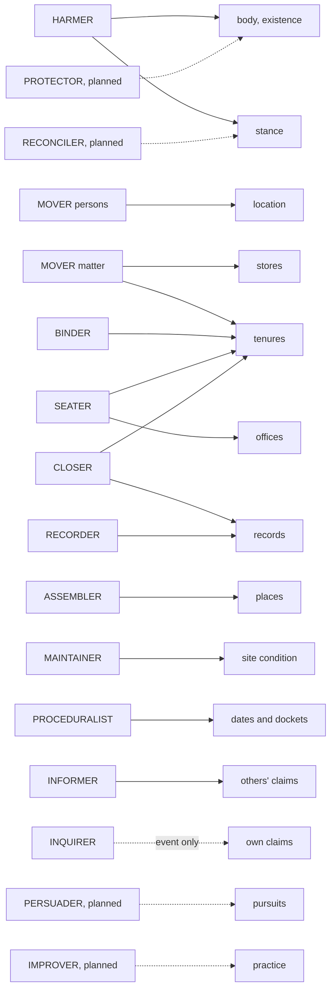
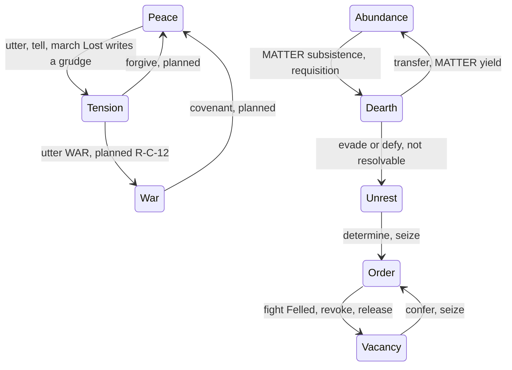

# Persons, attributes and verbs: the v2 synthesis — part 6: what verbs do to the world (II): signatures, roles, the framework, the assessment

## Status: PROPOSED (2026-10-16). Not ratified; merging ratifies nothing unless Jordan so rules. Static reading only. [CHECKED] = opened in this pass; NOT CHECKED names the run that would settle a claim.
## Parts, in reading order: [head](2026-10-16-v2-person-troop-attribute-synthesis.md) · [`_part2`](2026-10-16-v2-person-troop-attribute-synthesis_part2.md) · [`_part3`](2026-10-16-v2-person-troop-attribute-synthesis_part3.md) · [`_part4`](2026-10-16-v2-person-troop-attribute-synthesis_part4.md) · [`_part5`](2026-10-16-v2-person-troop-attribute-synthesis_part5.md) (Part IV §IV.0–§IV.5) · **this file** (Part IV §IV.6–§IV.13) · [`_part7`](2026-10-16-v2-person-troop-attribute-synthesis_part7.md) · [`_part8`](2026-10-16-v2-person-troop-attribute-synthesis_part8.md) (Part V: the trial).

The 46 shipped rows' writes, events and refusals were read from `engine/season/verb_table.yaml` by
script (`scratchpad/v2/vt_sig.txt`) [CHECKED]. The effects present are the 30 `@effect_for` bodies
in `loop/effects_*.py` [CHECKED by grep]. The 16 rows with no effect body write nothing in the
world: `comply`, `dispatch`, `evade / defy`, `exchange`, `challenge`, `construe`, `speak`,
`succeed`, `tell`, `examine`, `interview`, `research`, `surveil`, `thread_read`, `reconstruct`,
`tie / knot`.

---

### IV.6 The effect taxonomy

Any outcome is classified on eight dimensions:

| dimension | values | read from |
|---|---|---|
| WHAT changes | create · modify · move · destroy · inform | the row's `writes`; WITNESS for inform |
| WHERE | self · another person · a place · a holding · the realm | `beneficiary`, `counterparty`, `scale` |
| WHO LEARNS | co-located (firsthand) · knot partners · document holders (told) · chronicle (told, public) · co-located obligees (inferred) · nobody | `rosters.yaml: witness_channels` (*"PRECEDENCE, strongest first"*) [CHECKED] |
| WHEN | immediate · on a term · on a clock (ttl, decay, date) | `Tenure.term`, `Record.ttl`, `Claim.confidence` (MATTER), `Date.due_at` |
| REVERSIBILITY | which act undoes it, if any | the closers (§IV.9, CLOSURE) |
| COST | a scene (every act) · stores · body · coherence (thread, planned) | `decision/budget.py`; effects |
| RISK | what failure writes | `writes` by degree; `emits_on_refusal` |
| DEGREE LADDER | Overwhelming / Success / Partial / Failure (sigma); Felled / Wounded / Undecided (combat); Declared / Won / Lost / Unopposed (field); flat (uncontested) | `verb_table.yaml`; `rosters.yaml: combat_degree_bands`, `field_degree_bands` |

**The degree ladder in practice.**

- Only 4 of 46 rows grade their writes: `tell`, `fight`, `accept`, `march`.
- The other 42 are flat. The act lands whole or is refused, and a refusal deposits its refusal kind
  as a belief (`options.py:66-69`: *"`W-B` will deposit that refusal as a belief"*) [CHECKED].
- `tell`'s three success bands write nothing and transmit content. Its Failure transmits nothing
  (`witness.py:735-740`) [CHECKED].

### IV.7 Outcome signatures, grouped by role

**Roles were derived from the signatures, not before them.** Each shipped verb takes the role named
by the carrier it changes first. The roster has 13 roles that ship and 7 that exist only in the plan
or in design.

| role | shipped verbs | writes | events (examples) | who learns | reversed by | cost |
|---|---|---|---|---|---|---|
| **HARMER** | `fight`, `accept`, `march` | `Person.body`, `Person.exists`, `Tenure.until` (Felled); `Person.stance`, `travel_leg` (march) | `person.died`, `body.changed`, `field.won`, `army.arrived` | co-located; the losing side's grudge is written to its own stance | body: none shipped (`tend` planned); death: none (ruled); stance: none shipped (`forgive` planned) | a scene; the actor's own body at risk |
| **MOVER of persons** | `move`, `migrate` | `Person.travel_leg`, `Tenure.until`/`since` (`contain`, `reside`) | `travel.moved`, `residence.changed` | co-located at origin and destination | another `move` | a scene; travel legs cost scenes (`budget_leg_penalty`) |
| **MOVER of matter and holdings** | `transfer`, `requisition`, `give`, `seize`, `exchange` (declined) | `Rung.stores` ×2, `Tenure.term` (transfer renews upkeep); Tenures (give, seize) | `transfer.made`, `term.renewed`, `requisition.taken`, `record.given`, `rung.seized` | co-located; document holders | the reverse transfer; `seize` back; `release` | the stores moved |
| **BINDER** | `commit`, `oblige`, `tie / knot` (declined) | `Tenure.since`, `Tenure.term` | `commitment.made`, `duty.taken`, `bond.formed` | co-located; obligees (inferred) | `release`; term lapse via renewals | a scene; upkeep (oblige) |
| **SEATER** | `confer`, `establish`, `succeed` (declined) | `Tenure.since`/`until`/`term`/`payload`; `Office.exists`, `remit_acts` | `tenure.opened`, `office.established`, `remit.changed` | co-located; chronicle, meant public (NOT CHECKED whether it fires, §IV.5 (2)) | `revoke`, `release`; an office: **none** | a scene |
| **CLOSER** | `release`, `revoke`, `destroy_record` | `Tenure.until`; `Record.exists` | `tenure.closed`, `commitment.ended`, `record.destroyed` | co-located; chronicle (revoke, release) | `confer`, `commit` again; a Record: none | a scene |
| **ASSEMBLER** | `found`, `build` | `Rung.exists`, `Site.exists`, `Tenure.since`, `Rung.stores` (spent) | `rung.founded`, `site.built` | co-located | **none shipped** (`raze` planned) | stores |
| **MAINTAINER** | `work`, `restore` | `Site.condition` (up) | `site.worked`, `site.restored` | co-located | wear (MATTER); `sabotage` planned | a scene |
| **RECORDER** | `create_record`, `forge`, `issue`, `petition`, `utter` | `Record.exists`, `Record.stages`; `Proposition.exists` | `record.created`, `record.forged`, `dispensation.issued`, `petition.filed`, `proposition.uttered` | co-located; document holders | `destroy_record`, ttl; a Proposition: **none** (immutable) | a scene |
| **PROCEDURALIST** | `open_case`, `carry`, `convene`, `determine` | `Record.*`, `DocketItem.matter`, `Date.due_at`, `ConveningCondition`; `Tenure.since` (determine opens `detain`/`ban`) | `case.opened`, `petition.carried`, `date.scheduled`, `matter.determined` | co-located; chronicle (convene, determine) | `determine` closes a case; a sentence: `pardon` planned | a scene |
| **INFORMER** | `tell`, `speak`, `challenge`, `dispatch` | nothing in the world; `tell` moves content into the hearer's ledger | `news.told`, `confidence.broken`, `speech.made`, `challenge.issued`, `order.given` | `tell`: the hearer gets content; others only *that* it happened (`witness.py:714`) | — (a claim decays; none is unsaid) | a scene |
| **INQUIRER** | `examine`, `interview`, `research`, `surveil`, `reconstruct`, `thread_read`, `survey` | nothing (survey: a Record) | `finding.made` / `finding.none`, `faction.surveyed` | the actor (an event-kind claim); **no content yield** (R-C-23) | — | a scene |
| **RESPONDER** | `comply`, `evade / defy`, `construe` | nothing | `compliance.given`, `compliance.withheld`, `terms.distorted` | co-located | — | a scene |

**Planned and designed roles [DESIGN where no source specifies the outcome].**

| role | verbs | the outcome it should have, and the source or reason |
|---|---|---|
| **PROTECTOR / HEALER** | `tend` (plan); `ward` [DESIGN; PARKED by the trial] | `tend` writes `Person.body` up (Template row 49, the §9 row). `ward` [DESIGN]: raises the Ob of a thread operation aimed at the warded person; no source specifies it. Parked until a person-aimed operation executes; its first form is the target's standing in the working's Ob, not a row (Part V §V.3) |
| **DEGRADER** | `sabotage`, `raze` (plan) | `sabotage`: `Site.condition` down (§9 row). `raze`: ends a Rung or Site (IN-12 step 11). Both [DESIGN] on witnessing: sabotage should be concealable, raze public |
| **PERSUADER** | `argue` (plan) | target: the hearer's pursuits (the §9 row), sigma-contested. [DESIGN]: the size of a pursuit move per degree is unspecified; `Person.pursuits` is unproduced (H-62) |
| **IMPROVER** | `train` (plan) | writes `Person.capability` only where a case names a vocation (J-13 (iii)) |
| **RECONCILER** | `forgive` (plan) | writes the forgiver's stance (the §9 row) |
| **CONCEALER** | `conceal` (plan) | writes a `cover` Record whose terms is the actor; read at witnessing to withhold the doer [DESIGN: the read is unspecified]. The trial adds a `scope: room` cover that withholds the co-located `who`, and a degree-keyed break that exposes the doer of a failed act (Part V §V.2.10) |
| **THREAD-WORKER** | `weave`, `sever`, `mend`, `thread_read` (stubs, R-C-18) | writes `(Person, coherence)` through the seam (R-C-18); a thread binding made or broken. The trial corrects "Mending lowers the Calamity": that arm is `restore`'s (IN-35); `mend` is the only raiser of coherence and `weave` the producer of strain (Part V §V.2.6) |
| **KIN-MAKER** | `marry` [DESIGN; PARKED by the trial] | opens a kin relation, only if kin is carried with a reader; the gate is K-NPC-6 (Jordan), not J-T3, which answers the template only (Part V §V.3) |

**Merged and rejected verbs inherit their target's signature** (Part III's tables give each target).

### IV.8 Roles against carriers

| role | body / exists | stance | location | Tenure open | Tenure close | stores | places | Site condition | Records, Propositions | offices | dates, dockets | others' claims | own claims | pursuits | practice | coherence |
|---|---|---|---|---|---|---|---|---|---|---|---|---|---|---|---|---|
| HARMER | ● | ● (down) | ● (march) | ● | ● | | | | | | | | | | | |
| MOVER (persons) | | | ● | ● | ● | | | | | | | | | | | |
| MOVER (matter) | | | | ● | ● | ● | | | | | | | | | | |
| BINDER | | | | ● | | | | | | | | | | | | |
| SEATER | | | | ● | ● | | | | | ● | | | | | | |
| CLOSER | | | | | ● | | | | ● | | | | | | | |
| ASSEMBLER | | | | ● | | ● | ● | | | | | | | | | |
| MAINTAINER | | | | | | | | ● (up) | | | | | | | | |
| RECORDER | | | | | | | | | ● | | | | | | | |
| PROCEDURALIST | | | | ● | | | | | ● | | ● | | | | | |
| INFORMER | | | | | | | | | | | | ● (tell) | | | | |
| INQUIRER | | | | | | | | | ● (survey) | | | | ○ (event only) | | | |
| RESPONDER | | | | | | | | | | | | | | | | |
| *PROTECTOR (plan)* | ◆ (up) | | | | | | | | | | | | | | | ◆ (ward) |
| *DEGRADER (plan)* | | | | | | | ◆ (down) | ◆ (down) | | | | | | | | |
| *PERSUADER (plan)* | | | | | | | | | | | | | | ◆ | | |
| *IMPROVER (plan)* | | | | | | | | | | | | | | | ◆ | |
| *RECONCILER (plan)* | | ◆ (up) | | | | | | | | | | | | | | |
| *THREAD-WORKER (stubs)* | | | | | | | | | | | | | | | | ◆ |

● shipped · ○ event-kind only · ◆ planned or designed.

**What the matrix shows.**

- Interior state (pursuits, practice, conviction) and the raising of body and stance have **no
  shipped writer**. Every shipped arrow into a person's interior lowers it (harm, grudge).
- Every planned arrow raises or reshapes it (tend, forgive, argue, train).
- So the shipped world can damage persons and cannot change their minds.

### IV.9 The framework: ten checkable criteria

Each criterion is a test over the verb × outcome × motive tables, with the current verdict on the
46 shipped rows where a static reading settles it.

1. **COVERAGE.** *Every carrier dimension has an act that raises it and one that lowers it.*
   - **Verdict: FAIL on 9 dimensions.** One direction only: `Person.body` (no shipped raiser);
     `Person.stance` (acts only lower it); `Person.pursuits`, `conviction`, `capability` (no shipped
     writer); `Rung.exists`, `Site.exists` (no destroyer until `raze`); `Office.exists` (no closer);
     claims in ledgers (no unsaying, only decay).
   - `Proposition.exists` is one-directional **by design** (immutable). That is not a defect.
   - *For the designed verbs:* `tend`, `forgive`, `argue`, `train`, `raze` and `sabotage` each close
     one of these gaps. They are the planned verbs with the strongest N-lines.
2. **REACHABILITY.** *Every verb is preferred by at least one motive under some state.*
   - **Verdict: FAIL, structurally, for 6** (`carry`, `restore`, `tell`, `examine`, `interview`,
     `thread_read` score 0 on values; only the stance term can raise them).
   - **20 shipped rows executed zero times in four seeded realm seasons** (Template §10 probe 6,
     [RAN] in v1).
   - NOT CHECKED beyond four seasons (run: 20 seasons × 10 seeds, per-verb execution counts, and for
     each zero, which `opening_set` clause removed it, from its trace).
3. **DOMINANCE.** *No verb is ranked above another for every person by the value term alone.*
   - **Verdict: FAIL** (static, from the cells):
     - `issue` ≡ `seize`, and `transfer` ≡ `exchange` (identical vectors);
     - `revoke` / `issue` / `seize` / `dispatch` / `convene` and `transfer` / `move` / `work` /
       `give` / `utter` are one-axis families, so their relative order is the same for every person
       and flips only with the sign of one weight;
     - `fight` and `accept` have identical writes and different cells, so the choice between them is
       made by the value term alone, on an outcome that is the same.
   - *For the designed verbs:* a new verb must not land in a one-axis family without a reason.
4. **CLOSURE and INVERSES.** *Every opening act has a closing act or a clock.*
   - **Verdict: PARTIAL.** Closed:
     - `hold` by `revoke` and `release`;
     - `commit` and `oblige` by `release`, and `oblige` also by term lapse;
     - Records by `destroy_record` and ttl;
     - dockets by `determine`;
     - dates by CALENDAR.
   - Unclosed:
     - an office (no act);
     - a Rung or Site (until `raze`);
     - a `detain` / `ban` sentence (`pardon` is planned; whether `revoke` reaches those kinds is
       NOT CHECKED);
     - `tie / knot` (effect declined).
5. **CONSERVATION.** *Matter and weight are conserved by acts; only declared sources and sinks change
   totals.*
   - **Verdict: PASS by row shape [INFERRED].** `transfer` and `requisition` write `Rung.stores`
     twice (a debit and a credit). `found` and `build` spend. No act creates matter. Weight is
     CENSUS's alone.
   - NOT CHECKED (run: a season's store total against yield − subsistence − spend).
6. **ESCALATION.** *Ladders from mild to extreme exist, and each rung is reachable.*
   - **Verdict: the rungs exist in part:**
     - speech: `tell` → `argue` (plan) → `petition` / `open_case` → `determine` → `seize`;
     - violence: `challenge` → `fight` → `march`;
     - war: `utter` WAR (R-C-12, plan) → `march` → `seize` / `raze` (plan) → `covenant` (plan).
   - Executed in the four-season probe: `challenge` 14, `fight` 16, `march` 18, `open_case` 8,
     `determine` 3.
   - The top rungs (`seize`, `raze`, `covenant`, `argue`) had not shipped then. NOT CHECKED since.
7. **WITNESS CONSISTENCY.** *What the actor does and what the world believes may diverge only through
   an act that makes them diverge (a lie, a cover, a forgery).*
   - **Verdict: consistent, and therefore deception-free.**
     - Content travels only by `tell`.
     - No cover exists (`conceal` is planned).
     - No lie exists (J-C-6).
     - A forgery's quality is read by nothing (H-210).
     - Inquiries yield no content (R-C-23).
   - The world cannot be fooled, which narrows R-WORLD's intrigue half.
8. **RISK SYMMETRY.** *A failed act writes something.*
   - **Verdict: FAIL for 42 of 46.** Only `tell`, `fight`, `accept` and `march` have a failure band
     that writes (or emits) something other than a refusal. For the rest, failing means being
     refused, at the cost of a scene [INFERRED from the budget: every act occupies a scene].
9. **PLAYER LEGIBILITY.** *The effect is predictable from the verb's name.*
   - **Verdict: FAIL for 16.**
     - Names that suggest a change and write nothing: `dispatch`, `challenge`, `speak`, `construe`,
       `comply`, `evade / defy`.
     - Effects declined: `succeed`, `exchange`, `tie / knot`.
     - The six inquiries yield no finding's content.
     - `survey` writes a Record rather than informing the surveyor.
10. **STATE-LOOP.** *The world has regimes, and verbs chosen by motives move it between them in both
    directions.*

**State-loop verdict.**

- Every return edge to a calmer regime is planned or unresolvable: `covenant`, `forgive`, and
  `evade / defy` on the way out of dearth.
- The shipped game can escalate and cannot de-escalate except through MATTER's yield and `confer`.
- NOT CHECKED (run: regime occupancy over 20 seasons, against a no-acts control).
- **The trial's named acts on these edges (Part V, all unbuilt):** Tension → War is `declare (war)`,
  a preset of `utter` made a seat's act at `at_war`; War → Peace gains the loser's edge,
  `surrender` (a preset of `give` of a Rung); Order → Vacancy gains `abdicate` (a resignation kind on
  `release`); Dearth's root gains a demand the ruled can answer (`tax`, a `due` on `issue`) and its
  exit a relief witnesses read as care (`relief.given`). `seize` never takes a seat
  (`verb_table.yaml:911`) [CHECKED]: on the Vacancy → Order edge it takes an occupied settlement or a
  held Record, never the vacant seat itself.

### IV.10 The assessment table

Generated by script from the verb table and the alignment cells (`scratchpad/v2/assess.md`)
[CHECKED]. *Executed* is v1's four-season realm probe (Template §10 probe 6, [RAN]).

| verb | role | writes | values cell | executed (4 seasons) | DOMINANCE | COVERAGE (an act reverses it) | RISK (graded failure) | LEGIBILITY |
|---|---|---|---|---|---|---|---|---|
| `carry` | PROC | 2 pairs | 0 on all axes | 0 (not resolvable) | n/a (no cell) | pass | FAIL (refusal only) | pass |
| `commit` | BIND | 1 pair | 2 axes | 1 | pass | pass | FAIL | pass |
| `comply` | RESP | 0 | 3 axes | 0 | pass | — (writes nothing) | FAIL | FAIL: writes nothing |
| `confer` | SEAT | 3 pairs | 2 axes | 1 | pass | pass | FAIL | pass |
| `convene` | PROC | 2 pairs | 1 axis | 0 | FAIL: one-axis family (hierarchical) | pass | FAIL | pass |
| `create_record` | REC | 2 pairs | 1 axis | 187 | FAIL: one-axis family (precedent) | pass | FAIL | pass |
| `destroy_record` | CLOSE | 1 pair | 2 axes | 0 | pass | pass | FAIL | pass |
| `determine` | PROC | 2 pairs | 2 axes | 3 | pass | pass | FAIL | pass |
| `dispatch` | INFORM | 0 | 1 axis | 13 | FAIL: one-axis family (hierarchical) | — | FAIL | FAIL: writes nothing |
| `establish` | SEAT | 3 pairs | 2 axes | 0 | pass | FAIL: no closer for an office | FAIL | pass |
| `evade / defy` | RESP | 0 | 3 axes | 0 (not resolvable) | pass | — | FAIL | FAIL: writes nothing |
| `exchange` | MOVE-M | 1 pair | 1 axis | 0 (not resolvable) | FAIL: identical to `transfer` | pass | FAIL | FAIL: effect declined |
| `forge` | REC | 1 pair | 2 axes | 0 (not resolvable) | pass | pass | FAIL | pass |
| `found` | ASSEM | 3 pairs | 3 axes | 0 | pass | FAIL: `raze` planned | FAIL | pass |
| `build` | ASSEM | 2 pairs | 2 axes | 0 | pass | FAIL: `raze` planned | FAIL | pass |
| `give` | MOVE-M | 2 pairs | 1 axis | 1 | FAIL: one-axis family (deontological) | pass | FAIL | pass |
| `issue` | REC | 1 pair | 1 axis | 5 | FAIL: identical to `seize` | pass | FAIL | pass |
| `fight` | HARM | 3 pairs | 2 axes | 16 | pass | FAIL: no raiser of body (`tend` planned); no act creates a person (ruled) | pass | pass |
| `challenge` | INFORM | 0 | 3 axes | 14 | pass | — | FAIL | FAIL: writes nothing |
| `accept` | HARM | 3 pairs | 3 axes | 28 | pass | as `fight` | pass | pass |
| `requisition` | MOVE-M | 1 pair | 2 axes | 0 | pass | pass | FAIL | pass |
| `march` | HARM | 5 pairs | 4 axes | 18 | pass | FAIL: no raiser of stance (`forgive` planned) or body (`tend` planned) | pass | pass |
| `migrate` | MOVE-P | 3 pairs | 3 axes | 0 | pass | pass | FAIL | pass |
| `move` | MOVE-P | 3 pairs | 1 axis | 55 | FAIL: one-axis family (deontological) | pass | FAIL | pass |
| `oblige` | BIND | 2 pairs | 3 axes | 16 | pass | pass | FAIL | pass |
| `open_case` | PROC | 3 pairs | 3 axes | 8 | pass | pass | FAIL | pass |
| `petition` | REC | 1 pair | 2 axes | 28 | pass | pass | FAIL | pass |
| `construe` | RESP | 0 | 4 axes | 0 (not resolvable) | pass | — | FAIL | FAIL: writes nothing |
| `release` | CLOSE | 1 pair | 2 axes | 12 | pass | pass | FAIL | pass |
| `restore` | MAINT | 1 pair | 0 on all axes | 0 | n/a (no cell) | pass | FAIL | pass |
| `revoke` | CLOSE | 1 pair | 1 axis | 0 | FAIL: one-axis family (hierarchical) | pass | FAIL | pass |
| `seize` | MOVE-M | 2 pairs | 1 axis | n/a (shipped later) | FAIL: identical to `issue` | pass | FAIL | pass |
| `speak` | INFORM | 0 | 1 axis | 70 | pass | — | FAIL | FAIL: writes nothing |
| `succeed` | SEAT | 1 pair | 1 axis | 0 (not resolvable) | FAIL: one-axis family (precedent) | pass | FAIL | FAIL: effect declined |
| `survey` | INQ | 1 pair | 3 axes | 10 | pass | pass | FAIL | FAIL: writes a Record, not a finding |
| `tell` | INFORM | 0 | 0 on all axes | 36 | n/a (no cell) | — | pass | pass |
| `examine` | INQ | 0 | 0 on all axes | 0 | n/a (no cell) | — | FAIL | FAIL: no yield |
| `interview` | INQ | 0 | 0 on all axes | 20 | n/a (no cell) | — | FAIL | FAIL: no yield |
| `research` | INQ | 0 | 2 axes | 25 | pass | — | FAIL | FAIL: no yield |
| `surveil` | INQ | 0 | 1 axis | 56 | FAIL: one-axis family (hierarchical) | — | FAIL | FAIL: no yield |
| `thread_read` | INQ | 0 | 0 on all axes | 0 (not resolvable) | n/a (no cell) | — | FAIL | FAIL: no yield |
| `reconstruct` | INQ | 0 | 2 axes | 111 | pass | — | FAIL | FAIL: no yield |
| `tie / knot` | BIND | 1 pair | 3 axes | 0 (not resolvable) | pass | pass | FAIL | FAIL: effect declined |
| `transfer` | MOVE-M | 2 pairs | 1 axis | 3 | FAIL: identical to `exchange` | pass | FAIL | pass |
| `utter` | REC | 1 pair | 1 axis | 113 | FAIL: one-axis family (deontological) | FAIL: immutable by design | FAIL | pass |
| `work` | MAINT | 1 pair | 1 axis | 0 | FAIL: one-axis family (deontological) | pass | FAIL | pass |
| *PROTECTOR (`tend`, `ward`)* | — | ◆ | none yet | — | owed: cells must not join a one-axis family | closes body's gap | owed | owed |
| *DEGRADER (`sabotage`, `raze`)* | — | ◆ | none yet | — | owed | closes places' gap | owed | owed |
| *PERSUADER (`argue`)* | — | ◆ | none yet | — | owed | closes pursuits' gap | sigma-graded (pass when built) | owed |
| *IMPROVER, RECONCILER (`train`, `forgive`)* | — | ◆ | none yet | — | owed | close practice's and stance's gaps | owed | owed |
| *CONCEALER (`conceal`)* | — | ◆ | none yet | — | owed | makes WITNESS CONSISTENCY testable | owed | owed |

"Writes" counts distinct carrier.field pairs. "One-axis family" means the value term ranks the
family's members in the same order for every person, flipping only with the sign of one weight.

### IV.11 Does the chooser see what modulates the outcome?

**This is the finding of Part IV.**

| node type | modulates the outcome through | does the chooser's scoring see it? | verdict |
|---|---|---|---|
| ACTOR: body | the combat pool (`end`); scenes | scenes only (budget) | **partial**: the odds are unseen |
| ACTOR: capability | sigma pool and Ob | no: *"supplies dice and GATES NOTHING"* (`options.py:478-479`, v1 CHECKED-draft) | **mismatch** |
| ACTOR: stance | the stance term; regard | yes (`stance_toward` the subject) | **match** |
| ACTOR: ledger | `own_ledger` gates; the told content | as a veto (known-false) and as the question source | **partial**: never as a preference |
| ACTOR: tenures and offices | eligibility; purview; treasury | eligibility (remit via hold) and scenes; attention tier 1 | **partial**: purview is unseen |
| SUBJECT / referent | existence, relation, stance | the referent set; the stance term | **match** for stance; **mismatch** for the subject's capacity |
| SEAT exercised | remit, purview | remit yes; purview no | **partial** |
| PLACE | presence eligibility; march targets | `presence:` **declines person-side** (`options.py:92-95`) | **mismatch** |
| OBLIGATION / TERM | `_req_oblige` clause 4; upkeep; renewals | only via a known-false claim | **mismatch** |
| BELIEF of others | reception: refraction, `teller_weight` | no | **mismatch**: a teller does not weigh how his hearer will take it |
| WITNESS set | who learns | no | **mismatch**: the chooser cannot prefer an unseen act |
| CLOCK | terms, ttl, decay, dates | no (urgency is inert) | **mismatch** |
| RESOURCE | the stores threshold; dearth | operands only (`store_kind_of` from a shortfall claim) | **partial**: shortage shapes the act, not its value |
| THIRD PARTY's capacity | the Ob | no | **mismatch** |
| RULE context | basis, warrant | `warrant_sourced` narrows candidates | **match** as a gate |
| CONTENTS (amount, kind, object) | effect size; target selection | no: the value term reads the verb alone | **mismatch** |

**Count:**

- **3 matches**: stance, subject stance, rule;
- **5 partial**: body, own ledger, offices, seat, resources;
- **8 mismatches**: capability, place, obligations, others' beliefs, witnesses, clock, the third
  party's capacity, contents.

**Consequence for any change to the decision matrix.** A change is an improvement by this framework
only if it moves one row from mismatch toward match **through the person's own beliefs**. Two
examples:

- a value term over contents (an alignment cell per object kind);
- a risk term over believed odds (the person's claims about the opponent).

A change that reads the world directly fails the epistemic design (§IV.0).

### IV.12 What this says about the attributes

**Claim.** Under any attribute set in Part II, attributes can move only the carriers the HARMER role
writes (body, existence, stance, location), plus, through practice, the reception of claims. The
economy, offices, records, places and values are attribute-blind in every set.

| attribute | through which verbs | carriers it can move |
|---|---|---|
| STR, AGI, END, FOC, ACU, WIL, ATT | `fight`, `accept` (combat stub, T2) | `Person.body`, `Person.exists`, `Tenure.until` (death) |
| CHA, ACU | `march` (Command, T2; not in the season field, fixed at 4) | `Person.body`, `Person.stance`, location, `Tenure` (arrival) |
| WIL, TS, BON | `tie / knot`; thread operations (T2; rows unbuilt) | a bond Tenure (if built); `(Person, coherence)` and thread state (R-C-18) |
| PRA (not an attribute) | `tell`, `determine`, `argue`, `interrogate`, the inquiries | others' claims; dockets and sentences; pursuits (argue, planned) |
| REC, TMP, RES | — | none |

**The same framework assesses an attribute set.** A set earns its slots by the number of COVERAGE
dimensions its verbs can move.

- Today's nine, the recommended ten and the From-scratch fourteen all reach the same four
  dimensions. The fourteen's extra members (forethought, composure, nerve) would need verbs that read
  them in the economy, in inquiry and in the chooser. None exists.
- **So the decision about attributes is downstream of a decision about readers.** That is Part II's
  conclusion, reached here from the world's side.

### IV.13 Does the modulation model need a vector field?

**Verdict: no.** What the framework needs already exists in kind:

- a **verb × dimension matrix**: the alignment table, verb × the seven axes;
- a **typed graph** of contextual nodes and edges, whose per-node state is a small vector.

A vector field would be warranted only if an outcome had to vary smoothly with continuous distance,
or if a quantity had to diffuse and be conserved over space. Neither holds in the code, which is a
graph with discrete purview and co-location.

**(a) Already vector-valued** (static reading) [CHECKED]:

- `Person.pursuits` (15 weights) and its projection onto 7 axes (`projected_axes`, `person_q.py:564`);
- `Person.conviction` (affiliation → intensity);
- `Person.scar` (element → count);
- `Person.capability` (key → value);
- `Person.stance` (a list of rows toward persons and seats, `carriers.py`: `stance: list[tuple]`);
- `Rung.stores` (kind → amount).

**(b) Matrix-valued:**

- `tables.alignment` (verb × 7 axes);
- `tables.pursuit_projection` (15 × 7);
- `tables.incompatible` (affiliation pairs);
- `pursuit_cosine` compares two pursuit vectors (`data/pursuits.py:109`).

**(c) Where a field-like construct would be natural:**

- the adjacency Query R-C-7 (contiguity, spread, distance from the parsed geography);
- persisting dearth (J-C-30);
- the propagation of news beyond co-location (today a FILTER over held claims, `reach` / `place_of`,
  *"never as a new witness channel"*, `rosters.yaml: question_sources` note) [CHECKED].

**The test that would justify one:** an outcome that must vary smoothly with distance, such as rumour
confidence decaying by hops, or dearth spilling into neighbours in proportion to adjacency, AND a
propagation that must be conserved and diffused. Each is [INFERRED]; no source asks for either
today.

**(d) The cost:**

- a new carrier (a per-node field state);
- a new step (a diffusion clock, which `CLAUDE.md`'s licensed-clock discipline would have to admit);
- a new content-hash term.

The benefit is smooth spread. A graph signal gives the same at lower cost: per-node vectors, edge
weights from R-C-7, and one diffusion step.

**(e) Recommendation.** Do not build a vector field. If spread is wanted, build R-C-7's adjacency
Query first, then a signal on that graph. Build it only when a named outcome fails without it.
