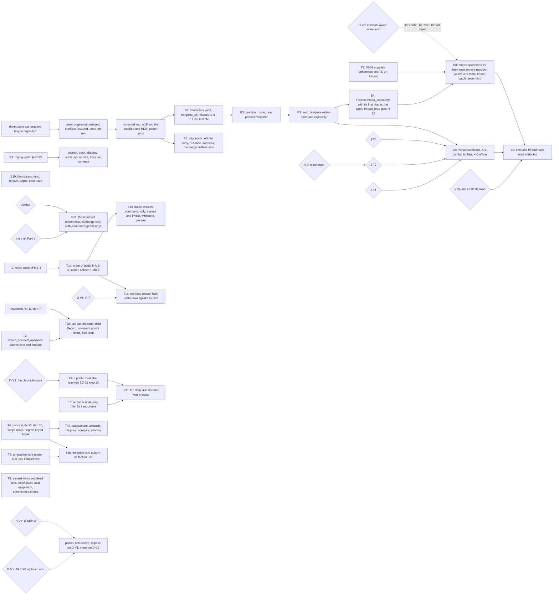

# Persons, attributes and verbs: the v2 synthesis — part 7: Roadmap, Reliability ledger, Sources, Trial registry

## Status: PROPOSED (2026-10-16). Not ratified; merging ratifies nothing unless Jordan so rules.
## Parts, in reading order: [head](2026-10-16-v2-person-troop-attribute-synthesis.md) · [`_part2`](2026-10-16-v2-person-troop-attribute-synthesis_part2.md) · [`_part3`](2026-10-16-v2-person-troop-attribute-synthesis_part3.md) · [`_part4`](2026-10-16-v2-person-troop-attribute-synthesis_part4.md) · [`_part5`](2026-10-16-v2-person-troop-attribute-synthesis_part5.md) · [`_part6`](2026-10-16-v2-person-troop-attribute-synthesis_part6.md) · **this file** · [`_part8`](2026-10-16-v2-person-troop-attribute-synthesis_part8.md) (Part V: the trial of the new verbs).

---

## 5. THE INTEGRATED ROADMAP (persons, attributes, verbs)

**Claim.**

- **Five builds need no ruling and should go first:** the template's shape (B1–B3), TS's carrier
  (B4), and the alignment cells the chooser lacks (B5).
- Every attribute build waits on J-T1. The roster closes on J-T2. The knot and thread readers wait
  on V-2a.
- The trial has ruled (Part V). Its build conditions are the T-nodes below: the force scale before
  any battle choice, the `kind`/`amount` keys before trade, credit, tax and embargo, a public route
  before SC-01 step 13 deletes `chronicle`, and `conceal` before the intrigue presets. Eight
  retirements of Part III survive the trial untried and still wait on Jordan.

**Each build, its gate and its falsifier.**

| build | gated by | falsifier |
|---|---|---|
| B1–B3 | nothing | the all-null control: the act log is unchanged with an empty template (Part I §I.6) |
| B4 | J-T1a, answered | the hash moves once, declared; `thread_read` becomes attemptable |
| B5 | nothing (cells are an `assumption` row, H-66) | `opening_set` rankings move for the six zero-scored verbs against the `uniform` sweep arm |
| B6 | J-T1, J-T2, J-T4 | two persons differing in one attribute differ in `fight`'s outcome rate, against the equal-attribute control |
| B7 | V-2a | — |
| B8 | B4 | — |
| B9 | — | a Success `research` leaves content in the actor's ledger (R-C-23) |
| B10 | IN-12 steps 9, 11, 13 (planned) | each closes one COVERAGE gap (Part IV §IV.9) |
| B11 | the trial (ruled), then Jordan | — |
| T1–T1d | nothing for T1; D-V5 for T1d | a season field is won in ≥1 seed; two fields identical but for the commander's attributes differ in survivor fraction, equal commanders byte-identical (Part V §V.2.5) |
| T2–T2b | `covenant` (IN-12 step 7) for its goods terms | a holder of a `due` transfers its `kind`/`amount` in ≥1 seed, a twin without the writ never; a borrower with a `debt` repays in ≥1 seed |
| T3–T3b | D-V3; T6 for war | the petitioner holds a claim of the denial, and the other head the declaring seat's `commit`, in the season it happens |
| T4–T4b | IN-12 step 10 | a covered actor's witnesses hold `seen.who = None`; an uncovered control is still named |
| T5–T5b | T4 and a recipient-side reader | a recipient holding an inducement chooses the sought act more often than a control without it |
| T7 | IN-06 (B-S) | `(Person, coherence)` and TS carriers exist; `weave` lowers coherence and `mend` raises it in one batch |
| T8 | nothing; K-FA-3 for the resignation kind | a witness's regard toward a relieving reeve rises against a twin paying the same to a rung not in shortfall |

**The decision table.**

| decision | options | effect | unblocks | recommended default | owner |
|---|---|---|---|---|---|
| **J-T1** the source of personal inputs | A derived · **B stored** · A-1 eight · (J-13 ii, orthogonal) | innate difference or practice only | B6, R-09 by-person, K-1, K-6, K-GO-8 | **B**, on J-13's narrow reading (Part I §I.5) | Jordan |
| **J-T2** the tenth, and the count | **TS** · TMP · Recall (with a reader) · RES · reopen to eight | which subsystem gains a by-person input | B6's roster; Godot fields bind | **TS**; keep ten (Part II §II.5) | Jordan |
| **J-T4** do attributes change | **none** · age · wounds | whether the bodies pass reaches attributes | B6's write rule | **none** (the code's state) | Jordan |
| **V-2a** an attribute at a gate or cap, or on a row without `contests:` | admit gates and caps (V-2a) · add `contests:` to `tie / knot` and the thread rows · neither | whether BON, WIL and TS reach knots and threads | B7 | **V-2a for gates and caps; `contests:` on the thread rows when they ship; inquiry stays uncontested** | Jordan (V-2 is carried binding by the plan, `_part7.md:51`) |
| **R-0** the from-scratch fourteen | rerun under a neutral brief · correct in place · drop | whether forethought, nerve or composure has a case | J-T2's evidence | **rerun** (Part II §II.6) | whoever commissions it, Jordan informed |
| (answered) J-T3 kin | (i) not carried · (ii) carried with a reader | — | nothing | (i) [medium]; revert by ruling. The template only: the live half is K-NPC-6 (D-V2) | v1, ladder step 5 |
| (frame) J-C-6 do persons lie | yes · no | whether WITNESS CONSISTENCY can fail (Part IV §IV.9) | `lie`, `conceal`, `forge` readers; the trial's parked `lie` and held `construe` (D-V4) | not this document's call | Jordan (Comparative C7) |
| **D-V1** ARC-40's replaced arm | the 2026-10-12 ruling covers every route · a removal basis on `revoke` | an unremovable or a removable king | `depose` (parked) | none: PARK (Part V §V.5.1) | Jordan |
| **D-V2** K-NPC-6 kin as a tie kind | dynastic · title | marriage alliances and heirs by blood, or heirship as a title | `marry` (parked) | none: PARK | Jordan |
| **D-V3** the public route after SC-01 step 13 | keep `chronicle` · a named surviving channel · co-located only | whether a denial and a war reach the absent party | T3, T3b | **a named surviving channel** | the SC-01 owner; Jordan only if step 13's deletion is a ruling |
| **D-V5** R-7 | every Lost army stays at origin · withdrawn differs from routed | whether `retreat` has a season half | T1d | **distinguish** | Jordan (`[ASSUMPTION; Jordan to correct]`) |
| **D-V6** a contents-aware value term or `(verb, kind)` key | build · refuse | `bribe`, `lie` and the thread rows' form; `declare (war)` needs a row if refused | B8's count, T5b's form | **the mood-keyed cell first** | Jordan (Part IV §IV.11) |

---

## 6. RELIABILITY LEDGER

**Claim.** Every part of this work was produced and checked by one producer per artifact. Independent
critics checked the character template three times and the attribute derivation twice. **Three of
the final v1 artifacts have had no critic since their last revision:**

- the template's fourth pass;
- the derivation's third pass (the eleven);
- the divergence test.

The from-scratch work failed its only critic. Size each claim's trust accordingly.

| artifact | passes | critics (findings) | what the last critic saw | not checked |
|---|---|---|---|---|
| character template (3 files) | 4 | 3: `critics/CHAR_TEMPLATE.md` (22), `CHAR_TEMPLATE_2.md` (20), a third (13; its report is **not on disk**, only its reconciliation table in Template `_part3`) | the third pass | **the fourth pass (final) had no critic**; resolvable 37 by execution; probes 3–6 were re-run with artifacts in scratch (`tmpl/*.out`), not in the tree |
| attribute derivation (head, `_part2`, `_part3`, `_aptitudes`, `_equivalences`) | 3 | 2: a first critic (14 findings; report not on disk); the Opus critic `critics/ATTR_DERIVATION.md` | the second pass, which then recommended **the nine plus Recall** | **the third pass's eleven (re-framed by "ignore all prior rulings") had no critic**; the reproduction command was claimed diffed, not re-run here |
| divergence test | 1 | **none** | — | single producer; outputs in scratch (`div/`), not the tree; one matchup per resolver; TMP against an aggressive opponent |
| attributes from scratch (5 files) | 1 | 1 (findings summarized by the orchestrator; **not on disk**): CONTAMINATED | the only pass | no correction pass; etymologies from memory |
| research lane files | — | per-lane critics (scratch `critics/{PC,MB,...}.md`) | — | lane content beyond the rows cited here |
| this v2 | 1 | **none** | — | every carried locator not re-opened here keeps its v1 tag (§7.3); Part IV is static reading only; the alignment and verb-table extractions were by script this pass |
| the trial (Part V) | 1 per subsystem (ten courts) | per subsystem an advocate and a prosecutor (Sonnet) and a judge (Opus); **no critic** of any verdict or of the assembly | — | static reading; one model family; independence by instruction and file discipline only; the questions §V.7 lists need a run; the roll-up was checked by script over Part V's own tables |

**Known stale or shifted.**

- **v9 `_part5.md` line numbers.** The merge of `origin/main` (#483, #484) took the file from 475
  to 442 lines. Re-located this pass: J-13 `:400`, D2 `:411`, the charge `:68`, IN-12 `:54`
  [CHECKED]. Every other v1 `_part5.md` locator is [UNVERIFIED] until re-opened.
- **`seize`** shipped in #484 (`verb_table.yaml:898`). The verb table has 46 rows. v1's 45/12
  counts predate it.
- **`loop/predicates.py`.** `_req_oblige` is at `:339-396`. v1's `:394-395` was the old clause-4 line.
- **`_ch_chronicle`'s docstring** says the channel matches nobody, on a premise (no resolvable
  `binding_decision` verb) that no longer holds. Whether it fires today is NOT CHECKED by a run here;
  the same docstring now records realm measurements (positions `15d`, `17a`) in which it admits
  deposits (`engine/season/epistemic.py:546-572`) [CHECKED, in the trial's assembly], and SC-01 step
  13 deletes it (`workplans/valoria_master_workplan_v9_part6.md:68`) [CHECKED] (Part V §V.2.11).

**Etymologies.** All etymologies, in both `_equivalences` and the From-scratch work, are from memory
and unchecked against a dictionary. The Derivation's critic graded them *"essentially sound"* with
four caveats.

**The state of the branch.** The merge of `origin/main` (#483, #484) was resolved without running
tests or regenerating `TRACE.txt`, by instruction. `test_w15` and the weather and h134 golden pins are
expected red until re-recorded. PR #482 was squash-merged and the work continues as PR #485 on the
same tree.

---

## 7. SOURCES

### 7.1 The work distilled

- `proposals/2026-10-16-character-template.md`, `_part2.md`, `_part3.md`.
- `proposals/2026-10-16-attribute-derivation.md`, `_part2.md`, `_part3.md`, `_aptitudes.md`,
  `_equivalences.md`, `_divergence.md`.
- `proposals/2026-10-16-attributes-from-scratch.md`, `_part2.md` through `_part5.md`.
- Critics (session scratchpad, not in the tree):
  `/tmp/claude-0/-home-user-ttrpg/3f6de207-94f6-530b-a5b4-52aac53c2712/scratchpad/critics/CHAR_TEMPLATE.md`,
  `CHAR_TEMPLATE_2.md` and `ATTR_DERIVATION.md` (the troop-stock critics in the same directory are
  out of scope).
- `research/by_lane/00_COMPARATIVE_ANALYSIS.md` (C7, C8).
- **Not distilled here:** `proposals/2026-10-16-troop-stock-design.md` and `_part2.md` (out of
  scope).
- The trial (Part V): `_advocate.md`, `_prosecutor.md`, `_verdict.md` for the ten
  subsystems, `BRIEF.md`, `JUDGE_NOTES.md` and `rollup_check.py`, in
  `/tmp/claude-0/-home-user-ttrpg/3f6de207-94f6-530b-a5b4-52aac53c2712/scratchpad/trial/` (session
  scratchpad, not in the tree).

### 7.2 Opened in this pass (static reading)

- **Code and data:**
  - `engine/season/verb_table.yaml` (all 46 rows, by script);
  - `engine/season/write_matrix.yaml` (rows, retired);
  - `engine/season/rosters.yaml` (`question_sources`, `witness_channels`, `tables.alignment.cells`,
    `requires_forms`, `eligibility_kinds`, `referent_classes`, `strata`, `:75-90`);
  - `engine/season/data/fixtures.py` (`:286`, `:680`, `:688`, `:698`, `:796`, `:810`, `:837`);
  - `engine/season/decision/choose.py` (`:1-250`, `:393-486`), `options.py` (`:46-135`,
    `:295-396`), `budget.py` (`:40-76`);
  - `engine/season/queries/world_q.py:1879-1904`; `engine/season/loop/witness.py:705-760`;
    `engine/season/epistemic.py:331`, `:546-560`; `engine/season/loop/effects_combat.py:181-200`;
    `engine/season/loop/predicates.py:339-396`;
  - the `@effect_for` lines of `engine/season/loop/effects_*.py`;
  - `engine/substrate/descriptors.py:105-130`;
  - `references/descriptor_registry.yaml:27-48`, `:134-200`.
- **Rulings and plan:** `registers/editorial_ledger_in_archive.jsonl:137`;
  `architecture/meta/01_AXIOMS.md:561`;
  `proposals/2026-09-30-character-and-play-surface/10_verbs_and_attributes.md:198-199`;
  `workplans/valoria_master_workplan_v9_part4.md:41`, `_part5.md:54`, `:68`, `:400`, `:411`,
  `_part7.md:51`, `_part8.md:202`, `:207`, `:329`, `:340`.
- **Research:** `research/by_lane/{PC,MB,SC,FI,WR,SE,FA,NPC}_*.md`, the §1.2 and §2.2 tables (by
  extract).
- `skills/ners/SKILL.md` §2–§5.

### 7.3 Carried locators and their v1 tags

Every locator in this document without [CHECKED] is carried from the v1 document named beside it.
Its v1 tag stands:

- Template: [CHECKED], [CHECKED-3], [CHECKED-2], [CHECKED-draft], [RAN];
- Derivation: opened in its pass unless tagged *not opened*;
- From-scratch: unverified judgement.

Notable carried locators:

- `fieldwork_v30.md:301-306`, `:351` (Template, CHECKED in the fourth pass);
- `operations.py:235-247`, `:144`, `:157`, `:249-275` (Template CHECKED-3 / CHECKED; the
  divergence test CHECKED);
- `knots.py:185-222` (Template CHECKED-2);
- `exchange.py:57-66`, `:103-126` (Template CHECKED-2/3);
- `combatant.py:30-47`, `:93-94`, `:147` (Derivation critic, confirmed);
- `combat_systems.py:113`, `:171-188`, `:1416-1452` (Derivation critic, confirmed);
- `resolver.py:184-236` (Template CHECKED-2/3);
- `options.py:478-479` (Template CHECKED-draft).

---

## APPENDIX: TRIAL REGISTRY (new verbs only)

**Scope.** Per Jordan's instruction (2026-10-16), the items to be tried are the **new verbs**:

- every verb whose triage status is DESIGN (2: `ward`, `marry`);
- every lane-recommended verb that is neither a code row nor a plan position (23);
- one SET row per subsystem: that subsystem's distilled new-verb set.

Code and plan verbs appear only as **incumbents**, the existing verbs a new verb is tested against.

**Verdicts.** The *first-pass verdict* is this document's pessimistic NERS verdict (Part III). The
trial (advocate, prosecutor, judge) upholds or overturns it; the last column is the judge's verdict,
carried from Part V. Ids are the From-scratch work's V-ids (head §2.3). **The trial was wider than
this registry:** it tried all 86 designed verbs, not only the two DESIGN survivors, plus the 21
in-scope lane recommendations and the stub Past-pulling (108 items). The rows not listed here are in
Part V §V.3.

**Node types** (Part IV §IV.3): ACT actor · SUB subject · SEAT · PLACE · OBL obligation/term · BEL
belief · WIT witness set · CLK clock · RES resource · 3P third party · RULE.

| id | item | subsystem | first-pass verdict | case for | case against | incumbent(s) | absorbed as | locators for the trial | nodes | JUDGE'S VERDICT (Part V) |
|---|---|---|---|---|---|---|---|---|---|---|
| V083 | interpose | PC | MERGE into `fight` | a bystander entering a bout is an act of its own, with a protector's motive | the bout already admits parties; a third party is a context node of `fight` | `fight` | a party joining the bout's contents | `research/by_lane/PC_personal_combat.md:113`; v2 `_part3` PC | ACT, 3P, PLACE | **MERGE** into `fight`: a `parties` content of the scene, after K-PC-5 |
| V084 | rescue | PC | MERGE into `fight` (or `release` of a `detain`) | freeing a captive is a distinct goal with its own legibility | its outcome is a fight's, or a closing of a `detain` | `fight`, `release` | the subject is a captor; the purpose is freeing | `verb_table.yaml` fight, release rows | 3P, OBL, PLACE | **PARK**: `arrest` lands and a run holds a live `detain`; never widen `release` |
| V085 | champion | PC | MERGE into `challenge` | fighting for another has its own standing and stakes | a proxy party is a parameter of the challenge | `challenge` (itself MERGE into `fight` in Part III) | a proxy named in the terms | `_part3` PC | 3P, SEAT, SUB | **PARK**: a RULE disposal reads a duel's result; then a `proxy` on PC-10b's Record |
| V071 | muster | MB | REJECT (troop scope) | assembling forces is a visible act | out of scope; not distilled here | `march` | — | the troop-stock proposal (not distilled) | — | not tried (troop scope) |
| V086 | surrender | MB | MERGE into `covenant` | ending a field or a war on terms is the missing de-escalation (STATE-LOOP, Part IV §IV.9) | a covenant with terms already ends a conflict | `covenant` (plan) | covenant terms: the yielding party's holds | `research/by_lane/FA_faction_actions.md:58`; Part IV §IV.9 | 3P, OBL, SEAT | **KEEP WITH CONDITIONS**: named preset, `give` of a held Rung, optional `covenant` terms |
| V087 | storm | MB | MERGE into `march` | an assault differs from a march in risk and ferocity | its writes are a field's | `march` | the target is a walled place | `MB_mass_battle.md:156` | PLACE, 3P | **KEEP WITH CONDITIONS**: `march` posture `assault`; walls graded first |
| V088 | sack | MB | MERGE into `seize` | plunder is a distinct outrage, with its own witnesses | a seizure of stores | `seize` | object: stores; no warrant | `SE_settlements_territory_economy.md:104` | RES, PLACE, WIT | **MERGE** into `requisition` (occupation basis, `amount: all`, own kind), not `seize` |
| V092 | marshal | MB | REJECT (troop scope) | arranging an army is a commander's act | the order of battle is `march`'s operand | `march` | — | — | — | not tried (troop scope) |
| V073 | withdraw | SC | REJECT (a choice inside fight or a contest) | leaving a contest early is a strategic choice | IN-46 `{engage, withdraw}` is in-bout, an [ASSUMPTION] | `fight`, the contest | in-bout or in-contest choice | `workplans/valoria_master_workplan_v9_part4.md:34` (v1) | 3P | **MERGE** into `release`: the petitioner releases his own `hold` on the petition |
| V074 | deny | SC | MERGE into `destroy_record` | refusing a petition is a ruler's act the world should see | J-C-7 (a) keeps Layer 1's one-closer shape; (b) a deny row overwrites a Layer 1 row | `destroy_record`, `release` | closing a petition Record | Comparative C7 J-C-7 | SEAT, RULE, WIT | **KEEP WITH CONDITIONS**: named preset of `release` (the receiver's `hold`), J-C-7 option (c) |
| V075 | lie | SC | MERGE into `tell` | deception is the missing divergence between deed and belief (Part IV §IV.9) | an arm of `said_of`, contents of `tell`; whether persons lie is J-C-6 | `tell` | a told value the teller does not hold | `research/by_lane/SC_social_contest.md:117`; Comparative R-C-35 | BEL, 3P, WIT | **PARK** on J-C-6; then an own row sharing `tell`'s cell, or a content |
| V076 | weave | TW | KEEP | the only creator of a thread binding | no verb row yet; a stub | stub `attempt_weaving` | — | `systems/threadwork/sim/operations.py:375` (v1) | ACT, CLK, BEL | **KEEP**: own row; the only chosen act that takes on a held load (strain for IN-35) |
| V077 | pull | TW | CUT | pulling is a named thread operation | K-WR-2 defers it: no detectable-orphan carrier | stub `attempt_pulling` | — | `research/by_lane/WR_world.md:538` | ACT | **PARK**: a carrier for P-09's orphan; stubs not retired |
| V078 | lock | TW | MERGE into `weave` | permanence is a distinct intent | same target and pool as weave | `weave` | a permanence parameter | `operations.py:417` (v1) | ACT, CLK | **MERGE** into `weave` (a preclusion parameter that `mend` reads) |
| V079 | loosen | TW | MERGE into `sever` | an untying without tearing differs from a cut | the name maps to Dissolution [UNVERIFIED] | `sever` | a gentleness parameter | — | ACT | **MERGE**: one's own shape `release`, another's `mend`; not `sever` |
| V080 | sever | TW | KEEP | the inverse of weave (CLOSURE) | the stub mapping is by name [UNVERIFIED] | stub `attempt_dissolution` | — | `operations.py:434` (v1) | ACT | **KEEP WITH CONDITIONS**: own row, built third, only if its write differs from Locking's |
| V081 | mend | TW | KEEP | the only act lowering the Calamity (R-C-26) | — | stub `attempt_mending` | — | `operations.py:512` (v1) | ACT, PLACE | **KEEP**: own row; the only raiser of coherence (the Calamity arm is `restore`'s) |
| V082 | leap | TW | MERGE into `thread_read` | the leap is the access act of all threadwork | *"Thread-Read is a Leap"*: one pool and one gate | `thread_read` | an access step | `fieldwork_v30.md:351` (v1) | ACT, PLACE | **MERGE**: the precondition and knot effect of every operation |
| V142 | ward | TW | CUT (DESIGN at triage; cut by NERS) | defence against hostile threadwork | no opposed threadwork exists to resist (no producer) | none | — | v2 `_part4` TW; `WR_world.md:56` | ACT, 3P | **PARK**: a person-aimed operation executes; first form an Ob read, not a row |
| V089 | abdicate | GV | MERGE into `release` | giving up a crown is a world event | release of one's own hold (K-FA-3) | `release` | the subject is one's own seat | `research/by_lane/FA_faction_actions.md:582` (v1) | SEAT, WIT | **KEEP WITH CONDITIONS**: a seat-resignation kind on `release`; K-FA-3 first |
| V090 | depose | GV | MERGE into `revoke` (by authority) or `seize` (by force) | removing a ruler is the coup the game needs | either closer already removes a holder | `revoke`, `seize` | the basis: authority or force | Comparative J-C-5 | SEAT, 3P, RULE | **PARK** on Jordan (ARC-40's replaced arm, D-V1); `seize` never takes a seat |
| V072 | recruit | FA | MERGE into `oblige` | enlisting followers is distinct from swearing service | a service oblige binds a person | `oblige` | the subject seat's binds | `loop/predicates.py:339-396` | OBL, SEAT | **MERGE** into the recruiter's `tell`; the recruit's own `oblige` or `commit` replies |
| V091 | declare (war) | FA | MERGE into `utter` + `commit` | war is the strategic layer's missing conflict (R-C-12) | a Proposition WAR uttered and committed to | `utter`, `commit` | the Proposition's content | Comparative R-C-12 | RULE, WIT, CLK | **KEEP WITH CONDITIONS**: named preset of `utter` (mood WAR), a seat clause at `at_war` |
| V093 | betray | NP | MERGE into `release` | betrayal is the richest R-WORLD act | a deed cell on `release` (R-C-20) | `release` | a deed judged as a broken vow | Comparative R-C-20 | OBL, BEL, WIT | **MERGE** into `release`, priced by one `deed:commitment.ended` cell; not done until it exists |
| V171 | marry | NP | CUT (DESIGN at triage; cut by NERS) | the one act that makes kin; the Woodville cascade | kin is not carried (J-T3 answered); no reader | `tie / knot` | a kin tie kind (K-NPC-6) | `research/by_lane/NPC_npc_cast.md:73`; Part I §I.6 | OBL, SUB, SEAT | **PARK** on K-NPC-6 (D-V2); J-T3 answers the template only |
| S-PC | distilled new-verb set: ∅ | PC | ∅ (3 lane recs merged) | — | — | `fight`, `challenge` | — | v2 `_part3` PC | — | 0 rows of 16; `yield`, `assassinate` named on `fight`; 3 parked; `challenge`, `accept` kept |
| S-MB | ∅ | MB | ∅ (5 lane recs merged or out of scope) | — | — | `march`, `seize`, `covenant` | — | v2 `_part3` MB | — | 0 rows of 15; 8 named (5 battle choices, 2 postures, `surrender`); `encamp` cut; force scale first |
| S-SC | ∅ | SC | ∅ | — | — | `tell`, `destroy_record` | — | v2 `_part3` SC | — | 0 rows of 16; `deny` named; 3 parked; `speak` kept |
| S-FI | ∅ (no new candidate) | FI | ∅ | — | — | — | — | — | — | 1 row of 9, `bribe` (conditional); 3 cut; the six inquiries and `conceal` kept |
| S-TW | {`weave`, `sever`, `mend`} as new verb rows | TW | KEEP 3 of 9 | thread work becomes persons' acts (R-C-18) | rows without readers until V-2a | `thread_read` | — | v2 `_part4` TW | ACT, CLK | 3 rows of 11: `weave`, `mend`; `sever` conditional; `ward`, `pull` parked |
| S-GV | ∅ | GV | ∅ | — | — | `release`, `revoke` | — | v2 `_part4` GV | — | 0 rows of 7; 3 named contents (`tax`, `relieve`, `abdicate`); 2 parked; 1 cut |
| S-FA | ∅ | FA | ∅ | — | — | `oblige`, `utter` | — | v2 `_part4` FA | — | 0 rows of 6; `declare (war)` named; `suborn` parked; `dispatch` kept |
| S-EC | ∅ (no new candidate) | EC | ∅ | — | — | — | — | — | — | 0 rows of 9; `lend` as the `debt` kind; 2 cut; `restore` kept; `exchange` conditional |
| S-WT | ∅ (no new candidate) | WT | ∅ | — | — | — | — | — | — | 0 rows of 7; a sail reader on `move`; 5 cut; `migrate` kept |
| S-NP | ∅ (`marry` cut) | NP | ∅ | — | — | `release`, `tie / knot` | — | v2 `_part4` NP | — | 0 rows of 12; 3 parked; 4 cut; `give` kept |

**What the trial should try first.** The trial should take these, in order:

1. `lie` and `surrender`: each closes a Part IV gap (WITNESS CONSISTENCY; STATE-LOOP de-escalation)
   that no incumbent closes today.
2. `marry`: the strongest R-WORLD case among the designed verbs.
3. `ward`.
4. `depose`: the coup.

**What it found on these.** `surrender` is kept as a named preset of `give`; `lie` is parked on
J-C-6; `marry` on K-NPC-6; `ward` until a person-aimed operation executes; `depose` on ARC-40's
replaced arm. Four of the five wait on a ruling or a producer, not on a verb (Part V §V.5.1).
