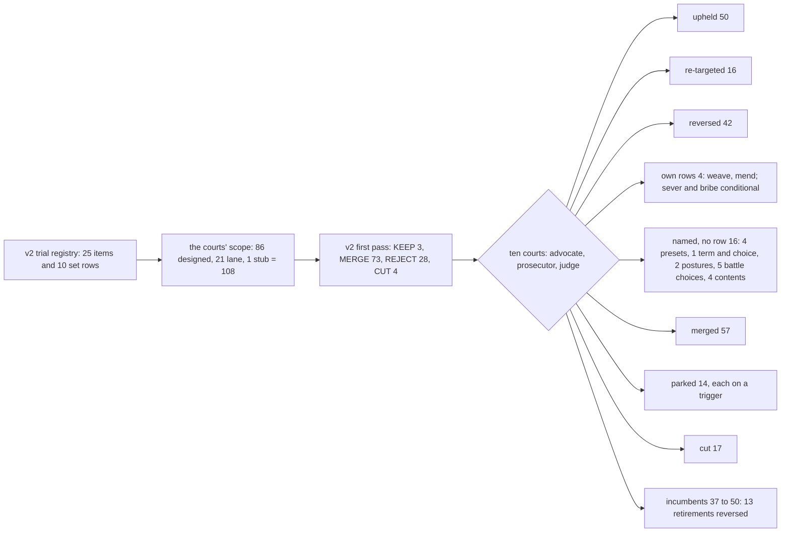
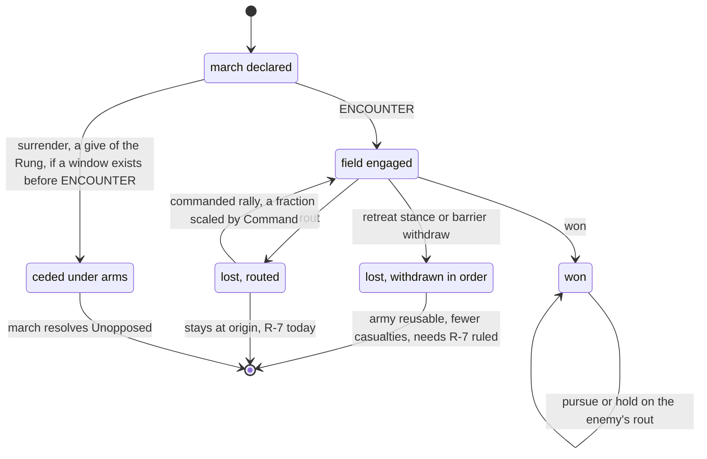

# Persons, attributes and verbs: the v2 synthesis — part 8: Part V, the trial of the new verbs

## Status: PROPOSED (2026-10-16). Not ratified; merging ratifies nothing unless Jordan so rules. Static reading only: no run was made for this Part or for any verdict it assembles.
## Parts, in reading order: [head](2026-10-16-v2-person-troop-attribute-synthesis.md) · [`_part2`](2026-10-16-v2-person-troop-attribute-synthesis_part2.md) · [`_part3`](2026-10-16-v2-person-troop-attribute-synthesis_part3.md) · [`_part4`](2026-10-16-v2-person-troop-attribute-synthesis_part4.md) · [`_part5`](2026-10-16-v2-person-troop-attribute-synthesis_part5.md) · [`_part6`](2026-10-16-v2-person-troop-attribute-synthesis_part6.md) · [`_part7`](2026-10-16-v2-person-troop-attribute-synthesis_part7.md) · **this file** (Part V: the trial, §V.0–§V.7).

**How to read a mark.** **[CHECKED]** = re-opened in this assembly pass. **[J]** = opened by that
subsystem's judge and carried from the verdict file. **[P]** = taken by a judge from an advocate's or
prosecutor's file, not reopened. **[INFERRED]** = a judge's or this Part's reading, not run.
**The rulings are the judges'.** This Part assembles them, reconciles two cross-court conflicts
(§V.2.8, §V.5.3) and checks the arithmetic. It adds no verdict of its own.

**Sources.** The ten verdict files, `_verdict.md` for PC MB SC FI TW GV FA EC WT NP, the
advocate and prosecutor files beside them, `BRIEF.md` and `JUDGE_NOTES.md` (Jordan's four standing
corrections), all in the session scratchpad
`/tmp/claude-0/-home-user-ttrpg/3f6de207-94f6-530b-a5b4-52aac53c2712/scratchpad/trial/`, not in the
tree. The roll-up was checked by `rollup_check.py` in the same directory, which parses §V.3 and §V.4
of this file.

---

## PART V. THE TRIAL OF THE NEW VERBS

### V.0 The result

**Claim.** The game gains four new verb rows, two of them conditional. Of 108 items tried, 4 end as
own rows, 16 survive by name inside an incumbent, 57 merge without a name, 14 are parked on a named
trigger and 17 are cut. The court overturned the first pass on 58 items and reversed 13 of its
retirements of incumbents. The distilled vocabulary goes from 37 to 50, not down.

- **What went in.** All 86 verbs designed from scratch and the 21 lane-recommended verbs that are
  neither code nor plan (the 23 less `muster` and `marshal`, troop scope), plus one stub, Past-pulling,
  which the TW court tried with `pull`: **108 items**.
- **Own rows: 4.** `weave` and `mend` (firm); `sever` (conditional on a write Locking lacks) and
  `bribe` (conditional on a recipient-side reader; FA's `suborn` is the same act).
- **Named survivals: 16, no row.** 4 named presets (`assassinate` of `fight`, `surrender` of `give`,
  `deny` of `release`, `declare (war)` of `utter`); 1 named term and choice (`yield`, of `fight`);
  2 postures of `march` (`assault` = storm, `invest` = besiege); 5 choices inside the battle module
  (rally, pursue, retreat, command, withstand); 4 named contents with their own Record kind or
  emitted kind (`tax` as a `due` on `issue`, `relieve` as `relief.given` on `transfer`, `abdicate`
  as a seat-resignation kind on `release`, `lend` as the `debt` Record kind).
- **Merged without a name: 57.** **Parked: 14**, each with the trigger that revives it (§V.3).
  **Cut: 17.**
- **Against the first pass:** upheld 50, re-targeted 16 (same disposition, a different incumbent),
  reversed 42 (a different disposition).
- **Incumbents:** v2 Part III distilled the 66 live verbs to 37. The courts reverse 13 of its
  retirements (§V.2.7), so the post-trial set is **50**. It counts the three TW rows, as v2 did
  (`sever` included, conditional); `bribe` would make 51 once its gate holds.

| subsystem | new verbs tried | own rows | named (preset, content, posture, choice) | merge | park | cut | distilled set: v2 → after the trial | first pass: upheld / re-targeted / reversed |
|---|---|---|---|---|---|---|---|---|
| PC | 16 | 0 | 2 | 11 | 3 | 0 | 1 → 3 | 10 / 1 / 5 |
| MB | 15 | 0 | 8 | 6 | 0 | 1 | 2 → 2 | 3 / 4 / 8 |
| SC | 16 | 0 | 1 | 12 | 3 | 0 | 5 → 6 | 9 / 3 / 4 |
| FI | 9 | 1 | 0 | 5 | 0 | 3 | 2 → 8 | 3 / 2 / 4 |
| TW | 11 | 3 | 0 | 5 | 2 | 1 | 4 → 4 | 5 / 2 / 4 |
| GV | 7 | 0 | 3 | 1 | 2 | 1 | 10 → 10 | 1 / 0 / 6 |
| FA | 6 | 0 | 1 | 4 | 1 | 0 | 3 → 4 | 1 / 3 / 2 |
| EC | 9 | 0 | 1 | 6 | 0 | 2 | 4 → 5 | 6 / 1 / 2 |
| WT | 7 | 0 | 0 | 2 | 0 | 5 | 1 → 2 | 3 / 0 / 4 |
| NP | 12 | 0 | 0 | 5 | 3 | 4 | 5 → 6 | 9 / 0 / 3 |
| **total** | **108** | **4** | **16** | **57** | **14** | **17** | **37 → 50** | **50 / 16 / 42** |

TW's distilled set counts its three new rows, as v2 did. The arithmetic was checked by script over
the §V.3 and §V.4 tables (a table count, not a probe).

**The consequence.** The thesis of Part III survives in its main clause and loses its strongest
corollary. The game is still short of readers, not of verbs: no subsystem needs more than three new
rows, and every named survival waits on a carrier or a reader. But "distil the vocabulary" was wrong
for the incumbents: the shorter set lost reachability, broke Jordan's rulings or orphaned plan steps.

### V.1 The method, in five lines

1. Per subsystem, an **advocate** argued each new verb's strongest honest case for its own row
   (strength 1–5) and a **prosecutor** its strongest case for exclusion (a disposition and a
   confidence); both were Sonnet, and each wrote its own file from the sources before seeing the other's.
2. A **judge** (Opus) per subsystem read both files and the sources, settled each disputed fact by
   opening the code, and ruled KEEP, KEEP WITH CONDITIONS, MERGE, PARK or CUT with build conditions.
3. Every judge was bound by Jordan's four standing corrections: bribe is not oblige; rally, pursue,
   retreat, command, withstand and storm are valid; their form is a phase, strategy or choice inside
   the battle; one pivotal use is no ground for a cut.
4. Independence was bought by instruction and file discipline, not by process: one model family,
   shared sources, and nothing enforced the rule against reading the other side's file.
5. Every party read statically and ran nothing; where a fact turned on a run, the judges say so
   (§V.7).

### V.2 The cross-cutting rulings

#### V.2.1 The value term reads the verb alone, so an act's identity decides its form

**Claim.** Where a new act's moral weight must differ from its host's, it needs its own row until the
chooser and the scar can read contents. That one fact decides four forms, and one design lever would
flip all four.

- *Premise 1.* The pursuit term is `align(c.verb, ax)` (`engine/season/decision/choose.py:149`)
  [CHECKED]; the production scar is `elements_violated_by(a.verb)` (`loop/resolve.py:623`) [J].
- *Premise 2.* A witness judges a deed by its kind, and a kind maps to a verb only where exactly one
  row emits it (`engine/season/data/verbs.py:1233-1248`) [CHECKED].
- *Inference.* A bribe carried as a `transfer` payload is scored as a gift by the briber's values and
  by every witness. A Mending and a Dissolution under one typed thread row are one act to every
  person's values.
- *Conclusion.* `bribe` is an own row (FI); `weave`, `mend` and `sever` are three rows over one
  resolver (TW); `lie` revives as an own row sharing `tell`'s cell (SC); `declare (war)` is a preset
  only because one mood-keyed cell can serve WAR, the charge and THREAT (FA).

**The strongest counter-argument.** *Rows multiply to work around a chooser defect.* It stands as the
reversal condition. A `(verb, kind)` alignment and scar key, or a contents-aware value term (Part IV
§IV.11), makes the one typed thread row lossless and turns `bribe` and `lie` into contents. **The
consequence:** this is the trial's most consequential open lever (§V.5.1, D-V6). Until it is built,
the four forms above stand.

#### V.2.2 One channel says what a document moves: `record_sourced_operands` gains `kind` and `amount`

**Claim.** Trade, credit, embargo and tax are four losses with one repair: a held Record whose keys
name a matter kind and an amount, supplied to a person's act through the existing single owner.

- *Premise 1.* `record_sourced_operands` is *"the shared enabler"*, mapping each Record kind's content
  keys to the closed eight operands; *"`kind` AND `amount` LEFT WITH THE FLAT LIST: no live kind
  carries either key ... a later kind that carries them (the deferred `debt`) adds them here"*
  (`engine/season/rosters.yaml:1708-1723`) [CHECKED].
- *Premise 2.* Each loss lacks exactly that: `comply` answers a dispensation that names no matter
  (`tax`, GV); `Term` has no amount and `oblige` binds to a seat, not a creditor (`lend`, EC);
  `exchange` cannot name its second side and `covenant`'s terms are a bare Proposition (`bargain`,
  EC); no ban on a good exists (`smuggle`, EC) [J].
- *Conclusion.* One roster extension, no ninth operand: a `due` writ on `issue` (tax), a `debt`
  Record kind (lend), per-side goods keys on `covenant`'s terms (bargain, and so trade), a ban term on
  a held Record (smuggle).

**The strongest counter-argument.** *Four different matters on one channel is a grab-bag.* The S test
answers it: one method for one quantity ("a document says what moves"); a second mechanism for any of
the four would fail SMOOTH. **The consequence:** one roadmap node (`_part7` §5, T2) precedes four
named contents. `exchange` is retired only in the commit that gives `covenant` both sides' goods
(§V.2.7).

#### V.2.3 A named act on a generic closer is a preset of `release`, not a new closer

**Claim.** Deny, withdraw, abdicate, letting go one's own weave and making peace are all `release` of
an edge the actor owns. Each keeps a name; none gets a row.

- *Premise 1.* The petition is held through a Tenure (`_eff_petition` mints it with the petitioner's
  `hold`), `release`'s domain includes `hold`, and `give` hands the `hold` on (SC F1) [J].
- *Premise 2.* Layer 1 row 14 asks for "one `release` verb, … generic over kind", and IN-11 cut
  `repudiate` as "a second closer of one edge" (`verb_table.yaml:851`, `:855-856`) [J].
- *Inference.* The receiver's denial is his `release` of the `hold` he received; the petitioner's
  withdrawal is his `release` before he hands it on; an abdication is `release` of one's own seat
  `hold`; peace is `release` of the war `commit`.
- *Conclusion.* `deny` is KEEP WITH CONDITIONS as a named preset of `release` (option (c) of J-C-7,
  which neither the first pass nor J-C-7 named). v2's absorber, `destroy_record`, is the worst of
  three: unformable today, co-located only, and it erases the evidence (SC F3).

**The strongest counter-argument.** *A denial should be costly, not merely seen.* It stands as a limit:
`tenure.closed` has several emitters, so nobody judges a denial by his own pursuits. A later own kind
with a `deed:` cell repairs it if Jordan wants denial value-scored (§V.5.2, SC call 1).

#### V.2.4 A content becomes visible by an earned kind priced by one `deed:` cell

**Claim.** A named content that witnesses must tell apart earns its own event kind beside the
incumbent's, and one `deed:` cell prices it. No row, no second effect.

- *Premise 1.* `seize` already earns `rung.seized` beside `record.seized` per subject, and `release`
  already earns `commitment.ended` for a `commit` edge (`verb_table.yaml:856`, `:915`) [J].
- *Premise 2.* `tenure.closed` is emitted by `confer`, `release` and `revoke`, so it maps to no verb,
  and a witnessed abdication is valued at zero on every axis (GV F3; mechanism [CHECKED] at
  `data/verbs.py:1233-1248`).
- *Conclusion.* `relief.given` on `transfer` (a famine ruler judged as care, not as debt paid),
  a seat-resignation kind on `release` (ARC-40's only ruled exit), `deed:commitment.ended` on
  `release` (the vow-break, `betray`), and three MB kinds: a siege held, a total taking under
  occupation, a cession under arms. Each keeps the incumbent's own kind earned as well, so
  `KIND_VERB` still maps it.

**The strongest counter-argument.** *A contents-aware value term makes these kinds redundant.* It fixes
the chooser's valuation, not the witness's judgement of the deed, which is by kind. The kinds are
redundant only if the witness side is made contents-aware too (GV call 4).

#### V.2.5 The mass-battle six live inside the battle module, and the force scale comes first

**Claim.** Rally, pursue, retreat, command, withstand and storm are kept, as named choices the battle
module reads, set through `march`'s order of battle. None becomes a season row. None is observed until
a season field can be fought and won.

- *Premise 1 (Jordan, corrections 2–3).* The six are valid; their form is a phase, strategy or
  choice inside the battle; the reader is the module's.
- *Premise 2.* The module already holds most of the substance: stances, brace and shock rows,
  `pursuit_damage`, `recall_check`, Feigned Retreat, `derive_command` (MB F5) [J].
- *Premise 3.* The season path reaches almost none of it: one subunit per side, no tactic, command
  fixed at 4, and at realm weights every opposed `march` grades Lost (MB F6; MBR via the parties)
  [J], [P].
- *Inference.* The prosecution's ID-13 finding (nothing reads a post-`march` verb) is true and is a
  build order, not a cut.
- *Conclusion (the build order).* 0 the force scale (M-MB-1); 1 the order of battle as `march`'s
  operand (K-MB-4); 2 the Officer from a seated person (K-MB-2): command; 3 `rally_check` filled, a
  fraction scaled by Command; 4 graded walls and garrison wear (H-150): storm, fortify; 5 the
  occupant's draw (M-MB-8), then `invest` and its per-season event: besiege; 6 a death carrier
  (K-MB-9) and the pursuit phase on the season path: pursue; 7 Jordan's ruling on R-7, then
  `field_degree` tells a withdrawn army from a routed one: retreat's season half.

**Retreat against rout.** The engine grades four degrees including a Partial in which the attacker
is not routed; `field_degree` collapses them to Won or Lost, and R-7 keeps every Lost army at its
origin whether it broke or withdrew (`loop/effects_combat.py:243-247`, *"[ASSUMPTION; medium;
Jordan to correct]"*) [CHECKED]. So the season throws away the distinction `retreat` exists to make
(§V.6, diagram 3).

**The strongest counter-argument.** *Named choices that nothing observes are portraits.* True until
step 0, and the court says so rather than counting them delivered. One residue is real: `withstand`
needs a named chooser (the holding seat's order of battle or a `dispatch` to the garrison's
commander), or it is a constant (MB call 4). **Shape condition:** every order-of-battle content is one
spec list, and the mass `withdraw` shares its name and meaning with PC's IN-46 `withdraw`.

#### V.2.6 Threadwork is three rows over one resolver, and `mend`'s N-line was wrong

**Claim.** `weave`, `mend` and `sever` are kept as three rows on the existing `_resolve_operation`;
`lock`, `loosen`, `leap`, `trace` and Past-pulling become parameters, targets or effects; `ward` and
`pull` are parked, not cut.

- *Premise 1.* The three directions do not share an outcome signature: `mend` raises
  `(Person, coherence)` (the only raiser; a clock may not, `write_matrix.yaml:170-178`), `weave`
  lowers it and opens a held load, `sever` unmakes and orphans (TW T-b, T-j) [J].
- *Premise 2.* v2's N-line for `mend`, "the only act that lowers the Calamity", is false: IN-35 gives
  that arm to `restore`, and `mending_stability_delta` is "REPORTED, written nowhere" (TW T-a) [J].
- *Premise 3.* Opposed threadwork exists in `systems/threadwork/sim/opposing.py`, unplugged; v2's
  reason for cutting `ward` ("no opposed threadwork exists") is false (TW T-f) [J].
- *Conclusion.* `restore` is NOT retired (it keeps IN-35's fabric arm); `weave` and `mend` land in one
  batch after IN-06 supplies coherence and TS; `sever` ships third and only if it writes something
  Locking does not; `ward` waits for a person-aimed operation to execute; the stubs
  `attempt_pulling` and `attempt_past_pulling` are not retired (no plan row exists to retire).

**The strongest counter-argument.** *One typed row with `kind ∈ {weave, sever, mend}` is two rows
cheaper.* It wins exactly when §V.2.1's key is built (TW call 1).

#### V.2.7 Thirteen retirements of incumbents are reversed

**Claim.** Part III recommended retiring 20 shipped rows, 3 planned positions, 4 stubs and 2 designs.
The courts reverse 12 shipped and 1 planned, make `exchange` conditional and hold `construe` on
J-C-6. Six shipped retirements were not tried and stand as v2 filed them.

| incumbent | v2 first pass | court | decisive argument |
|---|---|---|---|
| `challenge`, `accept` | retire into `fight` | **keep** (PC) | PC-10b (planned) mints a `challenge` Record and makes `accept` refuse without one: it strengthens both and gives `accept` the precondition `fight` lacks [J] |
| `speak` | retire into `utter` | **keep** (SC) | SC-01 step 12 builds a contested `speak` (four bands); retiring it orphans the step and turns 70 speeches into permanent Propositions [J]. Plead, refute, concede land on it |
| `interview`, `research`, `surveil`, `reconstruct`, `survey` | retire into a generic `examine` | **keep** (FI) | it cannot be written (the grammar has no disjunction, `rosters.yaml:1966` [CHECKED]); it overrides Jordan's *"you must ensure you build the six"* (`verb_table.yaml:1065-1067`, acceptance *"the six acts must stay six acts"*, `:1101-1102`) [CHECKED]; it moves four celled, executing rows into the unreachable class |
| `conceal` (planned) | retire into `create_record` | **keep** as its own row (FI) | a `cover` kind would carry a reader of witnessing no other Record kind has; it is the hub of intrigue (§V.2.10) |
| `dispatch` | retire into `issue` | **keep** (FA) | FA-01's test pins five heads acting through it, and `march` is `remit:dispatch` (`tests/test_fa01_head_seats.py:56-59`) [J] |
| `migrate` | retire into `move` | **keep** (WT) | RR-2 ruled migration *"a verb persons take"*, giving `residence` its first producer (`proposals/2026-09-17-governance-and-behaviour/01_THE_BUILD_ORDER.md:37-40`, `:1054`) [CHECKED]; its per-row columns differ; its 0 executions are a reachability defect (H-168) |
| `restore` | retire into `work` | **keep** (TW) | it carries IN-35's fabric arm of the Calamity (`workplans/..._part5.md:125-127`) [J] |
| `give` | retire into `transfer` | **keep** (MB, SC) | it carries `surrender` (a held Rung) and the petition's route to its receiver (`deny`); `give` moves Records and Rungs by Tenure, `transfer` stores rung to rung [J] |
| `exchange` | retire into `transfer` | **retire only with `covenant`'s goods keys**, same commit (EC) | retiring it first leaves no row that names trade and deletes IN-33's restoration path without a successor [J] |
| `construe` | cut | **held on J-C-6** (SC) | the bending of terms goes with `lie` |

Standing as filed, untried: `petition`, `carry`, `forge`, `evade / defy`, `found`, `succeed`
(shipped); `arrest`, `pardon` (planned; see §V.5.3).

**The strongest counter-argument.** *Thirteen more names cost E-OVERHEAD.* Each of the thirteen has a
named loss on the code or a ruling behind it; v2 itself listed most of them as its closest calls.
The cut was an amputation scored as elegance (NERS §5.2).

#### V.2.8 Bribe is not oblige: one corruption row, and four absorbers corrected

**Claim.** Jordan's correction removes `oblige` from every merge it was asked to carry except paid
service. Corruption becomes one own row, `bribe`, with FA's `suborn` as the same act.

- *Premise 1 (Jordan).* `oblige` binds a person to a seat by a term, with upkeep and lapse.
  A bribe binds no one to a seat.
- *Premise 2.* No incumbent carries what a bribe is. `transfer` has no purpose, no concealment and no
  change in the recipient's obligation or stance; `covenant` has no price and its `commit` is celled
  as a vow, so a corrupt bargain reads as piety (FI F-f, F-g; FA's four-part check carries one of four)
  [J].
- *Conclusion.* `bribe` is an own row composing on `transfer`'s store write: an offer moves nothing,
  acceptance moves the coin; own cells and a `deed:` cell, so witnesses judge it as corruption.
  `recruit` moves to the recruiter's `tell`, with the recruit's own `oblige` or `commit` as his reply.
  `lend`'s "+ an `oblige` to repay" is struck. `hire` is confirmed: it IS the definition.

**Reconciling two courts.** FI rules `bribe` KEEP WITH CONDITIONS, built after `covenant`'s readers;
FA rules `suborn` PARK until a recipient-side reader of a held inducement and `conceal` exist, then
"one own row shared with FI's `bribe`". They agree on the form and differ only on the gate. **The row
ships when both gates hold:** a reader through which a held inducement enters the recipient's choice,
and `conceal` (until which a bribe is witnessed by the co-located). This changes no count; it is the
stricter gate.

**The strongest counter-argument.** *A `transfer` content kind with its own cell would do.* Only with
§V.2.1's `(verb, kind)` key (FI call 1).

#### V.2.9 Pivotality changed 28 outcomes

**Claim.** Correction 4 (one pivotal use is enough) changed the outcome of 28 items against the first
pass or the prosecutor: 10 kept by name, 14 parked, 4 merged with a stated form. It saved nothing
that had no pivotal case.

- **To KEEP WITH CONDITIONS (10):** `yield`, `assassinate` (PC); `besiege`, `surrender` (MB); `deny`
  (SC); `tax`, `relieve`, `abdicate` (GV); `declare (war)` (FA); `lend` (EC).
- **To PARK (14):** `shoot`, `rescue`, `champion` (PC); `lie`, `insult`, `preach` (SC); `ward`, `pull`
  (TW); `ration`, `depose` (GV); `suborn` (FA); `court`, `marry`, `bless` (NP). Of these, `shoot`,
  `ward`, `pull` and `marry` were CUT or REJECT in the first pass itself.
- **To MERGE rather than the prosecutor's CUT (4):** `interpose` (PC); `bargain`, `haul`, `smuggle`
  (EC).
- **Cut after the walk, 17**, each because its pivotal case is absent from the model or carried
  elsewhere (§V.3 names the carrier): `encamp`, `patrol`, `appraise`, `hoard`, `navigate`, `ride`,
  `hunt`, `climb`, `swim`, `rear`, `mourn`, `pray`, `avenge`, `decipher`, `eavesdrop`,
  `infiltrate`, `anchor`.
- **Also:** it is the second ground for keeping `migrate`, and why the pull stubs are not retired.

**The consequence.** A park is not a deferral of judgement: each names the carrier or reader whose
arrival revives it (§V.3) and the form it then takes, so the revival is mechanical.

#### V.2.10 `conceal` is the hub of intrigue, and its acceptance line is amended

**Claim.** Nine verdicts wait on the planned `conceal` (IN-12 step 10), so it is kept as its own row
and becomes the first intrigue build.

- *Premise.* `assassinate`, `ambush` (the first-mover input), `disguise`, `conspire`, `bribe`,
  `shadow`, `infiltrate`'s cover read, `hoard`'s concealed store and `smuggle`'s unseen half each need
  a cover read at witnessing (§V.3) [J].
- *The amendment.* The plan's step 10 keeps *"`seen.who` still names the actor"*
  (`workplans/valoria_master_workplan_v9_part5.md:65`) [CHECKED]. `disguise` needs the room fooled:
  a `scope: room` cover withholds the co-located `who`, and `deed_doer` then names no doer (FI F-c).
  The FI judge found no ruling behind the line and Jordan's R8 asks for the opposite, so the
  amendment is answered, not escalated (FI call 5).
- *The one generic addition.* A failed concealed act must expose its doer: a degree-keyed cover
  break in `conceal`'s witness read, for every concealed act, never in `fight` (PC V106).

#### V.2.11 The chronicle channel is slated for deletion, and two named acts need a public route

**Claim.** `deny` and `declare (war)` must reach an absent party in the season they happen, and the
channel that would do it today is deleted by SC-01 step 13.

- *Premise 1.* `_ch_chronicle` is an event-kind filter: when it fires it fires "for everyone alive",
  for any kind a `binding_decision` row emits (`engine/season/epistemic.py:546-572`) [CHECKED]. Its
  docstring now records realm measurements (positions `15d`, `17a`) in which it admits deposits.
- *Premise 2.* SC-01 step 13: *"`chronicle` deleted (`rosters.yaml`, `epistemic.py`)"*
  (`workplans/valoria_master_workplan_v9_part6.md:68`) [CHECKED].
- *Premise 3.* `release` is `binding_decision`, so a denial is public today; `utter` and `commit` are
  `social`, so a war declaration is co-located only even today (SC F2, FA G2) [J].
- *Conclusion.* Each preset carries a test: the petitioner holds a claim of the denial, and the other
  faction's head holds the declaring seat's `commit`, in the season it happens, by a channel that
  survives step 13. Which channel is §V.5.1, D-V3.

#### V.2.12 War is a Proposition plus seat-holders' commits, and nothing reads it

**Claim.** `declare (war)` is kept as a named preset of `utter` (mood WAR), and the seat check goes at
the reader: `at_war` counts only commits by a person holding a seat of one of the two factions.

- *Premise 1.* `at_war` is True on any live `commit` to a WAR Proposition naming the pair, so anyone
  can put two factions at war (FA G1) [J]; war is a Query, never a stored flag (D-48) [J].
- *Premise 2.* `at_war` is read by nothing (FAR §3.1) [P].
- *Conclusion.* The order: a reader of `at_war` (at minimum `march`'s ranking or target selection),
  then the seat clause, then publicity (§V.2.11), then one mood source and one mood-keyed alignment
  cell shared with the charge and THREAT. Peace is `release` of the war `commit`; a treaty's reader
  is that each party releases it.

#### V.2.13 Sixteen merges were filed against the wrong row

**Claim.** Part III stated the rule that a merge is lawful only if the absorber's contents can carry
the difference (§III.0), and did not check it against the rows. Sixteen items were re-targeted, and
several merges were cuts in disguise.

- `seize` never takes a seat (*"A SEAT is never seized"*) and declines anything that is neither a
  held Record nor an occupied settlement (`verb_table.yaml:911`) [CHECKED]: so `depose` "by force",
  `forage` and `sack` cannot ride it.
- `examine` is Site-bound and `research` Record-bound (`audit`); `surveil` needs presence at the
  watched Rung (`track`, `reconnoitre`); `give` carries no coin; `exchange` is declined;
  `covenant` is seat-only, private and uncontested (`conspire`); `work` writes only `Site.condition`
  (`hunt`); `march` needs a Rung subject (`ambush` of a traveller) [J].
- **The consequence:** v2's §III.3 compositions fail four of six: `bribe`/`suborn`, `lend`,
  `infiltrate` and `conspire` (§V.4).

#### V.2.14 The inquiry yield is the shared dependency of seven verdicts

**Claim.** `search`, `track`, `shadow`, `audit`, `reconnoitre`, `trace` and a future route content on
an inquiry all wait on R-C-23, the content yield no inquiry has. A seventh inquiry would inherit the
defect, not fix it, so none is added. R-C-23 is the existing B9 node (`_part7` §5).

#### V.2.15 Execution before additions

**Claim.** In GV, EC and NP every named survival lands on an incumbent that barely runs (`requisition`
0, `revoke` 0, `work` 0, `transfer` rare; of NP's five, one executes), so the first build condition of
each set is that its incumbents execute in computed play. The courts grade the three sets *paper*
(NERS §10).

### V.3 The per-subsystem final sets

Columns: the v2 first pass (Part III); the advocate's strength (1 weak to 5 decisive); the
prosecutor's disposition and confidence; the **judge's verdict**; the **form** (own row, a named
preset or content of an incumbent, a merge, a park trigger, or nothing); the build condition.

#### PC — personal combat (16)

| item | first pass | adv. | prosecutor | JUDGE'S VERDICT | form | build condition |
|---|---|---|---|---|---|---|
| V094 strike | REJECT | 1 | CUT 95% | MERGE | `fight`: the module's attack beat | none; an engagement choice at IN-46 |
| V095 guard | REJECT | 1 | CUT 90% | MERGE | `oblige` + presence (`move`), read by IN-60's `guard_weight` Query | IN-60 ships as a Query over live `oblige` and presence |
| V096 parry | REJECT | 1 | CUT 95% | MERGE | `fight`: `DEFENCE_MODES` | if exposed at IN-46, a choice that weights the draw, never a second draw |
| V097 dodge | REJECT | 1 | CUT 95% | MERGE | `fight`: `DEFENCE_MODES` | as parry; the agile fighter is a per-person input (K-PC-1) |
| V098 feint | REJECT | 1 | CUT 95% | MERGE | `fight`: commitment depth (the duel feint was deleted, WS-5) | none |
| V099 grapple | REJECT | 1 | CUT 90% | MERGE | `fight`: the grab menu | none; taking alive is V104's and `detain`'s |
| V100 disarm | REJECT | 1 | CUT 90% | MERGE | `fight`: a grab outcome | none |
| V101 shoot | REJECT | 2 | CUT 90% | PARK | trigger: a ranged resolver in `modules/combat`, or a case demanding a killing at range | on revival a weapon kind inside `fight`, never a second resolver |
| V102 rush | REJECT | 1 | CUT 90% | MERGE | `fight`'s lunge; at the field, the battle's charge | none |
| V103 disengage | REJECT | 2 | CUT 85% | MERGE | IN-46's `withdraw` choice | IN-46 gets a batch; `withdraw` writes (the withdrawer leaves standing) |
| V104 yield | REJECT | 3 | CUT as a row 80% | KEEP WITH CONDITIONS | named term (PC-10) and the loser's named choice (IN-46) of `fight` | PC-10a, PC-10b; the season reads `duel.yielded` and routes it to `detain` or release |
| V105 ambush | MERGE → `march` | 2 | CUT 75% | MERGE | a context read on `fight` (persons) and `march` (armies): a held cover sets the first mover | `conceal`; then one first-mover input on the combat seam; then the field seam |
| V106 assassinate | MERGE → `fight` | 3 | CUT 70% | KEEP WITH CONDITIONS | named preset of `fight`: `death` term, held cover, first mover | PC-10b; `conceal` with a degree-keyed cover break; V105's input; IN-59 (a); its own cell |
| V083 interpose | MERGE → `fight` | 3 | CUT 80% | MERGE | `fight`: a `parties` content of the scene | K-PC-5 (an N-party loop over `engagement()`); IN-60 first |
| V084 rescue | MERGE → `fight` / `release` | 3 | CUT 70% | PARK | trigger: `arrest` lands and a run holds a live `detain` at season's end | revival form relocates the prisoner and leaves the sentence live; never widen `release` |
| V085 champion | MERGE → `challenge` | 2 | CUT 85% | PARK | trigger: a RULE disposal reads a duel's result, or PC-10b's `stakes` carry more than the body | revival form: a `proxy` content on PC-10b's `challenge` Record |

#### MB — mass battle (15; `muster` and `marshal` out of scope)

| item | first pass | adv. | prosecutor | JUDGE'S VERDICT | form | build condition |
|---|---|---|---|---|---|---|
| V107 reconnoitre | MERGE → `survey` | 2 | MERGE → `surveil` | MERGE | `surveil` on the target Rung | R-C-23's yield; K-MB-12's reader on the `march` chooser |
| V108 encamp | REJECT | 1 | CUT | CUT | nothing: halting is presence; the besieger's camp is V112 | revives only as a third `march` posture if winter quarters are wanted |
| V109 fortify | MERGE → `build` | 1 | MERGE → `work`/`restore` | MERGE | `work`/`restore` on a `garrison` Site; `build` for new walls | `fort_level` scales the WALLS bonus; garrisons wear (H-150) |
| V110 forage | MERGE → `seize` | 3/2 | MERGE → `requisition` | MERGE | `requisition` with one occupation basis beside `purview` | one basis rule (the grammar has no `any`); M-MB-8 |
| V111 provision | MERGE → `transfer` | 1 | MERGE → `transfer` | MERGE | `transfer` into the force's seat's treasury | LF-1, LF-3 (held back as Jordan's) |
| V112 besiege | MERGE → `march` | 2 | MERGE + a reader | KEEP WITH CONDITIONS | named `march` posture `invest` | M-MB-8; a witnessed event each season it holds; held by presence, not re-formed |
| V113 rally | REJECT | 2 | CUT | KEEP WITH CONDITIONS | in-battle choice: the commander's rally check (`rally_check` filled) | force scale; V116; a fraction scaled by Command, distinct from the emergent yield-rally |
| V114 pursue | REJECT | 1 | CUT | KEEP WITH CONDITIONS | in-battle choice: a per-side `pursue`/`hold` order on the enemy's rout | the season path reaches `pursuit_damage` and `recall_check`; K-MB-9 |
| V115 retreat | REJECT | 1 | CUT | KEEP WITH CONDITIONS | in-battle choice: the `retreat` stance and a barrier `withdraw` | K-MB-4; season half: R-7 ruled, then `field_degree` reads withdrawn against routed |
| V116 command | REJECT | 1 | CUT | KEEP WITH CONDITIONS | in-battle: the side's Command from its seated commander, and his tactic choices | K-MB-2 (Officer from a seated person; `derive_command` on the season path) |
| V117 drill | MERGE → `train` | 1 | MERGE → `train` | MERGE | `train` (the person half) | none |
| V118 withstand | REJECT | 1 | CUT | KEEP WITH CONDITIONS | in-battle choice: the defender's `hold`/brace order | name the chooser (the holding seat's order or `dispatch`), default `balanced` |
| V086 surrender | MERGE → `covenant` | 2 | MERGE → `covenant` + `give` | KEEP WITH CONDITIONS | named preset: `give` of a held Rung to the force mustered at it, optional `covenant` terms | `give` + Rung (B-R); `covenant` (B-Q 7); a cession-under-arms kind; the `march.declared` window |
| V087 storm | MERGE → `march` | 1 | CUT | KEEP WITH CONDITIONS | named `march` posture `assault` (the default), paired with `invest` | graded walls and garrison wear (H-150) |
| V088 sack | MERGE → `seize` | 2 | MERGE → `requisition` | MERGE | `requisition` under occupation, `amount: all`, its own event kind | V110 first; harm to the townspeople waits on a cohort-weight writer |

#### SC — social contest (16)

| item | first pass | adv. | prosecutor | JUDGE'S VERDICT | form | build condition |
|---|---|---|---|---|---|---|
| V119 persuade | MERGE → `argue` | 1 | CUT | MERGE | `argue`: a `manner` operand (proof or appeal) | `argue` (IN-12 step 9) declares `manner`; Ob reads claims or regard |
| V120 plead | MERGE → `argue` | 3 | CUT (into `argue` or `speak`) | MERGE | the contested `speak` at a docketed venue; representation (`for:`) parked | `speak` per SC-01 step 12 |
| V121 threaten | MERGE → `utter` | 3 | MERGE → `utter` | MERGE | `utter` mood THREAT (`subject` = the threatened) | the mood source shared with WAR and the charge; a reader that raises the threatened's question |
| V122 flatter | MERGE → `tell` | 2 | MERGE → `tell` | MERGE | `tell`: a favourable deed claim | the `said_slant` valence arm armed |
| V124 refute | REJECT | 1 | CUT | MERGE | `speak` content kind `cite_incompatible` | lives or dies with `speak` |
| V125 concede | REJECT | 2 | CUT | MERGE | `speak` content kinds `concede_fact`, `concede_harm`, emitted | the contested `speak` emits the concession |
| V126 testify | MERGE → `tell` | 2 | MERGE → `tell` | MERGE | `tell` at a docketed venue; the proof kind `testimony` | the bench reads claims told at the venue (SC-02) |
| V127 vote | MERGE → `determine` | 1 | CUT | MERGE | each voter's `commit`, counted by `determine`'s quorum | SC-01 step 11 (`cardinality`); `commit` executes |
| V128 preach | MERGE → `utter` | 2 | MERGE → `utter` | PARK | trigger: a writer of conviction or pursuits over a set of hearers (H-62) | revival form: an audience operand on `argue` |
| V129 insult | MERGE → `tell` | 3 | MERGE → `tell` | PARK | trigger: a reader of a slight (`challenge`/`accept`, or the regard arm, H-194) | revival form: own row contested on a standing, no held claim needed |
| V130 praise | MERGE → `tell` | 1 | CUT | MERGE | `tell`: a favourable deed told by a person of standing | none |
| V131 counsel | MERGE → `tell` | 1 | MERGE → `tell` + `utter` | MERGE | `tell` (informing) and `utter` mood OUGHT (recommending) | none |
| V132 mediate | MERGE → `convene` | 2 | MERGE → `convene` | MERGE | `convene` under `arbitration`; the mutual form parked with `negotiation` | none for the merge |
| V073 withdraw | REJECT | 3 | MERGE → `release` | MERGE | the petitioner's `release` of his own `hold` on the petition | test: the release closes the petition and is witnessed |
| V074 deny | MERGE → `destroy_record` | 4 | MERGE → `destroy_record` or `release` | KEEP WITH CONDITIONS | named preset of `release`: the receiver releases the `hold` he received by `give` | `give` of the petition forms (A-13); a channel to the absent petitioner that survives SC-01 step 13 |
| V075 lie | MERGE → `tell` | 4 | MERGE → `tell` (J-C-6) | PARK | trigger: Jordan rules J-C-6 that persons lie | revival form: own row sharing `tell`'s cell and kinds; a `sincere: false` content if a contents-aware term comes first |

#### FI — fieldwork and inquiry (9)

| item | first pass | adv. | prosecutor | JUDGE'S VERDICT | form | build condition |
|---|---|---|---|---|---|---|
| V133 search | MERGE → `examine` | 2 | MERGE → `examine` | MERGE | `examine`: a concealer branch on its obstacle, and the range of its yield | R-C-23 first; the concealer branch lands with `conceal` |
| V134 track | MERGE → `surveil` | 2 | CUT | MERGE | `reconstruct` with the quarry as subject; the physical-trace half cut | rides R-C-23 |
| V135 eavesdrop | MERGE → `surveil` | 1 | MERGE → `surveil` | CUT | nothing: presence already delivers what is overheard | revives only if private whispers are built, as `conceal` + `move` |
| V136 decipher | MERGE → `research` | 1 | CUT | CUT | nothing: no coded Record exists; the cipher hook was cut before | a sealed field on a Record kind would be an obstacle on `research` |
| V137 shadow | MERGE → `surveil` | 2 | MERGE → `surveil` | MERGE | `surveil`'s person case (a Person-bound sibling row); its build parked | R-C-23 and a covert-presence read (`conceal`) |
| V138 infiltrate | MERGE → `conceal` | 2 | CUT | CUT | nothing: the composition `oblige` → `tell`, with a cover read | the cover read lands with `conceal` |
| V139 disguise | MERGE → `conceal` | 3 | MERGE → `conceal` | MERGE | `conceal` content `scope: room`, plus one `who` reader | `conceal`'s acceptance line amended for `scope: room` (§V.2.10) |
| V140 bribe | MERGE → `oblige` | 3 | MERGE → `transfer` | KEEP WITH CONDITIONS | own row, composing on `transfer`'s write; FA's `suborn` is the same act | a recipient-side reader and `conceal` (§V.2.8); an offer moves nothing; own cells and a `deed:` cell |
| V141 audit | MERGE → `examine` | 2 | MERGE → `research` | MERGE | `research` on a frozen account (`faction_sheet`) | R-C-23; purview eligibility deferred |

#### TW — threadwork (11, with the stub Past-pulling)

| item | first pass | adv. | prosecutor | JUDGE'S VERDICT | form | build condition |
|---|---|---|---|---|---|---|
| V081 mend | KEEP | 4 | MERGE → one operation row | KEEP | own row | one batch with `weave` after IN-06; `price_mending` the one price; no second writer of `Site.condition` |
| V076 weave | KEEP | 3 | KEEP, as the one operation row | KEEP | own row | with `mend`; the held load as a Tenure the weaver owns (no fourth clock); a `permanent` parameter |
| V080 sever | KEEP | 4 | MERGE → one operation row | KEEP WITH CONDITIONS | own row (conditional), built third | must write a carrier Locking does not, else PARK; D-5 (no write on another's edge) |
| V078 lock | MERGE → `weave` | 1 | MERGE → `weave` | MERGE | `weave`: a preclusion parameter that `mend` reads | none |
| V079 loosen | MERGE → `sever` | 2 | CUT (`release`) | MERGE | one's own shape: `release`; another's: `mend` aimed at the shape | `mend`'s target admits a held shape |
| V077 pull | CUT | 2 | CUT | PARK | trigger: a carrier for P-09's orphan, as a new deposit, not an edit | do not retire `attempt_pulling` |
| — Past-pulling | CUT | — | CUT | MERGE | `pull`: a recency target parameter, parked with it | as `pull`; do not retire `attempt_past_pulling` |
| V082 leap | MERGE → `thread_read` | 2 | CUT as a verb | MERGE | the precondition and knot effect of every operation | the TS ≥ 30 gate on every thread row; one Leap owner |
| V144 trace | MERGE → `thread_read` | 2 | MERGE → `thread_read` | MERGE | `thread_read`: a finding kind that follows a knot | `thread_read` resolvable (H-85); the knot reader directed |
| V142 ward | CUT | 2 | CUT | PARK | trigger: a person-aimed `weave` or `sever` executes in the loop | first form: the target's standing in the working's Ob, not a row |
| V143 anchor | MERGE → `mend` | 2 | CUT | CUT | nothing: a co-location context read on the coherence-writing operations | optional: `environment_in_equilibrium` computed from company |

#### GV — settlements and governance (7)

| item | first pass | adv. | prosecutor | JUDGE'S VERDICT | form | build condition |
|---|---|---|---|---|---|---|
| V145 tax | MERGE → `requisition` | 2 | CUT | KEEP WITH CONDITIONS | named content of `issue`: a `due` writ carrying `kind` and `amount`, answered by `comply` → `transfer` or by `evade / defy` | the keys in `record_sourced_operands`; H-44 answered; `evade / defy` resolvable first |
| V146 patrol | MERGE → `surveil` | 1 | CUT | CUT | nothing: no disorder or hazard exists to suppress | a future hazard producer reads co-located guards itself |
| V147 steward | MERGE → `confer` | 1 | CUT (IN-48) | MERGE | `confer`: a delegate hold beside the principal's | IN-48 rules the edge |
| V148 ration | MERGE → `transfer` | 2 | CUT | PARK | trigger: shortage reachable (IN-52 or IN-28) and a draw-policy ruling | revival form: an `issue`d edict read by the one draw owner |
| V149 relieve | MERGE → `transfer` | 2 | CUT | KEEP WITH CONDITIONS | named content of `transfer`: `relief.given` earned beside `transfer.made` at a rung in shortfall | one `deed:relief.given` cell; a general earning condition |
| V089 abdicate | MERGE → `release` | 2 | CUT | KEEP WITH CONDITIONS | named content of `release`: a seat-resignation kind beside `tenure.closed` | K-FA-3's question source first; one `deed:` cell |
| V090 depose | MERGE → `revoke` / `seize` | 3 | CUT | PARK | trigger: Jordan rules ARC-40's replaced arm in | revival form: a removal basis on `revoke` reading two independent signals |

#### FA — faction actions (6)

| item | first pass | adv. | prosecutor | JUDGE'S VERDICT | form | build condition |
|---|---|---|---|---|---|---|
| V091 declare (war) | MERGE → `utter` + `commit` | 3 | MERGE → `utter` | KEEP WITH CONDITIONS | named preset of `utter` (mood WAR); a seat clause at `at_war` | a reader of `at_war`; the seat clause; publicity past SC-01 step 13; a mood-keyed cell |
| V072 recruit | MERGE → `oblige` | 1 | CUT | MERGE | the recruiter's `tell`; the recruit's own `oblige` or `commit` as his reply | test: a seat named in a `tell` forms an `oblige` Candidate |
| V150 conspire | MERGE → `covenant` | 2 | CUT | MERGE | `utter` + each conspirator's `commit` + `conceal` (VCD's Scheme) | `conceal`; conspiracy removed from `covenant`'s absorbed uses |
| V151 suborn | MERGE → `oblige` | 2 | CUT | PARK | trigger: a recipient-side reader of a held inducement, and `conceal` | revival form: the one `bribe` row (§V.2.8) |
| V152 ransom | MERGE → `exchange` | 2 | CUT | MERGE | `pardon` paid by `transfer`; optional `covenant` terms | `pardon` (IN-12 step 5); a capture producer |
| V153 negotiate | MERGE → `covenant` | 2 | CUT | MERGE | `covenant`, the bargaining hosted by SC's `negotiation` arrangement | `covenant` with a reader (peace releases the war `commit`s) |

#### EC — economy, trade and craft (9)

| item | first pass | adv. | prosecutor | JUDGE'S VERDICT | form | build condition |
|---|---|---|---|---|---|---|
| V123 bargain | MERGE → `exchange` | 2 | CUT | MERGE | `covenant`'s goods terms: each side's `kind` and `amount`, each performed by its own `transfer` | the keys channel (§V.2.2); a witnessed breach; `exchange` retired in the same commit |
| V154 craft | MERGE → `work` | 2 | MERGE (a Site kind) | MERGE | a workshop Site-kind data row with a `site_yield`; the transformation half parked | lands only with a reader of its made kind |
| V155 cultivate | MERGE → `work` | 1 | MERGE (a Site kind) | MERGE | `work` (purpose: tend a producing site); today `restore` carries the rise | `restore` is retained (§V.2.7), so the act is `restore`'s until a fold |
| V156 appraise | MERGE → `examine` | 1 | CUT | CUT | nothing: no price, value or quality exists | none |
| V157 lend | MERGE → `transfer` | 3 | MERGE (`debt` Record + `transfer`) | KEEP WITH CONDITIONS | named content: the `debt` Record kind; advance and repayment by `transfer`; default through `open_case` → `determine` | `debt` keys in `record_sourced_operands`; the borrower mints it; maturity a content key, not ttl |
| V158 hire | MERGE → `oblige` | 1 | CUT (it ships) | MERGE | `oblige` + the upkeep `transfer` | none |
| V159 haul | MERGE → `transfer` | 2 | CUT | MERGE | a distance cost on `transfer` | adjacency read by a season Query first |
| V160 hoard | REJECT | 1 | CUT | CUT | nothing: keeping is the default; concealing is `conceal`'s | `conceal` takes stores as a subject |
| V161 smuggle | MERGE → `transfer` | 2 | CUT | MERGE | a `transfer` made while a held ban term forbids it, optionally under a cover | a ban term (the keys channel); `conceal` |

#### WT — world, travel and survival (7)

| item | first pass | adv. | prosecutor | JUDGE'S VERDICT | form | build condition |
|---|---|---|---|---|---|---|
| V162 navigate | MERGE → `move` | 2 | CUT | CUT | nothing: no route graph exists to find | if R-C-7 lands, a route content on an inquiry |
| V163 ride | MERGE → `move` | 1 | CUT | CUT | nothing: no distance or kit for a mount to bite on | revisit with J-T5 and a leg price that reads distance |
| V164 sail | MERGE → `move` | 2 | CUT | MERGE | a context reader on `move`: water path × the season clock | a rung → province map over `water:`; a clock-keyed refusal; shipped at a control arm |
| V165 climb | REJECT | 1 | CUT | CUT | nothing: scene scale; escalade is `storm`'s | none |
| V166 swim | REJECT | 1 | CUT | CUT | nothing: carried by the sail reader | none |
| V167 hunt | MERGE → `work` | 2 | CUT | CUT | nothing: persons do not mint stores (W8) | re-point v2's `shoot` reason ("game is `hunt`") |
| V168 endure | REJECT | 1 | CUT | MERGE | the battle sense into MB's `withstand`; the season sense cut | inside the battle module only |

#### NP — NPC life and persons (12)

| item | first pass | adv. | prosecutor | JUDGE'S VERDICT | form | build condition |
|---|---|---|---|---|---|---|
| V093 betray | MERGE → `release` | 3 | CUT (author two cells) | MERGE | `release` priced by one `deed:commitment.ended` cell | author the cell, seeded equal to `release`'s; the merge is not done until it exists |
| V169 heal | MERGE → `tend` | 1 | CUT (into `tend`) | MERGE | `tend` | none |
| V170 court | MERGE → `tie / knot` | 2 | CUT | PARK | trigger: `tie / knot` gains a partner operand and a reader (H-182) | revival form: a contest clause on `tie` |
| V171 marry | CUT (DESIGN at triage) | 2 | CUT | PARK | trigger: Jordan rules K-NPC-6 for kin as a tie kind | revival form: a `kin` content of `tie / knot`, two edges, the heir gate its reader |
| V172 rear | REJECT | 1 | CUT | CUT | nothing: no child carrier; the cast is closed | none |
| V173 mourn | REJECT | 1 | CUT | CUT | nothing: grief is written by witnessing | none |
| V174 pray | REJECT | 1 | CUT | CUT | nothing: conviction moves only by argument and consequence | none |
| V175 avenge | REJECT | 2 | CUT | CUT | nothing: a motive; the grudge is stance | a cause-reading judge, not a verb |
| V176 confess | MERGE → `tell` | 1 | MERGE → `tell` | MERGE | `tell` payload preset: a claim of the teller's own deed | none now |
| V177 study | MERGE → `train` | 1 | CUT (into `train`) | MERGE | `train` with the actor as subject | `train` must not decline a self-subject |
| V178 recover | MERGE → `tend` | 1 | CUT | MERGE | active: `tend` of oneself; passive: a rising arm of the bodies pass | `tend` admits self; the rising arm shipped at a 0 control |
| V179 bless | MERGE → `confer` | 2 | CUT | PARK | trigger: H-100's revocation-cost reader, or a succession reader of consecration | revival form: the blesser's own edge, closable by `release`; not `confer` |

### V.4 Where the court overturned the v2 first pass

**Claim.** This is the document's own error ledger: 42 reversals and 16 re-targets of new verbs,
13 reversed retirements of incumbents (§V.2.7), and six first-pass reasons found false where the
disposition stood. The commonest cause is a merge filed without opening the absorber's row (§V.2.13);
the next is Jordan's corrections.

| subsystem | item | first pass | court | kind | decisive argument |
|---|---|---|---|---|---|
| PC | V101 shoot | REJECT | PARK | reversed | "ranged arms are KIT inside `fight`" is false: no ranged weapon exists in `modules/combat` [J] |
| PC | V104 yield | REJECT | KEEP WITH CONDITIONS | reversed | the only end of a fight chosen by the loser; Jordan's RS-25, *"a duel doesn't have to be lethal"* [J] |
| PC | V106 assassinate | MERGE → `fight` | KEEP WITH CONDITIONS | reversed | every act-caused Event names its actor (`witness.py:588-595`) [J]; canon's unattributed killing needs a named preset |
| PC | V084 rescue | MERGE → `fight` / `release` | PARK | reversed | both absorbers fail: a dead gaoler leaves the `detain` (it runs to a seat), and `release` is own-only [J] |
| PC | V085 champion | MERGE → `challenge` | PARK | reversed | a duel decides nothing about a principal; no producer |
| PC | V105 ambush | MERGE → `march` | MERGE → `fight` (persons) | re-targeted | `march` needs a Rung subject; a waylaid traveller is not one [J] |
| MB | V112 besiege | MERGE → `march` | KEEP WITH CONDITIONS | reversed | pivotal for both sides of a war; an unnamed "march that stays" is a non-act |
| MB | V113 rally | REJECT | KEEP WITH CONDITIONS | reversed | Jordan's corrections 2–3; the commander's one act that turns a breaking line |
| MB | V114 pursue | REJECT | KEEP WITH CONDITIONS | reversed | corrections 2–3; without it the module's feint and recall have nothing to bite on |
| MB | V115 retreat | REJECT | KEEP WITH CONDITIONS | reversed | corrections 2–3; the losing side's only way to preserve force |
| MB | V116 command | REJECT | KEEP WITH CONDITIONS | reversed | corrections 2–3; NPC5's demand that a commander's break matter (`cases/NPC5.yaml:172`) [CHECKED] |
| MB | V118 withstand | REJECT | KEEP WITH CONDITIONS | reversed | corrections 2–3; the defender's only decision in a field |
| MB | V086 surrender | MERGE → `covenant` | KEEP WITH CONDITIONS | reversed | the loser's War → Peace edge; a cession under arms must read as one (`rung.seized` precedent) |
| MB | V087 storm | MERGE → `march` | KEEP WITH CONDITIONS | reversed | corrections 2–3; assault against investment is the besieger's defining choice |
| MB | V107 reconnoitre | MERGE → `survey` | MERGE → `surveil` | re-targeted | `survey` mints a faction sheet; watching a Rung is `surveil` [J] |
| MB | V109 fortify | MERGE → `build` | MERGE → `work`/`restore` | re-targeted | `build` mints a Site; condition rises by `work`/`restore` [J] |
| MB | V110 forage | MERGE → `seize` | MERGE → `requisition` | re-targeted | `seize` moves no stores (§V.2.13) |
| MB | V088 sack | MERGE → `seize` | MERGE → `requisition` | re-targeted | as forage |
| SC | V128 preach | MERGE → `utter` | PARK | reversed | `utter` delivers no content to anyone; conviction has no writer |
| SC | V129 insult | MERGE → `tell` | PARK | reversed | `tell` needs a held claim, so an ungrounded slight is inexpressible; no reader of a slight exists |
| SC | V074 deny | MERGE → `destroy_record` | KEEP WITH CONDITIONS | reversed | the receiver's denial is the one priced exit at the petition seat; `destroy_record` is unformable and erases the evidence |
| SC | V075 lie | MERGE → `tell` | PARK | reversed | pivotal (the world cannot be fooled) and gated on J-C-6; an arm of `said_of` would make lying a fixture, not a choice |
| SC | V120 plead | MERGE → `argue` | MERGE → `speak` | re-targeted | `argue` writes pursuits; a plea feeds a bench (two targets in one effect) |
| SC | V127 vote | MERGE → `determine` | MERGE → `commit` | re-targeted | the voice is a `commit`; `determine` counts |
| SC | V073 withdraw | REJECT | MERGE → `release` | re-targeted | the first pass answered the combat sense; the petition's withdrawal is ED-IN-0210 Ruling 2's [J] |
| FI | V135 eavesdrop | MERGE → `surveil` | CUT | reversed | presence already delivers overhearing; private whispers are not built |
| FI | V136 decipher | MERGE → `research` | CUT | reversed | no coded Record exists; the cipher hook was cut once already |
| FI | V138 infiltrate | MERGE → `conceal` | CUT | reversed | three shipped acts compose it (`oblige` → `tell`); `conceal` writes no Tenure |
| FI | V140 bribe | MERGE → `oblige` | KEEP WITH CONDITIONS | reversed | Jordan's correction 1; no incumbent carries the inducement (§V.2.8) |
| FI | V134 track | MERGE → `surveil` | MERGE → `reconstruct` | re-targeted | `surveil` needs presence where the quarry is; the tracker stands where he was |
| FI | V141 audit | MERGE → `examine` | MERGE → `research` | re-targeted | `examine` is Site-bound; an account is a Record |
| TW | V077 pull | CUT | PARK | reversed | the only candidate closer of claims in ledgers; canon §6.7; correction 4 |
| TW | Past-pulling | CUT | MERGE → `pull` | reversed | a recency parameter of `pull`, parked with it |
| TW | V142 ward | CUT | PARK | reversed | "no opposed threadwork exists" is false; the only protection for a party not acting |
| TW | V143 anchor | MERGE → `mend` | CUT | reversed | canon: holding is not an operation and is not returning; a context read |
| TW | V079 loosen | MERGE → `sever` | MERGE → `release` / `mend` | re-targeted | a restorative act under the destructive cost regime crosses a categorical line |
| TW | V082 leap | MERGE → `thread_read` | MERGE → every operation | re-targeted | single-practitioner operations never roll a Leap; weave, sever, mend would depend on an inquirer |
| GV | V145 tax | MERGE → `requisition` | KEEP WITH CONDITIONS | reversed | `requisition` bypasses the subject; a demand the ruled can answer is GV's one resistance seat |
| GV | V146 patrol | MERGE → `surveil` | CUT | reversed | nothing to suppress; no pivotal use |
| GV | V148 ration | MERGE → `transfer` | PARK | reversed | "everyone eats less" is a change to the draw, which nothing models |
| GV | V149 relieve | MERGE → `transfer` | KEEP WITH CONDITIONS | reversed | famine relief is judged as debt paid unless it earns its own kind |
| GV | V089 abdicate | MERGE → `release` | KEEP WITH CONDITIONS | reversed | a resignation is valued at zero by witnesses; ARC-40's only ruled exit |
| GV | V090 depose | MERGE → `revoke` / `seize` | PARK | reversed | removing a living top ruler is barred by Jordan's 2026-10-12 ruling; `seize` never takes a seat |
| FA | V091 declare (war) | MERGE → `utter` + `commit` | KEEP WITH CONDITIONS | reversed | the state loop's one entry to war; named so it can be valued, made public and seat-checked |
| FA | V151 suborn | MERGE → `oblige` | PARK | reversed | correction 1; the composition carries one of four defining parts |
| FA | V072 recruit | MERGE → `oblige` | MERGE → `tell` | re-targeted | `oblige` is the recruit's own act; the recruiter does not appear in it (D-5) |
| FA | V150 conspire | MERGE → `covenant` | MERGE → `utter` + `commit` + `conceal` | re-targeted | `covenant` is seat-only; VCD's Scheme composes it |
| FA | V152 ransom | MERGE → `exchange` | MERGE → `pardon` + `transfer` | re-targeted | `exchange` is declined; VCD composes ransom |
| EC | V156 appraise | MERGE → `examine` | CUT | reversed | no price, value or quality to appraise |
| EC | V157 lend | MERGE → `transfer` | KEEP WITH CONDITIONS | reversed | the composition cannot be built (`Term` has no amount; correction 1); the `debt` kind is anticipated |
| EC | V123 bargain | MERGE → `exchange` | MERGE → `covenant` | re-targeted | `exchange` cannot name its second side and fails on non-will |
| WT | V162 navigate | MERGE → `move` | CUT | reversed | no route exists to find |
| WT | V163 ride | MERGE → `move` | CUT | reversed | speed changes nothing a reader sees |
| WT | V167 hunt | MERGE → `work` | CUT | reversed | `work` writes only `Site.condition`; persons do not mint stores (W8) |
| WT | V168 endure | REJECT | MERGE → `withstand` | reversed | corrections 2–3 overturn "nobody chooses it" for the battle sense |
| NP | V170 court | MERGE → `tie / knot` | PARK | reversed | `tie` writes nothing; the visible failed suit belongs to its contest, later |
| NP | V171 marry | CUT | PARK | reversed | v2 cut it on J-T3, which answers the template only; the gate is K-NPC-6 |
| NP | V179 bless | MERGE → `confer` | PARK | reversed | `confer` cannot consecrate a held seat; canon makes consecration the Crown's price |

**First-pass reasons found false where the disposition stood.**

| v2 claim | finding |
|---|---|
| `mend` "the only act that lowers the Calamity" | `restore`'s arm in IN-35; `mend` is the only raiser of coherence (TW T-a) [J] |
| `weave` "the only creator of a thread binding" | knots form in every operation; `weave` is the only chosen act that takes on a held load (TW) [J] |
| `sever` as `weave`'s inverse (CLOSURE) | a weave is closed by its holder's `release` or another's `mend`; `sever` is the destructive direction (TW) |
| `depose`: "by force it is `seize`" | `seize` never takes a seat (`verb_table.yaml:911`) [CHECKED] |
| `covenant` "absorbs treaty, surrender and conspiracy" | conspiracy leaves it; surrender is `give` of a Rung with optional terms (FA, MB) |
| §III.3, four of six compositions | `bribe`/`suborn` (oblige), `lend` (oblige), `infiltrate` (conceal), `conspire` (covenant) cannot be written as filed |

### V.5 Decisions for Jordan, and the closest calls

#### V.5.1 Decisions the trial surfaces

**Claim.** Six decisions survive the five answer-it-first tests (`CLAUDE.md` §0). Two would overwrite
a ruling or choose between two lawful games; the others are rulings the code already marks as
Jordan's, or the lever that flips four verdicts.

| id | decision | options | effect | the courts' default |
|---|---|---|---|---|
| **D-V1** | ARC-40's *replaced* arm: may a living top-rung holder be removed against his will? Jordan 2026-10-12: the Duke *"would need to resign/strip themselves of office/title"* (`research/by_lane/FA_faction_actions.md:311`, quoting `state/gate.py`) [CHECKED] | (a) the ruling covers every route: `depose` CUT, ARC-40 narrowed to "act or abdicate"; (b) admit a removal basis on `revoke` (`revocation_bases` is `open: false`, his) reading two independent signals | (a) regicide and abdication are the only exits; (b) a coalition or occupation can unseat a king | none: **PARK**. The court reads the ruling as answering revocation by the rung above only; *"a removable king and an unremovable one are materially different games"* (FA research `:582`) [CHECKED] |
| **D-V2** | K-NPC-6: is kin a tie kind? | (a) a dynastic game: `marry` revives as a `kin` content of `tie / knot` with the heir gate as its reader; (b) a title game: `marry` CUT | (a) the Woodville cascade and heirs by blood; `rear` gains a path; (b) heirship stays a title (RS-27) | none: **PARK**. v2's J-T3 answer covers the template only (NP N6) |
| **D-V3** | the public route after SC-01 step 13 deletes `chronicle` | (a) keep `chronicle` (amend step 13); (b) delete it and give `deny` and `declare (war)` a named surviving channel (the obligees' `post_remit`, the venue's co-located, the other head); (c) delete it and accept co-located-only | (a) every `binding_decision` kind stays public; (b) the two presets reach the absent party, nothing else changes; (c) a denial and a war are learned by rumour | **(b)**, with each preset's test (§V.2.11). Escalate only if step 13's deletion is a ruling; the plan text cites none at the line |
| **D-V4** | J-C-6: do persons lie? (v2's frame decision, now a trigger) | yes · no | yes revives `lie` (and `construe`, H-198's falsifier); no keeps the world unfoolable by speech | not the courts' call |
| **D-V5** | R-7: does a withdrawn army differ from a routed one? (`loop/effects_combat.py:243-247`, *"[ASSUMPTION; medium; Jordan to correct]"*) [CHECKED] | keep (every Lost army stays at origin) · distinguish (a withdrawn army has fewer casualties and is reusable) | `retreat`'s season half exists only under the second | distinguish; the engine already computes it (§V.2.5) |
| **D-V6** | a contents-aware value term, or a `(verb, kind)` / mood-keyed alignment and scar key | build · refuse | build: `bribe` and `lie` become contents, the thread rows go 3 → 1, `relief.given` may go; refuse: `declare (war)` needs an own row | build the mood-keyed cell first (one object serving WAR, the charge, THREAT); the rest is Part IV §IV.11's lever |

**Answered by the courts, not escalated** (each by a ruling, a precedent or the architecture):
J-C-7 gains option (c), `release` of the receiver's `hold` (Layer 1 row 14, A-16); `conceal`'s
acceptance line is amended for `scope: room` (Jordan's R8); the petitioner's withdrawal is
ED-IN-0210 Ruling 2's; the siege stays inside `march` (VCD K-28); recruit, conspire and ransom follow
VCD's compositions; `migrate` is kept on RR-2; the six inquiries stay six on Jordan's 2026-09-10
instruction. **Already Jordan's, and now load-bearing:** LF-1 and LF-3 (`provision`); a draw-policy
ruling (`ration`); K-PC-5, the N-party scene (`interpose`); IN-59 (a) co-location for a lethal act at
range (`shoot`).

#### V.5.2 The closest calls, collected

**Claim.** Each court named its five closest calls; together they are the trial's sensitivity list.
The flip column is the argument or fact that would reverse each.

| sub | # | call | flips if |
|---|---|---|---|
| PC | 1 | `assassinate`: named preset vs own row vs park | own row if `conceal`'s cover read cannot be keyed on degree generically; PARK if Jordan rules violence deception-free |
| PC | 2 | `rescue`: PARK vs build now | a run already holds live `detain` edges from `determine` |
| PC | 3 | `yield`: named vs a bare term value | IN-46 is never given a build batch |
| PC | 4 | `interpose`: MERGE vs CUT | Jordan refuses K-PC-5 (the bout stays two-party) |
| PC | 5 | `shoot`: PARK vs CUT | IN-59 (a) co-location is ruled absolute for every lethal act |
| MB | 1 | `encamp`: CUT vs a `hold` posture | Jordan wants winter quarters as a choice |
| MB | 2 | `besiege`: named vs silent | MATTER's occupant draw itself emits a witnessed, actorless event each season |
| MB | 3 | `surrender`: named preset vs plain `give` + `covenant` | the witness read can mark a cession under arms from context, with no new kind |
| MB | 4 | `withstand`: a choice vs a portrait | no act the defending seat already makes can carry the garrison's order |
| MB | 5 | `forage`: `requisition` vs `seize` | the occupation licence cannot be one basis rule without a disjunction |
| SC | 1 | `deny`: preset vs own row | Jordan wants a denial value-scored (its own kind and cell) |
| SC | 2 | `lie`: PARK vs KEEP; row vs content | J-C-6; content as soon as a contents-aware value term exists |
| SC | 3 | `plead`, and `speak` kept | SC-01 decides its host is `argue` after all |
| SC | 4 | `insult`: PARK vs KEEP WITH CONDITIONS | a ruling arms the regard arm (H-194) |
| SC | 5 | `threaten`: merge vs own row | Jordan rules a threat contests the addressee's nerve (`contests:` is a row column) |
| FI | 1 | `bribe`: own row vs a `transfer` content | a `(verb, kind)` key is built, or Jordan rules corruption needs no witness judgement |
| FI | 2 | the six inquiries kept | Jordan rules a disjunction form and withdraws the 2026-09-10 instruction |
| FI | 3 | `shadow`: a sibling row vs a column | a cell can admit two kinds without a disjunction |
| FI | 4 | `audit` into `research` | no frozen account reaches a steward's rung: then PARK on an account kind |
| FI | 5 | `disguise`'s amendment of `conceal` | "`seen.who` still names the actor" proves to be a ruling |
| TW | 1 | three rows vs one typed row | a `(verb, kind)` alignment and scar key is built |
| TW | 2 | `sever` | no carrier distinct from Locking's, or D-5 forbids every form: PARK |
| TW | 3 | `ward`: PARK vs CUT | Jordan rules hostile threadwork against persons will never be built |
| TW | 4 | `pull`: PARK vs CUT | the append-only log is ruled to admit no displaced-claim deposit |
| TW | 5 | `loosen`'s "another's" half into `mend` | canon reads undoing a long-held weave as destructive: then `sever` |
| GV | 1 | `depose`: PARK vs CUT | the 2026-10-12 ruling is read as already answering the replaced arm (D-V1) |
| GV | 2 | `ration`: PARK vs CUT | the dearth work never makes shortage reachable |
| GV | 3 | `tax` on `issue` vs into `requisition` | H-44 rules a dispensation may not name a payment, or extraction stays seat-initiated |
| GV | 4 | `relieve`: a kind vs a contents-aware term | both the chooser and the witness side read contents |
| GV | 5 | `abdicate`: the distinct kind | every reader is satisfied by `tenure.closed` and Jordan prices all seat closures alike |
| FA | 1 | `declare (war)`: preset vs own row | Jordan refuses a mood-keyed cell |
| FA | 2 | `suborn`: PARK vs CUT; row vs content | corruption ruled out of the game's tone (CUT); a contents-aware term first (content) |
| FA | 3 | `ransom`: MERGE vs PARK | "no producer of captives" weighed more heavily: PARK on `arrest` |
| FA | 4 | `negotiate`: MERGE vs a contest on `covenant` | the `negotiation` arrangement is seeded |
| FA | 5 | `declare`'s seat clause at the reader vs in `_req_utter` | a committer's seat cannot be read at `at_war` |
| EC | 1 | `bargain` → `covenant` vs `exchange` | Jordan wants trade as one atomic act: restore `exchange` (IN-33) with a contested return |
| EC | 2 | `lend`: named content vs MERGE | the `debt` kind is judged to have no identity of its own; who mints it stays open |
| EC | 3 | `haul`: MERGE vs PARK | adjacency never gets a season reader |
| EC | 4 | `craft`: data row vs PARK | the workshop row would be read by nothing for long (no equipment consumer) |
| EC | 5 | `smuggle`: MERGE vs CUT | no ban term is ever built |
| WT | 1 | `migrate` kept | RR-2 set aside; then a medium keep on the per-row columns alone |
| WT | 2 | `sail`: a reader or nothing | the season-and-water reader is never wanted |
| WT | 3 | `hunt`: CUT vs MERGE | W8 reopened so that persons may mint stores |
| WT | 4 | `endure`'s battle sense | the MB build keeps END and WIL out of `withstand`: the merge is a label |
| WT | 5 | `navigate`: CUT vs an FI content | R-C-7 gives the world routes |
| NP | 1 | `betray`: a cell, not a row | the cheap exit still dominates after the cell: a sequel-reading judge, still no verb |
| NP | 2 | `bless`: PARK vs CUT vs `confer` | legitimacy is never modelled (CUT) |
| NP | 3 | `marry`: PARK on K-NPC-6 | D-V2 |
| NP | 4 | `court`: PARK vs CUT | `tie / knot` is retired: `court` dies with it |
| NP | 5 | `confess`: preset vs nothing | SC decides the against-interest credit is unwanted |

#### V.5.3 What this Part could not reconcile

- **`arrest` and `pardon`.** v2 retires `arrest` into `seize` and `pardon` into `revoke`; no court tried
  either. Three verdicts lean on them as rows (`rescue`'s trigger, `ransom`'s composition, the capture
  producer), and `seize` declines any object that is neither a held Record nor an occupied
  settlement (`verb_table.yaml:911`) [CHECKED], so "arrest = seize of a person" needs a widening v2
  did not name. Left as filed, flagged for the next trial.
- **`restore` and `cultivate`.** The TW court keeps `restore`; the EC court merged `cultivate` into
  `work` "via v2's `restore` → `work` fold", which it declined to decide. Read together: `cultivate`
  is `restore`'s until a fold is ruled. The §V.3 row says so.
- **`give`.** The NP court declined to rule v2's retirement of `give`; the MB and SC courts keep it as
  the carrier of two named presets. This Part counts it kept.

### V.6 Diagrams

**1. The verdict flow.**

**2. Where the new verbs go.** Thick arrows: named survivals. Thin: merges. Dotted: parks. Own rows
are boxed in their subsystem.

```mermaid
flowchart LR
    subgraph PCn["PC"]
      pc1["strike, parry, dodge, feint, grapple, disarm, rush, disengage, interpose, ambush"]
      pc2(["yield, assassinate"])
      pc3["guard"]
      pc4["shoot, rescue, champion"]
    end
    subgraph MBn["MB"]
      mb1(["storm, besiege"])
      mb2(["rally, pursue, retreat, command, withstand"])
      mb3["forage, sack"]
      mb4(["surrender"])
      mb5["reconnoitre"]
      mb6["fortify"]
      mb7["provision"]
      mb8["drill"]
    end
    subgraph SCn["SC"]
      sc1["plead, refute, concede"]
      sc2["flatter, testify, praise, counsel"]
      sc3["threaten, counsel"]
      sc4(["deny"])
      sc5["withdraw"]
      sc6["persuade"]
      sc7["vote"]
      sc8["mediate"]
      sc9["lie, insult, preach"]
    end
    subgraph FIn["FI"]
      fi0["bribe: own row"]
      fi1["search"]
      fi2["track"]
      fi3["shadow"]
      fi4["disguise"]
      fi5["audit"]
    end
    subgraph TWn["TW"]
      tw0["weave, mend, sever: own rows"]
      tw1["lock"]
      tw2["loosen"]
      tw3["leap"]
      tw4["trace"]
      tw5["ward, pull, Past-pulling"]
    end
    subgraph GVn["GV"]
      gv1(["tax"])
      gv2(["relieve"])
      gv3(["abdicate"])
      gv4["steward"]
      gv5["ration, depose"]
    end
    subgraph FAn["FA"]
      fa1(["declare war"])
      fa2["recruit"]
      fa3["conspire"]
      fa4["ransom"]
      fa5["negotiate"]
      fa6["suborn"]
    end
    subgraph ECn["EC"]
      ec1(["lend"])
      ec2["bargain"]
      ec3["craft, cultivate"]
      ec4["hire"]
      ec5["haul, smuggle"]
    end
    subgraph WTn["WT"]
      wt1["sail"]
      wt2["endure"]
    end
    subgraph NPn["NP"]
      np1["heal, recover"]
      np2["study"]
      np3["confess"]
      np4["betray"]
      np5["court, marry, bless"]
    end
    FIGHT["fight"]; MARCH["march"]; BATTLE["the battle module"]; REQ["requisition"]; GIVE["give"]
    SURV["surveil"]; WORK["work, restore"]; TRANS["transfer"]; TRAIN["train"]; SPEAK["speak"]
    TELL["tell"]; UTTER["utter"]; REL["release"]; ARGUE["argue"]; COMMIT["commit"]; CONV["convene"]
    EXAM["examine"]; RECON["reconstruct"]; CONC["conceal"]; RES["research"]; WEAVE["weave"]
    MEND["mend"]; THR["thread_read and every operation"]; ISSUE["issue"]; CONF["confer"]
    PARD["pardon"]; COV["covenant"]; CREC["the debt Record kind"]; OBL["oblige"]; MOVE["move"]
    TEND["tend"]; WITH["withstand"]; PARK["PARK, on a trigger"]
    pc1 --> FIGHT
    pc2 ==> FIGHT
    pc3 --> OBL
    pc4 -.-> PARK
    mb1 ==> MARCH
    mb2 ==> BATTLE
    mb3 --> REQ
    mb4 ==> GIVE
    mb5 --> SURV
    mb6 --> WORK
    mb7 --> TRANS
    mb8 --> TRAIN
    sc1 --> SPEAK
    sc2 --> TELL
    sc3 --> UTTER
    sc4 ==> REL
    sc5 --> REL
    sc6 --> ARGUE
    sc7 --> COMMIT
    sc8 --> CONV
    sc9 -.-> PARK
    fi0 --> TRANS
    fi1 --> EXAM
    fi2 --> RECON
    fi3 --> SURV
    fi4 --> CONC
    fi5 --> RES
    tw1 --> WEAVE
    tw2 --> REL
    tw2 --> MEND
    tw3 --> THR
    tw4 --> THR
    tw5 -.-> PARK
    gv1 ==> ISSUE
    gv2 ==> TRANS
    gv3 ==> REL
    gv4 --> CONF
    gv5 -.-> PARK
    fa1 ==> UTTER
    fa2 --> TELL
    fa3 --> UTTER
    fa3 --> CONC
    fa4 --> PARD
    fa4 --> TRANS
    fa5 --> COV
    fa6 -.-> PARK
    ec1 ==> CREC
    ec2 --> COV
    ec3 --> WORK
    ec4 --> OBL
    ec5 --> TRANS
    wt1 --> MOVE
    wt2 --> WITH
    np1 --> TEND
    np2 --> TRAIN
    np3 --> TELL
    np4 --> REL
    np5 -.-> PARK
```

`bribe`'s arrow marks the store write it reuses, not a merge.

**3. A field's outcome as the season must read it** (the `retreat` and `surrender` rulings,
§V.2.5). Today `field_degree` maps both Lost states to one, and R-7 keeps both at the origin.

### V.7 Limits

**Claim.** The trial is a static, single-family reading that delivers dispositions, not behaviour.
Nothing in it runs (`CLAUDE.md` §0.2): every named survival lands on a carrier or reader that does not
yet exist.

- **Static reading only.** No court ran anything. Execution counts are v1's four-season probe as the
  parties quoted it. "Every opposed `march` is Lost at realm weights" is MBR's, via both MB parties.
- **Same-model parties.** Advocates and prosecutors were Sonnet, judges Opus; one model family read
  shared sources. Independence was by instruction; nothing enforced the rule against reading the other
  side's file. No critic has read any verdict or this Part.
- **Unverified precedents.** The parties' game precedents (Total War, Dominions, CK, Diplomacy, Pax
  Pamir and others) are tier-3 research rows or [PUBLIC KNOWLEDGE, UNVERIFIED]; the judges weighed
  them as support, never as the decisive argument.
- **Questions the judges could not settle without a run.** Whether `determine` produces live `detain`
  edges in a realm run (PC, `rescue`); whether the season's `run_battle` can call `pursuit_damage`
  without the multi-unit runner (MB, `pursue`); whether `march.declared` leaves a window for a cession
  (MB, `surrender`); whether a lie's deposit is indistinguishable from a telling (SC F6); whether
  `faction_sheet` reaches a steward's rung (FI, `audit`); whether a person's rung moves with him
  (EC, `haul`); whether embezzlement meets `_renewals` clause 4 (GV, a docstring); whether the planned
  `tend` and `train` rows admit a self-subject (NP N7).
- **[INFERRED] items carried.** The generic-verb pattern as "contents that share an outcome signature"
  (TW, from four rows); the revival form of `rescue` (PC); `suborn`'s inducement absent from
  `transfer.made` (FA, from the row); an intent spanning seasons for `infiltrate` (FI, H-54); the
  `sever` canon/code split (TW T-c, T-j: canon distinct, code identical to Locking).
- **Cross-court seams.** `bribe`/`suborn`, `restore`/`cultivate` and `give` were reconciled here
  (§V.2.8, §V.5.3); `arrest`/`pardon` were not.
- **What the counts mean.** "Own rows 4" and "named 16" count dispositions. They predict nothing about
  play until the build conditions hold and a falsifier has run.
