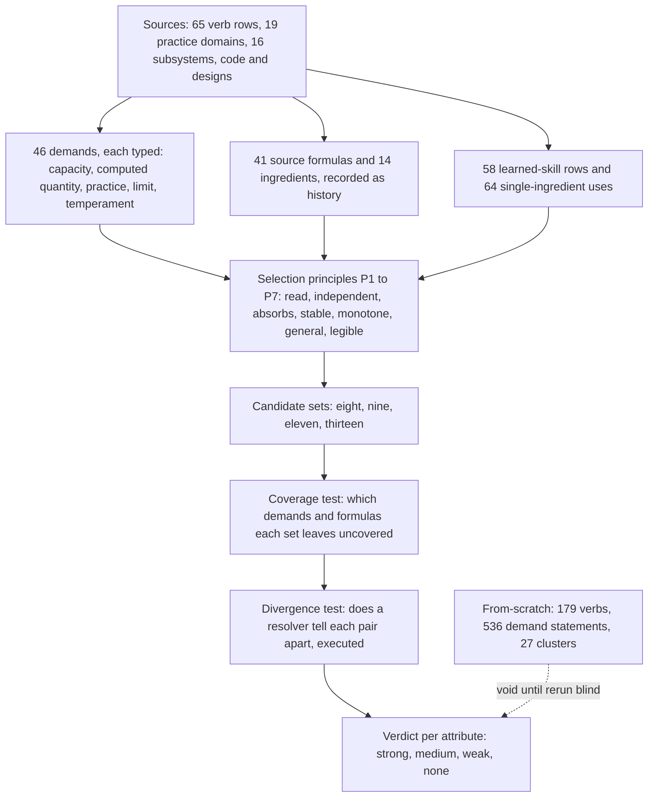
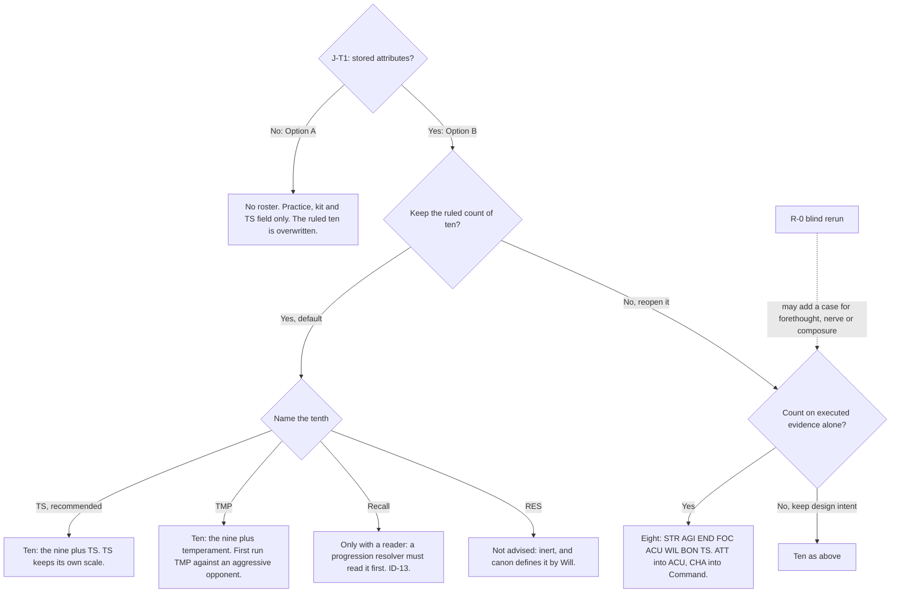

# Verbs, v2 — part 02: Attributes

## Status: PROPOSED (2026-10-16). Not ratified; merging ratifies nothing unless Jordan so rules.
## Parts, in reading order: [head](2026-10-16-verbs-01-thesis-and-persons.md) (§0, Part I Persons) · **this file** (Part II Attributes) · [`verbs-03`](2026-10-16-verbs-03-standards-roster-and-reconciliation.md) and [`verbs-04`](2026-10-16-verbs-04-critics-etymology-gaps-and-decisions.md) (Part III Verbs: standards, roster, reconciliation; critics, etymology audit, gap coverage, named mechanics, decisions) · [`verbs-05`](2026-10-16-verbs-05-what-verbs-do-to-the-world-1.md) and [`verbs-06`](2026-10-16-verbs-06-what-verbs-do-to-the-world-2.md) (Part IV What verbs do to the world) · [`verbs-07`](2026-10-16-verbs-07-roadmap-reliability-and-sources.md) (§5 Roadmap, §6 Reliability ledger, §7 Sources) · [`verbs-08`](2026-10-16-verbs-08-engine-findings-from-the-first-trial.md) (Part V: engine findings carried from the first-pass trial) · Part VI, the lexicon by subsystem: [`verbs-09`](2026-10-16-verbs-09-lexicon-personal-combat.md) PC · [`verbs-10`](2026-10-16-verbs-10-lexicon-mass-battle.md) MB · [`verbs-11`](2026-10-16-verbs-11-lexicon-social-contest.md) SC · [`verbs-12`](2026-10-16-verbs-12-lexicon-fieldwork-and-inquiry.md) FI · [`verbs-13`](2026-10-16-verbs-13-lexicon-threadwork.md) TW · [`verbs-14`](2026-10-16-verbs-14-lexicon-settlements-and-governance.md) GV · [`verbs-15`](2026-10-16-verbs-15-lexicon-faction-actions.md) FA · [`verbs-16`](2026-10-16-verbs-16-lexicon-economy-trade-and-craft.md) EC · [`verbs-17`](2026-10-16-verbs-17-lexicon-world-travel-and-survival.md) WT · [`verbs-18`](2026-10-16-verbs-18-lexicon-npc-life-and-persons.md) NP · Part VII, the verb gap register (the evidence behind Part VI's coverage tables): [`verbs-19`](2026-10-16-verbs-19-gap-register-pc-and-np.md) PC+NP · [`verbs-20`](2026-10-16-verbs-20-gap-register-mb-and-fa.md) MB+FA · [`verbs-21`](2026-10-16-verbs-21-gap-register-sc-and-gv.md) SC+GV · [`verbs-22`](2026-10-16-verbs-22-gap-register-fi-and-tw.md) FI+TW · [`verbs-23`](2026-10-16-verbs-23-gap-register-ec-and-wt.md) EC+WT.

**Note (2026-10-17): the verb Parts were rewritten.** Where this Part cites "Part III's triage" of the 86 designed verbs, or "65 live rows", it means the first-pass Part III (as filed at `716c253`). Part III now carries a 92-verb roster (`verbs-03` §III.3). The shipped-verb demands (the Derivation's 46) are unaffected, and the From-scratch fourteen stays void (§II.6). No attribute evidence was re-derived against the new roster: the blind rerun (R-0) should take that roster as its fixed verb list, which is why the roadmap keeps R-0 open.

Codes: STR AGI END FOC ACU WIL ATT CHA BON are the registry's nine
(`references/descriptor_registry.yaml:36-48`) [CHECKED]; TS Thread Sensitivity; REC Recall; RES
resilience; TMP temperament (`disp`); PRA practice (`capability`, History). Pair ids (D01, X04, A01,
L01 …) are the executed divergence test's (`proposals/2026-10-16-attribute-derivation_divergence.md`
§5). Demand names in `code font` are the Derivation's 46 (head §1.5).

---

## PART II. ATTRIBUTES

### II.1 What the evidence supports, and what it does not

**Claim.** The executed evidence supports seven attributes strongly: STR, AGI, END, ACU, FOC, WIL and
TS. It supports BON narrowly, ATT and CHA only through design intent, and Recall not at all. The v2
recommendation for a stored roster is therefore **the registry's nine plus TS as the tenth**. This
departs from v1's recommended eleven by dropping Recall.

**What the evidence is, and its limits.** Three bodies of work, of different strength:

- **Executed (strongest).** The divergence test ran every code reader of every ingredient, against a
  control band, over 37 pairs. It found 16 SEPARABLE, 7 IDENTICAL-BY-CODE, 1 SEPARABLE-ONLY-BY-MAGNITUDE
  and 13 NOT TESTABLE (`_divergence` §5).
  - It ran stub modules on fields the season loop never sets (T2), and one matchup per resolver.
  - So it shows what the stubs DO with an attribute. It does not show what the game needs.
- **Read and counted (medium).** The Derivation collected 46 demands, 41 source formulas, 58
  learned-skill rows and 64 sourced single-ingredient uses, and reproduces every count by one command
  (Derivation head §1.7). **Of 171 demand-statements, 63 are T4 design intent and 80 are the
  producer's inference; 16 are T1–T3** (2 + 13 + 1).
  - So coverage of a demand is mostly coverage of a design document's vocabulary.
  - The Derivation says so itself: its coverage test *"favours a set built from today's ingredient
    vocabulary"* (Derivation `_part3` §6).
- **Judged from scratch (weakest, and currently void).** The from-scratch fourteen was built from 179
  verbs, 86 of them the author's own additions. Its critic found it contaminated by its brief (§II.6).

**What the evidence cannot decide.** Whether the game should have innate attributes at all. That is
J-T1 (Part I §I.5), a design choice. Measurement can say which attributes earn a slot IF there are
attributes. It cannot say whether there should be any.

### II.2 The method, as it should be read

**Read the arrows as the order of trust.** Coverage (`C`) says only that some document names a demand
the set can express. Divergence (`X`) says a resolver actually distinguishes two candidates. Where the
two disagree, divergence wins, because it is the only step that executed code (`CLAUDE.md` §0.05).
v1 ran the steps in this order but weighted coverage most when it selected Recall. That is the error
v2 corrects.

### II.3 The 46 demands, grouped

Each demand sits under the primary that expresses it. The grouping rule (Derivation `_part3` §8.1):

- a capacity goes under the primary it uses;
- a computed quantity goes under the heaviest term of its formula, ties to the ingredient written first;
- practice goes to *practice*; a lean goes to *temperament*.

Counts per kind: CAPACITY 19, COMPUTED QUANTITY 14, PRACTICE 9, LIMIT 2, TEMPERAMENT 2 (head §1.5).

| group | demands | statements named / overridden / inferred | best tier |
|---|---|---|---|
| STR | `strength` | 1 / 0 / 2 | T2 |
| AGI | `quickness`, `reflexes`, `balance`, `dexterity` | 3 / 0 / 9 | T2 |
| END | `stamina`, `toughness`, `hardiness` | 6 / 0 / 8 | **T1** (through BODY → `end`) |
| FOC | `concentration` | 3 / 1 / 5 | T2 |
| ACU | `reasoning`, `observation`, `spatial-sense`, `land-sense`, `anticipation` | 15 / 3 / 8 | T2 |
| WIL | `will`, `steadfastness`, `sincerity`, `devotion`, `contact-endurance` | 16 / 0 / 1 | T2 |
| ATT | `reading-people`, `empathy`, `discernment` | 4 / 2 / 6 | T2 |
| CHA | `presence`, `persuasiveness`, `judgment`, `leadership`, `situational-awareness`, `tactical-read` | 7 / 3 / 17 | T2 |
| BON | `relational-depth` | 3 / 0 / 0 | T2 |
| REC | `memory`, `inference`, `learning`, `breadth`, `practice-ceiling` | 7 / 3 / 3 | **T4 only** |
| TS | `thread-sensitivity` | 9 / 0 / 1 | T2 (+T3 gate, K-3) |
| uncovered | `self-coherence` (resilience, gain 0) | 3 / 0 / 0 | T2, dark |
| temperament | `boldness`, `patience` | 1 / 0 / 5 | T2 |
| practice | `deception`, `discipline`, `intimidation`, `numeracy`, `planning`, `precision`, `quick-thinking`, `verbal-fluency` | 0 / 0 / 15 | none |

Source: Derivation `_part3` §8.1. The pattern to read is the **inferred** column.

- CHA's six demands rest on 17 inferred statements against 7 named.
- The eight practice demands rest on inference alone.
- Three of CHA's demands (`leadership`, `situational-awareness`, `tactical-read`) are uses of one
  field, Command, and are byte-identical in code (D12).

So **CHA's apparent breadth is mostly the producer's reading of one derived score.**

### II.4 The one mapping: nine, eleven, fourteen, demands, code evidence, v2 verdict

**Claim.** Lined up against the executed evidence, the three proposed rosters agree on the body and on
the thread. They disagree exactly where no code reads anything.

| v2 code | registry nine | v1 eleven | from-scratch fourteen | demand group | what code does with it (executed) | **v2 grade** |
|---|---|---|---|---|---|---|
| STR | Strength | STR | bodily force (agrees) | STR | combat only: impact, handling, bind, half of Balance; +9.90 points of win rate at +1; separable from END (X02) and AGI (X10) | **strong**, combat-only |
| AGI | Agility | AGI | quickness + fine hand (splits) | AGI | combat only: tempo, reflex, initiative, counter; +8.78 at +1; quickness is a real channel (3.50 of the 8.78); `dexterity` has no reader (D06) | **strong**, combat-only |
| END | Endurance | END | toughness (agrees) | END | combat: Durability and the stamina reserve; the season loop's one personal field, `end`, is computed from BODY (D03 identical); +4.50 at +1 | **strong** |
| FOC | Focus | FOC | none whole (composure, watchfulness, constancy) | FOC | combat: in code exactly the Concentration-tracker term (D07); separable from WIL, and merging them loses a measured dimension (X01, A01) | **strong**, combat-only |
| ACU | Acuity (Cognition) | ACU | reasoning + watchfulness + forethought (splits) | ACU | combat Reading (+17.89 at +1, the largest attribute lever); one-third of Command; the collective-helper dice | **strong** |
| WIL | Will (Spirit) | WIL | constancy (agrees in part) | WIL | thread pool and knot roll (T2); separable from TS (X09), BON (X07), END (X06); **no combat channel of its own** (§3.2: a Spirit+1 fighter is identical to a rescaled END/FOC one on 4,951 of 5,000 seeds) | **strong**, thread and knots |
| TS | practitioner stat | TS | thread perception (agrees) | TS | thread pool TPS term, Leap gate and Ob band, knot party gate, opposing Ob, anchor rank; separable from WIL except inside Weaving (X09) | **strong** |
| BON | Bonds | BON | warmth (agrees, broader) | BON | knot gate (≥ 5) and cap only; one attempt unchanged past the gate (X07) | **medium** (eligibility only) |
| ATT | Attunement | ATT | reading people (agrees) | ATT | one-third of Reading, a minor Reflex term; **a rescaled ACU wherever code reads it** (X05: k = 0.945, residual 0.46) | **weak**: design intent only (7 named T4 uses, 15 Histories skills) |
| CHA | Charisma | CHA | presence (agrees in part) | CHA | contest: byte-identical inert across 20,000 bouts (D13, L04). Field: two-thirds of Command, which changes end states in 1 of 10 battery rows, and there morale only (§3.3). The season field fixes Command at 4 | **weak**: design intent only (8 named T4 uses) |
| REC | — (not in the registry) | REC | reasoning, in part; learning, breadth and ceiling have no home | REC | **no Python field** (X08, D17 NOT TESTABLE) | **none** |
| RES | — | (larger set only) | a track | uncovered | inert at the shipped gain 0, byte-identical on 20,000 seeds; canon defines it by Spirit (`operations.py:144`) | **none** (fold into WIL if ever lit) |
| TMP | — | (larger set only) | nerve (no counterpart) | temperament | monotone in the one matchup tested (X12), a lean by design | **a field beside the attributes, not one of them** |
| — | — | — | forethought, nerve, composure (no counterpart) | practice / temperament | **no reader at any tier above the author's judgement** | **none, pending a blind rerun** |

Sources: `_divergence` §3–§6; Derivation `_part3` §7.4; From-scratch `_part5` §7.1–§7.2. **One v1
conflict is settled here.** The Derivation calls CHA *"narrowed at T2"*. The divergence file calls it
*"inert at T2"* (§7), but its own §3.3 shows Command 6 and 7 moving morale beyond the band in one
battery row. The executed figures win over both summaries: **CHA is near-inert at T2**. It reaches an
outcome only as two-thirds of a Command that moves one row's morale.

### II.5 The ranking, and the recommended set

**Strong** (a code reader that moves an outcome, and separable from its neighbours by executed test):

1. **ACU**: the largest attribute lever in combat, and the only mind attribute with readers in two
   resolvers.
2. **STR, AGI, END, FOC**: each moves combat outcomes beyond the band and separates from its neighbour.
   All four are combat-only in code; END alone also reaches the season loop, through BODY.
3. **WIL**: its readers are the thread pool and the knot roll. In combat it adds nothing END and FOC
   do not carry.
4. **TS**: five distinct readers across threadwork and knots. It separates from WIL wherever the code
   does more than add it into one pool.

**Medium:** **BON**. A gate and a cap, one formula (`⌊BON/2⌋ + 1`), and the knot also gates on
Disposition (`knots.py:189-193`, v1 critic-confirmed).

**Weak:**

- **ATT**: in code, half an ACU.
- **CHA**: in code, near-inert.

Each keeps its place only because it is ruled (the registry's nine) and because designs name many
uses (`_aptitudes`).

**None:** REC; RES; and every from-scratch-only candidate (forethought, nerve, composure, fine hand,
watchfulness).

**The recommended stored set (if J-T1 is B): STR · AGI · END · FOC · ACU · WIL · ATT · CHA · BON · TS.**

**Confidence, with its size and source.**

- **High** that Recall should not be the tenth now. It has no reader in any code, and the Derivation
  itself calls its N-line *"FALSE … today"* (Derivation `_part3` §7.4).
- **Medium** for the seven strong members. Each rests on one matchup per resolver, in stub code the
  loop does not run (`_divergence` §8).
- **Low** that ATT and CHA earn separate slots on evidence. They stand on the ruling and on design
  intent. If Jordan reopens the count, the code supports exactly two cuts: ATT into ACU (X05), and CHA
  into a derived or authored Command (X04).

**Coverage of the recommended ten.** This is inferred from the Derivation's printed K04 line (today's
nine) by adding TS; the command was not re-run here. The ten leave **7 demands and 7 formulas
uncovered**:

- the Recall family: `memory`, `inference`, `learning`, `breadth`, `practice-ceiling` and F25, F37–F40;
- `self-coherence` and F34 (dark);
- `boldness` and F17 (a lean).

Every one of these is either a design-only progression formula (HIST) or a dark slot.

**Why TS, and not Recall, TMP or RES, is the tenth.**

- *Premise 1.* ID-13 requires a reader (`01_AXIOMS.md:561`) [CHECKED].
- *Premise 2.* Of the candidates outside the nine, only TS has outcome-moving T2 readers in two
  subsystems and separates from its nearest neighbour (X09).
  - Recall has none (X08).
  - RES is inert as shipped (D15).
  - TMP is a lean read as `(disp − 4)/3`, monotone in one matchup only (X12).
- *Premise 3.* TS already has a ratified-as-intent carrier: K-3's `thread_sensitivity` field
  (`workplans/valoria_master_workplan_v9_part8.md:207`) [CHECKED]. Naming it the tenth adds no carrier.
- *Premise 4.* Both the Derivation (on formulas) and the From-scratch work (on verbs, blind) select
  it. It is the one non-body primary on which the two bases agree.
- *Conclusion.* TS is the tenth.

**The strongest counter-argument.** *TS is a practitioner stat on a 0–100 scale that grows by
exposure (`derived_stats_v30:578`, carried); the registry files it apart from attributes; making it
"the tenth attribute" mixes two scales on one sheet and relabels a Track.* This stands in part.

- **It costs legibility.** The Derivation's E score names the second scale as a cost (Derivation `_part3` §10).
- **It does not reverse the choice.** The alternatives each fail a test TS passes: Recall fails ID-13,
  RES fails ID-13, TMP fails monotonicity by design.
- **If Jordan wants the tenth to be a 1–7 capacity**, TMP is next. Its admission waits on one run:
  TMP against an aggressive opponent (`_divergence` §8, NOT CHECKED).

**Consequence.**

- Under B, `ATTRIBUTES_PENDING_TENTH` is filled with TS's key, and the loader's LR4 admits it on TS's
  own scale.
- Recall is recorded as a progression-design question, not an attribute: if a learning-rate resolver
  is ever built, its input is decided then (From-scratch `_part5` D-7).
- RES is re-expressed on WIL, canon's own definition (`operations.py:144`, carried), if it is ever lit.
- TMP is carried, if at all, as `disp` beside the attributes.

### II.6 The from-scratch fourteen is not independent, and must be rerun before it counts

**Claim.** The from-scratch derivation cannot be used as corroboration of the Derivation, nor as a
rival to it. It should be rerun under a neutral brief rather than corrected.

**Argument.** The from-scratch derivation was meant to be the structurally independent check on the
Derivation: same question, different base (verbs and etymology instead of formulas). Independence is
what it was for (`CLAUDE.md` §10, *"Independence is what you are buying"*). Its critic found the
independence broken at the source:

- **The brief named the result.** It named the eleven primaries and the count of 46 (From-scratch
  head, reading record). The selection principles of Phase A overlap the Derivation's, because the
  brief seeded them.
- **On the code, plan and lane verbs alone, its own P1** ("≥ 10 verbs and ≥ 4 subsystems") **admits
  only five attributes:** presence (12–15 verbs), forethought (12), toughness (11), nerve (11) and
  reasoning-with-memory (13). Its fourteen rest on the 86 verbs the author added (From-scratch `_part3` §5.6: force
  ranks 18th, quickness 24th, self-command 27th on code rows).
- **By its own definitions:**
  - Thread perception serves 2 verbs, not 12. The atomic demand "perceiving the threads" lands on
    `thread_read` and `trace` only (From-scratch `_part3` §5.3).
  - Warmth serves 6.
  - Fluency passes P1, yet it is excluded.
  - Nerve moves access (16 of 20 draws), so by the author's own P7 it belongs with values.
- **Its sources are mis-read.**
  - 6 of its 18 "plan" verbs are mis-sourced: `charge` is an `utter`; `detain` and `ban` are Tenure
    kinds already landed; `levy` was the plan's name for the store act, now `requisition`; `abolish`
    is a revert; `proclaim` is deleted.
  - About 15 of 25 sampled added verbs duplicate existing ones. Part III triages all 86 and finds 2
    that survive.
  - Its "n of n" root-family claims are false, 23 of its R tags are not root senses, and some columns
    count instances, not verbs.
- **Its etymologies are from memory, unchecked** (From-scratch head §2.1).

**Inference.** A derivation whose principles were seeded by the result it was to check, whose breadth
counts come mostly from its own additions, and whose additions mostly duplicate existing verbs, has
measured its author's sample. It has not measured the game. Correcting it in place keeps the seeded
principles. Only a rerun removes them.

**Counter-argument.** *Where it agrees with the Derivation (the body triad, TS, the social three), the
agreement is evidence even if the process was primed.* **It fails.** The agreement is exactly what a
primed author would produce, so it cannot be told apart from priming (*"REDUNDANCY, NOT
CORROBORATION"*, `CLAUDE.md` §10). Its disagreements (forethought, nerve, composure) are its only
unprimed signal, and they have no reader at any tier.

**Consequence: R-0, rerun under a neutral brief.** The brief must hold:

1. no named roster, count or prior derivation;
2. the verb list fixed in advance as Part III's roster of 92 verbs (`verbs-03` §III.3; the first-pass "65 live rows" are withdrawn), not the author's additions;
3. demand statements tagged by source, with root senses taken from a dictionary, not memory;
4. selection principles written and committed before any demand is collated;
5. a different producer from the Derivation's.

Until R-0 reports, the fourteen counts for nothing in J-T2. **Owner:** whoever commissions the rerun,
with Jordan informed. The rerun is a commission, not a ruling. *What R-0 can change:* only whether
forethought, nerve or composure has a verb-level case strong enough to justify building a resolver
that reads it, which is the only route by which any of them could earn a code reader
(From-scratch `_part5` §8.2, rows D-1 to D-3).

### II.7 The decision tree for Jordan: the count and the tenth

**What each branch builds.**

- **T1 (recommended).** Fill the tenth slot with TS; K-1 and K-6 read the roster.
- **E8.** Command becomes `derive_command(ACU)` or an authored or practised Command; the contest
  reads `faculty` alone, as it does today.
- **A0.** The template's `attributes:` key is never built.

**Owner of every branch:** Jordan.
