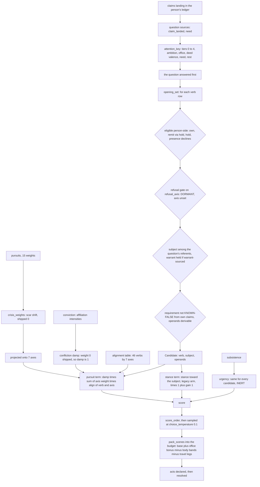
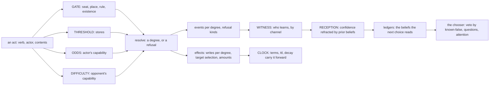
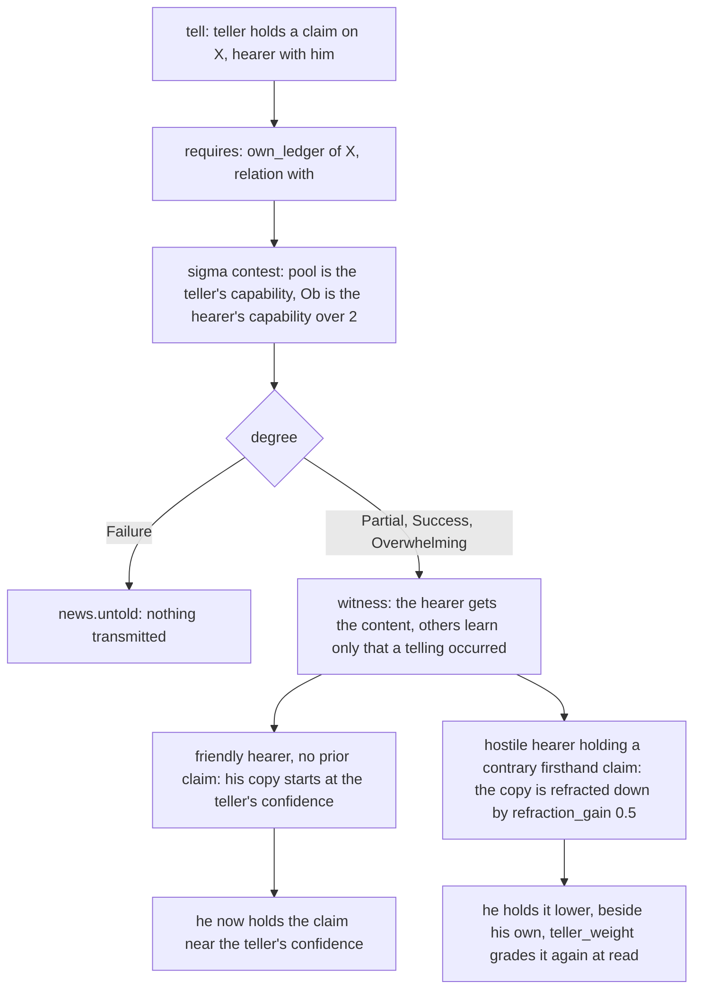
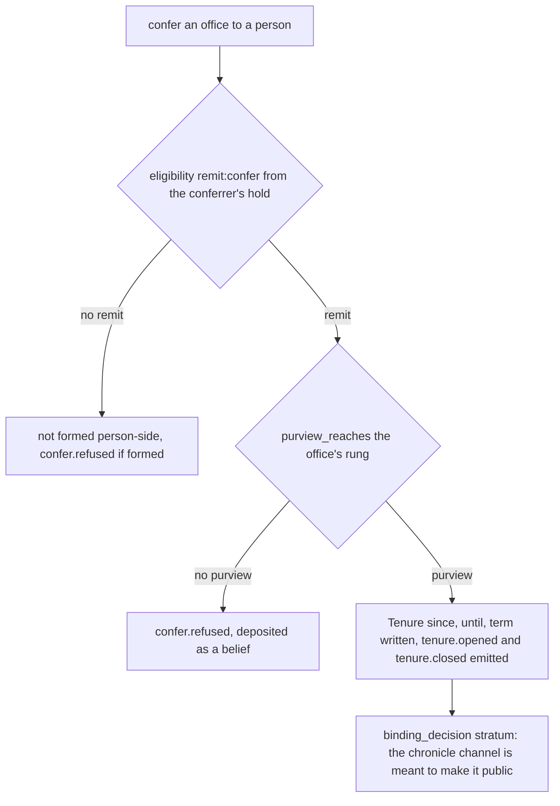
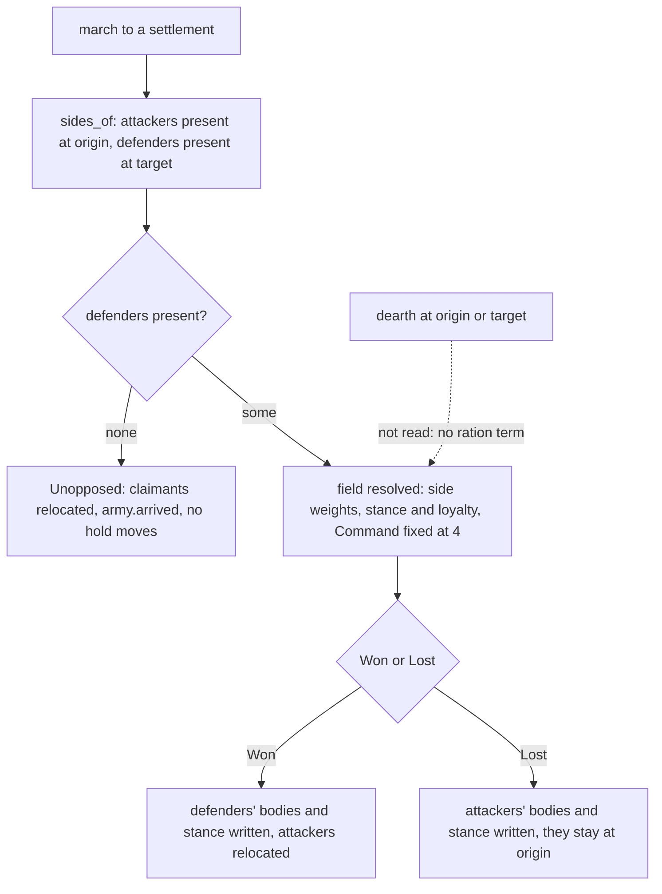
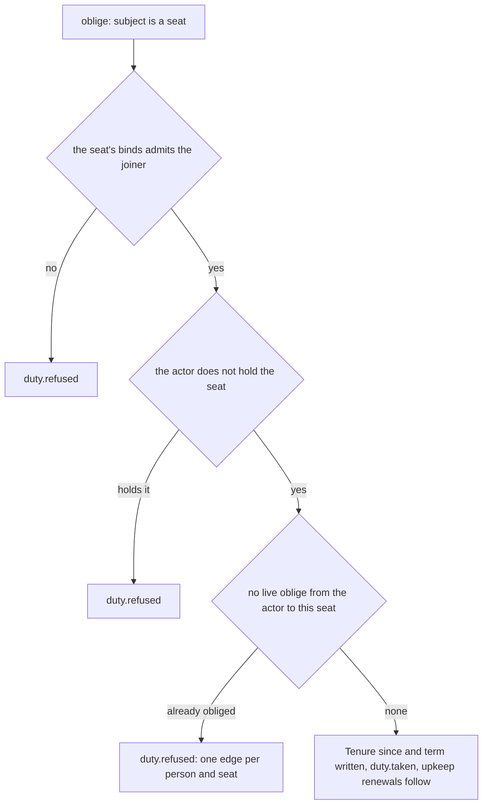

# Verbs, v2 — part 05: what verbs do to the world (I): the chooser, the world, and how context modulates an act

## Status: PROPOSED (2026-10-16). Not ratified; merging ratifies nothing unless Jordan so rules. Static reading only: no run was made for this Part. Every line marked [CHECKED] was opened in this pass; a claim only a run could settle is marked NOT CHECKED with the run named.
## Parts, in reading order: [head](2026-10-16-verbs-01-thesis-and-persons.md) (§0, Part I Persons) · [`verbs-02`](2026-10-16-verbs-02-attributes.md) (Part II Attributes) · [`verbs-03`](2026-10-16-verbs-03-standards-roster-and-reconciliation.md) and [`verbs-04`](2026-10-16-verbs-04-critics-etymology-gaps-and-decisions.md) (Part III Verbs: standards, roster, reconciliation; critics, etymology audit, gap coverage, named mechanics, decisions) · **this file** and [`verbs-06`](2026-10-16-verbs-06-what-verbs-do-to-the-world-2.md) (Part IV What verbs do to the world) · [`verbs-07`](2026-10-16-verbs-07-roadmap-reliability-and-sources.md) (§5 Roadmap, §6 Reliability ledger, §7 Sources) · [`verbs-08`](2026-10-16-verbs-08-engine-findings-from-the-first-trial.md) (Part V: engine findings carried from the first-pass trial) · Part VI, the lexicon by subsystem: [`verbs-09`](2026-10-16-verbs-09-lexicon-personal-combat.md) PC · [`verbs-10`](2026-10-16-verbs-10-lexicon-mass-battle.md) MB · [`verbs-11`](2026-10-16-verbs-11-lexicon-social-contest.md) SC · [`verbs-12`](2026-10-16-verbs-12-lexicon-fieldwork-and-inquiry.md) FI · [`verbs-13`](2026-10-16-verbs-13-lexicon-threadwork.md) TW · [`verbs-14`](2026-10-16-verbs-14-lexicon-settlements-and-governance.md) GV · [`verbs-15`](2026-10-16-verbs-15-lexicon-faction-actions.md) FA · [`verbs-16`](2026-10-16-verbs-16-lexicon-economy-trade-and-craft.md) EC · [`verbs-17`](2026-10-16-verbs-17-lexicon-world-travel-and-survival.md) WT · [`verbs-18`](2026-10-16-verbs-18-lexicon-npc-life-and-persons.md) NP · Part VII, the verb gap register (the evidence behind Part VI's coverage tables): [`verbs-19`](2026-10-16-verbs-19-gap-register-pc-and-np.md) PC+NP · [`verbs-20`](2026-10-16-verbs-20-gap-register-mb-and-fa.md) MB+FA · [`verbs-21`](2026-10-16-verbs-21-gap-register-sc-and-gv.md) SC+GV · [`verbs-22`](2026-10-16-verbs-22-gap-register-fi-and-tw.md) FI+TW · [`verbs-23`](2026-10-16-verbs-23-gap-register-ec-and-wt.md) EC+WT.

Paths are under `engine/season/` unless written in full.

---

## PART IV. WHAT VERBS DO TO THE WORLD, AND WHETHER THE CHOOSER SEES IT

### IV.0 The finding

**Claim.** The world modulates an act's outcome through about a dozen kinds of contextual node: the
actor's seat, the place, the opponent's capacity, the witnesses, the hearer's prior beliefs, the
stores, the terms in force. **The chooser that decides which act a person takes perceives four of
them**: the verb's identity, the subject's stance, the actor's own claims (as a filter and as the
source of questions), and the actor's own offices (as eligibility and scenes). Its value term reads
**the verb alone**.

A person therefore picks an act by what kind of act it is and how he feels about its subject, never
by what it will do in this context. That mismatch is the measure against which any decision-matrix
change should be assessed (§IV.11).

**Argument.**

- *Premise 1.* The chooser's value term is `damp · Σ_axis axis_w[axis] · align(c.verb, axis)`
  (`decision/choose.py:149`) [CHECKED]. `align` takes the verb and an axis, nothing else.
- *Premise 2.* The only candidate-dependent term besides it is the stance term, `stance_toward(p,
  c.subject)` under the shipped `legacy` arm (`choose.py:89-94`; `data/fixtures.py:796`) [CHECKED].
- *Premise 3.* The third term, urgency, *"HAS NO `c` IN IT … INERT BY CONSTRUCTION"*
  (`choose.py:217-238`) [CHECKED].
- *Premise 4.* The resolver reads, besides the actor: eligibility over seats and presence; `requires`
  forms over subject existence, relations, own claims, basis and stores; the opponent's `capability`
  as obstacle (`seam/wrappers/sigma.py:112`); the witness channels; and terms and clocks (§IV.3).
- *Conclusion.* Everything in Premise 4 that is not in Premises 1–2 is context the world uses and the
  chooser does not see.

**The strongest counter-argument.** *That is the epistemic design, not a defect. A person chooses on
what he believes (Jordan, 2026-09-02: "our understanding of all other words and actions is subjective
and singular", `decision/options.py:86-87`) [CHECKED]; a chooser that read the world would cheat.*

**It stands, and it sharpens the finding rather than dissolving it.** The chooser need not read the
world. It needs to read the person's own BELIEFS about the nodes that modulate the outcome: the
hearer he believes hostile, the granary he believes empty, the warden he believes watching.

- Clause 4 of `opening_set` already does this, but only as a veto: a requirement KNOWN-FALSE from
  one's own claims removes the candidate (`options.py:84-91`) [CHECKED].
- Nothing turns those same beliefs into a preference.

**The mismatch is between what the person could know and what the score uses, not between the
world and the score.**

**Consequence.** Any change to the decision matrix is assessed by one question: *does it let a
person's beliefs about the modulating nodes move his ranking?* §IV.11 lists node by node what that
would need.

### IV.1 The decision matrix, as it is in code

**What "the decision matrix" is.** It is not one matrix. It is a pipeline whose one true matrix is
the **verb × axis alignment table**: 46 verbs (three uncelled by design) × 7 bipolar axes
(`rosters.yaml: tables.alignment`, formula *"`score(c) = Σ_axis axis_weight[axis] · alignment(c.verb,
axis)`"*) [CHECKED]. It is fed by a person's 15 pursuit weights, projected onto the 7 axes through a
15 × 7 table (`rosters.yaml: tables.pursuit_projection`; `queries/person_q.py:564` `projected_axes`)
[CHECKED].

| term | reads | shipped state | source [CHECKED] |
|---|---|---|---|
| attention tier | own ambitions' referents; own tenures and purview; deed valence under own pursuits | live | `queries/world_q.py:1879-1904` |
| eligibility | own, `remit` (via the `hold` Tenure's granted acts), `hold`; **`presence` declines person-side** | live | `decision/options.py:373-396`, `:92-95` |
| refusal gate | projected weight on `refusal_axis` against the verb's cell | **dormant**: `refusal_axis=None` | `options.py:334-370`; `fixtures.py:698` |
| known-false veto | own claims contradicting a requirement | live | `options.py:84-91` |
| pursuit term | `align(verb, axis)` × projected pursuit weights × damp | live; damp = 1 (`confliction_weight=0`); scar shift 0 | `choose.py:149`; `fixtures.py:680`, `:688` |
| stance term | `stance_toward(p, subject)` × (1 + `stance_gain`) | `legacy` arm, gain 1 | `choose.py:54-106`; `fixtures.py:796`, `:810` |
| urgency | subsistence ÷ scale, the same for every candidate | inert by construction | `choose.py:217-238` |
| `benefits_me` | the verb's beneficiary column | **unwired**: nothing multiplies it | `choose.py:195-214` |
| sampling | `choice_temperature` | 0.1 | `fixtures.py:286` |
| scene budget | live `hold` count, body bands, travel legs | live | `decision/budget.py:57-61` |

**Static findings on the one matrix** (cells read by script from `rosters.yaml`) [CHECKED]:

1. **Six shipped verbs score 0 on values for every person:** `carry`, `restore`, `tell`, `examine`,
   `interview`, `thread_read`. `tell`, `thread_read` and `restore` are uncelled by design (`tell`:
   *"testimony's moral weight is in WHAT is told"*); `carry`, `examine` and `interview` are all `null`.
2. **One axis is empty.** `selfish_selfless` carries no nonzero cell for any verb. A person's whole
   projected weight on self against others moves no choice, and `benefits_me`, the term that would
   carry it, is unwired.
3. **Single-axis verbs are totally ordered for every person.**
   - `revoke` (−0.7), `issue` and `seize` (−0.6 each), `dispatch` (−0.5) and `convene` (−0.4) are
     celled on `hierarchical_equal` alone. For every person their value scores keep one order (its
     sign set by the person's weight on that axis), and `issue` and `seize` are **identical**.
   - Likewise `exchange` = `transfer` (+0.6), then `move` (+0.5) and `work` (+0.4), all celled on
     `deontological_instrumental` alone.
   - Within such a family only the stance term and eligibility separate them.
4. **The `deed:` rows** (`deed:person.died`, `deed:body.changed`) are celled. They judge others'
   deeds, not choices.

### IV.2 The world-state model

**Claim.** Worldly state is held on eight carriers. Acts write only a subset of their fields. Three
fields a person's choices depend on have no act that writes them at all: pursuits, conviction and
weight.

| carrier · field | written by (step) | an act writes it? | conserved / monotone / per-person | source [CHECKED] |
|---|---|---|---|---|
| `Person.body` | MAT, RES, ENC | yes: `fight`, `accept`, `march` (down) | per-person; raised by no shipped act | `write_matrix.yaml` row; `verb_table.yaml` |
| `Person.exists` | MAT, RES, CEN | yes: `fight` / `accept` Felled (down); CENSUS mints | per-person; acts only remove (ED-WR-0011) | same |
| `Person.stance` | RES, ENC | yes: `march` (the losing side's grudge) | per-person; acts only lower it | same; `loop/effects_combat.py:181-190` |
| `Person.pursuits` | RES | **no**: unproduced (H-62) | per-person; static in play | `write_matrix.yaml` (`unproduced`) |
| `Person.conviction` | RES, ENC | **no** verb cell (H-62); the crisis rewrites it | per-person | same |
| `Person.scar` | RES, ENC | no verb cell; WITNESS-time scarring | per-person; monotone up | same |
| `Person.capability` | — | **retired** until `train` lands | per-person | `write_matrix.yaml: retired` |
| `Person.weight` | CEN | no | per-person (cohorts) | same |
| `Person.travel_leg` | MAT, RES, ENC | yes: `move`, `migrate`, `march` | per-person | same |
| `Person.ledger` (claims) | WIT | only through WITNESS: every event deposits; `tell` carries content | per-person; decays (`Claim.confidence` on MAT, *"the THIRD licensed clock"*) | same |
| `Tenure.since` / `until` / `term` / `payload` | RES, ENC, MAT | yes: opened by confer, commit, oblige, give, found, determine, seize, move, migrate, march; closed by release, revoke, give, seize, fight; term by confer, oblige, transfer | relational (person → object) | same |
| `Rung.stores` | MAT, RES | yes: `transfer`, `requisition` (move), `found`, `build` (spend), `exchange` (declined) | **conserved under transfer** (two writes) [INFERRED from the row shape; NOT CHECKED: a run summing stores]; MATTER is the only source | `verb_table.yaml` |
| `Rung.exists` | RES | yes: `found` (create); none destroys (`raze` planned) | monotone up today | `write_matrix.yaml` |
| `Site.exists`, `Site.condition` | RES, MAT | `build` (create); `work`, `restore` (raise); MAT wear (lower) | condition raised by acts, lowered only by wear today (`sabotage` planned) | same |
| `Record.exists`, `stages`, `ttl` | RES, MAT | create_record, forge, issue, petition, open_case, survey (create); destroy_record (remove); MAT ttl | closable | same |
| `Proposition.exists` | RES | `utter` (create) | **immutable** (*"§14 — IMMUTABLE. There is no write"*) | same |
| `Office.exists`, `remit_acts` | RES | `establish` | monotone up: no act removes an office | same |
| `Date`, `DocketItem` | RES, CAL | `convene`, `carry`, `determine`, `open_case` | scheduled, then fired by CALENDAR | same |
| the event log | every act and clock | append-only | monotone | — |

**What the model shows.**

- Of a person's interior, acts reach **body, stance, location, tenures and (through WITNESS) the
  ledger**.
- Acts never reach **pursuits, conviction or scar** directly. The value system is static in play
  until `argue` (planned) or the crisis fires. NOT CHECKED: whether the crisis fires in a long run;
  the four-season probe found none (Template §2, probe 2).

### IV.3 The act as a structure: verb, actor, contents, situation

**Claim.** Every act is `verb + actor + contents + situation`. The verb row declares which contents
it needs and which situation nodes may veto, oppose or modulate it. **Contents** are the operands;
**situation** is the typed node set below.

**Contents, as declared** (from `verb_table.yaml`, `rosters.yaml: requires_operands` and
`requires_forms`, read by script) [CHECKED]:

| declaration | values in the tree | example rows |
|---|---|---|
| operands | `actor`, `subject`, `from`, `to`, `site`, `kind`, `amount`, `floor` | `transfer`: from, to, kind, amount |
| `requires_typed` forms | `existence`, `scalar_threshold`, `contain_path`, `cardinality`, `relation`, `own_ledger`, `basis` | `tell`: own_ledger(subject) + relation(to, with); `requisition`: basis(subject) + scalar_threshold(subject, kind) |
| `eligibility` | `own`, `remit:<act>`, `hold:<object>`, `presence:<rung or site>` | `requisition`: remit:issue + presence:<rung> |
| `counterparty` | `to`, `subject` (8 rows) | `tell` (to), `oblige` (subject: a seat) |
| `contests` | `"the body"` (`fight`, `accept`), `"a field"` (`march`), `"a standing"` (`tell`) | 4 rows |
| `scale` | settlement, territory, province, person (11 rows) | `issue`: province; `dispatch`: territory |
| `referent_class` | Office, Record, Rung (5 rows) | `confer`: Office; `requisition`: Rung |
| `writes` | per degree or flat | `march`: Declared, Won, Lost, Unopposed |
| `emits`, `emits_on_refusal` | event kinds per degree; refusal kinds per failing conjunct | `determine`: seven refusal conjuncts |

**The contextual nodes.** Each node type, what carries it, and which query exposes it.

| node | carrier | exposed by [CHECKED unless marked] |
|---|---|---|
| ACTOR | `Person` body, stance, ledger, capability, tenures | `budget.body_band_penalty`; `person_q.stance_toward` (:67), `regard` (:336); `sigma._capability` (:82) |
| SUBJECT / OBJECT / REFERENT | a Person, Rung, Site, Record, Office or Proposition named in the contents | `requires` forms `existence`, `relation`; `referents_of(q)` |
| SEAT / OFFICE exercised | a `hold` Tenure with `granted_acts`; `Act.via` | `options.exercised_seat` (:410), `seat_of` (:456), `treasury_of` (:621); `state/gate.py:352` `purview_reaches` |
| PLACE | Rung, Site; `contain` / `reside` | eligibility `presence:`; `contain_path`; `march_target_kinds` (settlement) |
| OBLIGATION / TERM graph | `oblige`, `commit`, `tie` Tenures; `Tenure.term` | `loop/predicates.py:339` `_req_oblige`; `world_q.establishment_of`; renewals |
| BELIEF | each person's claims, with confidence | `own_ledger` form; `options.dissents` (:1267), `refracted_confidence` (:1312), `teller_weight` (:1415) |
| WITNESS set | presence index, knots, documents, chronicle, obligees | `epistemic.observers_for` (:680); channels `co_located` (:331), `chronicle` (:546) |
| CLOCK | season tick, `Tenure.term`, `Date.due_at`, `Record.ttl`, claim decay | CALENDAR, MATTER |
| RESOURCE | `Rung.stores` by kind; shortfall records | `scalar_threshold` form; `store_kind_of` (:651); `_from_shortfall_claim` (:761) |
| THIRD PARTY | the opponent or hearer | `counterparty`; `sigma._obstacle_of` (:112) |
| RULE context | open case, warrant, docket, disposal game | `basis` form; `rosters.yaml: warrant_sourced`; `open_case` and `determine` refusals |

**The edges: how a node reaches an outcome.**

| edge | node types it carries | where evaluated in code |
|---|---|---|
| GATE / eligibility | SEAT, PLACE, RULE, SUBJECT existence | `requires` (eligibility, `basis`, `existence`, `relation`, `contain_path`); the person-side copy in `opening_set` |
| THRESHOLD | RESOURCE | `scalar_threshold` (stores ≥ amount) |
| DIFFICULTY (Ob) | THIRD PARTY's capacity (`capability` ÷ 2 for a person) | `sigma._obstacle_of` (:112); contested rows only |
| ODDS (pool) | ACTOR's capacity (`capability`; combat `end` from BODY) | `sigma._pool_of` (:97); `seam/wrappers/combat.py` |
| EFFECT SIZE | contents (`amount`), degree | effects (`loop/effects_*.py`) |
| TARGET SELECTION | SUBJECT, PLACE, OBLIGATION | effects; `loop/sides.py:40` `sides_of` |
| RECEPTION | BELIEF of each witness, WITNESS set | `loop/witness.py` (the told channel, `:705-760`): the hearer's copy starts at the teller's confidence and is refracted by channel and by firsthand holdings (`refraction_gain` 0.5 shipped, `fixtures.py:837`) |
| TIMING and REVERSIBILITY | CLOCK, OBLIGATION | MATTER (term maturity, ttl, decay); renewals in `effects_economy` |

### IV.4 Meaning against code: the ordinary-sense lever

**Claim.** For most shipped verbs, the contexts the verb's ordinary meaning calls for are not what the code
reads. The gaps cluster in three places:

- the opponent's will (only four rows are contested);
- the resource context (one row, `requisition`, reads stores, and `transfer` its `from`);
- the belief context of the acted-on party (only `tell` reaches it).

**Method, as corrected.** The first pass read the intended nodes from each verb's *root* sense, from memory. Two critics showed that this is the etymological fallacy and that several roots were misstated (L-01, V-12, V-13; `verbs-04` §III.7). The intended node is now read from the verb's **ordinary current sense** (`CLAUDE.md` §4, ED-IN-0179), and no gap rests on a root alone. Etymology is the linguistic record, kept with each verb in Part VI. Actual nodes are read from each row's eligibility, `requires_typed`, `counterparty` and `contests` (the script check of the first pass, at `716c253`; not re-run). Roles are Part IV §IV.7's; they are not repeated here (V-14).

| verb | ordinary sense | actual (code) | gap |
|---|---|---|---|
| `tell` | relate or recount; inform | own_ledger(subject), hearer with; contested by the hearer's `capability`; reception refracted by the hearer's beliefs | **none**: the best-modulated verb |
| `oblige` | (the row binds the actor to a seat; Part III renames it `pledge`.) Ordinary *oblige* means compel, or do a favour, which runs the other way | a seat as subject; one edge per (person, seat) (`predicates.py:396`); actor-side `own` | the seat's standing and the joiner's reason are not read |
| `commit` | bind oneself to a course or cause | existence(subject) | nothing about the actor's prior commitments |
| `confer` | bestow (a title, a grant) | remit:confer; purview (`gate.py:352`) | the recipient's standing is not read |
| `revoke` / `release` | annul or withdraw a grant; *release*: let go, set free | remit:revoke / own | the holder's resistance is not read |
| `issue` | put out, promulgate (an order, a writ) | remit:issue; existence(to), basis(to), own_ledger(subject) | the addressee's compliance is not modelled at issue; it is `comply` / `evade / defy` |
| `requisition` | demand and take for official use (supplies) | remit:issue + presence; basis; stores ≥ amount | the subject's hunger is not read (R-C-10's price is unbuilt) |
| `transfer` | move from one holder or place to another | from-stores ≥ amount; seat or own or hold | — |
| `march` | advance in a body; move an army | remit:dispatch; existence; contested by "a field" (sides, weights, stance, loyalty) | **ration and terrain are not read**: no provisioning term in the season loop (TROOP critic, grep 0, carried) |
| `fight` / `accept` | contend in combat; *accept*: take up (a challenge) | existence(subject); contested by the body (`end` from BODY) | the opponent's will to refuse is not read; `accept` duplicates `fight` |
| `challenge` | call to a contest, especially a duel; dispute | existence(subject) | nothing is written; refusal is not an event |
| `survey` | examine the extent or condition of; take a general view | own_ledger(subject) | **the place and the surveyor's purview are not read** |
| `examine` | inspect closely | presence at a site | **a concealer's Ob is not read** (R-C-15 open) |
| `interview` | question a person to obtain information | existence(subject) | **the interviewee's resistance is not read** |
| `surveil` | keep under observation (Part III renames it `watch`) | existence + present_at | **being seen is not modelled**: no covert witness rule |
| `reconstruct` / `research` | rebuild from evidence; *research*: investigate systematically | own_ledger / existence; presence | yields nothing beyond `finding.made` (R-C-23) |
| `construe` | interpret (a text or an act) | nothing | **everything**: grade `absent` |
| `determine` | settle authoritatively; decide | remit:determine; existence, basis, threshold; seven refusal conjuncts | the parties' evidence is not read (proofs roster unread) |
| `open_case`, `petition`, `carry`, `convene` | begin proceedings; *petition*: ask formally; *carry* (a petition; Part III renames it `lodge`); *convene*: call together | remit or own; basis or existence | the addressee's disposition is not read |
| `give` | hand over freely | the Record held_by the actor; the recipient with | — |
| `found`, `build` | establish (a town, an institution); *build*: construct | existence + held_by; stores spent | labour (cohort weight) is not read |
| `work`, `restore` | labour on, or exploit, a site; *restore*: return to a former condition | presence at a site; threshold | `× f(degree)` is unbuilt (H-164) |
| `move`, `migrate` | change place; *migrate*: relocate one's home | contain_path | dearth as a motive is not read at the act |
| `utter`, `speak` | say aloud, put into words; *speak*: say words, address | nothing | the audience is not read |
| `create_record`, `destroy_record`, `forge` | make a document; *destroy_record*: destroy one; *forge*: counterfeit | own or hold + presence; own_ledger (forge) | **forge's quality is not read by any inquiry** (H-210) |
| `dispatch`, `establish`, `succeed`, `seize`, `comply`, `evade / defy`, `exchange`, `tie / knot`, `thread_read` | (ordinary senses; see Part VI for each) | as their rows | effects declined or nothing written for `dispatch`, `succeed`, `exchange`, `tie / knot`, `comply`, `evade / defy` |

**Verbs the roster adds.** Part III's 92-verb roster adds acts that should read the node their ordinary sense names; each Part VI section states the node and the mechanic that supplies it. Examples: `interrogate` reads the interrogated person's resistance and the witnesses present; `conceal` reads the witness set, by a cover read at witnessing; `sabotage` reads concealment and the Site's condition; `tend` the patient's body; `persuade` the hearer's pursuits and prior beliefs; `forgive` the forgiver's stance and scar; `recruit` the target's regard and the seat's standing; `levy` the settlement's pool and the cohort's stance.

**Reading the table.** The context the code reads best is the ACTOR's seat and the SUBJECT's existence, which are gates. The context the meanings call for most is the OTHER person's will and beliefs. That is reached only by `tell` (reception) and by the four contested rows (difficulty). **The world is gate-rich and response-poor.** This finding rests on the checked actual-code column, and survives without any etymology (V-12).

### IV.5 How context modulates: four worked examples

Each follows one verb through two contexts, at each step citing the code path
(`requires` → `resolve` → `witness` → `effects`). No run was made.

**(1) `tell` to a friendly hearer, against a hostile one who holds a contrary claim.**

- **Path.** `verb_table.yaml` `tell` row; `seam/wrappers/sigma.py:97-129`; `loop/witness.py:705-760`;
  `decision/options.py:1312` [CHECKED].
- **What the chooser sees.** Hostility enters the score only as the stance term toward the SUBJECT X,
  never toward the hearer, and the hearer's capability (the Ob) is unseen. `tell` carries no values
  cell at all.

**(2) `confer` with purview over the settlement, and without it.**

- **Path.** `remit:confer`; `state/gate.py:352` `purview_reaches`; `loop/effects_governance.py`
  `_eff_confer`; `epistemic.py:546` `_ch_chronicle` [CHECKED].
- ⚠ **Who learns is uncertain.** `_ch_chronicle`'s own docstring says it *"matches NOBODY"* because no
  `binding_decision` verb was resolvable when it was written. Several now are (Template §A.2.1).
  Whether `chronicle` admits anyone today is NOT CHECKED (run: one season, count deposits whose
  channel is `chronicle`).
- **What the chooser sees.** Remit (eligibility) and the conferrer's stance toward the recipient. It
  does not see purview (it is not a person-side clause).

**(3) `march` on a defended settlement, and on an undefended one, in dearth.**

- **Path.** `loop/sides.py:40`; `seam/wrappers/mass_battle.py:126` (`_side_stance`) and `:231-249`
  (Unopposed); `loop/effects_combat.py:181-200` [CHECKED].
- **What the chooser sees.** The stance toward the subject and the verb's cells
  (`hierarchical_equal` −0.5, `partisan_equitable` −0.4, `grandiose_humble` −0.4,
  `deontological_instrumental` +0.4). Not the defenders' presence, not the odds, not dearth.

**(4) `oblige` to a seat, by a person not yet obliged and by one already obliged.**

- **Path.** `loop/predicates.py:339-396` `_req_oblige`; `loop/effects_governance.py` `_eff_oblige`
  [CHECKED].
- **What the chooser sees.** Clause 4 only if his own ledger holds a claim that he is already obliged
  (the known-false veto). Otherwise he forms the act and is refused.
- **Correction to the brief's framing.** `oblige` binds a person to a SEAT, not to another person.
  The "already bound" context is the existing edge to that seat.
