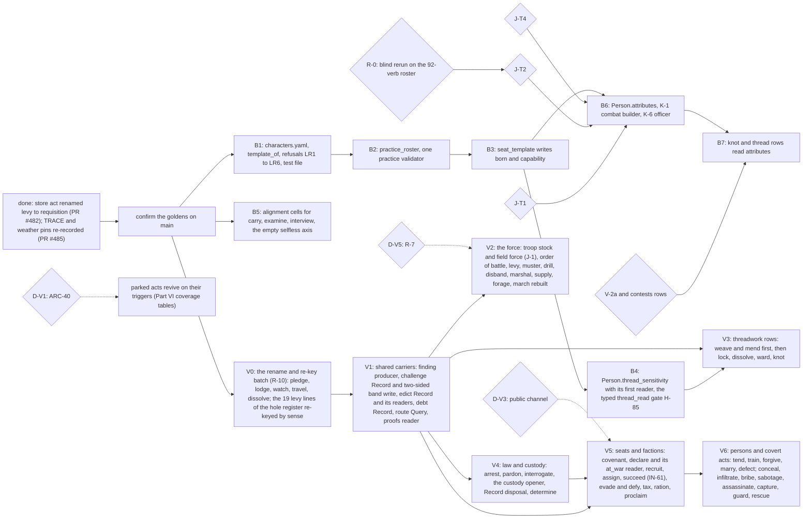

# Verbs, v2 — part 07: Roadmap, Reliability ledger, Sources, Trial registry

## Status: PROPOSED (2026-10-16). Not ratified; merging ratifies nothing unless Jordan so rules.
## Parts, in reading order: [head](2026-10-16-verbs-01-thesis-and-persons.md) (§0, Part I Persons) · [`verbs-02`](2026-10-16-verbs-02-attributes.md) (Part II Attributes) · [`verbs-03`](2026-10-16-verbs-03-standards-roster-and-reconciliation.md) and [`verbs-04`](2026-10-16-verbs-04-critics-etymology-gaps-and-decisions.md) (Part III Verbs: standards, roster, reconciliation; critics, etymology audit, gap coverage, named mechanics, decisions) · [`verbs-05`](2026-10-16-verbs-05-what-verbs-do-to-the-world-1.md) and [`verbs-06`](2026-10-16-verbs-06-what-verbs-do-to-the-world-2.md) (Part IV What verbs do to the world) · **this file** (§5 Roadmap, §6 Reliability ledger, §7 Sources) · [`verbs-08`](2026-10-16-verbs-08-engine-findings-from-the-first-trial.md) (Part V: engine findings carried from the first-pass trial) · Part VI, the lexicon by subsystem: [`verbs-09`](2026-10-16-verbs-09-lexicon-personal-combat.md) PC · [`verbs-10`](2026-10-16-verbs-10-lexicon-mass-battle.md) MB · [`verbs-11`](2026-10-16-verbs-11-lexicon-social-contest.md) SC · [`verbs-12`](2026-10-16-verbs-12-lexicon-fieldwork-and-inquiry.md) FI · [`verbs-13`](2026-10-16-verbs-13-lexicon-threadwork.md) TW · [`verbs-14`](2026-10-16-verbs-14-lexicon-settlements-and-governance.md) GV · [`verbs-15`](2026-10-16-verbs-15-lexicon-faction-actions.md) FA · [`verbs-16`](2026-10-16-verbs-16-lexicon-economy-trade-and-craft.md) EC · [`verbs-17`](2026-10-16-verbs-17-lexicon-world-travel-and-survival.md) WT · [`verbs-18`](2026-10-16-verbs-18-lexicon-npc-life-and-persons.md) NP · Part VII, the verb gap register (the evidence behind Part VI's coverage tables): [`verbs-19`](2026-10-16-verbs-19-gap-register-pc-and-np.md) PC+NP · [`verbs-20`](2026-10-16-verbs-20-gap-register-mb-and-fa.md) MB+FA · [`verbs-21`](2026-10-16-verbs-21-gap-register-sc-and-gv.md) SC+GV · [`verbs-22`](2026-10-16-verbs-22-gap-register-fi-and-tw.md) FI+TW · [`verbs-23`](2026-10-16-verbs-23-gap-register-ec-and-wt.md) EC+WT.

---

## 5. THE INTEGRATED ROADMAP (persons, attributes, verbs)

**Claim.**

- **Five builds need no ruling and should go first:** the template's shape (B1–B3), TS's carrier
  (B4), and the alignment cells the chooser lacks (B5).
- Every attribute build waits on J-T1. The roster closes on J-T2. The knot and thread readers wait
  on V-2a.
- The verb builds wait on the named mechanics of Part III §III.10, not on a verdict. They fall into seven batches (V0 to V6 below), in dependency order. The order is a dependency order derived from
  the lanes' mechanic tables, not a schedule, and it is not ratified. The first batch is a rename and re-key with a declared hash move.

**Each build, its gate and its falsifier.**

| build | gated by | falsifier |
|---|---|---|
| B1–B3 | nothing | the all-null control: the act log is unchanged with an empty template (Part I §I.6) |
| B4 | J-T1a, answered | the hash moves once, declared; `thread_read` becomes attemptable |
| B5 | nothing (cells are an `assumption` row, H-66) | `opening_set` rankings move for the six zero-scored verbs against the `uniform` sweep arm |
| B6 | J-T1, J-T2, J-T4 | two persons differing in one attribute differ in `fight`'s outcome rate, against the equal-attribute control |
| B7 | V-2a | — |
| V0 | nothing; the renames are R-10's | the hash moves once, declared; goldens re-recorded and said plainly (`CLAUDE.md` §7); no old `levy` citation names the troop act |
| V1 | nothing for most; the draw policy (Jordan's) for `M-DRAW`; D-V3 for the public channel | a Success inquiry leaves content in the actor's ledger (R-C-23); a `challenge` Record is closed by `accept`; a holder of an `edict` is taxed in ≥1 seed, a twin without it never; a borrower with a `debt` repays in ≥1 seed |
| V2 | J-1 (the troop body) and the field force (amends Layer 1); D-V5 for the season half of `retreat` | a force raised by `levy` marches and arrives with its allegiance; two fields identical but for the commander differ in survivor fraction, equal commanders byte-identical |
| V3 | B4, IN-06 (coherence and TS on `Person`) | `weave` lowers coherence and `mend` raises it in one batch; a locked write is refused |
| V4 | SC-03a (`detain`, landed); IN-10 | `arrest` opens a `detain` to a seat; `pardon` closes it; `interrogate` deposits a proof the bench reads |
| V5 | IN-12 step 7 (`covenant`); IN-61; D-V3; FA-M1 | a `declare` makes `at_war(a, b)` True and a `war.declared` claim reaches a non-co-located head in the season it happens; a private `utter` of mood WAR does not |
| V6 | J-C-6 for `lie`-dependent acts; IN-12 step 10 (`conceal`) | a covered actor's witnesses hold `seen.who = None`; an uncovered control is still named |

**The decision table.**

| decision | options | effect | unblocks | recommended default | owner |
|---|---|---|---|---|---|
| **J-T1** the source of personal inputs | A derived · **B stored** · A-1 eight · (J-13 ii, orthogonal) | innate difference or practice only | B6, R-09 by-person, K-1, K-6, K-GO-8 | **B**, on J-13's narrow reading (Part I §I.5) | Jordan |
| **J-T2** the tenth, and the count | **TS** · TMP · Recall (with a reader) · RES · reopen to eight | which subsystem gains a by-person input | B6's roster; Godot fields bind | **TS**; keep ten (Part II §II.5) | Jordan |
| **J-T4** do attributes change | **none** · age · wounds | whether the bodies pass reaches attributes | B6's write rule | **none** (the code's state) | Jordan |
| **V-2a** an attribute at a gate or cap, or on a row without `contests:` | admit gates and caps (V-2a) · add `contests:` to `tie / knot` and the thread rows · neither | whether BON, WIL and TS reach knots and threads | B7 | **V-2a for gates and caps; `contests:` on the thread rows when they ship; inquiry stays uncontested** | Jordan (V-2 is carried binding by the plan, `_part7.md:51`) |
| **R-0** the from-scratch fourteen | rerun under a neutral brief · correct in place · drop | whether forethought, nerve or composure has a case | J-T2's evidence | **rerun** (Part II §II.6) | whoever commissions it, Jordan informed |
| (answered) J-T3 kin | (i) not carried · (ii) carried with a reader | — | nothing | (i) [medium]; revert by ruling. The template only: the live half is K-NPC-6 (D-V2, answered in Part III by the convention floor: `marry` stands, births are Jordan's) | v1, ladder step 5 |
| (frame) J-C-6 do persons lie | yes · no | whether WITNESS CONSISTENCY can fail (Part IV §IV.9) | `lie` (parked), `conceal`, `forge` readers | **yes**, built in the order SC states (Part VI SC §3.9) | Jordan (Comparative C7) |
| **verb decisions** | see Part III §III.11 | the games the roster can build | V2 to V6 | the lane defaults named there | Jordan, for the items that survive the five tests |

---

## 6. RELIABILITY LEDGER

**Claim.** Every part of this work was produced and checked by one producer per artifact. Independent
critics checked the character template three times and the attribute derivation twice. **Three of
the final v1 artifacts have had no critic since their last revision:**

- the template's fourth pass;
- the derivation's third pass (the eleven);
- the divergence test.

The from-scratch work failed its only critic. Size each claim's trust accordingly.

| artifact | passes | critics (findings) | what the last critic saw | not checked |
|---|---|---|---|---|
| character template (3 files) | 4 | 3: `critics/CHAR_TEMPLATE.md` (22), `CHAR_TEMPLATE_2.md` (20), a third (13; its report is **not on disk**, only its reconciliation table in Template `_part3`) | the third pass | **the fourth pass (final) had no critic**; resolvable 37 by execution; probes 3–6 were re-run with artifacts in scratch (`tmpl/*.out`), not in the tree |
| attribute derivation (head, `verbs-02`, `verbs-03`, `_aptitudes`, `_equivalences`) | 3 | 2: a first critic (14 findings; report not on disk); the Opus critic `critics/ATTR_DERIVATION.md` | the second pass, which then recommended **the nine plus Recall** | **the third pass's eleven (re-framed by "ignore all prior rulings") had no critic**; the reproduction command was claimed diffed, not re-run here |
| divergence test | 1 | **none** | — | single producer; outputs in scratch (`div/`), not the tree; one matchup per resolver; TMP against an aggressive opponent |
| attributes from scratch (5 files) | 1 | 1 (findings summarized by the orchestrator; **not on disk**): CONTAMINATED | the only pass | no correction pass; etymologies from memory |
| research lane files | — | per-lane critics (scratch `critics/{PC,MB,...}.md`) | — | lane content beyond the rows cited here |
| this v2 | 1 | **none** | — | every carried locator not re-opened here keeps its v1 tag (§7.3); Part IV is static reading only; the alignment and verb-table extractions were by script this pass |
| the verb rewrite (Parts III, VI, VII) | 1 per subsystem (ten Opus lanes) | two Opus critics on the first pass and the incumbent lexicon (40 findings); two Opus etymology auditors on the lexicon chains; **no critic of the reconciliation (Part III §III.5) or of the assembled Parts** | the lane files as written | static reading and static lookup (Wiktionary, Lewis & Short); 'precedent games' marked `[MEMORY]` are unchecked; the gap register is extracted by readers and was not independently sampled; lane statements about what the code reads are carried from the lanes unless a row says it was opened |

**Known stale or shifted.**

- **v9 `_part5.md` line numbers.** The merge of `origin/main` (#483, #484) took the file from 475
  to 442 lines. Re-located this pass: J-13 `:400`, D2 `:411`, the charge `:68`, IN-12 `:54`
  [CHECKED]. Every other v1 `_part5.md` locator is [UNVERIFIED] until re-opened.
- **`seize`** shipped in #484 (`verb_table.yaml:898`). The verb table has 46 rows. v1's 45/12
  counts predate it.
- **`loop/predicates.py`.** `_req_oblige` is at `:339-396`. v1's `:394-395` was the old clause-4 line.
- **`_ch_chronicle`'s docstring** says the channel matches nobody, on a premise (no resolvable
  `binding_decision` verb) that no longer holds. Whether it fires today is NOT CHECKED by a run here;
  the same docstring now records realm measurements (positions `15d`, `17a`) in which it admits
  deposits (`engine/season/epistemic.py:546-572`) [CHECKED, in the trial's assembly], and SC-01 step
  13 deletes it (`workplans/valoria_master_workplan_v9_part6.md:68`) [CHECKED] (Part V §V.2.11).

**Etymologies.** The etymologies in `_equivalences` and the From-scratch work are from memory and were
unchecked against a dictionary; the From-scratch critic found several wrong and a method error (root sense used as
design intent). The verb etymologies in Part VI were looked up in Wiktionary and Lewis & Short and audited by
two independent auditors (`verbs-04` §III.8); what remains `[UNVERIFIED]` is tagged where it stands.

**The state of the branch.** PR #482 and PR #485 were squash-merged to `main` (`716c253`), which carries the first-pass v2 and the rename of `levy` to `requisition`. This rewrite continues on the same branch name, restarted from `main`; the test suite was not run for it (documents only).

---

## 7. SOURCES

### 7.1 The work distilled

- `proposals/2026-10-16-character-template.md`, `_part2.md`, `_part3.md`.
- `proposals/2026-10-16-attribute-derivation.md`, `_part2.md`, `_part3.md`, `_aptitudes.md`,
  `_equivalences.md`, `_divergence.md`.
- `proposals/2026-10-16-attributes-from-scratch.md`, `_part2.md` through `_part5.md`.
- Critics (session scratchpad, not in the tree):
  `/tmp/claude-0/-home-user-ttrpg/3f6de207-94f6-530b-a5b4-52aac53c2712/scratchpad/critics/CHAR_TEMPLATE.md`,
  `CHAR_TEMPLATE_2.md` and `ATTR_DERIVATION.md` (the troop-stock critics in the same directory are
  out of scope).
- `research/by_lane/00_COMPARATIVE_ANALYSIS.md` (C7, C8).
- **Not distilled here:** `proposals/2026-10-16-troop-stock-design.md` and `_part2.md`. Its verbs (`levy` and the force verbs) are in Part III as MB's; its design is read, not restated.
- The verb rewrite: the ten lane sections (Part VI) and the gap register (Part VII) are in the tree. The session scratchpad held the lane briefs, the two critic reports and their disposition table; their content is in `verbs-04` §III.7.
- Etymology sources: Wiktionary (raw wikitext, en.wiktionary.org) and Lewis & Short, *A Latin Dictionary* (Perseus, 1999.04.0059), fetched in this pass; Etymonline returned 403 and is not cited.

### 7.2 Opened in this pass (static reading)

- **Code and data:**
  - `engine/season/verb_table.yaml` (all 46 rows, by script);
  - `engine/season/write_matrix.yaml` (rows, retired);
  - `engine/season/rosters.yaml` (`question_sources`, `witness_channels`, `tables.alignment.cells`,
    `requires_forms`, `eligibility_kinds`, `referent_classes`, `strata`, `:75-90`);
  - `engine/season/data/fixtures.py` (`:286`, `:680`, `:688`, `:698`, `:796`, `:810`, `:837`);
  - `engine/season/decision/choose.py` (`:1-250`, `:393-486`), `options.py` (`:46-135`,
    `:295-396`), `budget.py` (`:40-76`);
  - `engine/season/queries/world_q.py:1879-1904`; `engine/season/loop/witness.py:705-760`;
    `engine/season/epistemic.py:331`, `:546-560`; `engine/season/loop/effects_combat.py:181-200`;
    `engine/season/loop/predicates.py:339-396`;
  - the `@effect_for` lines of `engine/season/loop/effects_*.py`;
  - `engine/substrate/descriptors.py:105-130`;
  - `references/descriptor_registry.yaml:27-48`, `:134-200`.
- **Rulings and plan:** `registers/editorial_ledger_in_archive.jsonl:137`;
  `architecture/meta/01_AXIOMS.md:561`;
  `proposals/2026-09-30-character-and-play-surface/10_verbs_and_attributes.md:198-199`;
  `workplans/valoria_master_workplan_v9_part4.md:41`, `_part5.md:54`, `:68`, `:400`, `:411`,
  `_part7.md:51`, `_part8.md:202`, `:207`, `:329`, `:340`.
- **Research:** `research/by_lane/{PC,MB,SC,FI,WR,SE,FA,NPC}_*.md`, the §1.2 and §2.2 tables (by
  extract).
- `skills/ners/SKILL.md` §2–§5.

### 7.3 Carried locators and their v1 tags

Every locator in this document without [CHECKED] is carried from the v1 document named beside it.
Its v1 tag stands:

- Template: [CHECKED], [CHECKED-3], [CHECKED-2], [CHECKED-draft], [RAN];
- Derivation: opened in its pass unless tagged *not opened*;
- From-scratch: unverified judgement.

Notable carried locators:

- `fieldwork_v30.md:301-306`, `:351` (Template, CHECKED in the fourth pass);
- `operations.py:235-247`, `:144`, `:157`, `:249-275` (Template CHECKED-3 / CHECKED; the
  divergence test CHECKED);
- `knots.py:185-222` (Template CHECKED-2);
- `exchange.py:57-66`, `:103-126` (Template CHECKED-2/3);
- `combatant.py:30-47`, `:93-94`, `:147` (Derivation critic, confirmed);
- `combat_systems.py:113`, `:171-188`, `:1416-1452` (Derivation critic, confirmed);
- `resolver.py:184-236` (Template CHECKED-2/3);
- `options.py:478-479` (Template CHECKED-draft).

---

## APPENDIX: THE FIRST-PASS TRIAL REGISTRY (retired)

The first-pass registry of 86 designed verbs and the trial's verdicts (as filed at `716c253`) is withdrawn with the Part V verdicts it fed. Its successor is Part VII (the gap register: 488 rows, each with its source, precedent documents and disposition) and the Part VI lexicon sections. Recover the old text with `git show 716c253:proposals/2026-10-16-v2-person-troop-attribute-synthesis_part7.md`.
