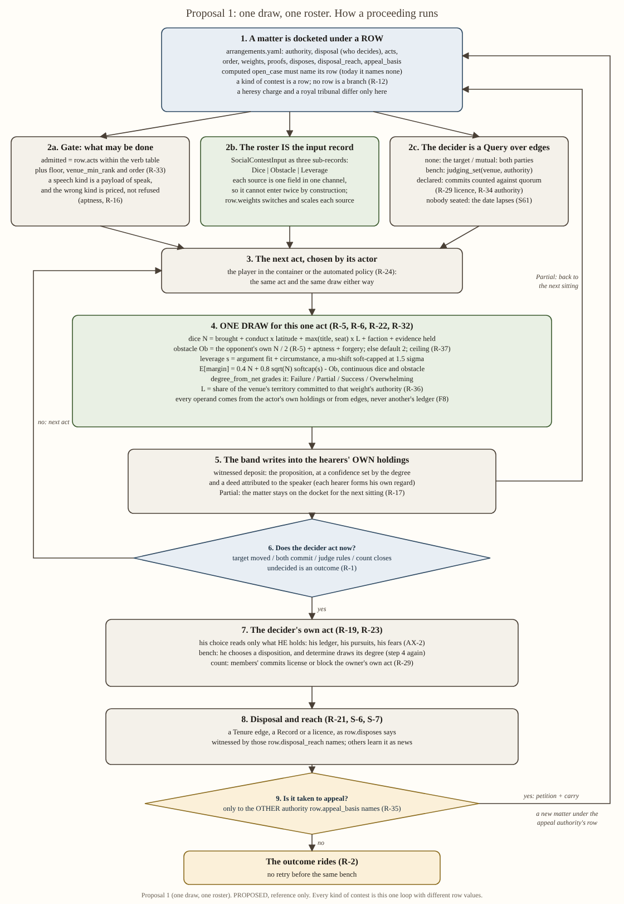

# Social contest, proposal 1: one draw, one roster

## Status: PROPOSED (reference; resolves nothing, schedules nothing)

One of three competing proposals built on `2026-10-30-social-contest-armature.md` (**AR**, read with its §I
corrections as given). Rulings `R-1..R-41` and `S-1..S-8` are those of `...-primitives-and-kinds.md` §1. Code
cites are to this checkout. Probabilities are my runs of `engine/dice_engine/sigma_leverage.py::p_success`
("meets" = Partial or better). Canadian spelling.

---

## 1. Executive overview

**What the subsystem is.** Valoria's social contest is how characters change one another's minds, win
judgments, strike bargains and pass motions, with no game master: the engine resolves every act.

**How a contest happens here.** A matter (an accusation, a petition, a motion, an offer) is placed on a docket
under a **row**: one line of data that says whose authority the venue carries, who decides, which acts are
allowed, how each source of advantage is weighted and what the outcome writes. People then act, one act at a
time. **Every act is one roll** of the same continuous, sigma-leveraged dice engine: dice for what the actor
holds, an obstacle for what the other side holds, a leverage shift for what lies between them. The roll moves
what hearers believe; the decider (the hearer himself, both parties, a judge, or a counted body) then acts by
his own choice, and the result is written into the world and spread as news.

**What is different.** It is the smallest of the three. No stages, no new authority objects: a proceeding is
just a run of single draws, a kind of contest is just a row, and authority is one key on the row. The
"roster" of advantage sources is the existing input record, split into three typed channels, so a source
cannot be counted twice.

**What it costs.** About six batches. The hard one is the link from a speech to a judgment, which does not
exist today. Procedure (issue joined before proof, stage-by-stage trials) is flattened into prices and
turn order; P2 keeps it.

**What it needs from Jordan.** The Layer-1 wording that lets an office carry weight; the obstacle ceiling's
value; what "5D" counts; how a parliament's count is weighted; whether equals should fail 61% of the time.

---

## 2. Flowchart

Source: `2026-10-30-social-contest-proposal-1-one-draw-flowchart.svg`. What is visible and distinctive: there
is one loop (steps 3 to 6) and one draw box (step 4) that every kind of contest passes through; the row (step 1)
is the only place kinds differ; the decider's judgment (step 7) is a second pass through the *same* draw, not a
different mechanism; and appeal is not a step but an arrow back to step 1 under another authority's row.

---

## 3. How it works

### 3.1 What is a code object and what is only a word

| code object (the game reads it) | owner | what it carries |
|---|---|---|
| **the row** | `engine/season/arrangements.yaml`, loaded by `engine/season/data/arrangements.py` | authority, decider (`disposal`), admitted acts, order, weights, proofs, disposes, reach, appeal, quorum |
| **the input record** (the roster) | `engine/season/queries/inputs.py::SocialContestInput`, split into `Dice`, `Obstacle`, `Leverage` | one field per source; the field's sub-record *is* its channel |
| **producers** | `engine/season/seam/wrappers/sigma.py`: `dice_of`, `obstacle_of`, `leverage_of` | one function per field, reading `World` |
| **the composition** | `modules/social_contest/roll.py` | N, Ob and s from the three sub-records; one continuous draw |
| **the ladder** | `engine/dice_engine/dice_engine.py::degree_from_net` | unchanged |
| **the gate** | `engine/season/state/gate.py` | admission by the row's `acts`, `floor`, `venue_min_rank`, `order` |
| **deciders** | `queries/world_q.py`: `judging_set(w, venue, authority)`, `commit_count(w, matter)`; the target and the parties need no Query | who decides |
| **legitimacy** | `queries/world_q.py::legitimacy_share(w, authority, territory)`, new | L, read when needed, stored nowhere (S-7) |
| **choice** | `engine/season/decision/` | the decider's own act, from what he holds |

**Only words, with no code object:** "kind" (K1 to K8 name families of row values); genre (read off
`Proposition.mood`); the stasis ladder and the oration's parts (they survive as which speech kinds are apt for a
matter, and as `order`); "standing" (title and seat in dice); "appeal" (`petition` plus `carry`). Nothing in this
proposal adds a stage, a track, a stored score or a second resolver.

### 3.2 The roster, and how it differs from the unification plan's

The unification plan (UP §1) proposed a data table of sources, each with a `side` (pool or obstacle), a
`producer` and a `venue_key`. AR B1 rejected it. P1 keeps its rule, *one source, one side, once*, and puts
it where the code already keeps the closed set:

| | UP's roster | P1's roster |
|---|---|---|
| channels | two sides | three typed sub-records: `Dice`, `Obstacle`, `Leverage` (σ is the channel R-32 names) |
| owner | a new table beside `SocialContestInput` (a second owner, §0.05 clause 3) | the record itself, a single Python owner |
| channel of a source | a `side:` string a reader must honour | the sub-record that declares the field; a field has one home, so **entering two channels is impossible by construction**, not by discipline (answers AR §I finding 5 for the channel half) |
| venue switch | a `venue_key` per source | one `weights:` column on the row, keyed by field name (R-12: every difference lives in the row) |
| producer | named in data | one function per sub-record in `sigma.py` |
| merged | none | standing into title and seat (S-7); "authority weight" into seat × L (R-36) |

**What stays discipline.** Two *different* fields could still read one fact (faction membership read for
`faction` dice and again for argument fit, say). The producers below are chosen so that no two read the same
edge family, and the falsifier is cheap: set one field's row weight to 0 and assert that only that producer's
reads stop moving the outcome. That is one test per source when it is built, not a standing guard (§0.1 pt 5).

The fields:

| sub-record | field | producer reads | row weight key | tier |
|---|---|---|---|---|
| `Dice` | `brought` | `Person.capability` brought keys (preparation, evidence discrimination, memory); `pool_default` where none is authored | `brought` | RULED source (R-31, R-40); scale ASSUMPTION |
| | `conduct`, `latitude` | conduct keys (presence, charisma: R-41) × a Query over the row's `interposed` | `conduct` | RULED (R-18, R-41) |
| | `standing` | max(row weight for his title, row weight for the seat he acts through, `Act.via`) × L of that seat's authority (AR B10) | `titles`, `seats` | RULED (R-31, R-36, R-38); sizes swept |
| | `faction` | row weight for each faction he holds a live `commit` to (`world_q.members`) | `factions` | RULED source (R-31); sizes swept |
| | `evidence` | his **own** ledger: deed claims about the opponent, by remove (`world_q.remove_weight`) × the row's grade for the proof kind; gross, no mirror | `proofs` | RULED (R-32, R-40) |
| `Obstacle` | `opposing` | the opponent's own `Dice` total **less his evidence** (see 3.3), or `None` | none: R-5 fixes ÷ 2 | RULED (R-5, R-38) |
| | `aptness` | `aptness_price` where the speech kind's `genres` lacks the matter's genre | none | RULED (R-16); price swept |
| | `forgery`, `default`, `ceiling`, `refusal_multiple` | as live (`roll.py:103-113`) | none | live; ceiling value G1 |
| `Leverage` | `fit` | the decider's live `commit` edges agreeing with the actor's proposition, less those agreeing with the opponent's; mean over deciders | `fit` | RULED source (R-32 "argument"); gain swept |
| | `circumstance` | the actor's live `hold` on the matter's object, less the opponent's | `circumstance` (0 except negotiation, R-34) | RULED (R-34, R-40); gain swept |

### 3.3 The one draw

AR §D.1's scheme, unchanged (the flowchart's step 4), on the continuous path (`roll_net_continuous`,
`sigma_leverage.py:299`). At the 5D reference against an equal (Ob 2.5) an act meets .390 and succeeds .201.

**Departure from AR B3 and B4 (the one substantive one).** AR put the bench's *reception* of the speaker in σ and
each party's evidence in his own score. Both read another person's ledger inside the fold
(`world_q.py:673` sums every bench member's ledger; `:759` reads the opponent's ledger for the mirror), which
`04_CODE_ARCHITECTURE.md` §B.2's F8 row forbids ("the fold may ask the ACTOR'S OWN ledger ... and no other",
`:253`), and ED-SC-0040's closing row resolved toward re-sourcing them (option B, an agent assumption). P1 takes
option B all the way, by placing each fact where it is someone's own:

- **Regard (reception) leaves the draw.** It is the decider's fact about the speaker, so it acts in the
  decider's own choice (`person_q.regard`, `person_q.py:393`, already person-side). This also answers AR's own
  attack H.3 ("whose fact is reception?"): his.
- **σ keeps what an edge can carry:** argument fit, read from `commit` edges, and circumstance, from `hold` edges.
- **Evidence enters only its holder's own draws.** The opponent's score is his capability, title, seat and
  faction; his proofs bite when he speaks. The mirror netting goes (AR §I finding 3 left it open).

What this costs is stated in §7: more weight on the speech-to-judgment link.

### 3.4 The action surface, limited by the venue (R-33)

The row gains `acts:` (a subset of the 56-verb table and of the speech kinds). `state/gate.py`'s admission refuses
a verb not in the docketed row's `acts`, a speaker outside `floor`, below `venue_min_rank`, or out of turn under
`order`:

| `order` | admitted when |
|---|---|
| `free` | always |
| `rank` | no attendee of higher rank holds an unspent turn this sitting |
| `alternating` | the last act on this matter was the other side's |
| `scripted` | the bench has opened (the inquisitor proposes) |

`written_only` is deleted: a written proceeding is the row with `weights.conduct: 0` (the petition discounts
presence, R-41) and no `speak` in `acts` (see §9a, a false N-line). A speech kind is the payload of `speak`;
choosing the wrong one raises the obstacle, never refuses (R-16). The six forensic kinds stay; deliberative and
epideictic kinds are content to add (propose, object, praise, blame, supplicate, frank speech; anger and detailed
denial as aptness rows per AR B28, ASSUMPTION).

### 3.5 The decider

`disposal` keeps its four values; P1 gives each a reader.

| `disposal` | decider (Query) | the decider's own act |
|---|---|---|
| `none` | the target (dyadic) or nobody (display) | deposits move the target's claims and pursuits; his later acts read them. In display each hearer's regard moves through the deed deposited |
| `mutual` | the parties (claimants) | each `commit`s to the terms by his own choice; both, and `give` or `oblige` opens; else impasse (R-1, R-11) |
| `bench` | `judging_set(w, venue, authority)` | the judge **chooses a disposition** from his own ledger (the speeches' deposits at their confidence), his regard for each speaker, his pursuits and fears; `determine` then draws its degree, his N against the party's N ÷ 2 (AR B6) |
| `declared` | members by `commit` edges; `quorum` | `commit_count` against the quorum licenses or blocks the owner's own act (R-29); no declaring verb, nothing stored |

### 3.6 Disposal, reach and appeal

`disposes` writes a Tenure edge (`oblige`, `detain`, `ban`; `hold` once `determine` can open one, the signal
`test_arrangements.py` already pins), a Record, or, for a `declared` row, the licence. `disposal_reach` names who
witnesses (room, body, rung); everyone else learns by news (S-7). Partial on an act about a docketed matter
leaves it docketed for the next sitting (R-17); a dyadic Partial leaves the hearer holding the claim at low
confidence, as `tell` already deposits it. `appeal_basis` changes value from a remit act to an **authority** (`polity`, `church`,
`none`). An appeal is `petition` plus `carry` to a row of that authority; the gate refuses a docket item for a
matter already determined under the same authority (R-2, R-35); the appeal row's `disposes: void` closes the
lower edge when it finds for the appellant. That cures the wedge and the stacked edges PROBE §2.3 found.

### 3.7 Legitimacy, office weight and authority (R-31, R-34, R-36, R-38)

- **Authority** is one key, `authority: parties | polity | church | none`. One `authorities:` map in
  `rosters.yaml` ties each `body` and `faction` spelling in `offices.yaml` to an authority (AR B17), and
  `judging_set` keeps only seats of the row's authority. Today it has no such filter, so the King and Queen sit on
  every bench, church benches included (AR §F).
- **Weight** is the row's `seats` and `titles` columns (R-31, R-38); per holder, the larger (AR B10). It lands on
  the holder's own roll, and reaches the other side only through the holder's score as obstacle (R-38 read per
  holder).
- **L** is `legitimacy_share(authority, territory)`: the share of persons in the venue's territory holding a live
  `commit` to that authority's faction (`world_q.members`, `:1795`). It reads edges, never ledgers, so it passes
  F8; it is a share, so it is floored at 0 (AR B20); it is computed when read (S-7, AR B21).
  `[ASSUMPTION; medium; revert: a mean of person_q.legitimacy over residents, which reads other ledgers and
  needs F8 amended]`. Unmeasured: how many residents hold such a commit. The realm seeds faction commits
  (`fac_church_of_solmund` sheets appear in realm runs, `hole_register.yaml:3794`), the corpus spine none; if
  laity commits are sparse, L is near 0 everywhere and every authority is weak, which B4 must measure first.
- **Crown over church** is AR B18's four routes and nothing new: a royal party brings his title or seat weight
  where the church row weights it, scaled by the *polity's* L; the crown holds `arrest` and `seize`; the crown
  confers and revokes; the church row's `appeal_basis: polity`.

---

## 4. The eight kinds through it

| kind | row values that differ | acts | who decides | what is written | who learns |
|---|---|---|---|---|---|
| K1 dyadic influence | `authority: none`, `disposal: none`, weights: titles only | `tell`, `argue`, frank speech | the target | his claims, pursuits | those present |
| K2 negotiation | `authority: parties`, `disposal: mutual`, weights: titles, `circumstance` | `utter` (offer), `argue`, `commit`, `give` | both parties | `commit` pair, then `give`/`oblige`; impasse | parties, principals |
| K3 adjudication: royal tribunal | `authority: polity`, `disposal: bench`, seats of the Crown, `appeal_basis: none` | `speak`, `tell`, `determine` | Crown seat-holders over the venue | `detain`, `ban`, `oblige` | `body` |
| K3 adjudication: heresy | `authority: church`, church seats, `order: scripted`, `appeal_basis: polity` | as above, forensic kinds | church seat-holders | `ban` | `body` |
| K4 petition | `disposal: bench`, bench of the addressee | `petition`, `carry`, intercession | the addressee | grant or lapse (R-1) | the petitioner |
| K5 panel or jury | as K3, `quorum` | as K3 | each member's disposition, counted | as K3 | as K3 |
| K6 parliament | `authority: polity`, `disposal: declared`, `order: rank`, `quorum` | `speak`, `commit` | the count | licence of the owner's act; members' pursuits drift (R-26) | body, then realm |
| K7 display | `disposal: none`, no `disposes` | display kinds | each hearer, privately | a deed per hearer; regard moves | the room |
| K8 over the forum | K3 or K6 values; the matter is a seat or a jurisdiction | as K3 or K6; forum challenge as a speech kind | as K3 or K6 | `confer`, `revoke`, `hold`; re-docket under another row | the realm |

### 4.1 Worked example A: a heresy charge where piety is weak

Today every church seat holding `determine` is anchored at T9, Himmelenger (AR §F, `offices.yaml`), so a church
bench sits only over venues inside T9; elsewhere `judging_set` is empty and the date lapses. Take a settlement in
T9. Capability is the default 4D for everyone (Q3); the row weights the inquisitorial seats at 3 (swept); the
inquisitor holds two told informer claims (remove weight 0.5 each, grade 1: evidence 1D). L is the share of the
territory committed to the Church: 0.9 (pious) against 0.2 (weak).

| act | pious (L 0.9) | weak (L 0.2) |
|---|---|---|
| the Senior Inquisitor speaks, `cite_incompatible` (apt): N = 4 + 3L + 1 against the miller's 4 ÷ 2 | N 7.7, Ob 2: meets .687, succeeds .514 | N 5.6, Ob 2: meets .550, succeeds .344 |
| the miller denies (apt): N 4 against the inquisitor's (4 + 3L) ÷ 2 | Ob 3.35, held to 3 by a ceiling of 3: meets .191 | Ob 2.3: meets .331 |
| the Cardinal of Justice chooses from his own ledger, then `determine`: N = 4 + 3L against 2 | meets .629, succeeds .439 | meets .463, succeeds .249 |

In the weak territory the church's weight shrinks on both its own rolls and in the miller's obstacle, which is
R-36's example exactly. What is written: a `ban` at the determined degree, or on Partial the matter stays docketed.
Who learns: the church body; everyone else by news. The miller (or his lord) may carry the matter to the crown
(`appeal_basis: polity`). If the miller were a royal person, his title would enter his dice at the polity's L, the
modulation R-34 asks for.

### 4.2 Worked example B: a royal tribunal with the King on the bench

`tribunal`, `authority: polity`. The King and Queen hold `determine` at realm scope and sit; with the authority
filter they sit here and not in church rows. A Duke is accused of withholding a levy. Weights: seat `off_king` 3,
title Duke 2 (swept). L of the polity in the Duke's territory: 0.7.

- The Duke's defence, with 1D of his own evidence: N = 4 + 2(0.7) + 1 = 6.4 against the King's score ÷ 2,
  (4 + 2.1) ÷ 2 = 3.05: meets .404.
- The King chooses a disposition from what he holds (the speeches' deposits, his regard for the Duke, his own
  pursuit of the levy), then `determine`: N 6.1 against the Duke's 5.4 ÷ 2 = 2.7: meets .448, succeeds .262.
- If the duchy is restive (L 0.3): N 4.9 against 2.3, meets .424. Low legitimacy flattens *both* ranks, since
  the Duke's title is a polity weight too.

Written: `detain` or `oblige`, reach `body`. No appeal: there is no authority above the sovereign
(`appeal_basis: none`, RD C7). The draw cannot make a determined King lenient; his choice can.

---

## 5. What it keeps, changes and deletes

**Deletions first.**

1. **The kernel**, `systems/social_contest/sim/contest/` (18 files, no game caller; CA §3 B-1), with its nine
   dependants repointed: six tests (including `test_import_cycle_game_state_npe.py`, which counts three import
   cycles), `sim_params.json`, `value_pointer_links.json`, the `sim_module:` pointer and the stale row in
   `references/module_contracts.yaml:448-470`. R-14; timing is SM-15's, already Jordan's (AR B23).
2. **The cross-ledger reads:** `world_q.reception` (`:673`) leaves the fold (regard moves to `person_q.regard` in
   choice); the mirror in `world_q.proofs` (`:759`) goes, and `proofs` becomes evidence from the actor's own
   ledger. With them go the fields `reception`, `reception_gain`, `proofs`, `proof_step` on `SocialContestInput`
   (`inputs.py:85-88`) and the room term in `roll.py:104-105`.
3. **The discrete path:** `roll_net` in `roll.py:124` (replaced by `roll_net_continuous`) and the `int(...)` cast in
   `sigma.py:131`.
4. **`leverage=0.0`** (`sigma.py:191`), `_capability`, `_pool_of`, `_opposition_of` (`sigma.py:104-146`), and the
   two-row `VERB_CAPABILITY` map (`data/rosters.py:528`), replaced by the three producers.
5. **Arrangement keys** `bench_basis` (every row says `determine`, the constant `BENCH_BASIS` owns it) and
   `records_dissent` (folded into `disposal_reach`); the `order` value `written_only`.
6. **Dead code** CA B-6 to B-10: the unreachable `ladder.degree_ladder` fallback, `contest()`'s unread `extension`
   parameter, `judging_set`'s unused `matter` parameter (replaced by `authority`).

**Changes** (each described in §3): `inputs.py::SocialContestInput` (three sub-records, float pool);
`roll.py::roll` and `obstacle`; `sigma.py::contest_input` (takes the row and `Act.via`, which CA §2 found unpassed;
calls three producers); `seam/contest.py::contest` (`row`, `via` keywords); `data/arrangements.py` (`authority`,
`acts`, `weights`, a `default_weights` block, `void` added to `_DISPOSES_LITERALS`, `:68`; 13 keys become 14);
`state/gate.py` (admission by row; the same-authority refusal); `queries/world_q.py` (`judging_set` by authority,
`legitimacy_share`, `commit_count` with `commit_count_guard`, `:164`, as its live-edge check); one `authorities:`
map in `rosters.yaml`; `decision/` (the disposition operand, the matter term, a row for computed `open_case`);
`verb_table.yaml`'s `speak` (deposits its proposition at a confidence set by the degree, and a deed attributed to
the speaker).

**Keeps.** `offices.yaml` as written: its `body` and `faction` spellings are read through the one map, and whether
the church's `determine` seats should reach beyond T9 is a content edit there, not a mechanism. The seam, the
provider, the composition row, the `Margin` contract, `degree_from_net`, S27.4's refusal,
`obstacle_default`, the forgery term, the docket, the witness channels, the verb table.

---

## 6. Execution path

| batch | what | runs after it | the test that shows it runs |
|---|---|---|---|
| **B1 delete** | §5 items 1 to 6 | the same season, smaller; `speak`'s obstacle loses the room term | suite green; `sys.modules` after a season holds no `systems.social_contest`; same-seed `content_hash` equal twice |
| **B2 the draw** | the three sub-records; continuous; `dice_of`, `obstacle_of`, `leverage_of`; `pool_default` as default capability; the ceiling's value | pools vary by person; σ moves outcomes | across `build_realm(0)` pools differ by person; a leverage of 0.5 moves the band distribution (today it does not, CA §1); 20,000 draws match `p_success` at 5D against Ob 2.5 |
| **B3 the row** | `authority`, `acts`, `weights`; gate admission; aptness; computed `open_case` names a row | rows change outcomes | one actor admitted to `speak` under one row and refused under another; a forensic kind in an OUGHT matter rolls against `aptness_price` more |
| **B4 authority** (needs Q1) | the `authorities:` map; `judging_set` filter; `legitimacy_share`; seat and title weights × L | heresy and royal tribunals differ by data | same accused, two rows, two benches, different N; sweeping L moves the church bench's degree |
| **B5 deciders** | the speech-to-judgment link (disposition operand, a matter term in choose from his own ledger, computed `determine` reached); `commit_count`; `mutual`; Partial re-dockets; appeal and `void` | every decider runs | AR H.1's falsifier: an `argue` Success on a judge flips his `determine` choice against a control; a motion carries or fails by count; a negotiation ends in `commit` or impasse; an appeal voids the lower edge; a same-bench retry is refused |
| **B6 rows** | seed negotiation, petition and audience, display, parliament at four rungs, appeal rows | the eight kinds construct | each seeded row reaches a roll in a computed season |

Effort: six batches; B5 is about as large as B2 to B4 together (AR §I finding 12). Jordan's answers are needed
before B2 (Q2, Q3), B4 (Q1) and B5 (Q4, Q5).

---

## 7. Strongest, weakest, and how it could be wrong

**Strongest.** One formula serves every kind, and the row is the only thing a designer edits (R-12, R-15, R-33).
The channel rule is a type, not a reader's promise. It deletes more than it adds: the kernel, two cross-ledger
reads, four record fields, a fixture pair, two keys and the integer path. It is the only proposal that removes the
F8 tension rather than carrying it (ED-SC-0040). Rulings best served: R-5, R-6, R-12, R-16, R-22, R-32, R-33, R-36.

**Weakest.**

1. **Everything rides on the speech-to-judgment link.** Regard and the judge's belief both act in his choice. If
   `choose` reads the deposits weakly, the best speaker wins every draw and loses the verdict, and R-18's
   "brilliant speaker rewarded" fails. Nothing of it exists today (PROBE §2.3); B5 builds it.
2. **Procedure is flattened.** *Litis contestatio* (the issue fixed before proof), the stasis descent as a
   sequence, and Cicero's parts survive only as aptness prices and turn order. A trial cannot rule "the fact is
   conceded; now argue the law" as a state. P2 can.
3. **σ is thin.** Fit and circumstance are both edge proxies with low evidence; outside negotiation σ is mostly
   fit. R-40 names "argument, leverage, standing" among the dice; P1 reads 5D as dice only (Q3) and so strains
   R-40.
4. **Content dependence.** Church benches reach only T9; capability is unauthored for all 83 persons, so with
   the default at 4D every person is equally able until attributes exist; L depends on how many residents hold a
   faction commit, which nobody has counted.

**How it could be wrong.** If the choice link cannot be made strong without reading other ledgers, regard must
return to the draw (AR B3), which brings back F8. If designers find themselves wanting per-kind sequencing, P1
has collapsed into P2 with extra steps. If sweeps show σ's share of variance exceeds dice at 12D (AR H.2), fit
belongs in dice.

**Rulings it strains:** R-40 (as above); R-18 (by placing the reward in choice); R-11's "many lines of
adjudication" is met only as one matter per draw, many docket items per sitting.

---

## 8. Departures and questions for Jordan

**Departures from the armature.** (1) Reception leaves the draw for the decider's choice, and σ keeps fit and
circumstance only (AR B3), by F8 and ED-SC-0040 option B. (2) The opponent's score excludes his evidence, and the
mirror goes (AR B4), by F8. (3) The roster is the record split by channel (AR B1 accepted the field-edit form;
this is that form with the channel made structural). (4) G6 is answered, not escalated: circumstance is σ only
where the row weights it (negotiation, R-34), and a pressed fear is always the target's choice (R-19); step 4,
the rulings divide it. (5) `written_only` is deleted.

**Questions (at most five).**

- **Q1. Layer 1 §A.3's wording** (AR G2): "a seat adds no verb and no modifier *of itself*; a venue row may license
  an office-keyed act set and weight." Nothing in B4 can be built before it.
- **Q2. The ceiling's value** (R-37, AR G1). P1 uses 3; it binds only where an opponent exceeds 6D.
- **Q3. What R-40's 5D counts** (AR G5), and so `pool_default`. P1 reads dice only and sets the default
  capability at 4D `[ASSUMPTION; medium; revert: 2]`.
- **Q4. The count's weights** (AR G3). In P1 this is a data value: `commit_count` reads the same `seats` and
  `titles` columns, so one seat one vote is the row with every weight 1. Which default?
- **Q5. Equals** (AR G4): keep R-5's ÷ 2 (an act against an equal fails 61% at 5D) or convert at × 0.4.

---

## 9. What I expect to be assessed on

### 9a. NERS

| cut | what dies | verdict |
|---|---|---|
| the `weights` column | R-31's venue-keyed office weight and R-36's L: the King weighs the same in a church as in his court | N holds |
| the σ channel | the probability-constant lever: a negotiator holding the disputed site (5D v equal, s 0.5: meets .580 against .390) | N holds; narrow (two producers) |
| the authority key | which seats sit; church and crown benches merge; appeal has no target | N holds |
| the `order` key | rank-ordered parliaments and the scripted inquisition | N holds |
| `order: written_only` | nothing: `weights.conduct: 0` and no `speak` provide it | **false N-line**; cut |
| stages (P2's addition) | issue joining as a state; a Partial that moves the matter to a different question | not free: P1 loses it. For non-forensic kinds the docket and aptness provide what stages would, so for those the stage list is a false N-line |
| the choice link | every bench, count and negotiation verdict | N holds and is the most fragile |

**E**, as a ratio against N and R: one formula, three channels, one row, four deciders, and a player can read why
an act was hard ("he outranks you here; the town no longer believes the Church"). The cost side is the choice
layer: "I won the speech and lost the verdict" is legible only if the explanation contract shows what the judge
held. **S**: one ladder; the same `score ÷ 2` as combat's `ob_from_defender`; the count's licence hands off to
domain acts; the player's contest pauses into the container (R-24). **R**: weights per row customise venues; the
world generates contests through computed `open_case` (§9b); the extremes are bounded by the ceiling and σ's cap.

### 9b. Emergent narrative (no player)

1. **A failing faith.** A shortage moves Himmelenger residents' pursuits and some `commit`s to the Church lapse.
   A Confessor holding a told claim of a miller's heterodox `utter` opens `inquisition_hearing` (computed
   `open_case` naming the row, B3). L has fallen, so the inquisitor's and the Cardinal's weights shrink;
   determinations end at Partial or fail. The failure is witnessed by the body and spreads as news; fewer hold the
   Church's claims; L falls further. A heresy wave becomes a crisis of church authority with no script.
2. **A parliament over a levy.** A shortage is a reason to convene (B6). The Duke convenes; members speak in rank
   order, and each `speak` deposits into the others; members `commit` by their own choice; the count licenses or
   blocks the Duke's `issue`. If blocked, he may act anyway; the illegitimate deed lowers his regard in every
   witness and, through lapsed commits, the polity's L, which next season weakens his seat in every polity row.
3. **A border bargain.** Two lords contest a site; one holds it (circumstance). Offers and arguments move each
   other's pursuits; they `commit` to the same terms (a `give` opens) or reach impasse (R-1), after which `seize`
   is available and an `arrest` needs the crown.

**What makes a seat dead:** a producer that returns its default for everyone (capability today); a row computed
play never names (every row today, `{None: 15}`); a decider whose choice ignores the deposits. Each is a B2, B3 or
B5 test.

### 9c. Season-loop compatibility

- **Seam.** `seam/contest.py::contest` gains `row` and `via` (keyword, defaulted, as U1 added `verb`, `subject`
  and `rng`). The composition row `social_contest.roll` (`references/module_contracts.yaml:52-56`) is unchanged:
  same target, entry, `Margin` contract. No new module, role or import.
- **Layer 1.** The module stays World-free: typed record in, `Margin` out (A-25). Producers read `World` host-side
  in `sigma.py`. F8 is satisfied: evidence is the actor's own ledger; L, fit, circumstance and the count read
  edges; regard is read person-side by its holder (AX-2). No stored aggregate: L and the count are computed when
  read. One owner per fact: a weight lives in its row, a channel in its type. The office weight needs Q1's
  amendment and is not built before it.
- **What it asks of `engine/season/`:** gate admission by row; the authority filter; two Queries; the
  disposition operand and matter term in `decision/`; `speak`'s deposit; computed `open_case` naming a row. No
  driver change.
- **Goldens.** `engine/tests/goldens/sigma_leverage_parity.json` is untouched (the dice engine does not change).
  Same-seed determinism tests compare a run with itself and stay green. Every seeded figure that pins pool 2,
  Ob 2, the ceiling at 2, the room term or a computed count (`test_sc01_obstacle_ceiling.py`,
  `test_sc02_reception.py`, `test_social_contest_module.py`, `test_sc01_provider.py`, the stress logs and
  `m1_acceptance`'s seeded probe) moves in B1 and B2. Each re-record is a behaviour change, to be stated plainly
  (CLAUDE.md §7), not hidden in a batch.

`[CONFIDENCE: medium]` on the costs; the probabilities are closed-form runs and the weights are placeholders to
sweep. I have not run the season with any of this.
