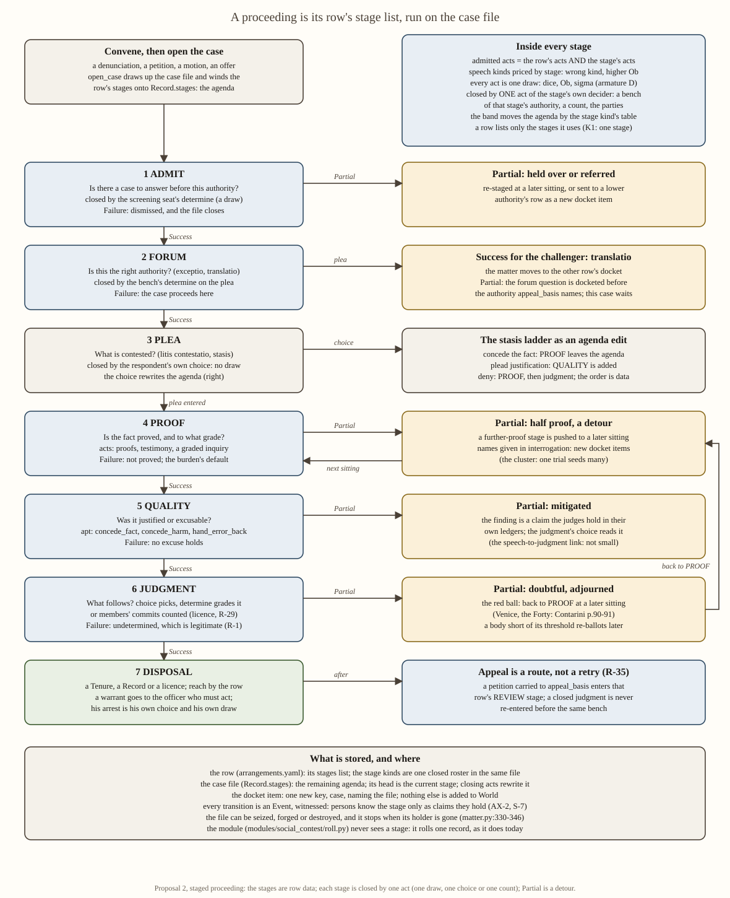

# Social contest, proposal 2: the staged proceeding

## Status: PROPOSED (reference; resolves nothing, schedules nothing)

One of three competing proposals on one shared base, the armature (`2026-10-30-social-contest-armature.md`,
**AR**), read with its section I corrections taken as given. Rulings R-1 to R-41 and S-1 to S-8 are cited from
`2026-10-30-social-contest-primitives-and-kinds.md` §1 (**PK**). Code was read at this checkout; citations are
file:line. Canadian spelling. Departures from AR are gathered in §8.

---

## 1. Executive overview

A social contest in Valoria is any occasion where characters try to move each other or a body that can bind
them: a word to one hearer, a negotiation, a trial, a petition, a vote in a parliament. There is no game
master. The engine rolls one σ-leveraged dice draw per act (R-5, R-6, R-22) and the world records what changed.

**This proposal makes a proceeding a staged procedure whose stages are data.** A venue's row lists its stages
in order, for example *admit, forum, plea, proof, quality, judgment*. Each stage asks a different question (is
there a case to answer; is this the right court; what is contested; is the fact proved; was it justified; what
follows), admits only the acts that suit that question, and is closed by one act of its own decider. That act
is one draw, or a count where a body decides. The four bands move the matter: Success goes to the next stage,
Failure to the stage's fallback, and **Partial to a detour**: a further proof, a forum question docketed
before another authority, an adjournment. Where the matter stands is written on the case file that
`open_case` already draws up, so a burnt, seized or orphaned file stalls the proceeding inside the world.

**What is different:** the order of business is something characters fight over. They can concede the fact
and fight on justification, challenge the forum, or stall a stage. Crown and church can each own different
stages of one case.

**What it costs:** a stage roster, one row key, one docket key, a new meaning for `Record.stages` on case
files, more acts per proceeding, and proceedings that run across seasons. Two pinned hashes move.

**What it needs from Jordan:** AR's G1 to G6 unchanged, and three choices in §8: the default pace, whether
procedure may be attacked through the file, and how unwatched contests run.

---

## 2. Flowchart

(`...-proposal-2-staged-proceeding-flowchart.png` is the same chart.) The spine is one row's stage list; the
right column is what each stage's Partial does. The plea stage has no draw; the judgment stage closes by a
draw for a bench and by a count for a body. Stages a row does not list are skipped: K1 is a one-stage row.

---

## 3. How it works

### 3.1 The data model, and what is code

| object | what it is | code object or classification | owner | new state? |
|---|---|---|---|---|
| **stage kind** | a question, the acts and speech kinds it admits, who closes it, and a band → transition table | **classification**: a member of one closed roster, data | `stage_kinds:` in `engine/season/arrangements.yaml`, loaded by `data/arrangements.py` (the loader refuses an unknown id, as it does for keys) | no |
| **a row's stage list** | the order of business for one kind of venue | data | a `stages:` key on each row | no |
| **the agenda** | the stages still before this matter; its head is the current stage | state on an existing carrier | the case file's `Record.stages` (`state/carriers.py:783`), which `open_case` already mints (`effects_information.py:274-354`) | the labels change meaning; no field is added |
| **the link** | which case file a docket item belongs to | state | one key, `case`, in `_docket_item` (`effects_information.py:162-166`) | **one key** |
| **the transition** | pop the head; push what the band's cell names; write a subsidiary docket item where it names one | code: **one** function, no branch on a stage id | the closing act's effect (`_eff_determine`, `effects_information.py:419`, and the count's licence) | no |

**A stage is a classification, not a code object.** There is no `Stage` class, no per-stage resolver and no
per-stage effect body. The code that knows stages exist is three things: an admission conjunct (the act is
admitted at the head stage), the one transition, and a Query `stage_of(w, matter)`. If any stage ever needs a
body of its own, the design has failed by its own test: *"If it branches on a member, it is drift"*
(`architecture/meta/04_CODE_ARCHITECTURE.md`, G.1.6).

**Why the case file and not a new docket field.** `Record.stages` already holds a list of
`(due_tick, label, winding act)` (`effects_information.py:143-158`); its labels are placeholders
(`stage1`…, `H-80`, `record_stages_default=3`, `data/fixtures.py:530`); `carry` already rewrites a petition's
stages as its first write (`verb_table.yaml:131`). A new `stage` field on the docket item would be a second
carrier for a position the file can already hold (the NERS false N-line's first disqualifier). Using the file
also gives procedure a body in the world (S-5): MATTER does not mature a stage whose holder is gone
(`loop/matter.py:330-346`), and `seize` and `destroy_record` exist. **Revert:** a `stage` key on the docket item.

**The roster** (eight question kinds, each sourced):

| stage | question | closed by | sources |
|---|---|---|---|
| `admit` | is there a case to answer here? | the screening seat's `determine` (one draw) | Avogaria's preliminary evaluation; the Ten's vote to proceed; the Spanish *calificadores* (file 01 §1.3-1.4; file 02 §2.1) |
| `forum` | is this the right authority? | the bench's `determine` on the respondent's plea | *translatio*, the fourth stasis (PK §5); Clarendon c. 3; Bruno's transfer (file 01 §3.4; file 02 §2.5) |
| `plea` | what is contested? | the respondent's own act, **no draw** | *litis contestatio* `[repo-cited (Tancred, PK §5); file 02 §1.0 could not source it to a primary text]`; partitio, "what is agreed and what is contested" (`RAH` I.17, file 03 §1.2) |
| `proof` | is the fact proved, and to what grade? | the bench's `determine` | two witnesses a full proof; confession; interrogation (file 02 §1.1 rows 5-6) |
| `quality` | was it justified or excusable? | the bench's `determine` | the descent (Lausberg; Aristotle *Rhet.* III.15, PK §5); the six forensic speech kinds already in `arrangements.yaml:73-96` |
| `judgment` | what follows? | bench: choice picks, `determine` grades (AR B6); body: commits counted (R-29) | the Forty's guilt ballot; the Senate's *discessio* (file 01 §1.3 step 8, §2.1; PK §5) |
| `review` | was the judgment lawful? | another authority's bench, on the record | appeal to another authority (R-35; file 02 "Design handle"; the Avogadori's *intromissione*, file 01 §1.6) |
| `licence` | do the members consent? | the count Query (AR C), **no draw** | R-29; the Senate's ballot per opinion, drop the lowest, repeat (file 01 §2.1) |

Speeches are not stages. Cicero's six parts belong to one speaker's turn (file 03 §1.2), and making each a
draw would sextuple the draws per speech. Where a procedure itself separated the duties, the stage list
carries them: partitio is the plea, confirmatio is proof, refutatio and peroratio are the acts of `quality` and
`judgment`. Inside a stage a speech is one act, priced by aptness to **that stage** (R-16).

### 3.2 The one draw and its inputs

Unchanged from AR §D: `E[m] = 0.4·N + 0.8·√N·softcap(s) − Ob`, dice for what the actor holds, Ob for the other
side's score ÷ 2 plus aptness and document terms, σ for what holds between actor and decider. What staging adds
is **one operand**: the aptness price is read for the head stage (a `deny` at `proof` is apt; at `quality`,
after the fact is conceded, it is priced high but still rolls, R-16). The stage is read by the host adapter
(`seam/wrappers/sigma.py::contest_input`, `:149`, which already reads `World`), never by the module.

**What staging costs in draws.** R-5, R-6 and R-22 hold literally: every act is one draw; a closing act is one
draw; `plea` and `licence` have none. But a proceeding spends more acts. A forensic row of six stages costs six
closing acts plus the advocacy, against roughly the advocacy plus one under P1. Draws are keyed
`H(seed, tick, subject, purpose)` (`sigma.py`, docstring of `resolve`, `:195`), so added acts move no other
act's draw. The pressure goes on two budgets: the scene budget (`scene_budget=5`, `data/fixtures.py:228`) of
each judge, and the season, because `w.tick` advances once per season (`loop/driver.py:393-396`, `:524`). Stages
of one sitting run as consecutive scenes; an adjournment is a season. **Two Venetian ballots are two stages and
two acts, never one act drawing twice.**

### 3.3 The action surface (R-33)

Admitted acts are the row's acts **and** the head stage's acts: R-33's limit applied twice. At `proof` the
parties may produce proofs, testify, be interrogated (the graded-inquiry route, `seam/contest.py::grade`,
`:118`); at `quality` they may plead excuse; at `judgment` the bench decides and parties may only speak if the
row's `floor` admits them. A wrong act is refused only when its **verb** is not the stage's; a wrong **speech
kind** is priced (R-16). An act may come too late: Cicero penalises "a useful argument introduced late"
(`DI` I.33), and here a proof offered after `proof` has closed is simply not admitted.

### 3.4 Deciders, by stage

Each stage kind names its decider; a row may hand a stage to **another authority** (`decider_basis`). That is
the one place the proposal changes AR's decider set: the decider becomes a property of the stage, not only of
the row. It also repairs a corrected fact: `judging_set` has no authority filter, so the King and Queen sit on
every bench (AR I item 7; `world_q.py:566`, the walk at `:636-642`). `stage_of` plus `decider_basis` gives
`judging_set` the filter it lacks.

- **Target** (K1, K7): one stage; the hearer's claims or pursuits move. Staging adds nothing here (§7).
- **Parties** (K2): `judgment` closes when both `commit` to the same terms (R-1, R-11).
- **Bench** (K3, K4, K5): the bench of the stage's authority.
- **Count** (K6): `licence` closes by the count Query, licensing the owner's own act (R-29).

### 3.5 Partial, failure and success

Success pops the stage. Failure takes the stage's fallback (dismissal at `admit`; the case continues at
`forum`; the burden's default at `proof`; undetermined at `judgment`, a legitimate outcome, R-1). **Partial is
a detour**, which is the text of R-17's source: *"referred, adjourned, or answered with a subsidiary question
... the proceeding now has more to get through"* (`proposals/2026-09-05-proceedings-subsystem/04_VERBS.md:131-150`).
Each Partial either **pushes a stage** onto the file (adjourned) or **writes a subsidiary docket item**
(referred; a question taken up), so R-17 is met by its own text and needs no ruling. The detour per stage is in
the flowchart. The sharpest one is sourced: when the Forty's red balls led, the case was adjourned and
re-balloted, and at the third ballot the doubtful were disregarded (file 01 §1.3 step 9). A cap is optional
row data. Counting adjournments is a Query over the case file's Events, never a stored counter (AX-3;
`04_CODE_ARCHITECTURE.md`, G.1.5: *"a track is a stored aggregate wearing a stage's clothes"*).

### 3.6 Disposal, reach and appeal

The terminal stage opens the row's disposal as today (`_eff_determine` reads `disposes`). Reach is the row's.
A church sentence that needs a body taken writes a **warrant** Record for the secular arm. The officer's
`arrest` is his own choice and his own draw (the warrant path exists: PROBE §2.8). Appeal (R-35) is a petition
carried to `appeal_basis`, which docket-items the matter under that row with the agenda `[review, ...]`. The
transition refuses to push a closed `judgment` back for the same row: **no retry before the same bench** (R-2,
R-35). That also ends today's wedge, where a re-opened matter stays docketed forever (PROBE §2.3).

### 3.7 Legitimacy, office weight and authority (R-31, R-34, R-36, R-38)

The weights are AR's: a seat's weight in this venue × L(authority, territory), in dice for its holder and
through the holder's score on the other side (R-38 read per holder). L is a per-contest Query (AR B21).
Staging adds a **second channel for local hostility, the one the research found**: across every sourced case,
hostility changed *"whether, where, by whom and how fast"* a proceeding ran, never its rules of proof (file 02
§3.5). Here that happens through existing acts on stages: an expelled officer's files stop maturing
(`matter.py:330-346`); the citation fails because the officer who must serve it refuses; a seized file moves its
`hold`. L in the draw (R-36) and stalls on the agenda are different facts in different places, so neither is
counted twice.

---

## 4. The eight kinds

| kind | row's stages | who closes | what is written | who learns |
|---|---|---|---|---|
| K1 dyadic influence | `[judgment]` (the target's) | the target | his claims or pursuits | those present |
| K2 negotiation | `[admit, judgment]`; `judgment` by the parties | both `commit`, or impasse | `commit`, then `give`; Partial: terms on some matters bind, the rest docketed (R-11) | parties, principals |
| K3 royal tribunal | `[admit, forum, plea, proof, quality, judgment]` | polity bench; `admit` by an accusing seat | `detain`, `ban`, `oblige` | `disposal_reach` |
| K3 heresy tribunal | `[admit, plea, proof, judgment]`, `proof` scripted (interrogation) | church bench; warrant to the polity's officer | `ban`; warrant Record | body, then the world |
| K4 petition | `[admit, judgment]` | the addressee; lapse when the file matures open (R-1) | grant, or nothing | the petitioner |
| K5 panel or jury | as K3; `judgment` closes when the threshold of seats' determinations is met | each seat's own `determine` | as K3 | as K3 |
| K6 parliament | `[admit, licence]`, speaking `order: rank` within `admit` (the *sententiae*) | the mover frames (R-30: no chair); the count | a licence; the owner's own act follows | the body, then the world (R-21) |
| K7 display | `[judgment]` (each hearer's) | each hearer | reception moves | the room |
| K8 forum or enforcement | not a row: the `forum` stage of K3 rows, and `review`; seats contested under K3 or K6 values | as those | `confer`, `revoke`, `hold` | per row |

**Worked example 1: a heresy charge where piety is weak.** A denunciation reaches the Senior Inquisitor;
`open_case` under `inquisition_hearing` winds `[admit, plea, proof, judgment]` onto the file. His seat is at T9,
so a church bench reaches only venues inside T9 (AR I item 7); a charge against a man in another territory
cannot pass `admit` until that is changed. The case therefore needs the venue inside T9, or a row that names
the crown, a different authority. Inside T9's hostile parish, L(church) is low, so the inquisitor's office
weight adds little to his dice (R-36). The accused pleads `deny`; `proof` runs as interrogation. A Partial
pushes a further `proof` to next season and writes a docket item for each person the deponent named. The
cluster spreads one trial into many (file 02 §1.1 row 5). The judgment is `ban`, plus a warrant to the crown's
officer, who lives among the hostile and holds his own doctrine pursuit. His `arrest` is his choice. If he
declines, the sentence stands unexecuted and the file stays open: the Toulouse outcome (file 02 §3.1), produced
by no rule of proof.

**Worked example 2: a royal tribunal with the King on the bench.** A cleric is charged with treason. At `forum`
he pleads that the church must try a clerk (Clarendon c. 3). The bench's determine draws: Success for him moves
the matter to the church row; **Partial** keeps the treason case but docket-items "jurisdiction over this
clerk" under the row `appeal_basis` names, and the trial waits at `proof`. If he fails, the plea is `deny`. At
`judgment` the King's dice carry his seat's weight in this row × L(polity, territory) (R-31, R-38). With
`decider_basis: polity` the King sits because the stage is the crown's, not because `judging_set` cannot
exclude him.

---

## 5. What it keeps, changes and deletes

**Deletes (first).** The kernel `systems/social_contest/sim/contest/` (CA B-1), including its `Stasis` ladder
(`primitives.py:11-25`) and its persuasion track: the ladder returns as data, and the track is refused by
G.1.5. `ladder.degree_ladder`'s unreachable fallback and `contest()`'s unread `extension` (CA B-6, B-7). The
`H-80` placeholder labels on case files (other Records keep them). `records_dissent` folds into
`disposal_reach` and `venue_min_rank` into `admit`'s gate, as AR §C. `proofs:` moves from the row into the
`proof` stage's admitted proof kinds, with a per-row override.

**Keeps.** `modules/social_contest/roll.py` keeps its shape: one record in, one `Margin` out
(`roll.py:116-125`). AR's changes still apply (the continuous path, AR B8; reception and proofs out of the
obstacle, AR B3-B4). `engine/season/seam/contest.py` stays a dispatcher that owns nothing. The composition row
`social_contest.roll` (`references/module_contracts.yaml:52`) is unchanged. So are `offices.yaml`'s seats, with
AR B17's one spelling of the office-to-authority tie.

**Changes.**
- `engine/season/arrangements.yaml` and `data/arrangements.py`: a `stage_kinds:` roster and a `stages:` key;
  `decider_basis` per stage; transitions per band.
- `loop/effects_information.py`: `_docket_item` gains `case`; `_eff_open_case` winds the row's stages through
  `_declared_stages`; `_eff_determine` runs the one transition and opens a disposal only at a terminal stage.
- `state/gate.py`: the admission conjunct (head stage admits the verb), beside the existing determination
  clause (`:245-258`). `[ASSUMPTION; medium; revert: an eighth requires form]` that the existing `Existence`
  form over the docket expresses it; `rosters.yaml: requires_forms` refuses an eighth at load.
- `queries/world_q.py`: `stage_of`; an authority filter in `judging_set`; the count Query; L (AR).
- `seam/wrappers/sigma.py::contest_input`: AR's producers, plus aptness read at the head stage.
- `write_matrix.yaml`: a `(DocketItem, case)` row; `(Record, stages)` gains `determine` as a writer.

---

## 6. Execution path

| batch | builds | runs after it (the test that shows it) | Jordan |
|---|---|---|---|
| S0 | nothing | AR's G1-G6 and §8 Q1-Q3 answered | **yes** |
| S1 | deletions above | suite green with fewer files; one `FORK:` row per deletion | no |
| S2 | AR's draw: continuous pool, producers, aptness field | pool varies by person in a computed run | after G1, G5 |
| S3 | the stage roster and `stages:` keys | the loader refuses an unknown stage; eight rows construct | no |
| S4 | the agenda: `case`, winding, the transition | hand-built: a Partial at `proof` leaves the file's head at `proof` with a later due tick **and** a docket item per named deponent; Success pops. Re-pins `BASE_HASHES` (`engine/season/tests/test_season_weather.py:378-380`) and `WORLD_VECTOR_HASH` (`test_go07_canonical_digest.py:100`), said plainly, with a control: rows without `stages:` read the old hashes | no |
| S5 | admission and aptness by stage | the same actor is admitted to a `proof` act at `proof` and refused it at `judgment`; `deny` is priced higher at `quality` than at `proof` | no |
| S6 | deciders by stage | a church `judgment` writes a warrant; the crown's officer declines; the file stays open; the King does not sit on a church bench | Q2 |
| S7 | the central link (AR I item 12: a disposition operand on `determine`, a matter term in `choose`, computed play reaching `determine`) | a `proof` Success flips the `judgment` disposition against a control without it | no |
| S8 | computed play names rows and stage acts | a computed season moves one case file across two stages | Q3 |

That is eight building batches against AR's unification plan's seven. S3-S6 are this proposal's own work and
S7 is everyone's.

---

## 7. Strongest, weakest, and how it could be wrong

**Strongest.** It is the only design in which the research's main finding about authority has a home without a
new mechanism: hostility acts on *whether, where, by whom and how fast*, and here that is the agenda stalling
on a real file. Partial gets procedural meaning per question (half proof, referral, adjournment) rather than one
docket write for everything. The stasis ladder becomes a choice a player can make: concede the fact, fight on
justification. That is R's "intuit complex outcomes from simple choices". The case file gives R-WORLD material:
it can be burnt, stolen and forged.

**Weakest.** (1) **Pace.** One tick is a season; a six-stage trial with two adjournments takes three seasons
and most of a judge's scene budget. That may be right (the Templar trials ran 1307-1314) or it may make
proceedings scenery. (2) **K1 and K7 collapse into P1.** A one-stage row is P1's act. That is a finding: staging
pays only where a body decides after several acts. (3) **The speech-to-judgment link is not made smaller.** It is
named: judges read findings in their own ledgers (F8's own-ledger carve-out, `04_CODE_ARCHITECTURE.md:253`).
The three costs in AR I item 12 remain. (4) **More acts, more chooser work.** The chooser must offer stage-apt
acts, which computed play does not do today: `determine` ran 0 times in PROBE §3.

**The cut test (NERS).** *Cut the stage list, keep AR.* What dies: the plea as a choice of ground; per-stage
admission; the procedural detours; the diegetic agenda. **False N-line found: an `execute` stage.** I drafted
one for the secular arm, and the armature already provides it: a warrant Record and the officer's `arrest`
(AR B19; PROBE §2.8) carry it, disqualifier 1. It is cut, and the warrant carries the crown's part. A second
candidate, the forum challenge, survives only partly: P1 and P3 can open a K8 matter separately, and what
staging adds is that the trial **waits** on it. Rulings served best: R-17, R-16, R-35, R-11, R-21, R-34. Strained:
R-15's zero-new-primitives tiebreak (a roster is added); R-24 (the container must show stages, and the
procedure lives in season state, not the module); R-18's "brilliant speaker rewarded" (speech matters only in
the stages that admit it).

**How it could be wrong.** If computed play cannot carry a case past two stages in a season, every staged row
is a dead seat and P2 is P1 with extra data. Falsifier: S8's count of case files whose head moved, over three
seeds.

---

## 8. Departures from the armature, and questions for Jordan

**Departures.** (a) The decider is a property of the stage, and a stage may belong to another authority (AR §A.3
puts it on the row). (b) Proceeding state lives on the case file's `Record.stages` plus one docket key (AR adds
none). (c) `proofs:` moves from the row to the `proof` stage. (d) AR §E's eight kinds are kept, but K8 is a
stage, not a matter type. AR's G1-G6 stand unchanged.

**Questions.**
1. **Pace.** Does a hearing run in one season's scenes unless a Partial adjourns it, or does each stage default
   to a season? These are different games: trials of a day against trials of years.
2. **May procedure be attacked through the file?** Seizing, forging or burning a case file stalls or bends the
   proceeding (S-5). Accept that, or keep the agenda off any seizable object (revert: a docket key)?
3. **Unwatched contests (R-24).** Do non-player proceedings run every stage as acts (true, slow, many draws), or
   does the automated route collapse a row to its terminal stage? Collapsing breaks AR B30's "the draw is
   identical at both fidelities".

---

## 9. What I expect to be assessed on

**(a) NERS.** N: the plea, staged admission and procedural detours each die under the cut; `execute` was a
false N-line and is cut (§7). E: one roster, one key, one Query, one conjunct and one transition, against those
three N-lines. Scored as a ratio, it is positive only for K3, K5 and K6 and nil for K1 and K7. R: strategy (the
choice of ground), world hooks (below), completeness (every stage has a Failure fallback). It breaks at one
extreme: a stage with no seated decider wedges forever, unless the file matures (lapse, R-1). S: it **pauses
correctly**, which is S's own test: an empty bench halts the agenda and a seated one resumes it. Calculations
stay one draw throughout; a count and a draw close different stages by AR's four deciders, not a fifth.

**(b) Emergent narrative** (no player):
1. *The cluster.* A Partial at an inquisition's `proof` → docket items for each named person (R-17) → the
   inquisitor's scene budget is spent → stages adjourn into next season → the named act in the interval
   (migration exists in `loop/effects_migration.py`) → a lord whose kin are named refuses the citation → a
   church `ban` on the lord, at news speed (S-7) → L(church) in his territory moves for the next case.
2. *The refused arm.* A church `ban` plus a warrant → the crown's officer, with a low doctrine pursuit, declines
   → the file stays open → the church opens `excommunication_deliberation` (`arrangements.yaml:265`) against him
   → his followers' stances move → the next royal tribunal there reads a different L(polity).
3. *The forum fight.* A clerk's forum plea at Partial → two benches each hold an item about one man → the
   faster authority's disposal binds; the other's item lapses when its file matures → a precedent Record both
   sides cite later.

**A seat is dead** when its stage never closes in computed play. The live risks are a church row heard outside
T9, where no church seat reaches the venue, and any stage whose acts the chooser never offers.

**(c) Season-loop compatibility.** At the seam: nothing. `seam/contest.py` dispatches and the composition row
is unchanged. Asked of `engine/season/`: one docket key; a new meaning for case-file `Record.stages` (still
`steps: [RES]`, class ACTS, act-written, never advanced by MATTER); `stage_of`; one admission conjunct; one
transition; an authority filter on `judging_set`; the count Query. **Layer 1.** AX-2: persons learn a stage only
as claims from the witnessed transition Events. The chooser never reads the file, so a party can be wrong about
the stage (S-8) and act too late, and the gate refuses him. No stored aggregate: the agenda is categorical and
neither measures nor decides (G.1.5); adjournments are counted from Events. One owner per fact: the row owns the
order and the file owns the position. **Risk:** the docket item's sitting `date` and the stage's due tick both
say "when", which is an S defect if they disagree; the due tick is a floor and the sitting is CALENDAR's.
Composition: the module never sees a stage. ED-SC-0040 and F8 stay open exactly as in AR I item 6. **Goldens:**
the two pinned season hashes above move once in S4, as SC-03a's two docket keys did
(`effects_information.py:323-325`); `engine/tests/test_contest_kernel.py` goes with the kernel;
`engine/tests/goldens/sigma_leverage_parity.json` does not move.

`[CONFIDENCE: medium]` on the code facts, each opened at its line; low on the pace and the chooser's ability to
carry stages, which no one has run.
