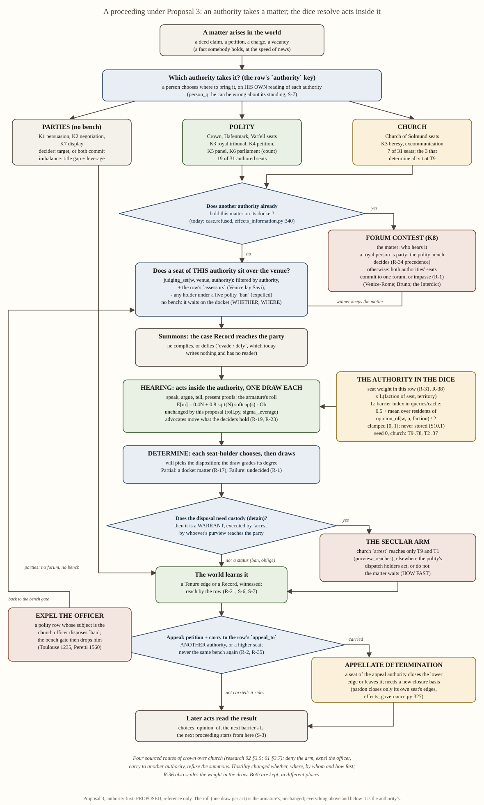

# Social contest, proposal 3: authority first

## Status: PROPOSED (reference; resolves nothing, schedules nothing)

One of three competing proposals on the common base `2026-10-30-social-contest-armature.md` (**ARM**, read with its
§I corrections as given). Rulings `R-1..R-41` and `S-1..S-8` are cited from
`2026-10-30-social-contest-primitives-and-kinds.md` §1. Code is cited at file:line from this checkout; figures marked
*measured* were run by me on `build_realm(0)` at world build (season 0, one seed: counts, not rates). Scripts:
`/tmp/claude-0/-home-user-ttrpg/b9ffadb9-a21e-55d5-8bf9-c652527b3c6b/scratchpad/proposals/C/` (`measure.py`,
`m2.py`, `flow.py`). Canadian spelling.

---

## 1. Executive overview

Valoria's social contests are the arguments, trials, petitions, negotiations and parliamentary votes by which persons
in the world change what other persons hold, owe and may do. There is no game master: the engine resolves every act
with one σ-leveraged roll, and the result is written into the world as a fact others learn.

This proposal organises the subsystem around **authorities**: the parties themselves, the polity (crown and duchies)
and the church. A contest is *what an authority does with a matter*. Before any die is rolled the engine asks which
authority takes the matter, whether another authority already holds it (a contest over the forum), whether a seat of
that authority sits over the place, and whether the party answers the summons. The dice then resolve the acts inside
the proceeding, exactly as in the armature, with one addition: a seat's weight is scaled by how the territory's
residents regard that seat's faction. After the determination the engine asks who holds the arm that executes it,
and whether the losing side carries the matter to another authority.

What is different: crown-over-church, jurisdiction fights and appeals are native. The four routes by which real
crowns checked real church courts (deny the arm, expel the officer, carry the case elsewhere, refuse the summons)
are each an existing verb given a reader. The roll changes least of the three proposals.

What it costs: five new readers on existing verbs, one data column, a handful of row keys and one barrier index; all
of it is unreachable from computed play until computed cases name a row (today none do). It needs five answers from
Jordan, chiefly whether the church may reach beyond Himmelenger (T9) and whether a barrier index built from other
persons' ledgers may be read inside the fold.

---

## 2. Flowchart



(`2026-10-30-social-contest-proposal-3-authority-first-flowchart.svg`, `.png` beside this file.) What it shows that
the generic chart does not: three authority lanes before any draw; a forum test and a forum contest; a bench filtered
by authority; the summons; the arm that executes; and appeal as a move to another authority. The roll sits in one
box in the middle and is the armature's, unchanged.

---

## 3. How it works

### 3.1 What "an authority" is: a classification, not an object

**Not a code object.** The tree already refuses a faction that acts (`rosters.yaml:1669-1671`: *"A FACTION STILL NEVER
ACTS ... the actor is always the person holding the office"*), and an `Authority` carrier holding precedence or
legitimacy would be a stored aggregate (S-7; `state/carriers.py:1102-1104`, S10.1). **Not a new table of rows.**
**A classification of offices, through their faction, in one column.** Every one of the 31 authored seats in
`offices.yaml` names a `body` or a `faction`, and `Office.__post_init__` already resolves both to one faction
(`state/carriers.py:986`, via `data/rosters.py:1174 office_faction` over `rosters.yaml:1791 office_bodies`). The
tree's own precedent for "a property of the faction, not of the office" is `role_templates.by_faction`
(`rosters.yaml:1698-1717`). This proposal adds one sibling mapping there:

```yaml
authority:
  by_faction: {Crown: polity, Hafenmark: polity, Varfell: polity, Church of Solmund: church}
  precedence: [polity, church]     # read ONLY by the forum contest, and only under R-34's condition (§3.6)
```

A faction not listed (Löwenritter, Guilds, Restoration Movement, Schoenland, Altonia) has **no bench of its own**: its
members contest as parties. `authority_of(office)` is one lookup; no `Office` field is added, so the `Office`
encoding, which folds every field name into `World.content_hash` (`carriers.py:930-932`), does not move. The 31
authored seats classify as:

| authority | seats (by faction) | of which hold `determine` in `build_realm(0)` (*measured*) |
|---|---|---|
| polity | 19: Crown 11 (incl. Inner Circle 2, Ministries 1), Hafenmark 4, Varfell 4 | King, Queen (realm scope); Senior Jarl, Skald-Chief (Varfell) |
| church | 7: Holy See 1, four Cardinals, Senior Inquisitor, Archbishop's Representative | Confessor, Cardinal of Justice, Senior Inquisitor: **all scoped at T9** |
| parties only | 5: Guild 1, Lions' Table 1, Riskbreakers 2, Restoration 1 | none authored; the unauthored 32nd seat (`off_npc_084`, a guild leader) holds it with `scope_rung None`, so it never sits |

Two content facts fall out at once: **Hafenmark has no seat that determines**, so polity proceedings there are heard
only by the King and Queen; and **the church can judge only at T9 venues** (ARM §I, finding 7).

### 3.2 The row

Every arrangement row (`engine/season/arrangements.yaml`) carries, beyond the armature's keys:

| key | values | replaces |
|---|---|---|
| `authority` | `parties` · `polity` · `church` | nothing; ARM B17 overloaded `bench_basis`, which stays the remit act (`state/gate.py:243`) |
| `assessors` | another authority whose seats over the venue also sit (Venice's three lay Savi beside three clerics, research 01 §3.1) | the accident by which the King sits on every bench today |
| `weights` | per-seat weight in this row (R-31, R-38); ARM D.2 | — |
| `appeal_to` | an authority, or `higher` (a superior seat of the same authority), or `none` | `appeal_basis` (a remit act, unread) |
| `heard_at` | `party` (the matter's place, as live) or `seat` (the bench's own rung: the Roman and Congregation shape) | — |

There is **no `arm` key**; §7's own cut test removed it (the executor falls out of `Office.rung`, below).

### 3.3 The draw and its inputs

The armature's draw, unchanged: one σ-leveraged continuous roll per act, `E[m] = 0.4·N + 0.8·√N·softcap(s) − Ob`, each
source on one channel by whose fact it is (ARM A.2, D.1, D.2). This proposal supplies one operand the armature left
unsourced, **`weight × L`** in the dice of the holder of a weighted seat (his roll when he acts, his score ÷ 2 when he
resists: R-38 read per holder, ARM D.4):

```
pool += row.weights[seat] × L(faction(seat), venue)
L(f, v) = clamp[0,1]( 0.5 + mean_{p resident under v} opinion_of(w, p, f) / (2 · opinion_full) )
```

- **The owner of "how a person regards a faction" already exists**: `world_q.opinion_of` (`queries/world_q.py:2590`),
  on [−3, +3], composing pursuit fit, the faction's engaged affiliation poles and regard for its head and members.
  One ladder for one quantity (§0.06 S): the polity's political legitimacy and the church's piety (R-36) are the same
  function of different factions. "Residents under v" are `residence_of` (`world_q.py:1500`) walked up by `ancestry`.
- **Indifference reads 0.5**; hostility lowers L toward 0, never below (ARM B20's floor kept, its zero point moved;
  §8, D1). `opinion_full` is a sweep `[ASSUMPTION; medium; revert: 1.0]` with the **control arm L ≡ 1**.
- *Measured* at `opinion_full = 1`, seed 0, season 0: church L is T9 .78, T8 .59, T14 .57, T1 .53, T3 .45, T4 .38,
  T2 .37; Crown L is T9 .77, T14 .75, T1 .74, T3 .70, T2 .68, T5 .67, T4 .57. Territories peopled only by cohorts read
  .50. Cost: 166 `opinion_of` calls took 0.04 s.
- **A content defect this exposes:** the Church's only engaged pole is `einhir_restoration`, sign −1
  (`engaged_poles`, measured); no goal engages `solmund_orthodoxy`, so a devout resident's orthodoxy does not raise
  church L. The fix is a goal row in `goals.yaml`, at the owner, not code.

**How L is sourced, given ED-SC-0040 and F8.** `opinion_of` reads each resident's ledger. Read inside the fold, that is
exactly what 04 §B.2 forbids (`04_CODE_ARCHITECTURE.md:253`: *"A Query taking a ledger and an asker who is not its
holder still does not exist"*), and ED-SC-0040's last row (closed, option B) re-sources the bench's reception from
commits for the same reason. So L is **not** a resolver Query. It is a **barrier index in `queries/cache`**, the
module 04 §A.2 types as reading *"any store, **at a barrier only**"* (`04_CODE_ARCHITECTURE.md:170`), whose row names
"subtree aggregates" and whose own header says none yet exists (`queries/cache.py:27`). It is built at RESOLVE's entry,
before the first act, dropped by `discard_caches()` at the next barrier, and stored on no Rung (S10.1). ED-SC-0040's
own ladder names the precedent: census and witness read every ledger at barriers; the fold reads only the actor's.
`[CONFIDENCE: medium]` that this is the §A.2 shape and not a laundering of F8: the fold reads a number derived from
ledgers it does not own. That is Q2. **The fallback, if the answer is no:** L from `commit` edges only (World truth,
`members`, `world_q.py:1795`). *Measured:* the Church has 7 committed members, 6 in T9 and 1 in T1, so commit-share
piety is 0 in 14 of 16 territories and the church's office weight vanishes almost everywhere. I do not recommend it.

### 3.4 The action surface and the decider

The armature's: the row admits acts from the one verb table (R-33); deciders are the target, both parties, a bench, or
a count (R-29). Authority adds three things to the bench decider.

1. **The bench is filtered by authority.** `judging_set(w, venue, authority, assessors)` (`world_q.py:566`; its unused
   `matter` parameter goes) lists seat-holders whose `authority_of` is the row's authority or one of its `assessors`.
   A row of `None`, which is every computed case today (PROBE §3, `{None: 15}`), keeps the live unfiltered behaviour.
2. **Judging reach and acting reach are already two fields.** `Office.scope_rung` is where a seat judges (H-32);
   `Office.rung` is its purview, where it acts (`state/gate.py:739-746` keeps the difference deliberately). Q1 asks to
   give the church's three determining seats a realm `scope:` anchor in `offices.yaml` while their `rung` stays T9:
   **the church may then judge anywhere and execute only where its own arm reaches**, which is the Languedoc and Venice
   shape exactly.
3. **An expelled officer does not sit.** A seat-holder under a live `ban` whose object is a polity seat sitting over the
   venue is dropped from the bench (one conjunct in `judging_set`).

### 3.5 Disposal, arm, reach

- **The arm.** A disposal that needs custody (`detain`) executes directly only where the determining seat's purview
  reaches the party (`purview_reaches`, `state/gate.py:353`), or where the party has not defied the summons. Otherwise
  `_disposal` (`loop/effects_information.py:584`) opens a **warrant** (the K-52 basis, `gate.py:259`), and the edge opens
  only when some `dispatch` holder whose purview reaches the party performs `arrest`. Measured: every church seat
  holding `dispatch` sits at T9 or T1, so outside those two territories a church custody needs a polity hand. A status
  (`ban`, `oblige`) needs no arm.
- **The summons.** `open_case`'s Record is the summons; `evade / defy` (verb table: `writes: []`, no reader) gains
  its reader: a defiant party's custody disposal is always a warrant (Bohemia, 1415: the proceeding could not reach
  them). The draw is not changed by defiance.
- **Reach.** The row's `disposal_reach` and the existing witness channels (ARM A.4); nothing new.

### 3.6 The forum contest and precedence (R-34)

Today a second `open_case` on a docketed matter is refused (`effects_information.py:341-342`). Here, when the second opener's
authority differs from the docketed one, the matter becomes a **forum matter** (K8): *which authority hears it*, docketed
under a `forum` row whose parties are the two openers. **If a royal person is a party**, the polity bench decides
(R-34; `precedence` read here and nowhere else). **Otherwise** it is mutual: both seats commit to one forum or it is an
impasse, and an undecided forum is a legitimate outcome (R-1) in which neither authority can determine. This is the
Venetian shape: the Collegio and Senate, not the Holy Office, decided whether Bruno left the territory (research 01
§3.4), and in the Interdict the two authorities contended until a third crown mediated (01 §3.5).

### 3.7 Appeal as a route to another authority (R-35)

A rendered outcome may be carried, by `petition` and `carry`, to the row's `appeal_to`; it is never re-heard by the same
authority (R-2, R-35): a re-opening under the same authority is refused with a named reason instead of wedging as it
does today (PROBE §2.3). The appellate seat's determination under an `appeal` row closes the lower edge or leaves it.
**This needs a new closure basis**: `pardon` closes only edges whose object is the exercised seat
(`loop/effects_governance.py:327-352`), so a crown seat cannot today end a church ban. In every sourced row the appeal
went to a different authority than the bench, which acted by commissioning or suspending, never by rehearing (research
02, "Design handle").

### 3.8 Where office weight, legitimacy and authority enter (R-31, R-34, R-36, R-38)

Office weight: `weights[seat] × L`, in dice, per holder (§3.3). Legitimacy: L, through that product only (R-36), and
through **nothing else in the draw**. Authority: who sits (§3.4), who executes (§3.5), who hears the forum (§3.6), where
the appeal goes (§3.7). This keeps research 02's finding intact: across every sourced case, local hostility changed
**whether, where, by whom and how fast** a proceeding ran, and **never its rules of evidence or sentence**; the restoring
force was external (02 §3.5, "Net", with the Montaillou control). R-36 adds a bias in the draw that the sources do not
show; it is ruled, so it stays, and §7 says why its sweep should be modest.

---

## 4. The eight kinds through it

| kind | `authority` | who decides | what differs | written | who learns |
|---|---|---|---|---|---|
| K1 dyadic influence | parties | the target's own choice | title only weighted | claims, pursuits (ARM) | those present |
| K2 negotiation | parties | both `commit`, else impasse | title gap and circumstantial leverage (R-34) | `commit` pair, then `oblige` | parties and principals |
| K3a royal tribunal | polity | polity seats over the venue | `weights` King 3, Queen 3, Duke 2 `[ASSUMPTION; sweep]`; `appeal_to: none` (R-2) | `detain` (warrant outside purview), `ban` | the row's reach |
| K3b heresy tribunal | church | church seats (+ polity `assessors` where the row says, Venice) | church weights × church L; `appeal_to` per Q4; `heard_at` per row | `ban`; custody by warrant outside T9 and T1 | body, then realm |
| K4 petition | the addressee's | a bench of one; lapse is an outcome | `appeal_to: higher` | as the row | the petitioner |
| K5 panel or jury | polity or church | each member's `determine`, counted | lay `assessors` from the other authority | as K3 | as K3 |
| K6 parliament | polity at a rung (R-27) | count of `commit`s licensing the owner's act (R-29) | weights per ARM G3 | the owner's act | the body, then the world |
| K7 display | parties | each hearer's reception moves | — | stances | witnesses |
| K8 forum and enforcement | `forum` row; the arm; expulsion | polity bench if a royal person is party, else mutual | §3.5 to §3.7 | the docket item moves; warrants; bans on officers | both authorities' seats, then chronicle |

**Worked example A: a heresy charge in a territory of weak piety.** T2 (Valorsmark, a Crown duchy; church L .37,
Crown L .68, measured). The Senior Inquisitor opens `inquisition_hearing` against a T2 resident who has preached the
Restoration. (1) *Forum gate*: church row, church seat. **Today it fails** (scope T9); under Q1 it passes. (2)
*Summons*: the accused defies. (3) *Hearing*: the inquisitor's weight 2 enters his dice at × .37 (0.74D) where in T9
it would be × .78 (1.56D); at the 5D reference that 0.82D is worth about 7 points of "meets" (ARM D.1: +1 die moves
.390 to .480). (4) *Determine*: Partial leaves a docket matter (R-17); Success opens a `ban`. (5) *Arm*: had the row
disposed `detain`, the church's own dispatch-holders cannot reach T2, so a warrant goes to whoever's purview does: a polity
seat at realm scope (measured: the King, Queen, Heir and Princess hold `dispatch`). The King arrests, or he does not, and the matter waits (Philip IV, 1291: the seneschal told not to obey
inquisitors' arrest orders). (6) *Appeal or forum*: if the accused's patron is a royal person, the polity can take
the forum (K8) and decide it on its own bench; if not, the forum is mutual and may end in impasse.

**Worked example B: a royal tribunal with the King on the bench.** T1, row `tribunal`, authority polity. The bench is
the King and Queen (and no church seat unless `assessors: [church]`). The King's determine pool gains 3 × .74 = 2.2D.
If the accused is a Cardinal, his church seat adds nothing unless the polity row weights church seats (a row-level
benefit of clergy, Clarendon c. 3, research 02 §2.5). A second polity bench re-opening the matter after judgment is
refused (R-35); the Cardinal's way out is `appeal_to`, which this row sets to `none`, so the outcome rides (R-2).

---

## 5. What it keeps, changes and deletes

**Deletes first.**
- `systems/social_contest/sim/contest/` (the kernel; 18 files, 9 sites to repoint, CA §3 B-1), per R-14 and ARM B23.
- The arrangement keys `bench_basis` (as a row key; the constant `BENCH_BASIS` stays at `state/gate.py:243`),
  `appeal_basis` (renamed `appeal_to`), `venue_min_rank` (into the admission gate), `records_dissent` (into
  `disposal_reach`).
- `judging_set`'s unused `matter` parameter (`world_q.py:566`); the stale kernel identity row in
  `references/module_contracts.yaml:448-470`; `contest()`'s unread `extension` (CA B-7).

**Changes.**
- `engine/season/rosters.yaml`: the `authority` mapping (§3.1); `data/rosters.py`: `AUTHORITY_OF` beside
  `ROLE_TEMPLATE_OF` (`:1011`).
- `engine/season/arrangements.yaml` and `data/arrangements.py`: the keys of §3.2; three new rows: `negotiation`
  (parties, mutual), `forum`, `appeal`.
- `queries/world_q.py`: `judging_set` filters by authority and assessors and drops the expelled; `is_royal(w, person)`
  over live `hold`s on realm-rung Crown seats.
- `queries/cache.py`: `standing_index(w)` → `{(faction, rung): L}`, built at RESOLVE's entry.
- `state/gate.py`: the forum branch of admission; the appellate closure basis; `may_determine` reads the row's
  authority.
- `loop/effects_information.py`: `_eff_open_case`'s forum branch (`:341`); `_disposal`'s warrant branch (`:584`);
  the `evade / defy` reader.
- `seam/wrappers/sigma.py::contest_input`: the `weight × L` producer in the pool (`:186`), with `Act.via` passed down
  (CA §2); the rest of its changes are the armature's (continuous pool, σ producers).
- `engine/season/offices.yaml`: a `scope:` anchor on three church seats (Q1); `goals.yaml`: a Church goal engaging
  `solmund_orthodoxy`.

**Keeps.** `modules/social_contest/roll.py` and `engine/dice_engine/sigma_leverage.py` exactly as the armature leaves
them: this proposal changes nothing in the draw itself. `person_q.legitimacy` (`queries/person_q.py:452`) stays the
person-side reading a chooser uses to guess an authority's standing (and be wrong, S-7); it does not feed L.

---

## 6. Execution path

| batch | what | runs after it | the test that shows it runs | Jordan |
|---|---|---|---|---|
| **C0** | Q1 to Q5 below; the armature's G1 to G6 stand | nothing | the rulings recorded | **yes** |
| **C1** | deletions (§5) | the suite, fewer files | green; one `FORK:` row per deletion | no |
| **C2** | the classification; the bench filter and assessors | a church row's bench excludes the King; a Venice row seats him | `test_bench_filters_by_authority`: same venue, two rows, two benches | Q5 |
| **C3** | `standing_index`; `weight × L` in the pool (needs ARM's continuous pool and G2) | the same accused, seed and row: the inquisitor's pool differs between T9 and T2 by `w × ΔL`; the L ≡ 1 arm shows no difference | `test_authority_weight_by_territory` | Q2, G2 |
| **C4** | forum contest, warrant branch, appellate closure, expulsion, defy reader | the four routes and appeal | one test each: a forum decided by the polity bench when a royal person is party and mutual otherwise; a T2 church custody opens a warrant and no edge until `arrest`; a crown appellate seat closes a church `ban` after a carried petition; a banned inquisitor leaves the bench; a re-open under the same authority is refused | Q3, Q4 |
| **C5** | computed play names rows (ARM's reasons to convene, UP B6), and the choice layer can choose forum, appeal and defy | a seeded season forms a forum or an appeal without hand-building | an aperture run counting forum and appeal events above zero | no |

**Effort:** five building batches; C2 to C4 are this proposal's own (about two batches more than a design without
the institutional layer). C2 to C4 change nothing in computed play, because computed cases name no row; **C5 is where
the work becomes the game**, and it is shared with the armature.

---

## 7. Strongest, weakest, and how it could be wrong

**Strongest.** It is the proposal that makes R-34, R-35 and R-36 *institutions* rather than modifiers, and it does so
with the shapes the sources actually show. It reuses owners the tree already has: `office_faction`, `opinion_of`,
`purview_reaches` against `sits_over`, the warrant basis, `evade / defy`, `petition` and `carry`. It changes the roll
least. Its world churns without a player: authorities collide over matters persons bring them.

**Weakest.**
1. **All of it is dead in computed play until C5.** Computed `open_case` names no row (`{None: 15}`), `determine` rolled
   0 times and `arrest` was attempted 0 times (PROBE §3). Every warrant this design issues would go unexecuted in
   computed play today. P3 has more such apparatus than the other two proposals.
2. **It does nothing for the missing link from speech to judgment** (ARM §I, finding 12). It shifts weight from
   eloquence to institutions: who hears, who executes, where the appeal goes. That strains **R-18** ("a brilliant
   speaker to be rewarded") more than P1 or P2 do.
3. **The church cannot judge outside T9** without Q1, so R-36's own example (a heresy proceeding in a land of weak
   piety) cannot occur as the tree stands.
4. **F8.** If Q2 is answered no, L falls back to commit shares, which are zero for the church in 14 of 16 territories.
5. **R-34's "if a royal person is involved"** is ambiguous, and the forum contest's decider depends on it (Q3).
6. **R-36 against the research.** The sources show hostility acting on availability and enforcement, not on the
   verdict; R-36 rules a bias in the draw. Both are kept, but if the `weight × L` sweep is large, the draw double-counts
   what the routes already do. The sweep should be modest and the L ≡ 1 arm kept.

**Cut test (NERS).** *Cut the classification*: the King sits on every church bench (live, ARM §I finding 7), R-34 has no
place to act and R-36 has no per-authority L; not free. *Cut the forum contest*: two authorities' edges stack and
neither voids the other (PROBE §2.3); the Interdict and extradition scenarios die; not free. *Cut `precedence`*: every
forum is mutual. What dies is only R-34's royal condition, so it is a one-line datum, kept. *Cut `heard_at`*: the
Roman shape (summon to the seat) dies; it is the weakest key and the first to drop. **A false N-line, found and
applied:** the draft carried an `arm:` row key naming who executes; `Office.rung` and `purview_reaches` already say
whose arm reaches the party (disqualifier 1, the carrier already exists), so the key was cut. **Does P3 collapse into
P1?** Not wholly, but partly, and I say so: its roll *is* P1's, and its bench filter and appeal route are the
armature's. What only P3 has is the forum contest, the warrant branch, the expulsion and defy readers, the appellate
closure basis and the L index. Read honestly, P3 is P1's engine with an institutional layer on top; Jordan could adopt
P1 and add C2 to C4 later without rework.

**Rulings served best:** R-34, R-35, R-36, R-21, R-9 ("no monopoly of power"), S-3 and S-4. **Strained:** R-18 (above);
R-15's zero-new-primitives tiebreak (one index, five readers); R-36 against research 02 (item 6).

---

## 8. Departures from the armature, and questions for Jordan

**Departures.**
- **D1 (B20).** L's zero point: indifference reads 0.5 and local hostility lowers it. B20 placed hostility in
  reception, but reception reads the *bench's* ledgers (`world_q.py:673`), not the residents'.
- **D2 (B21).** L is a per-barrier index in `queries/cache`, not "a per-contest Query dying with the run", because its
  inputs are ledgers (F8).
- **D3 (B17).** A new `authority` key; `bench_basis` stays the remit act. One spelling of the office-to-authority tie,
  through faction, not body *or* faction.
- **D4 (B18).** B18 said crown-over-church needs "no new mechanism". Three of its four routes have no reader today
  (`pardon` closes only its own seat's edges; `determine` opens custody without an arm; `evade / defy` writes nothing),
  so P3 adds them. B18 understated the cost.
- **D5 (E, K8).** K8 gets its own decider rule (§3.6) instead of borrowing K3's or K6's.

**Questions for Jordan** (the armature's G1 to G6 stand and are not re-asked).
1. **Church reach.** May the Confessor, Cardinal of Justice and Senior Inquisitor *judge* across the realm (a `scope:`
   anchor) while *acting* only at T9? Without it, R-36's own example cannot occur.
2. **F8.** May the fold read a barrier index (`queries/cache`, 04 §A.2) built from residents' ledgers? If not, L comes
   from commit shares and the church's weight is zero in 14 of 16 territories.
3. **R-34's condition.** Does "a royal person is involved" mean a party, a bench member, or the ruler of the
   territory? P3's default is a party who holds a realm-rung Crown seat.
4. **Where church appeals go:** to the polity (Clarendon c. 8; the Spanish Suprema) or to a higher church seat (the
   Holy See)?
5. **The King on church benches:** removed by default, with Venice's mixed bench as a row choice (`assessors`), or kept
   everywhere as today?

---

## 9. What I will be assessed on

### 9.1 NERS (§0.06; `skills/ners/SKILL.md`)

**N:** each piece passes the cut test in §7 except `heard_at` (weak) and the removed `arm` key (a false N-line, cut).
N from all directions: top-down (R-34 to R-36 are about institutions), bottom-up (each route is an existing verb plus
one reader), lateral (the polity and church use one L function and one ladder).
**R:** it gives the player strategy above the dice (where to bring a matter; whom to petition; whether to defy) and it
has the strongest half with no player in it (§9.2). Completeness at the extremes: L is clamped to [0, 1]; an empty bench,
an impasse forum and an unexecuted warrant all leave the matter on the docket, never a refusal (R-16, R-17).
**S:** the roll is untouched; the forum contest *pauses* the substantive case correctly (it sits on the docket while
jurisdiction is decided); polity legitimacy and piety are one calculation, not two ladders.
**E, as a ratio:** one column, five row keys, one index and five readers buy three ruled behaviours (R-34, R-35, R-36)
and four sourced routes. The legibility cost is that a player must read the institution before the dice; a simple
choice (which authority to petition) produces a large outcome, which is the E test passed, not failed.

### 9.2 Emergent narrative: three unplayed scenarios

1. **News lowers a crown's bench.** A Crown officer's `requisition` strips stores in T4, and the `requisition.taken`
   claim spreads by `tell`. (An unpaired deed kind is needed: a told copy of a paired kind such as `person.died`
   names no doer and moves nothing, `person_q.legitimacy`'s docstring and `deed_doers`.) Residents' `opinion_of(Crown)`
   in T4 falls with the regard term, so at the next barrier L(Crown, T4) falls `[UNVERIFIED by a run]`. The King's tribunal
   determinations in T4 grade lower, while the Varfell jarls (also polity, other faction, L unchanged) grade as before.
   More T4 matters are disposed by jarl seats; `matter.determined` events name them through `chronicle`; the realm
   learns that Varfell judges its own.
2. **A warrant nobody serves.** Restoration preaching in T2 (`argue`, `tell`) moves residents' pursuits and lowers church
   L. An inquisition hearing (under Q1) disposes custody; the church's dispatch-holders cannot reach T2, so a warrant
   goes to the King's realm seat. The King's own choice, reading his opinion of the Church, declines. The matter waits
   on the docket (R-17), the Church's standing in T2 is witnessed falling, and the Church can answer only through its
   own rows (an excommunication deliberation against the King), which today it cannot hold outside T9.
3. **A cleric who kills.** A Cardinal's man kills in T1. A polity tribunal and a church hearing both open on the matter:
   a forum contest. No royal person is a party, so it is mutual; the King's duchy seat and the Confessor do not commit to one forum;
   impasse (R-1). Neither authority can determine; the killer walks; the victim's kin keep the grievance in their
   pursuits and later act on it (`fight`, `petition` to the King, which brings a royal person in and makes the next
   forum the polity's).

**What would make a seat dead:** a row no computed case names (all of them today); a church that judges only at T9
(Q1); a Hafenmark with no determining seat; a choice layer that never chooses `arrest`, `carry` or `evade / defy`
(measured 0 `arrest` attempts); L flat because residents hold no opinion (cohort-only territories read .50 throughout).

### 9.3 The season-loop engine

- **The seam.** `engine/season/seam/contest.py::contest` keeps its signature; the composition row `social_contest.roll`
  (`references/module_contracts.yaml:52-56`) is unchanged; the module stays World-free and imports nothing new. The
  only seam change is the operand `contest_input` adds to the pool, plus `Act.via` passed down.
- **What it asks of `engine/season/`.** State: no new carrier field (no `Office` field, no Rung field; the docket item
  already names its arrangement). Queries: `judging_set`'s filter and `is_royal` (World-side); `standing_index` in
  `queries/cache` (the first subtree-aggregate index, the slot 04 §A.2 already names). Gate: forum admission and the
  appellate closure basis in `state/gate.py`. Witnessing: the existing channels. Driver: builds the index at RESOLVE's
  entry; no new step.
- **Layer 1.** AX-2: no decision code can read the index (resolver-side); persons choose a forum from their own
  `person_q` readings. No stored aggregate (S10.1). One owner per fact: authority from one faction column; L from
  `opinion_of`. Composition, not import. **Two Layer-1 tensions remain**: F8 (Q2) and §A.3's "a seat adds no verb and
  no modifier" (`03_VERBS_AND_LOOPS.md:34`; ARM G2), which no office weight can be built before.
- **Goldens.** The σ parity golden (`engine/tests/goldens/sigma_leverage_parity.json`) does not move: nothing here
  touches `sigma_leverage`. Same-seed determinism pins (`test_build_realm_determinism.py`, `test_aperture.py`) compare
  a run with itself and survive. C2 to C4 should not move a computed-play digest, since computed cases name no row; the
  falsifier is the pinned digests in `engine/season/tests/test_go07_canonical_digest.py` (e.g. `:490`). **Q1 would
  move every `build_realm` digest** (three seats' `scope_rung` change); that is a declared move, to be re-pinned and
  said plainly. C5 moves outcomes and every digest that sees a contest, by design.

`[CONFIDENCE: medium]` on the overall design; `[CONFIDENCE: low]` that the L sweep can be set without a campaign-level
instrument, which the tree does not have (CLAUDE.md §7).
