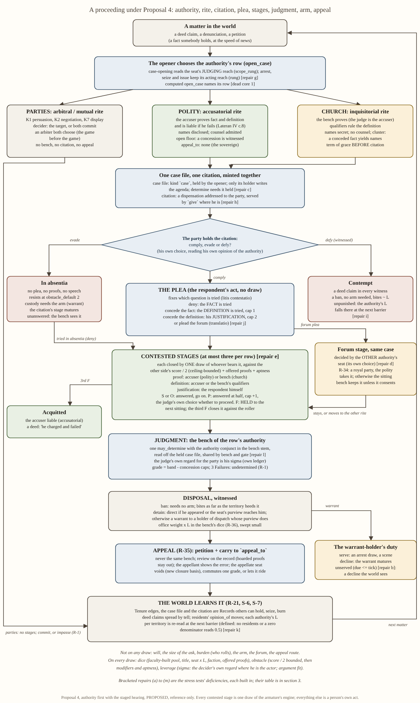
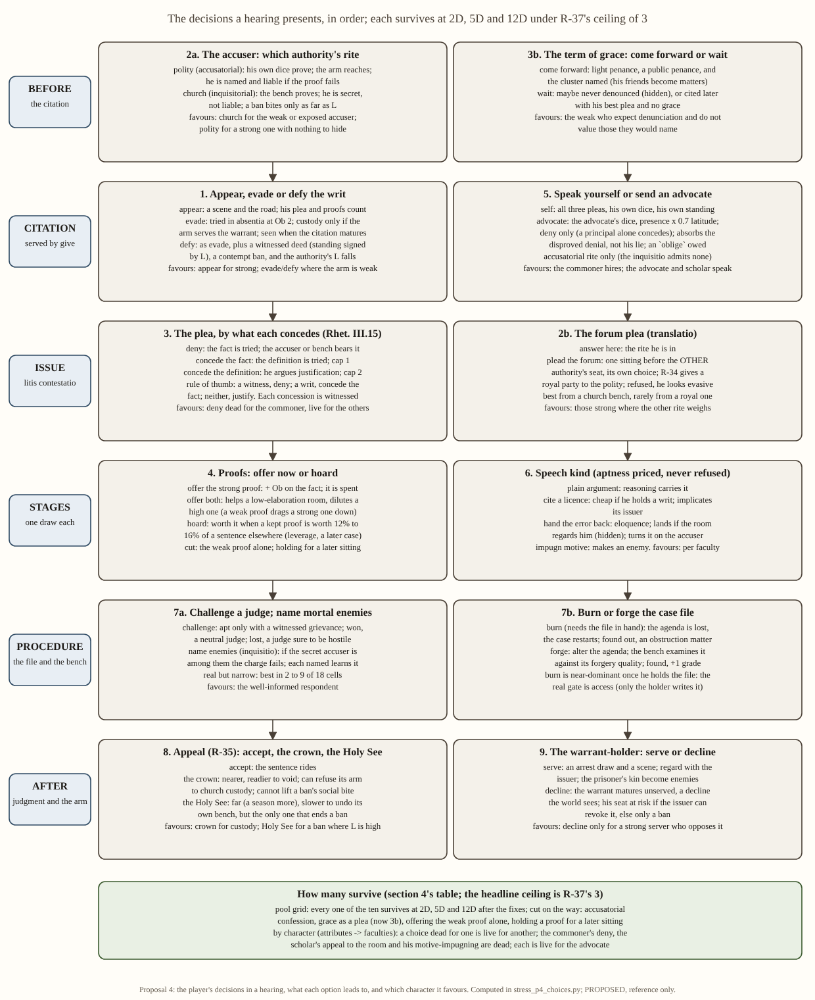

# Social contest, proposal 4: authority first, with the staged hearing and its real choices

## Status: PROPOSED (reference; resolves nothing, schedules nothing)

Proposal 3's authority-first framework, carrying Proposal 2's staged hearing, rebuilt as one design with the repairs the
three stress tests and three assessments called for, and Jordan's addendum on character attributes. Base: the armature
(`2026-10-30-social-contest-armature.md`, **ARM**, with its §I corrections). Rulings `R-1..R-41` and `S-1..S-8` are cited
from `2026-10-30-social-contest-primitives-and-kinds.md` §1 and outrank everything here. Code is cited at file:line on
this checkout (`5c0e25ec`; the later `c60f11db` touches only this proposal's harness and log). Every payoff figure comes from `stress_p4_choices.py` and its log
`2026-11-01-stress-log-p4-choices.jsonl` (this folder), cited as **log:N**. The log holds four runs. Runs 1 to 3 are
false starts, kept and explained at log:1225, 2477 and 3925; **run 4 (log:3926 onward, with C10, C3c and C3d at
log:5726 onward) is the evidence.** Canadian spelling.

---

## 1. Executive overview

Valoria's social contests are the trials, hearings, petitions, negotiations and votes by which characters change what
other characters hold, owe and may do. There is no game master: the engine resolves every act with one dice draw, and
the result is written into the world as a fact other characters learn at the speed of news.

**What this design is.** A contest belongs to an **authority**: the parties themselves, the polity (crown and duchies)
or the church. Each authority has a default **rite**, a procedure family drawn from the historical record. In the
polity's accusatorial rite the accuser must prove his case and pays if he fails. In the church's inquisitorial rite the
bench itself proves the case, and the accuser's name is kept secret. A matter opened before an authority produces a
**case file** and a **citation** (a summons the party must physically receive). The hearing then runs as **stages**:
proof of the fact, the definition of the offence, the respondent's justification, and judgment. Each stage is closed
by one draw. Legitimacy in the territory weights the bench a little. Its main effects work through people's own
choices: whether the summons is obeyed, whether a warrant is served, how far a ban bites.

**What is new.** The player's decisions are real choices, and that has been computed rather than asserted. There are
ten of them: appear or defy, where to bring the matter, the plea, which proofs, who speaks, which kind of speech, moves
against the bench or the file, whether and where to appeal, the term of grace, and the warrant-holder's duty. Under the
ruled ceiling, every one survives a dominance test at 2D, 5D and 12D: each option is undominated somewhere and best for
someone. Four options did not survive the test and were cut or redesigned. Pools are built from character
**attributes** through **faculties**, so the same choice is dead for one character and live for another.

**What it costs.** The kernel deletion, the shared dead core, about seven building batches, two new Record kinds with
readers, a rite block, a faculty table and one legitimacy index. All of it is paper until computed play opens cases
under rows, which it does not do today. Five questions for Jordan (§11).

---

## 2. Flowcharts



`...-flowchart-proceeding.svg` / `.png`. It shows the authority choosing the rite before any draw, the case file and
citation minted together, and the summons as the party's own choice. The plea fixes which question is tried. Every
contested stage is one draw by whoever bears it, a Failure is held over to the next sitting, and the forum question
is a stage of the same case. Disposal needs the arm, the warrant-holder's duty follows, and appeal goes to another
authority. The world learns the outcome and loops back.



`...-flowchart-choices.svg` / `.png`: each decision in the order a hearing presents it, what each option leads to, and
which character it favours.

---

## 3. How it works

### 3.1 The data model: what is code, what is data, what is only a word

| object | what it is | owner | new? |
|---|---|---|---|
| **authority** | a classification of offices through their faction: `parties`, `polity`, `church` | `authority.by_faction` in `engine/season/rosters.yaml` (P3 §3.1's mapping; `role_templates.by_faction` is the precedent) | one mapping |
| **rite** | a defaults block a row picks: stage list, who bears each stage, secrecy, counsel, accuser liability, admitted proofs and grades, appeal route, term of grace | `rites:` in `engine/season/arrangements.yaml`, loaded by `data/arrangements.py` | data, three entries |
| **row** | one venue: its authority, its rite, overrides, office weights, faculty weights per role, reach | `arrangements.yaml` | keys added (`authority`, `rite`, `faculty_weights`, `appeal_to`) |
| **stage** | a classification: `proof`, `definition`, `justification`, `judgment`, `forum`, `licence` | the rite's stage list; no `Stage` class, no per-stage body (a branch on a stage id is drift, `04_CODE_ARCHITECTURE.md` G.1.6, P2 §3.1) | data |
| **case file** | the agenda, held: a `Record` of kind `case` whose `stages` are the rite's stage list wound by `open_case` | `_eff_open_case` (`loop/effects_information.py:301`), now minting kind `case` instead of `text` (`:370`) | a `record_kinds` member, landing with its readers (`determine`, the gate, `forge`) |
| **citation** | a summons: a `Record` of kind `dispensation` addressed (`to`) to the party, minted beside the case file and served by `give` | `_mint_document` (`:198`); `comply` / `evade / defy` already form on a held writ that names the holder (`queries/world_q.py:2818`, `writs_held`) | none: an existing kind |
| **faculty** | the contest-relevant strength a rite or stage weighs: `eloquence`, `reasoning`, `reading`, `composure` | `faculties:` table (attribute keys to weights) and `person_q.faculty_of` (§3.2) | replaces `VERB_CAPABILITY` (`data/rosters.py:528`, two rows) |
| **legitimacy L** | how a territory regards an authority's faction, read per territory at a barrier | `queries/cache` barrier index over `world_q.opinion_of` (`world_q.py:2683`), P3 §3.3 with repair (k) | one index |
| the docket item | what is before the room | `World.docket`, unchanged; its `arrangement` key is already written (`_docket_item`, `effects_information.py:189`; read off the act at `:355`) | none |

**Only words, with no code object:** "kind" (K1 to K8 are families of row values); "plea" (the respondent's act that
pops the stages its concession skips); "the descent"; "standing" (title and seat in dice; regard in choice).

### 3.2 The capability layer: attributes to faculties to dice (the addendum)

**The ruling.** R-31: capability stems from "character attribute, title, office, and faction as according to venue and
contest type". R-41: presence and charisma *are* capability. Jordan's addendum restates both: the design must take
character attributes such as faculty and presence.

**Where an attribute lives today: nowhere on the live path.** `Person` carries `capability: dict` (`state/carriers.py:669`),
empty on every corpus person (0 of 83, CA §1; stress P1). `_pool_of` maps a verb through `VERB_CAPABILITY`, a two-row
map, to a key nobody holds, and falls to `pool_default` (`seam/wrappers/sigma.py:119-131`). The attribute roster is a
registry entry with no carrier on `Person`: nine attributes on a 1-7 scale, default 1, and a ruled tenth still unnamed
(`references/descriptor_registry.yaml:27-45`; ED-IN-0185, ED-IN-0193). The only code that binds a contest attribute is
the retired kernel. It takes `faculty` and `charisma` (`systems/social_contest/sim/contest/resolver.py:184-195`) with
`Pool.size = max(5, 2·faculty + 3)` (`primitives.py:211`), and uses charisma only as Face's outcome-inert ceiling.

**The interface (one owner for the mapping, the roster replaceable behind it).** This follows V-2 and V-3
(`proposals/2026-09-30-character-and-play-surface/10_verbs_and_attributes.md:198-199`). An attribute reaches a verb only
through a faculty, and only on a `contests:` row. One `faculty(domain)` owns the slot.

```
faculties:                       # rosters.yaml: the ONE table naming attribute keys (descriptor_registry keys)
  eloquence: {attr.social.charisma: 0.7, attr.social.bonds: 0.3}    # the CONDUCT faculty: x latitude (R-18, R-41)
  reasoning: {attr.mind.acuity: 0.6, attr.mind.focus: 0.4}
  reading:   {attr.social.attunement: 1.0}
  composure: {attr.mind.will: 0.7, attr.mind.focus: 0.3}

faculty_of(p, f) = sum_a weight(f, a) * attribute(p, a)            # person_q; a missing attribute reads the registry default
dice(p, row, role) = 1.25 * sum_f row.faculty_weights[role][f] * faculty_of(p, f) * (latitude if f is eloquence)
                   + title weight + seat weight x L (R-36) + faction weight + offered proofs
```

A row says which faculties each role's draw weighs. In the accusatorial rite, the prover is weighed on eloquence .4,
reasoning .4 and composure .2. In the inquisitorial rite, the inquisitor's proof is weighed on reading .6 and reasoning
.4, and the respondent's resistance on composure .7 and reasoning .3, because there is no open floor for eloquence to
work on. A written petition weighs no eloquence (R-41's discount). **A speech kind chooses its faculty**: an argument
runs on reasoning, while handing the error back to the room runs on eloquence. `1.25` dice per faculty point puts an
average person (faculty 4) at R-40's 5D `[ASSUMPTION; medium; revert: the kernel's max(5, 2f+3)]`. All of these weights
are row data to sweep, and none is ruled.

**The roster is replaceable.** The same three people are written on three rosters: the registry's nine; the fourteen
of `2026-10-16-attributes-from-scratch_part4.md:34-35`; and its smaller eight (`:193-195`). Only the `faculties:`
table changes, and the code path is one (log:5729-5732, 6076-6077):

| character | sheet (registry nine) | faculties E / R / Rd / C | accusatorial resist / justify | inquisitorial resist / justify / as inquisitor |
|---|---|---|---|---|
| commoner | all 2 (STR, END 3) | 2.0 / 2.0 / 2.0 / 2.0 | 2.5D / 2.5D | 2.5D / 2.5D / 2.5D |
| advocate (high presence) | CHA 7, BON 5, ACU 5 | 6.4 / 4.6 / 4.0 / 4.0 | 6.4D / 6.3D | 5.2D / 5.5D / 5.3D |
| scholar (high faculty) | ACU 7, FOC 6, ATT 6, WIL 5, CHA 2 | 2.0 / 6.6 / 6.0 / 5.3 | 5.5D / 6.2D | 7.1D / 7.8D / 7.8D |

On the fourteen-attribute roster the pools differ from these by at most 0.09D. On the eight they differ by at most
0.35D, because the sheets authored on that roster differ (`Bearing` 6 cannot carry both Presence 7 and Warmth 5). That
difference is the sheet's, not the design's. **What must be authored:** a carrier for attributes on `Person` (or the
cast overlay that writes `capability` today), the `faculties:` table, the rows' `faculty_weights`, and sheets for 83
persons. **The sources conflict.** J-13 says *"a derived score … not a character attribute in and of itself"* and
*"pool only it is"* (`workplans/valoria_master_workplan_v9_part5.md:433`, as quoted in
`2026-10-16-attribute-derivation.md:51-55`). The 2026-09-05 ruling says *"ignore their use of attributes"*
(`04_VERBS.md:465-466`). R-31 and R-41 are newer and govern, and P4 builds on them. The open question is §11 Q3.

### 3.3 The draw and its commensurable inputs

The armature's draw, unchanged in arithmetic: `E[margin] = 0.4·N + 0.8·√N·softcap(s) − Ob`, spread `0.8·√N`, one
continuous draw per act (ARM A.2, D.1; `sigma_leverage.py::p_success`, `:246`). The closed form reproduces sampling of
`roll_net_continuous` at every control cell. For example, 5D against Ob 2.5 gives .3899 closed against .3875
sampled (n = 20,000, Wilson [.381, .394], log:3931). **The live discrete path does not**: `roll_net`, with its integer
pool, reads .581 against .430 at 2D (log:3929) and .793 against .742 at 12D (log:3935). P4 therefore inherits ARM B8's
continuous path as a precondition, not as an option.

| channel | P4's sources | whose fact |
|---|---|---|
| **dice** | faculty-built pool (§3.2); title; seat weight × L (R-31, R-36, R-38 per holder); faction; the roller's own offered proofs | the actor's |
| **obstacle** | `min(ceiling, opponent's score ÷ 2)` **then** the opponent's offered proofs ÷ 2, then the act's aptness price | the other side's score (R-5), bounded (R-37); then R-5's "specific modifiers for them in that instance"; then the act's own term (R-16) |
| **leverage σ** | the decider's own regard for the party, **only on an act the decider performs** (the judge's `determine`, the inquisitor's proof roll); argument fit | between actor and decider |

Two choices in this table carry weight. First, the ceiling bounds only the opposing *score*. Proofs and aptness are
added after it, so neither a concession reward nor defensive evidence nor an aptness price can be clipped to nothing.
Both stress tests found exactly that clipping (P2 claim 18: clipped in 6 of 9; P1: the aptness price vanishes at 12D).
Second, reception enters only where the decider is the actor, because the fold may read the actor's own ledger and no
other (`04_CODE_ARCHITECTURE.md:253`, F8). This puts hidden, load-bearing minds into the draw where 15_WHY_IT_IS_A_GAME
Part C asks for them, without reopening F8: the judge's regard moves his own `determine`; it never moves an advocate's
roll.

### 3.4 The rite

**Argued for, with one correction to the suggestion: an authority has a default rite, but does not own a rite.**
Venice's polity ran both an accusatorial rite (the Avogadori before the Forty) and an inquisitorial one (the Ten)
(research 01 §1.1). The Spanish crown ran an inquisitorial rite under its own appointees (02 §2.1). So a row picks a
rite, and the authority supplies the default. A rite is a block of row defaults, not a code object. It supplies:

| key | accusatorial (polity default) | inquisitorial (church default) | arbitral / mutual (parties) |
|---|---|---|---|
| stage list (≤ 3 contested) | plea · proof · definition · justification · judgment (the plea pops what it concedes) | the same; term of grace before citation | judgment by both parties' `commit` |
| who bears proof and definition | the accuser; liable if he finally fails (Lateran IV c.8's *legitima inscriptio*) | the bench (the judge is the accuser); qualifiers rule the definition (02 §2.1-2.2) | none |
| who bears justification | the respondent | the respondent (abjuration at a degree) | — |
| names disclosed | yes, with a copy of the record (01 §1.3 step 4) | no; the mortal-enemy rule instead (02 §1.1 rows 7-8) | yes |
| counsel | yes | no | proxies (envoys) |
| concession witnessed | open floor: weight 1.0 | secret: 0.25; the cluster rule (a conceded fact yields names, 02 §1.1 row 5) | the parties |
| appeal route | none for the sovereign's bench (01 §1.3 step 11) | the crown or the Holy See (§3.7) | none (the finding is final) |

The four keys that separate the first two columns are **what the heresy inquisition removed from Lateran IV's canon 8
inquiry**: the accuser's liability, the accused's sight of names, counsel, and the separation of judge from prosecutor
(02 §1.0). The design takes them as four switches. The Quarantia and the Ten are the same polity running each column
(01 §1.1).

### 3.5 Stages, transitions and pace

Each contested stage is closed by one draw of whoever the rite says bears it. **The plea is the respondent's act, with
no draw, and it fixes which question is tried** (*litis contestatio*; P2 §3.1's roster, trimmed):

- **deny**: the fact is tried, and the accuser (or bench) bears it;
- **concede the fact**: the definition is tried, still by the accuser (or the bench's qualifiers); the sentence is capped one grade;
- **concede the definition**: the respondent's own justification is tried; capped two grades (repair a).

Aristotle's other three methods in *Rhet.* III.15, as the study reconstructs them (cite something incompatible, impugn
the motive, hand the error back to the audience; `proceedings-subsystem/01_THE_STUDY.md:259-264`), are **speech kinds**
within those pleas, not pleas.

| band on a stage's draw | what happens |
|---|---|
| Success or Overwhelming | the question is answered for the roller; the matter goes on |
| Partial | answered at half: the sentence cap rises one grade and a subsidiary docket item is written (R-17); after a half proof, the judge's own choice decides whether to proceed |
| Failure | **held to the next sitting** (repair e); the third Failure on one stage closes it against the roller (the Forty's third ballot, 01 §1.3 step 9) |

Judgment is the bench's `determine`. The grade is the band minus the caps, and a grade below Partial is an admonition
on the record. Three Failures at judgment leave the matter undetermined (R-1). A row carries at most three contested
stages, so a hearing costs at most three closing draws and nine sittings. One sitting runs per season (P2 Q1's default).
Measured, the expected extra seasons run from 0.5 to 2.3 (log:3955-3966). **MATTER matures a stage when
`due <= tick`, not `==`** (`loop/matter.py:340` reads `due != w.tick`; repair b). An overdue stage then matures once
its holder returns, which P2's stress test found impossible (claim 3).

### 3.6 Legitimacy: where it acts

**Decided: in the draw only as R-36 rules, and modestly; everywhere else through persons' own choices.** R-36 rules
that an authority's weight in a territory scales with its legitimacy there. P4 honours it with one operand: a bench
seat's row weight × L, in that holder's dice, swept small with a control arm of L ≡ 1. Research 02 §3.5 found that
hostility changed *whether, where, by whom and how fast*, and never the rules of evidence. In P4 those effects need no
L term at all:

- **summons obedience** is the party's own `comply` / `evade / defy`, read from his own `opinion_of` the authority;
- **enforcement** is the warrant-holder's own choice to serve, read from his own opinion;
- **a ban's bite** is the territory's heeding: each neighbour's own choice, approximated as bite ∝ L in the model;
- **speed** comes from held stages and judges' scene budgets.

The research's finding therefore emerges from individual choices, and the aggregate number has one reader. **Defined
(repair k).** L is read at the *territory* containing the venue, walking `ancestry` up from a settlement or hearth. At
settlement level 76% of settlements have two residents or fewer (P3 stress S5), so a finer read would be noise. A
territory with no residents, or with a zero denominator, reads 0.5 (indifference). `opinion_full <= 0` is refused at
load, and a NaN mean is refused rather than clamped (P3 stress: `clamp01(NaN)` read 1.0). L moves through **witnessed
deeds**: defiance unpunished, a warrant lapsed, a sentence executed. Each is a deed claim that reaches `opinion_of`'s
regard term. **Content owed:** a Church goal that engages `solmund_orthodoxy` (`goals.yaml`; the pole exists,
`rosters.yaml:2930`), or church L is flat by construction. **How L is read (F8):** as P3's barrier index in
`queries/cache` (P3 §3.3), which is §11 Q2.

### 3.7 Forum, appeal and the arm

- **Forum (repairs d, j).** A forum plea is a stage of the *same* case, decided by the *other* authority's seat by its
  own choice. A second case on a docketed matter stays refused (`effects_information.py:367`). Precedence is R-34's
  rule: a royal party gives the matter to the polity if the polity claims it. Otherwise the sitting bench keeps the
  matter (prevention) unless it consents to transfer. The mutual forum contest is gone, along with its only
  equilibrium, impasse (P3 stress S3.2).
- **Appeal (R-35).** A `petition` carried to the row's `appeal_to` authority, never the same bench. Review is on the
  record (hoarded proofs stay out). The appellant shows the error, and the appellate seat voids, commutes one grade,
  or lets the sentence ride. Voiding needs **a new closure basis**: `pardon` closes only edges on the exercised seat
  (`loop/effects_governance.py:325-352`; P3 stress claim 21).
- **The arm (repair i).** A `detain` executes directly if the party appeared, or if the determining seat's purview
  (`Office.rung`, `state/gate.py:353`) reaches him. Otherwise the disposal is a warrant to a holder of `dispatch`
  whose purview does reach him. A warrant that matures unserved is a witnessed decline. A ban needs no arm.

### 3.8 The repairs, and where each is built

| repair | built as | where |
|---|---|---|
| (a) concession paid in the grade | caps of one or two grades on the judgment; never an obstacle term | `_eff_determine` (`:446`), the degree it writes |
| (b) MATTER `<=` | `due <= w.tick`, maturing once | `loop/matter.py:340` |
| (c) the file is load-bearing | `determine`'s precondition asks for the held case file; only its holder writes `stages`; `_mint_document` declines an existing id (the overwrite P2's stress test found); `forge` accepts kind `case` | `verb_table.yaml:360` (a fifth conjunct); `_mint_document` (`:198`); `_eff_forge` (`:777`) |
| (d) forum is a stage | the docket item's row changes in place; no second case | `_eff_open_case`'s decline at `:367` kept |
| (e) ≤ 3 contested stages; Failure holds | row validation in the loader; the transition | `data/arrangements.py`; the one transition |
| (f) unwatched contests run every stage | no collapse; same draws, policy chooses the acts (ARM B30) | the automated route (R-24) |
| (g) purview split | case-opening reads `scope_rung` (as `sits_over`, `gate.py:729`); `arrest`, `seize` and `issue` keep `rung` | `open_case`'s `purview` conjunct (`verb_table.yaml:997`) |
| (h) citation is a writ | a `dispensation` addressed to the party, minted with the case file, served by `give` (the writ-to-addressee mint stays refused, ED-IN-0292 (1), `world_q.py:2823-2826`) | `_eff_open_case`; `comply`, `evade / defy` unchanged |
| (i) defiance has a price | a witnessed `compliance.withheld` deposits a deed claim; contempt is a ban (no arm); an unserved warrant lapses visibly | WITNESS deposits; MATTER on the warrant's stage |
| (j) no mutual forum contest | precedence as above | the forum stage |
| (k) legitimacy content | defined empty and zero cases; deeds move it; a Church goal | `queries/cache`; `goals.yaml` |
| (l) one `may_determine` | the authority conjunct inside the predicate, reading the row off the **held case file**, which the same write does not clear (the docket item is cleared, the gate's blind spot in P3 stress claim 10) | `state/gate.py:752`; the `bench` stem (`data/requires.py:501`) |
| (m) a `scope` key | `offices.yaml` `scope:`; `build_realm` passes it instead of `scope_rung=rung` | `harness/populated.py:1523, 1583` |

The dead core comes first (§7, P2): computed `open_case` names its row, `determine` fires, a speech reaches a judgment
(the judge's own regard as σ on his `determine`, and the speeches' deposits read in his own choice), a petition can be
addressed to someone other than its subject, a decline is visible (the matured citation and warrant), and capability
is authored (§3.2).

---

## 4. The player's choices, computed

### 4.0 The test, and what it can and cannot show

Payoffs are vectors, never one number, because the goods are incommensurable (15_WHY_IT_IS_A_GAME D.3). Each good is
measured in its own unit:

- **sev**: expected sentence severity (Overwhelming 1.0, Success .75, Partial .35, admonition .10; the P2 stress scale);
- **risk**: P(grade Success or worse); persons differ in risk appetite (R-28);
- **stand**: concession levels witnessed (0 to 3.5), weighted 1.0 on an open floor and 0.25 in secret; a sentence
  publishes the fact and the wrong; a disproved denial costs half a level more;
- **time**: extra seasons;
- **rel**: persons made enemies or implicated; **names**: a cluster named to an inquisitor;
- **keep**: proofs or scenes kept;
- **partisan**: legitimacy taken from an authority the chooser opposes.

Within a visible configuration (pools, rite, what he holds), payoffs are averaged over the hidden states: the judge's
discretion on a half proof, whether the room regards him, whether the judge is hostile, whether he will be denounced.
An option is **Pareto-dominated** in a configuration if another option is at least as good on every good and better on
one. An option **survives** at a pool if it is undominated in at least one configuration there, and is the best option
under at least one weighting of the goods (a grid of 1,944 weightings) in at least one configuration. A **choice**
survives if all its options survive.

Every band probability is `p_success` on the continuous engine. The hearing chains, rites, priors and severity scale
are **model**, not code (§12). Each choice section names its control. The test's weakness is that "best under some
weighting in some cell" is generous, so the counts below also give *how often* each option is best under the headline
weights (sev 1, stand .1, time .03, rel .1, keep .05, names .25). An option that survives narrowly is called narrow.

### 4.1 How many survive

At the headline ceiling, R-37's 3: run 4, `r37_3`.

| # | choice | options | 2D | 5D | 12D | log | narrow options (headline-best share at the weakest pool) |
|---|---|---|---|---|---|---|---|
| 1 | appear / evade / defy | 3 | 3/3 | 3/3 | 3/3 | 4366 | appear at 2D (0 of 54 headline cells; best under other weights in 27) |
| 2a | forum, the accuser's | 2 | 2/2 | 2/2 | 2/2 | 4857 | polity at 2D (9 of 162) |
| 2b | forum plea, the respondent's | 2 | 2/2 | 2/2 | 2/2 | 4896 | challenge (0 to 1 of 12) |
| 3 | plea, accusatorial | 3 | 3/3 | 3/3 | 3/3 | 3979 | deny at 2D (1 of 12) |
| 3 | plea, inquisitorial | 3 | 3/3 | 3/3 | 3/3 | 4093 | concede the fact at 5D and 12D (0 of 12; best under other weights in 6) |
| 3b | term of grace | 2 | 2/2 | 2/2 | 2/2 | 6105 | come forward (0 of 4 headline cells; best when names weigh nothing) |
| 4 | proofs | 3 | 3/3 | 3/3 | 3/3 | 4978 | hoard at 2D (0 of 12; break-even worth 0.12 to 0.16) |
| 5 | self or advocate | 2 | 2/2 | 2/2 | 2/2 | 5017 | — |
| 6 | speech kind | 4 | 4/4 | 4/4 | 4/4 | 5057 | impugn motive (0 of 12 headline; 6 of 12 under other weights) |
| 7a | challenge a judge | 2 | 2/2 | 2/2 | 2/2 | 5115 | challenge (0 of 18 headline at every pool) |
| 7a′ | name mortal enemies (inquisitio) | 3 | 3/3 | 3/3 | 3/3 | 5126 | — |
| 7b | burn the file / forge it | 2 + 2 | 2/2 | 2/2 | 2/2 | 5155, 5184 | keep the file (burn is near-dominant); forge (best in 1 or 2 of 9) |
| 8 | appeal | 3 | 3/3 | 3/3 | 3/3 | 5259 | the Holy See at 2D (3 of 24) |
| 9 | warrant: serve or decline | 2 | 2/2 | 2/2 | 2/2 | 5370 | decline at 2D (3 of 36) |

**All of the choices survive at all three pools at the ruled ceiling.** Under the *live* ceiling 2, which R-37 rejects,
one fails: the inquisitorial plea at 12D, where conceding the fact is never best (log:4130). **Cut or redesigned on
the way:**

- confession in the accusatorial rite: Pareto-dominated by justification at 12D in 3 of 3 cells (log:1252); it is now
  a speech kind;
- grace as a plea: never best at 12D (log:2646); it is now a decision taken before citation (3b);
- offering only the weak proof: never best at 2D or 5D (log:2083);
- holding a proof for a later sitting: a knife-edge, best only for a kept-proof worth between 0.16 and 0.17 at 5D
  (log:3469-3475).

**The control for the plea repair** is P2 as its stress test read it: a Failure ends the stage, there is no concession
reward, and the ceiling is the live 2. Under that control, deny alone is best on severity in 6 of 9 cells, and a bare
concession is weakly dominated in 9 of 9 (log:6090). That reproduces P2 stress claims 17 to 19. **The control for
defiance** is P3 as written: the draw is unchanged by defiance, and custody comes only by warrant. Under that control,
defy is best on severity in 27 of 27 cells (log:4367), as P3's stress test found.

### 4.2 Choice 1: appear, evade or defy the writ

*Options and costs.* **Appear**: a scene and the road; his plea, proofs and speech count. **Evade**: no act. He is
tried in absentia against the default obstacle 2 (no resisting person, H-127), custody needs the arm (q, the chance a
warrant is served, times the arrest draw), and the bench learns of it when the citation's stage matures unanswered.
**Defy**: as evade, plus three things. A witnessed deed (standing gained where L < .5 and lost where L > .5, ×k_s), a
contempt ban the bench opens with no arm, and, if he goes unpunished, the authority's L falls. *Irreversible:* the
witnessed refusal. *Cost outside the frame:* standing, and the authority's next case in his territory.

| pool, polity row (custody) | arm never serves (q 0) | arm always serves (q 1), L .37 | arm always serves, L .78 |
|---|---|---|---|
| 2D: appear / evade / defy (sev) | .14 / .00 / .12: **evade** | .14 / .24 / .37: **evade** (appear's scene and concession standing) | .15 / .26 / .54: **evade** |
| 5D | .11 / .00 / .12: **evade** | .11 / .13 / .26: evade | .06 / .14 / .42: evade |
| 12D | .01 / .00 / .12: **evade** | .01 / .10 / .22: **appear** | .01 / .10 / .39: **appear** |

Log:4205-4283; k_s .1. In the church row a ban needs no arm, so evading gains only standing. Defy is headline best
where the church is weak (L .37) at every pool, and appear is best where it is strong (L .78) at 5D and 12D
(log:4286-4364). Evading a polity custody when the arm cannot reach is the Bohemian outcome, sourced (02 §3.3). It is
a real hole in an authority's reach, not a defect. **Favours:** the commoner evades or defies (C10: evade 33 and defy
6 of 54 headline cells, appear 0). The advocate and the scholar appear where the arm reaches (18 and 21 of 54;
log:6071).

### 4.3 Choice 2: where to bring or answer the matter

**2a, the accuser's choice.** The polity's rite: his own dice prove; the arm reaches; he is named (one enemy) and is
liable for a talio of λ × .75 if the proof finally fails. The church's rite: the bench proves; he is secret and not
liable; the sentence is a ban biting by L, and custody needs the arm. The respondent best-responds with his own best
plea in each rite.

| accuser pool | church L .37, arm 0 | church L .78, arm 1 |
|---|---|---|
| 2D | church (gain .048 against .038; the polity also costs an enemy) | church (.237 against .038) |
| 5D | church on the headline weights; **polity** on severity alone (.082 against .048) | church (.237 against .082) |
| 12D | church; polity on severity alone (.077 against .048) | church |

Log:4426-4802, λ .5, one enemy. **This is the most lopsided choice in the design.** The church is the headline best
in 153 of 162 cells at 2D and 135 of 162 at 12D (log:4857). The polity wins only for an accuser who does not mind
being named, where the church is weak. This is P3's forum-shopping finding inverted (there the polity won 15 of 15),
and the inversion has a cause. The inquisitio's secrecy and freedom from liability are worth more than the King's
weight to an accuser who fears the accused. Historically that is why the denunciation box existed (01 §1.4). It is
real, but it is close to a corridor. A stronger accuser gains *less* in the polity (.077 at 12D against .082 at 5D),
because a strong prover makes the respondent concede, and concessions cap the sentence.

**2b, the respondent's forum plea.** One sitting before the other authority's seat, its own choice, with R-34
precedence. From a church bench the plea lowers his expected severity, from .277 to .208 at 2D with a royal party
(log:4870). From a polity bench it raises it, from .158 to .176 (log:4879). Answering is the headline best almost
everywhere. Pleading the forum is best in 6 to 8 of 12 cells under other weightings. *Cost:* a season, and the look of
evasion if refused. **Favours:** the scholar, whose faculties count more under the inquisitio (C10: challenge
undominated in 4 of 4 cells for him, 2 of 4 for the advocate; log:6072).

### 4.4 Choice 3: the plea

*Irreversible:* the plea fixes the question tried, and each concession is witnessed. Accusatorial rite, accuser 5D,
bench 5D, R-37 ceiling 3; severity / standing loss / extra seasons (log:3955-3966):

| respondent | holds nothing | holds a defence proof (1.5D) | holds a writ redefining the act |
|---|---|---|---|
| 2D | deny .51/2.10/.69 · concede .26/1.84/.69 · **justify .14/2.00/2.24** | deny .37/1.75/1.14 · concede .26 · **justify .14** | deny .51 · **concede .18/1.70/1.14** · justify .14/2.00/2.24 |
| 5D | deny .22/1.20/1.59 · **concede .10/1.48/1.59** · justify .05/2.00/1.75 | **deny .10/0.62/1.91** · concede .10/1.48 · justify .05/2.00 | deny .22 · **concede .04/1.25/1.91** · justify .05 |
| 12D | deny .13/0.80/1.83 · concede .06/1.32 · **justify .01/2.00/0.49** | **deny .05/0.33/2.01** · concede .06 · justify .01/2.00 | deny .13 · **concede .02/1.13** · justify .01/2.00 |

Each option buys something different. **Justify** gives the lowest severity, but concedes two levels and puts the burden
on his own dice. **Concede the fact** costs one level, keeps the burden on the accuser, and needs a paper. **Deny**
keeps his standing whole, and needs a witness. A player can read this from his own hand: *a witness, deny; a writ,
argue the definition; neither, justify.* That rule is a lookup only for a player who already knows his hand and the
room. The judge's discretion on a half proof is hidden and moves it. The inquisitorial rite shifts the picture.
Conceding costs names (the cluster rule), so deny is the headline best for 5D and 12D respondents even when it sentences
more often (log:4073-4080). The term of grace (3b) is the inquisitorial confession, taken before citation: come forward
for a certain light penance, a public penance and the cluster named, or wait unknowing (log:6093-6104). **Favours, from
C10 (log:6068-6070):** the commoner's deny is dead in the accusatorial rite (never best in 4 of 4 cells). For the
advocate and the scholar it is the best plea whenever they hold a witness. Before a scholar-inquisitor (7.8D) the
commoner's only headline-best plea is justification, 4 of 4 cells.

### 4.5 Choice 4: which proofs, and when

A proof offered is spent. It adds half its dice to the accuser's obstacle on the fact question and is then known. One
held is worth something elsewhere: leverage outside the room (R-19), or a later matter. Elaboration is the room's
property, visible on the row: a high-elaboration room averages its proofs, so a weak proof drags a strong one down;
a low-elaboration room sums them. Severity at accuser 5D, bench 5D (log:4904-4971):

| respondent | high elaboration: hoard / strong / both | low elaboration: hoard / strong / both | hoarding pays when a kept proof is worth |
|---|---|---|---|
| 2D | .51 / **.39** / .41 | .51 / .39 / **.35** | ≥ 0.14 of a sentence |
| 5D | .22 / **.11** / .13 | .22 / **.11** / .08 (both best on severity; strong on the headline) | ≥ 0.16 |
| 12D | .13 / **.05** / .06 | .13 / **.05** / .04 | ≥ 0.12 |

The dilution flip is computed, not assumed. Offering both proofs beats the strong proof alone in a low-elaboration room
and loses to it in a high one (07_THE_GAME C.3's "no dominant option, decided by a parameter the player can read").
The break-even worth of a kept proof is a stated threshold, not an asserted weight. Hidden proofs are load-bearing:
the accuser does not see the respondent's hand, and his choice to proceed is made without it.

### 4.6 Choice 5: who speaks for you

An advocate rolls his own dice, with presence at 0.7 latitude (ARM D.2's sourced 70%). He may only deny: a principal
alone concedes, 07 B.1. He absorbs the disproved denial but not the principal's lie, he is owed an `oblige`, and the
principal keeps his scene. Counsel is admitted in the accusatorial rite only. At 2D the advocate is the headline best
only when he is 4D better than the principal (.19 against self's .14 severity, but 0.87 standing against 2.00;
log:4988). At 12D the principal does better himself (log:5009-5012). **Favours:** the commoner hires the high-presence
advocate (headline best 3 of 3; log:6073). The advocate and the scholar speak for themselves.

### 4.7 Choice 6: the speech kind

Each kind is priced, never refused (R-16), and **chooses its faculty**:

- **plain argument**: reasoning;
- **cite a licence**: cheap only with a held writ; implicates its issuer;
- **hand the error back to the room**: eloquence; lands with the room's hidden regard, misfires without it, and turns
  the room on the accuser if it lands;
- **impugn the accuser's motive**: makes an enemy and reads as having no answer; it is a guess in the inquisitio,
  where the accuser is unnamed.

In the pool grid, the kinds differ by hundredths of a sentence (log:5022-5036). The choice is real, but **its stakes
are small** once the plea's caps have done the work. By character it matters more (log:5814-6035):

| character | best kind (headline) | dead for him |
|---|---|---|
| commoner | plain argument | none (all four survive) |
| advocate (eloquence 6.4) | hand the error back (.035 against plain's .046) | plain argument (never best) |
| scholar (eloquence 2.0) | plain argument (.033) | hand the error back (.072) and impugning motive: Pareto-dominated |

### 4.8 Choice 7: moves against the bench and the file

- **Challenge a judge.** The challenge is apt only with a witnessed grievance (else priced +1). Won, a neutral judge
  sits. Lost, the judge is sure to be hostile (his own regard as σ +0.75 on his `determine`) and the challenger looks
  quarrelsome. It is never the headline best, and is best under other weights in 4, 6 and 9 of 18 cells at 2D, 5D
  and 12D (log:5115). Real but **narrow**.
- **Name mortal enemies (inquisitio; 02 §1.1 row 8).** If the secret accuser is among those named, the charge fails,
  and each person named learns it. With a one-in-two chance that his best guess is right, naming three gives the
  respondent a certain acquittal at the price of three enemies (log:5119). With one in ten, he names no one (log:5117).
- **Burn the file.** Under repair (c), burning stalls `determine` and restarts the case. Once he holds the file,
  burning is the headline best in 9, 8 and 7 of 9 cells (log:5155). **Near-dominant, so the real gate is access:**
  `destroy_record` needs the hold (`verb_table.yaml:338-352`), and only a holder's `give` or a warranted `seize`
  moves it. That holder's choice is not modelled.
- **Forge the file.** The bench examines the agenda at judgment against its forgery quality, and a forgery found
  adds a grade. It is the headline best in no cell, and best under other weights in 1 to 2 of 9 (log:5184). Narrow.

### 4.9 Choice 8: appeal, and to which authority

Review is on the record, the appellant argues the error, and the appellate seat acts by its own hidden disposition.
The crown is nearer and readier to void. It can refuse its arm to church custody, but cannot lift a ban's social bite
(half of L remains). The Holy See is a season farther and slower to undo its own bench, but it alone ends a ban.
Severity against a Success-grade church sentence on a full proof (log:5211-5233):

| appellant | ban, L .78: accept / crown / Holy See | custody: accept / crown / Holy See |
|---|---|---|
| 2D | **.59** / .57 / .57 (the appeal's seasons outweigh it) | .75 / **.36** / .73 |
| 5D | .59 / .42 / **.40** | .75 / **.23** / .51 |
| 12D | .59 / .31 / **.19** | .75 / **.09** / .25 |

The rule falls out of the arithmetic: go to the crown against custody, and to the Holy See against a ban where the
church is heeded. A weak appellant accepts.

### 4.10 Choice 9: the warrant-holder's duty (repair i)

Serving costs an arrest draw and a scene, wins regard with the issuer (scaled by the server's own opinion of it), and
makes enemies of the prisoner's kin. Declining lets the warrant mature unserved, a decline the world sees. It puts his
seat at risk where the issuer can revoke it, and otherwise risks only a ban. Serving is the headline best except for
a strong server (12D) who opposes the issuer (log:5347). The duty therefore has a cost, which P3 lacked (P3 stress
S3.1: defy cost nothing because no one served). The duty also stays a choice.

### 4.11 By character: the same choices, built from attributes

| choice | commoner (2.5D everywhere) | advocate (eloquence 6.4) | scholar (reasoning 6.6) |
|---|---|---|---|
| 1 appear / defy | evade or defy (appear never headline best) | appear where the arm reaches | appear where the arm reaches |
| 3 plea, accusatorial | justify or concede; **deny dead** | deny with a witness, else concede | deny with a witness, else concede |
| 3 plea before a scholar-inquisitor | justify only | deny | deny |
| 5 advocate | **hire** | speak | speak |
| 6 speech kind | plain | hand the error back | plain; **appeal to the room dead** |
| 2a forum as accuser | church | church; polity in 6 of 32 | church; polity in 6 of 32 |

Log:6068-6075. Every option that is dead for one character is live for another, which is what R-31 and the addendum
ask of capability. No option in the table is dead for all three characters.

---

## 5. The eight kinds

| kind | authority / rite | staged? | who decides | written | who learns |
|---|---|---|---|---|---|
| K1 dyadic influence | parties / mutual | **no: one draw** (a one-stage row is P1's act, P2 §7) | the target's own choice | his claims, pursuits | those present |
| K2 negotiation | parties / arbitral | **no**: offers and arguments are draws; closure is both `commit`s, else impasse (R-1); with an arbiter, the real choice is the arbiter (07 F) | both parties | `commit` pair, `give` / `oblige` | parties, principals |
| K3a royal tribunal | polity / accusatorial | **yes**: plea, proof, definition, justification, judgment | polity bench (`may_determine` with the authority conjunct) | `detain` or `ban`, graded | `disposal_reach`; news |
| K3b heresy tribunal, weak-piety territory | church / inquisitorial | **yes**, the bench proving; grace before citation | church bench; judging reach realm-wide under Q1, acting reach T9 | `ban` biting by L; custody only by warrant | the body, then news |
| K4 petition | the addressee's | **no**: `[judgment]` by a bench of one; lapse is an outcome | the addressee | grant or nothing | the petitioner |
| K5 panel | polity or church | **yes**, judgment counted over members' own `determine`s | members | as K3 | as K3 |
| K6 deliberation by count | polity at a rung (R-27) | **no**: `licence` is the count Query, no draw (R-29) | the count | the owner's act is licensed or blocked | the body, then the world |
| K7 display | parties | **no**: one draw per hearer | each hearer | reception moves | the room |
| K8 forum and enforcement | the other authority's seat; the warrant-holder | the **forum stage** of a K3 case; the warrant is a held Record that matures | as §3.7 | the docket item's row changes; `detain` by `arrest`; lapses witnessed | both authorities, then news |

**The staged hearing serves K3, K5 and K8. K1, K2, K4, K6 and K7 run as single draws (K6 as a count).** This is
P2's own finding kept (P2 §7 weakest 2): staging pays only where a body decides after several acts.

**K3b, worked.** A Restoration preacher in T2 (Valorsmark; church L .37, P3 stress S5) is charged before the Senior
Inquisitor. The church can open the case only if case-opening reads `scope_rung` (repair g) and the seat has a realm
`scope:` (Q1). The citation is served in T2 by `give`. He is a commoner, so in the model he evades or defies. Defiance
is the headline best in the church row at L .37 at every pool (log:4286, 4313, 4340), because the ban bites only
.37 there and defiance wins him standing. He is tried in absentia. The ban opens without an arm and bites .37. Had
the row disposed custody, his arrest would need a polity server: the King, by his own choice (§8 S2).

---

## 6. What it keeps, changes and deletes

**Deletes, first.**

1. **The kernel**, `systems/social_contest/sim/contest/` (16 tracked files, not 18), per R-14 and ARM B23. The batch
   is scoped as the stress tests found it.
   - Repoint the six or seven test files that go red: `test_sigma_leverage_parity` (imports the kernel's
     `degree_extension`; the golden JSON does not move), `test_import_cycle_game_state_npe`,
     `test_engine_does_not_import_systems`, `test_band_extension_seam`, `test_structure_audit`,
     `test_degree_ladder_single_owner`, and `engine/tests/test_contest_kernel.py` with the kernel.
   - Regenerate `sim_params.json` and `value_pointer_links.json` with their exporters; hand edits failed.
   - **Do not delete the `social_contest` row of `references/module_contracts.yaml`** (near :464 on this checkout;
     :448-470 when the stress tests read it). The contest dispatch maps `a matter` to `social_contest` through it, and
     54 of 65 `test_u7_remit` tests fail without it (P3 stress S8). Only its stale `sim_module:` path changes.
2. `VERB_CAPABILITY` (`data/rosters.py:528`) and `_capability` (`seam/wrappers/sigma.py:104`), replaced by the
   `faculties:` table and `person_q.faculty_of`.
3. The discrete call in `roll.py:124` and the `int` cast at `sigma.py:131` (ARM B8; log:3929 shows the gap).
4. `judging_set`'s unused `matter` parameter (`world_q.py:567`); `records_dissent` and `venue_min_rank` fold into
   `disposal_reach` and the rite's admission. This moves `test_arrangements.py` (5 of 12) and
   `test_stress_proceedings_rehost` (1 of 10), which is stated, not hidden.
5. The `H-80` placeholder labels on case files, replaced by the rite's stage list. This moves `BASE_HASHES[1, 2]`
   (`test_season_weather.py:382-384`) and the go07 `BASE` seeds (P2 stress S8, step S1d), re-pinned and said plainly.
6. **Not adopted from the earlier proposals:** P3's mutual forum contest, its `heard_at` key, and its proposal to
   delete the contract row. P2's `execute` stage was already cut by P2 itself.

**Changes.**

- `rosters.yaml`: `authority.by_faction`; `faculties:`.
- `arrangements.yaml` and `data/arrangements.py`: `rites:` (three entries); row keys `authority`, `rite`, `appeal_to`
  and `faculty_weights`; the stage roster; at most three contested stages, refused at load otherwise.
- `effects_information.py`:
  - `_eff_open_case` (`:301`) mints a `case` Record and a citation, and reads judging reach;
  - `_eff_determine` (`:446`) applies the caps and the transition;
  - `_mint_document` (`:198`) declines an existing id;
  - `_disposal` (`:611`) adds the warrant branch;
  - `_eff_forge` (`:777`) accepts kind `case`.
- `loop/matter.py:340`: `<=`; an unanswered citation and an unserved warrant mature visibly.
- `state/gate.py`:
  - `may_determine` (`:752`) gains the authority conjunct, read off the held case file;
  - an appellate closure basis beside `pardon`'s;
  - `open_case`'s `purview` reads `scope_rung`.
- `queries/`: `person_q.faculty_of`; `world_q.judging_set` filtered by the same conjunct; `cache.standing_index`
  (L, defined as §3.6).
- `seam/wrappers/sigma.py::contest_input`: the faculty-built pool, the obstacle composition of §3.3, σ from the
  acting decider's own regard, and `Act.via` passed down. Widening `contest()` also touches
  `wrappers/combat.py:180-182` and `wrappers/mass_battle.py:243-245` (three adapters, not one).
- `offices.yaml` `scope:` and `harness/populated.py:1523, 1583` (repair m); `goals.yaml`: a Church goal on
  `solmund_orthodoxy`; `verb_table.yaml`: `determine`'s fifth conjunct; `write_matrix.yaml`:
  `(Record, stages)` written by `determine`.

**Keeps.**

- `modules/social_contest/roll.py`'s shape: one record in, one `Margin` out. The obstacle composition changes inside
  `obstacle()`; the module stays World-free.
- `seam/contest.py` as a dispatcher; the composition row `social_contest.roll` (`module_contracts.yaml:52`).
- `degree_from_net`; the witness channels.
- The verbs `comply`, `evade / defy`, `issue`, `give`, `arrest`, `seize`, `destroy_record`, `pardon`, unchanged in
  their rows.

---

## 7. Execution path

| batch | builds | the test that shows it runs | Jordan |
|---|---|---|---|
| **A0** | nothing | §11 answered; ARM's G1-G6 stand (G2, the Layer-1 §A.3 wording, blocks every office weight) | yes |
| **A1** deletions | §6 deletes 1-5 | the six repointed files green; `export_sim_params --check` rc 0; `sys.modules` after a season holds no `systems.social_contest`; the fold tests green with the contract row kept | no |
| **A2** dead core | computed `open_case` names its row; `determine` reached; a speech reaches a judgment (deposits read in the judge's own choice; his own regard as σ); petitions addressed to others (H-94); matured unanswered citations and unserved warrants emit | a seeded season: `docket_named_arrangement` > 0 and `determine` executed > 0 over 3 seeds; an `argue` Success on a judge flips his `determine` against a control without it (ARM H.1) | no |
| **A3** the draw and the faculty layer | continuous path; `faculties:`; `faculty_of`; row `faculty_weights`; §3.3's obstacle; attribute sheets authored | two persons with different sheets roll different pools in the same act; the same act with an alternative `faculties:` table runs the same code; an obstacle reward is not clipped by the ceiling (P2's clip case) | Q3 |
| **A4** authority and rite | `authority.by_faction`; `rites:`; the authority conjunct in `may_determine` via the held case file; `scope:` | a church-row matter: the King is neither on the bench nor admitted by the gate (P3 stress claim 10 reversed); a church seat opens a T2 case; the same accused under two rows gets two benches | Q1 |
| **A5** the hearing | case file kind `case`, mint decline, `forge` on `case`, MATTER `<=`, citation and service, plea transitions, caps, the three-sitting rule | burning the file stalls `determine`; an overdue stage matures when its holder returns; a Failure holds, the third closes; a conceded fact caps the grade by one | no |
| **A6** forum, appeal, arm, legitimacy | the forum stage; the appellate closure basis; the warrant branch and the lapse; `standing_index` with its defined cases and deed term; the Church goal | a forum plea moves a case's row without a second case; a crown appellate seat voids a church custody; a T2 church custody becomes a warrant and no edge until `arrest`; L reads 0.5 for T15; the L ≡ 1 arm shows no draw difference | Q2 |
| **A7** the choice layer | computed play offers the ten decisions from each person's own holdings | an aperture run over 3 seeds counts each decision taken above zero; the stress harness re-run against the built code reproduces §4.1 | no |

Seven building batches. A2 and A7 are shared with every proposal. A3 to A6 are this design's own, about two batches
more than P1 plus P3's institutional parts. **Goldens:** the σ parity golden does not move. Same-seed determinism
pins survive. A1 (H-80 labels) and A3 (every computed roll) move the season hashes, by design, and are re-pinned and
declared.

---

## 8. Three unplayed scenarios

Status is against this checkout and the stress logs. **FIRES** = exists and fires in computed play; **NEVER** =
exists, runs by hand, never fires in computed play; **ABSENT** = does not exist.

### S1. Heresy where piety is weak

| link | status | evidence |
|---|---|---|
| A Restoration preacher speaks in T2; hearers hold the claim | **FIRES** (`tell` 35-79 per seed; `argue` once in 3 seeds) | CA §8 |
| Residents' `opinion_of(Church)` falls with the told deed | **NEVER** (the Query exists, `world_q.py:2683`; that a told deed moves its regard term is unverified) | P3 §9.2, `[UNVERIFIED]` |
| Church L in T2 re-read at the barrier | **ABSENT** (no index; defined cases absent) | P3 stress S1 |
| The Senior Inquisitor opens a case on a T2 resident | **NEVER**: refused today (`case.unauthorized`, 0 of 19 in T1, 0 of 4 in T4) until repair g and Q1 | P3 stress claim 8 |
| Case file and citation minted; citation given in T2 | **ABSENT** (`issue` FIRES 6-10 per seed; `give` to an absent addressee is refused) | P3 stress claim 14 |
| He defies; witnesses deposit a deed | **NEVER** (`evade / defy` attempted 160 times, executed 0; emission-only, `verb_table.yaml:469`) | P3 stress claim 15 |
| Tried in absentia; a ban opens | **NEVER** (`determine` executed 3 of 65, all undetermined) | P3 stress claim 18 |
| The ban unpunished lowers church L; the next T2 case is weaker | **ABSENT** | — |

**World cause to world consequence:** a sermon spreads, the church's standing in Valorsmark falls, its next heresy
case there is harder, and its bans bite less. **Dead seat if:** the church cannot judge outside T9 (no Q1), no Church
goal engages orthodoxy (L stays .50), or no chooser ever forms `evade / defy`.

### S2. The warrant nobody serves

| link | status | evidence |
|---|---|---|
| A church bench disposes custody on a T1 party it cannot reach | **NEVER** (a church `detain` opens directly today, no arm) | P3 stress claim 12 |
| The disposal becomes a warrant to the King, who holds `dispatch` and whose purview reaches T1 | **ABSENT** (the church's `issue` to the King is `issue.unauthorized`) | P3 stress claim 14 |
| The King declines; the warrant matures unserved and is witnessed | **ABSENT** (MATTER matures only at `due == tick`; a decline emits nothing) | `matter.py:340`; CA §8 |
| The church's L in T1 falls; the King's regard among the devout falls | **ABSENT** | — |
| The church answers with an excommunication deliberation against the King | **NEVER** (the row exists and disposes `ban`; a church seat cannot reach T1) | `arrangements.yaml`; P3 stress S5 |
| The crown, as appellate authority, voids the church's custody | **ABSENT** (no closure basis; `pardon` refused) | P3 stress claim 21 |

**Consequence:** two authorities' standing moves in opposite directions over one man. The model says the King serves
unless he is strong and opposed (§4.10). **Dead seat if:** no `dispatch` holder is ever offered `arrest` (4 attempts in
24 seasons, 0 made).

### S3. The scholar's forum plea (the attribute scenario)

A Cardinal's secretary (the scholar's sheet: Acuity 7, Focus 6, Attunement 6, Will 5, Charisma 2) is charged with
treason before the King's tribunal in T1.

| link | status | evidence |
|---|---|---|
| A royal accuser opens `legal_trial`, naming its row | **NEVER** (by hand only; computed cases name no row) | P3 stress claim 19 |
| His pools are built from his attributes: 5.5D resisting under the accusatorial rite, 7.1D under the inquisitorial | **ABSENT** (no attribute on `Person`; `capability` empty for 83 of 83) | §3.2; log:5731 |
| He pleads the forum (Clarendon c. 3): the church's seat claims him; no royal party is a *party* (the accuser is the King's officer), so the sitting bench keeps the case unless it consents | **ABSENT** (a second case is refused at `effects_information.py:367`; the forum stage does not exist) | P2 stress claim 8 |
| Kept: he denies, offering a hidden witness; at 5.5D with a 1.5D proof deny is his headline-best plea | **ABSENT** (no plea; no stages) | log:5960 |
| The accuser's proof fails three sittings; the accuser is liable and a deed "charged and failed" spreads | **ABSENT** | — |

**Consequence:** the faculty layer is what makes the forum plea worth a season. The same plea is worth little to the
high-presence advocate, whose eloquence counts in the accusatorial rite and not in the inquisitio (C10: forum plea
undominated in 2 of 4 cells for him, 4 of 4 for the scholar; log:6072). **Dead seat if:** attributes are never
authored (every person is the commoner, and the scholar's choice collapses into his).

---

## 9. Strongest and weakest (NERS, §0.06; `skills/ners/SKILL.md`)

**Strongest.**

1. It is the only proposal whose player choices have been computed and attacked. Each one survives, against controls
   that reproduce the earlier designs' dominance findings (log:6090, 4367). Four options did not survive and were
   removed.
2. The research's finding, that hostility changes *whether, where, by whom and how fast* and never the rules of
   evidence, needs almost no apparatus. It emerges from the summoned party's, the warrant-holder's and the
   neighbours' own choices, and the aggregate L has one reader, the draw term R-36 rules.
3. The rite's four switches are what heresy actually removed from canon 8, so the institutional difference is sourced
   and not invented.
4. The plea gives the player a rule he can read from his own hand: *a witness, deny; a writ, argue the definition;
   neither, justify.* That is the E test: complex outcomes intuited from a simple choice.
5. Capability enters through one table, and the roster can change under it without changing the design.

**Weakest, said plainly.**

1. **It is all paper.** Every scenario link that matters is NEVER or ABSENT (§8). The dead core (A2) and the choice
   layer (A7) are prerequisites the design cannot shortcut.
2. **Several real choices have small stakes.** Speech kinds differ by hundredths of a sentence in the pool grid, and
   the challenge and the forgery are best in a handful of cells. These options survive the test, but a player may
   not feel them. This is the explanation contract's problem (07 D) as much as the design's.
3. **The accuser's forum is lopsided toward the church** (153 of 162 headline cells at 2D). The design's own arithmetic
   says secrecy and freedom from liability outweigh the King's weight.
4. **Burning the file is near-dominant once the file is in hand.** The design relies on access being costly, which
   the model does not price.
5. **The magnitudes are assumptions:**
   - the severity scale; the caps of one and two grades; a names cost of 1;
   - `1.25` dice per faculty point and the faculty weights;
   - the weight grid itself.
   They are swept or stated, not evidenced. The verdicts are robust to the grid only in the sense the test defines.
6. **Pace.** Held stages add 0.5 to 2.3 expected seasons (log:3955-3966); a sitting per season is P2 Q1's default,
   still unruled.
7. **R-36 against the research.** The draw term exists because it is ruled. The sources show no bias in the verdict,
   so the sweep should stay small, with the L ≡ 1 arm kept.
8. **In the inquisitorial rite the accuser's pool does nothing** (the bench proves). Those cells collapse to four
   distinct situations per pool, and are reported as such.
9. **The live discrete roll is not the continuous closed form** (up to 15 points at 2D, log:3929). Every figure here
   assumes ARM B8's path.

**The cut test.**

| cut | what dies | verdict |
|---|---|---|
| the rite block | the four switches; the forum choice becomes a lookup on weights, as in P3 (polity 15 of 15) | not free |
| the staged hearing | the plea as a choice: P2's control, deny best alone in 6 of 9 cells, concession dominated in 9 of 9 (log:6090) | not free |
| the citation as a writ, and contempt | defiance free again: P3's control, defy cheaper in 27 of 27 (log:4367) | not free |
| the faculty layer | R-31 and R-41 unmet; every person is the commoner and every per-character difference in §4.11 vanishes | not free |
| the forum *stage* | Clarendon and Bruno; the scholar's plea (S3) | not free, but narrow (answering is the headline best almost everywhere) |
| the challenge of a judge, the forgery | a narrow corner each | **the weakest; first to cut if the explanation contract cannot show them** |
| L in the draw | nothing the research shows; R-36 dies | ruled, so kept, swept small |

**False N-lines, found and applied:**

- **Accusatorial confession**: justification provides it (log:1252); it is now a speech kind.
- **Grace as a plea**: it is a pre-citation decision.
- **Offering only the weak proof**, and **holding a proof for a later sitting**: hoarding and the strong proof cover
  them.
- **P3's mutual forum contest**: precedence and prevention provide a decision without an impasse equilibrium.
- **P3's `heard_at`**: `Office.rung` and `scope_rung` already say who judges and who acts.

**Does it add a system?** Partly. It adds no resolver, no stage code and no stored aggregate: stages are data, L is a
barrier index, and capability replaces a two-row map. It does add three row-level data blocks (rites, stages,
faculties), two Record kinds' readers, one index and four readers (forum, appellate closure, warrant lapse, contempt).
That is the most of the four proposals. Every piece survived a cut test above, but **E, scored last as a ratio, is
this design's weakest grade**: a player must read an authority, a rite and his own hand before the dice.

---

## 10. Departures from the armature

- **D-1 (B1, D.1).** The obstacle is `min(ceiling, score ÷ 2)` + the opponent's offered proofs ÷ 2 + aptness. The
  ceiling bounds the score, not the instance modifiers. The live `roll.obstacle` clips after the room (`roll.py:63`).
- **D-2 (D.3 "burden off the scale").** Burden stays off the draw, and is now a *rite key* saying who rolls each stage.
- **D-3 (B3, F8).** Reception is σ only on an act the decider himself performs: the judge's `determine`, the
  inquisitor's proof. It is never on an advocate's roll. This is a partial answer to ED-SC-0040 that keeps F8.
- **D-4 (B4).** A defender's evidence is an instance modifier on the opponent's obstacle, not gross dice in his own
  score. On his own roll it is dice, as B4 says.
- **D-5 (B19-B21).** L in the draw only as R-36's weight × L, read from a barrier index at territory level (P3's D2).
  Availability and enforcement come from persons' own choices.
- **D-6 (D.2 capability rows).** The brought and conduct rows become faculties keyed by the row's roles. Conduct
  (eloquence) keeps the latitude multiplier.
- **D-7 (§E).** K8 is a stage of a case and a warrant-holder's duty, not a matter type (P2's D(d) kept).
- **D-8 (B22).** Two appeal routes for a church bench, the crown and the Holy See, chosen by the appellant.

---

## 11. Questions for Jordan (at most five; ARM's G1-G6 stand and are not re-asked)

1. **Church judging reach.** May the Confessor, the Cardinal of Justice and the Senior Inquisitor *judge* realm-wide
   (an `offices.yaml` `scope:` key, repair m) while *acting* only where their `rung` reaches? Without it, R-36's own
   example, a heresy case in a land of weak piety, cannot occur.
2. **F8.** May the draw read R-36's L from a barrier index built from residents' ledgers (`queries/cache`, 04 §A.2)?
   If not, everything else in P4 stands (legitimacy acts through persons' own choices), but R-36's draw term needs
   another source.
3. **Attributes into the roll.** J-13 / JQ-2 say *"a derived score … not a character attribute in and of itself"* and
   *"pool only it is"*; the 2026-09-05 ruling says *"ignore their use of attributes"*; R-31 and R-41 say attributes are
   capability. P4 reads R-31 and R-41
   as governing, through V-2 and V-3's faculty. Confirm?
4. **The ceiling's value (G1, R-37).** At 3, deny survives at 12D. At 2 (live), deny is Pareto-dominated at 12D
   (log:4194). Confession, before it was cut, was undominated at 12D only at a ceiling of 6 or more (log:4198). Is 3
   the value?
5. **R-34's "a royal person is involved"**: a party (P4's default), a bench member, or the territory's ruler? It
   decides who takes a forum plea.

---

## 12. Fidelity, and the roll-call

**Real:** `sigma_leverage.p_success`, `roll_net`, `roll_net_continuous`, `net_boost`, `soft_cap`; `degree_from_net`.
**Model:**

- the hearing chains, the rites, the transitions and caps;
- the payoff goods and weights, the priors over hidden states;
- the faculty table and the character sheets;
- the absentee's resistance at `obstacle_default` 2, a ban's bite ∝ L, the warrant service rate q.

No proposal-4 code exists, so no result here is about code. The citations into `engine/season/` were opened at their
lines on this checkout; the stress reports' figures are theirs, cited with their claim numbers.

**The log** (6,107 lines): manifest first in each of its six runs and reruns; 5,796 `result` lines; 94 summaries.
Every non-success line:

- **3 `error`** (log:94, 753, 970): harness defects of mine, one of them the same `kind` collision P2's tester hit.
- **8 `fail`**:
  - the three defects above, explained (log:1083-1085);
  - three supersession notes: run 1 tied the bench's pool to the opponent's and scored relationship costs at a
    hundredth of a sentence (log:1225); run 2 found the four dominated options (log:2477); run 3 put the definitional
    burden on the wrong side and grace in the wrong place (log:3925);
  - a speech-kind model that could not show character (log:5725);
  - a control I made degenerate when I moved the burden (log:6079).
- **44 `blocked`**: S27.4 would refuse an act whose obstacle exceeds twice its pool. This happened with no ceiling
  (15 lines), in the proofs grid (28) and in one speech cell. Each is treated as a held Failure, and each is a
  standing conflict between S27.4 and R-16's "priced, never refused" that P1's stress test also found.
- **16 `unverified`**: the discrete live path against the continuous closed form, four per run.
- **4 `skipped`**: seizing the case file, an authority's move, which is traced in S2 instead.

No `null` lines: no instrument returned nothing. Not run: the full test suite; any season; anything in a scratch
worktree. The proposal's code claims (§6, §7) are by reading, cross-checked against the three stress reports, and the
golden moves in §7 are the stress tests' measured ones.

`[CONFIDENCE: medium]` on the design and on the code facts, each opened at its line. `[CONFIDENCE: low-medium]` on
magnitudes: every weight and scale in §4 is an assumption with a stated sweep, and no campaign-level instrument exists
to set them (CLAUDE.md §7).
