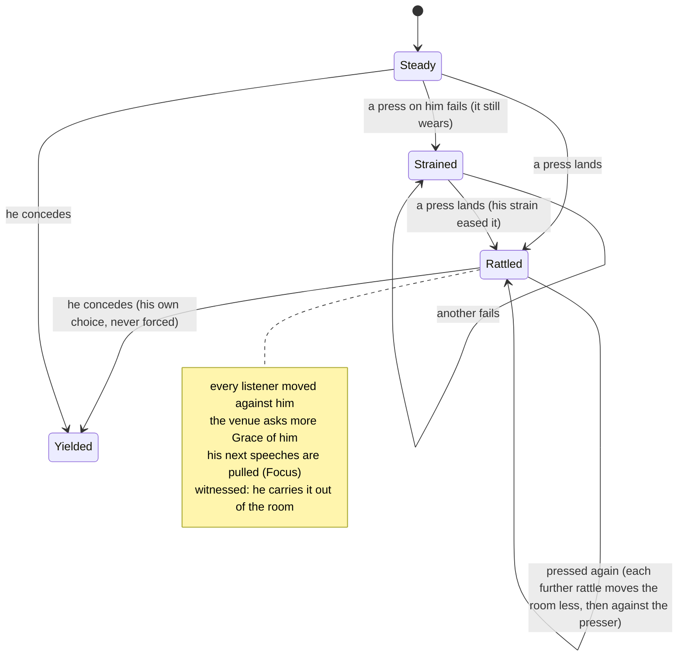

# SC — the social contest redesigned, v2: one machine (part 1: the architecture, the convergence table, the graphs, the types)

Written 2026-11-15 on the working tree of branch `ccr-ef587cd0-nbwjff`. Authored by a Fable lane on Jordan's explicit
instruction (a recorded departure from CLAUDE.md §10's "fable: not artifact authorship"). Producer half of a
producer and critic relay; one adversarial pass follows, by a separate read-only critic. Nothing was committed; no
id was allocated; the only edit to an existing file is the one-line banner on the five `2026-11-14` redesign files.

**Parts, in reading order:** this file (architecture; convergence table; state graphs; the types and the card);
`_part2.md` (the design: the person, the rite, the exchange, the close, play and simulation, worldly matters, power,
context, disposal, settings, the precedent map); `_part3.md` (the scene and the world; verification by execution;
transcripts; the handshake); `_part4.md` (the NERS pass; the cut list; the plan-item corrections; the questions).

## Status: PROPOSED

Design input, reference under CLAUDE.md §0.05: nothing reads it at runtime and it is not a mechanism. It
**supersedes in part** `2026-11-14-social-contest-redesign.md` and its parts 2 to 5 (cited **RD**): it replaces RD
§A to §D (the model, the six roles, the types, the verbs' routing) and the body of every build item of Batch
`B24p-sc-proceeding` that implements them; it keeps RD's Layer 1 placement (§A.2: the module keeps no state, the
host writes), RD's verb routing table (§D.1 to §D.4) and RD's F.6 table of source corrections, which stand. The
plan copy (`workplans/valoria_master_workplan_v12_part22_b24p.md`, `_cont.md`) states this design; part 4
§H lists the edits that were applied to it.

**Evidence.** Every number below was read from an executable model, `sc_model_v2/` (a copy of the stress test's
`sc_model/` with a new package `sc2/`: `engine.py` the module, `host.py` the host side, `checks_core.py`,
`checks_world.py`, `transcripts.py`; now `acts.py` and the battery `checks_v8.py`), run with `PYTHONHASHSEED=0`. "Before" figures are
the stress test's (at the old design's shipped values) or the premise-check's (on the model as it stood, `fix2/before/`). The model is scratch, not repository code; nothing in the tree runs this design, so its
grade is **paper with a running model** (CLAUDE.md §0.2), and part 3 says what was not verified.

**Reconciled once, 2026-11-15**, after two antagonist passes (execution and logic; rulings, theory and NERS) and
Jordan's answers to this design's three questions and two further rules (rows A-129 to A-140 of
`../unified/DECISIONS_ANSWERED.md`, appended in this pass). What changed: A-139 as Jordan corrected it the same day (only a
sitting with ONE character is refused; a person may be both a side and an adjudicator: a noble who speaks with you
and then decides, an inquisitor who questions and judges, a questioned man who decides whether to give way); the NPC plays its reading while it keeps its temper; six cuts were
overturned because each removed the only carrier of a ruled clause (part 4 §G); the execution defects were fixed
and re-run (`checks_v3.py`, output `v3_out.txt`, n = 400). That run's numbers are history: every figure these
files now state is from `checks_v8.py` (below).

Three later statements were folded in the same day and are rows A-141 to A-143: Attunement gauges the perceived
worth of a contestant's choices; Attunement frames the speech on what the listener wants and holds; and the
division of labour on a speech (Reason its content and stakes, Attunement its framing, Presence its delivery,
Grace its conduct). A-144 then gave the adjudicator his five (validation, the relevance filter, perception of the
participant, intimidation, the reception of his verdicts). A-145 priced silence ("silence is often seen as tacit admittance or weakness or refusal to engage
... and therefore disrespect") and A-146 took it from a man whose temper has broken.

**Fixed a second time, 2026-11-16**, after a premise-check of this design against Jordan's words (four runners;
their reproducible probes are in `sc_model_v2/pc_run1` to `pc_run4`) and Jordan's instruction *"Opus to address all
findings/failures/inert identified."* Five root causes were fixed at the cause (speaking had negative worth between
equals; a party who decides was moved on the other side's lead; a rig's price fell as the rig rose; the temper rule
broke men at no provocation; the record did not read as the proceeding named), then the other findings, the inert
items, the links no code owned (now built in the model: the acts before and after a sitting, the season driver,
recusal, the source of a false item) and the stale prose. **Part 4 §K is the one table: every item, FIXED / CUT /
DECIDED, with the rung and the before and after figure.** No new ruling was needed; every decision is a ladder
decision recorded there. **One battery, `checks_v8.py`, re-measures every figure these files state on the model as
it now stands** (output `v8_out.txt`; n = 300 an arm unless stated; the fix pass's own probes are `fix2/*.py`, the
model as it stood before is kept in `fix2/before/`). Part 3 §B and part 4 §E say plainly what is still open.

Markers: `[ASSUMPTION; Jordan to correct]` on every shipped value; `[HOOK]` a carrier that is only proposed in the
tree, named and not invented; `[UNVERIFIED]` a claim not opened or not run; **(rung n)** a decision taken by the
ladder of CLAUDE.md §0 (1 superseded, 2 irrelevant, 3 a design document, 4 precedent, 5 the architecture).

## What binds (Jordan's, not this lane's to overwrite)

- **R1 to R12** (`../unified/DECISIONS_ANSWERED.md` rows A-117 to A-128, verbatim there). R1 each of Focus, Reason,
  Attunement, Presence, Grace, Will acts in the manner he stated; R2 all are used in that manner; R3 the influence
  verbs call this subsystem; R4 proceedings are typed; R5 Spirit holds Will; R6 a proceeding is a run of exchanges
  and telling, lying and speaking are its abridged automatic form; R7 dice from attributes, skill and office; R8 a
  continuous engine, fractional dice and obstacles, calibration on variances over pairs; R9 duel and fight; R10
  fold into v12 later; R11 the dice of an argument are Reason and Presence by content and venue; R12 a decider
  judges with Reason (does it make sense), Focus (is it relevant), Attunement (sincere or a ploy).
- **The twelve statements of 2026-11-15** (the charter, in his order): (0) logic, thematic structure, immersive
  gameplay, worldly coherence, NERS, cut excess without losing characterization; (1, R13) exchanges relevant to one
  another, a cogent narrative; (2) by type of proceeding; (3) a game first, not a social simulator; (4) with a
  player it plays as a game; (5) without one it is a simulation; (6) pursuits and convictions; (7) goals,
  ambitions, needs, arcs, relationships, and each person's relationship to evidence; (8) offices, seats, factions,
  era, regime, strife; (9) for participant, adjudicator and audience alike; (10) the type is arranged by power;
  (11) legibility, an array of choices, characterization for everyone, era regime and strife, worldly matters
  brought in, a real change for the world on resolution; (12) Aristotle, Cicero and the persuasion research; and
  the handshake: bottom-up primitives meet top-down theory, checked.
- **A-136 to A-140** (2026-11-15): an NPC argues "as well as their view allows so long as they keep their temper";
  "keep 0.4" (the resisting attribute counts in the opposition at 0.4 a point); a quiet tell need not exercise all
  six; A-139 ("it is nonsensical for a character to have a proceeding where they are the only participant
  and adjudicator", corrected: "no, this can be the case like if you're having an audience with a noble who speaks
  with you then decides. it's the sitting with one character that is nonsensical."); "overturn cuts based on your refutations", recency winning.
- **Standing rulings read here:** A-79 (one opposed rule, 0.4 a point; equals on a routine matter fail 59 %, half
  land 16 %, carry 25 %), A-80 (entrenchment must still move the world), A-14 (a verdict is a draw on the voter),
  A-92 (`architecture/meta/04_CODE_ARCHITECTURE.md:251`: evidence enters a conviction only as a term in the
  person's own drawn act, never as a direct write), Layer 1 `04` §A.2 and G.1.5 (the module keeps no state, returns
  margins, and no one quantity both measures and decides).

---

## A. The integrating idea (one page)

**A proceeding is people in a room making and answering points about one matter, under a rite somebody arranged,
until those who decide come down** (when the forum's time is spent, nobody has more to say, or a side yields: the
forum's time is the measure of readiness, part 2 §C.5). Four sentences carry all of it.

1. **Everyone in the room is the same kind of record** (`Present`): six attributes and a skill (what he can do),
   and one **bearing reading** (what the matter, each other person and each thing shown mean to him: what he wants,
   what he holds, whom he stands with). A role is two cells on that record: `side` (speaks for, speaks against, or
   neither) and `decides` (he adjudicates); the two are independent, so one person may hold both. An accuser, a judge, a witness and a man in
   the gallery differ only in those two cells.
2. **Every exchange is one speech that raises a point, answers the point on the table, presses the man who made
   it, concedes the issue, or rests**, and it moves, for each person listening, how he stands on the matter (his
   own **track**), by one draw on the engine's one opposed form. What the point is called, who must answer whom,
   what conceding does, who may do what and what may be shown are **cells of the rite**; the module reads the cells
   and compares no type, move or person by name.
3. **The rite is arranged**: a type row gives the structure, the context (era, regime, strife) shifts its cells,
   and whoever holds power over the other party tilts them toward himself and pays for it in the room. All of this
   is the host building one input from data; the module sees only the finished cells.
4. **The close is each adjudicator's own draw with his own track as its leverage** (or, where the rite decides by
   consent, a party's own accept and no draw at all); the module returns margins and the
   record, and the host grades them on the one ladder and performs the typed writes the rite's disposal row names.
   A player is a `decide` callback on the same entry; with no callback the same view goes to the automatic policy,
   which is the man's own judgement.

So there are **seven structures and four rules**, and nothing else:

| structure | what it is | owner after the build |
|---|---|---|
| `Present` | the one person-in-the-room record; role = `side`, `decides` | `engine/season/queries/inputs.py`; built by the host from the bearing reading |
| the **bearing reading** | `bearing(person, referent) -> (want, hold, bond)`, signed; role-free | one function in `queries/person_q.py` (it replaces B24p.06's `moved_by`) |
| `Rite` | the type's cells after context and arrangement | `engine/season/arrangements.yaml` rows; `data/arrangements.py` |
| `Sitting` and `Beat` | the live value (issue, points, tracks, each person's condition) and one typed row per exchange | `inputs.py`; returned by the module, written by the host |
| the **matters** roster | the closed set of kinds of thing that can be shown; every item is a typed reference | `rosters.yaml: matters` (it absorbs the `proofs` roster) |
| the **context** table and the **disposal** table | era, regime and strife as cell deltas; outcome band to typed writes | `arrangements.yaml: context`, `: disposal` |
| the `View` and the `Card` | what a chooser sees each exchange; what the proceeding is | `inputs.py`; both derived, never authored |

| rule | one line | where |
|---|---|---|
| the **exchange** | one speech, one margin per listener, on `pool_of` against `even + opposed_ob` with signed leverage | part 2 §C |
| the **close** | one draw per decider, his track as leverage; `declared` carries by its quorum-th seat; under consent, and where a party who decides gives way or the bearer drops the matter, the act itself | part 2 §D |
| the **bearing** | one reading for stake, fit, aim, sincerity, credit, partiality, concession cost and verdict effect | part 2 §A |
| the **arrangement** | `tilt = rig x max(0, tanh((power_arranger - power_other) / scale))` moves the rite's cells | part 2 §H |

**Where requirements pulled against each other, resolved once (the rungs):** game first against R13's continuity
and against the simulation's richness: the sitting keeps **one live point a side and one issue**, and a player
tracks six things (the issue, their point, his point, the room's mood, his own condition, what he holds); every
further piece of continuity (the parts of a speech as phases, inoculation, a point ledger with several live points,
self-contradiction as its own rule) is cut and named in part 4 (**rung: the charter, statement 3**). Elegance
against depth of characterization: depth lives in the **one reading** (three channels) and in data, never in a
mechanism per layer; a layer with no carrier in the tree is a `[HOOK]` on the reading's inputs (**rung 5**).

## B. The convergence table

Every requirement against the ONE structure that carries it. No row has its own subsystem.

| requirement | the structure that carries it | specified | verified by (part 3) |
|---|---|---|---|
| 0 logic, theme, immersion, world, NERS | the whole; the types table; part 3 §A; part 4 §E | all | V-all |
| 1 (R13) exchanges relate; cogent narrative | `Sitting.live`, `.issue`, `Beat.relation`, `.point` | p2 §C.1, §C.5 | invariants; six transcripts |
| 2 by type | the rite's cells `live`, `reply`, `issues`, `concede`, `moves`, `admits` | p2 §B | per-rite table; transcripts differ |
| 3 game first | the `View`'s options with believed worth; a handful of things to track | p2 §E | options count; no inert setting |
| 4 played | `decide(view, me)` on the same entry | p2 §E | skill; leak; a mixed sitting |
| 5 simulated | the automatic policy on the same `View`; the season driver for what follows | p2 §F, §J | character table; three and twelve seasons |
| 6 pursuits, convictions | the bearing reading (`want`, `hold`) | p2 §A | bearing (a) to (d) |
| 7 goals, needs, arcs, ties, tie to evidence | the same reading (`want`, `bond`); `credit`, `aim` | p2 §A, §G | bearing (e) to (h) |
| 8 office, faction, era, regime, strife | context deltas on the rite's cells; `power`; the reading's inputs | p2 §I | context arms |
| 9 all roles alike | `Present` with two role cells | p2 §A | roles (a) to (e) |
| 10 arranged by power | the arrangement rule on the rite's cells | p2 §H | power arms |
| 11 legibility | the `Card` | p1 §E | card invariants |
| 11 choices | the `View`; the pre-sitting and after-sitting acts | p2 §E | menu table; dominance |
| 11 worldly matters | the matters roster; `Item` | p2 §G | admitted and barred; credit |
| 11 real change | the disposal table read by the fold | p2 §J | the toy fold; world diff |
| 12 Aristotle, Cicero, research | grounds = the means; genres = the families; stasis = `issues`; decorum = `standard`; elaboration; reactance | p2 §L | the precedent map; transcripts |
| handshake | primitives ledger, theory ledger, matrix | p3 §D | each link run with a control |
| D1 bench ignores the sitting | the close: one pool form for every decider, the track as leverage | p2 §D | D1 |
| D2 the centre | the opposition mirrors the pool (A-137); fit centred on the scale and reading the matter | p2 §C.2 | D2 |
| D3 the rattle does nothing | a rattle moves every listener's track, lowers his esteem, pulls him, spends his staying power | p2 §C.4 | D3 |
| D4 strain ratchets | each rattle fades on its own clock, the k-th counting half | p2 §A.4 | D4 |
| D5 the opener | equal turns; the bearer opens | p2 §C.1 | D5 |
| D6 the act's margin under consent | the close's margin without the draw | p2 §D | D6 |
| D7 types are names | five structures; cells that each move play; the floor is in the room | p1 §D | D7 |
| D8 the decider's three; lean; saturation | three weights in his own track; lean is where the track starts; no clamp | p2 §C.3, §D | D8 |
| D9 integration | the ordered edits | p4 §H | not run (plan edits) |
| A1 the card | `Card` | p1 §E | card invariants |
| A2 choices | `View.options` | p2 §E | menu table; with and without |
| A3 characterization | the bearing reading | p2 §A | bearing |
| A4 context | context table; arrangement | p2 §H, §I | context; power |
| A5 worldly matters | matters roster | p2 §G | admits; credit |
| A6 real change | disposal table | p2 §J | fold |

## C. The state graphs

A sitting:

```mermaid
stateDiagram-v2
    [*] --> Arranged: the host builds one input (type row x context x power) and the Card
    Arranged --> Turn: the bearer of the live thing opens, the rest by precedence
    state Turn {
        [*] --> View: he reads the room (one draw, blurred by his Attunement)
        View --> Choice: player, or his own judgement
        Choice --> Beat: raise / answer / press / concede / rest (one draw)
    }
    Turn --> Turn: next speaker
    Turn --> NextIssue: he concedes the issue and the rite says `descends`
    NextIssue --> Turn: the next rung, argued from its own grounds; he pays a fixed step from where he stood
    Turn --> Close: everyone has had the rite's turns (budget)
    Turn --> Close: a whole round of rests (rested)
    Turn --> Close: he concedes the last rung, or the rite says `accepts` (yielded: the bearer drops it, a party who decides gives way, else the bench draws)
    Close --> [*]: one margin per decider and the record go back to the host, which grades, folds and writes
```



A side's condition (one person; the same for a witness or a judge who is pressed):



## D. The types that are different in play

Five structures (**rites**), eight rows that play differently, and the tree's other rows as the same structure
arranged by another authority. A type is its cells; the right-hand column is what the model shows by execution
(part 3 §B, D7).

| type (row) | genre: who judges, what they decide | the live thing; how exchanges relate | who may do what | the close | who arranges, and how | what context changes | its own kind, as the model shows |
|---|---|---|---|---|---|---|---|
| `conversation` | dyadic; the one addressed, for himself | a **claim**; each may answer or raise | both: argue, press, rest, concede | the addressed man's own draw (he is a side and decides); his concession is his giving way | the speaker picks the moment | strife pulls every speaker; the era weighs grounds | the hearer is also the opponent: the proposer's speech moves him, and so does his own case as he hears it |
| `negotiation` | dyadic; nobody: consent | an **offer**; each may answer or raise (an unanswered offer simply earns no deal: `reply: must` was inert and is cut) | both: all four; conceding **accepts** | consent; neither accepting is an impasse | whoever needs it less | a need (famine) raises what the needy accept | a need changes who accepts (0.330 with none, 0.507 with a need of 0.9) |
| `questioning` (`interrogation`) | judicial; the one questioned, for himself | a **question**: the questioner must ASK (his rest with no question standing is a question not asked, priced); the answer **must** answer it, evasion is priced and seen | questioner: argue, press, rest; questioned: argue, rest, concede (he talks) | the questioned man's own draw; his concession is his giving way; a confession accepted or a charge laid on it is `determine`'s separate step | the questioner | war shortens it | the questioner gets it 1.00 if the questioned concedes at once, 0.37 automatic, 0.23 if he never concedes; what he yielded is a claim and, when overwhelming, a `confession` on the case file |
| `inquisition` (`inquisition_hearing`, `examination`) | judicial; a bench, which may be the accuser's own | a **charge** the inquisitor must put; the accused **must** answer; fact, then justification | as `questioning` | the presiding seat's draw | the authority whose seats sit; an inquisitor may question and judge, and his stake is seen | unlawful in a commune; a theocracy admits confession | the accused cannot press; silence admits; a non-party seat with a conflict steps down |
| `trial` (`legal_trial`, `tribunal`, `arbitration`) | judicial; a bench (a `tribunal` is a panel, deciding by its quorum); a past act | a **charge** the accuser must put; both sides **must** answer; fact (argued from the proof), definition (from what is owed), justification (from what it brings and who stands with whom) | both: all four; conceding **descends** | the presiding seat's draw | the convening seat: bench packed, floor thinned, presumption | regime sets admissible proof; strife cuts turns | proof and refutation; a concession costs and changes the ground; a full confession convicts 0.733 |
| `debate` (`parliamentary_debate`, `council_of_state`, `excommunication_deliberation`) | deliberative; every seat, by a quorum | a **motion**; speeches may answer or raise | both: all four; the mover's concession withdraws it | every seat's draw; the quorum-th best seat's margin carries it | the body's presiding seat; a faction forces the floor open or shut | unlawful in a theocracy; the floor sways the dice toward manner | several adjudicators, each moved for himself; a majority carries |
| `rally` | deliberative; every hearer for himself | a **theme**; nothing to answer: each speech raises | the speaker: argue, rest | each body of the crowd draws | the speaker; a seat may close the ground | a famine sharpens what the hungry want | no opponent; bodies of the crowd split; Presence is what is heard; a failure files no grievance and mints no legitimacy |
| `audience` | deliberative; one seat, who may speak with the petitioner and then decide | a **plea**, answered by a ruling | the petitioner: argue, rest; the seat, where he is the other party: argue, press, rest | the seat's draw | the seat: who is admitted, how long | regime sets what may be shown | the seat's own stake is where he starts (start -0.60; the petitioner carries 0.193 against 0.267 with his stake flattened) and the room holds a `partial` claim |
| the abridged form of any row | as its row | one speech, raised | the speaker | that speech's own margin with the one addressed (no bench needed) | as its row | as its row | at control equal to the one roll (200 of 200 keys); a passing word nobody watches takes it (`form="auto"`) |

Jordan's seven: heresy trial = `inquisition` arranged by the Church; parliamentary debate = `debate`; private
negotiation = `negotiation`; rallying a crowd = `rally`; interrogation for information = `questioning` (and the row
`interrogation` now names it: one word, one thing); a trial = `trial`; the abridged automatic proceeding = the
abridged form. **Merged** (identical structure, different arranged cells): `tribunal` and `arbitration` into
`trial`; `council_of_state` and `excommunication_deliberation` into `debate`; `examination` (the polity's
inquisition, which the first pass mislabelled `interrogation`) into `inquisition`; `interrogation` into
`questioning`. Their rows stay in `arrangements.yaml` as rows naming the same rite with other `authority`, `floor`,
`standard`, `disposes` and `close` cells: a designer adds a kind by adding a row.

## E. The card (legibility)

`Card` is derived by the host from the arranged rite and the room, never authored, and is what every participant
reads before and during a sitting:

```python
@dataclass(frozen=True)
class Card:
    kind: str; genre: str
    arranged_by: Optional[str]; tilt: float; tilted_against: Optional[str]   # who tilted it, how far, against whom
    stake: str; outcomes: tuple           # what is disposed; ((band, the typed writes), ...)
    room: tuple                           # ((person, role, visible circumstances), ...)
    live: str; bears: str; reply: tuple
    moves: tuple; barred: tuple
    admits: tuple
    close: str; decided_by: tuple         # the adjudicators; none under consent: each party's own accept
    turns: int; issues: tuple
    silence: str; unargued: str; ends: str   # what silence means; what happens if nobody speaks; when it closes
    standard: float; unrest: float; gravity: float   # the Grace asked; the pull of the times (Focus); how grave a change is
    reason_weight: tuple                  # Reason's share of the dice per ground here
    recused: tuple                        # seats that stepped down for a conflict
    odds: Optional[float]                 # P(carried) before an ordinary unmoved bench; None where nothing is drawn
```

The card holds no true attribute and no true start (B05.62: a stranger is an ordinary person); what a chooser
believes of this room is on his `View`. Invariant, checked in the model on every sitting (part 3 §B): no beat makes a move the card bars; no item of a
kind the card does not admit is shown; nobody speaks more turns than the card gives; the verdicts returned are the
card's adjudicators and no others; and its odds are what a
sitting where nobody speaks delivers (the trial's card shows 0.141; a sitting where both sides rest delivers 0.132, n = 600). The card also carries `silence` (what not answering means
here: `admits`, `refusal`, `free`), `unargued` (what happens to the matter if nobody speaks: under a rite whose
other side must answer, an unpressed charge lapses), `ends` (when it closes), `unrest` (the pull of the times,
which Focus holds against) and `gravity`. A card that promises what the sitting does not do is a defect.
